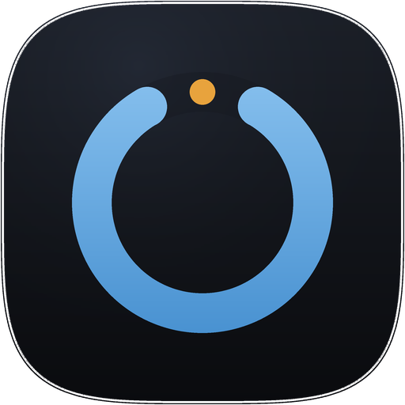
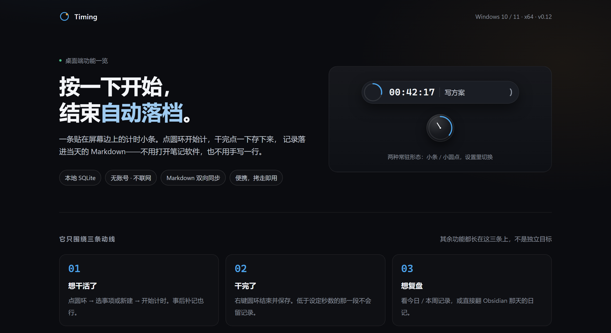
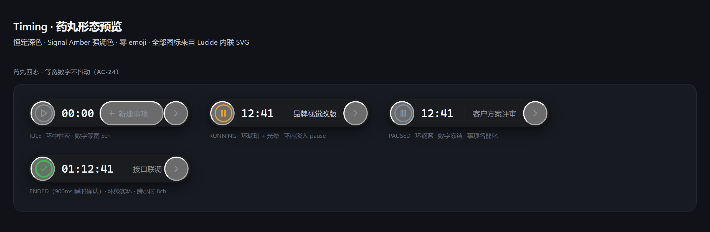
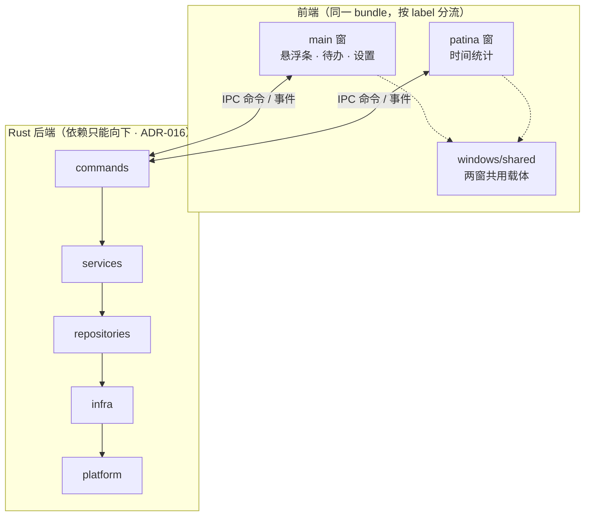

<div align="center">



# Timing

**屏幕边缘的一颗药丸。点一下开始计时，不打断你手上的事。**

[](https://github.com/BigDog2712/Timing/actions/workflows/ci.yml)
[](https://github.com/BigDog2712/Timing/releases)
[](LICENSE)
[](docs/)
[](https://tauri.app)
[](rust-toolchain.toml)

Windows 10 / 11 · Tauri 2 · React 19 · Rust · SQLite

[中文](#为什么是这个形态) · [English](#english)

</div>

---

## English

**Timing is an always-on-top timer that lives as a 32 px pill at the edge of your
screen.** Click it to start tracking; it never covers your working area. It is
100 % local — SQLite only, no account, no telemetry, no network calls.

Built with Tauri 2 + React 19 + Rust. **Windows 10/11 x64 only**: the tray menu,
click-through and window geometry are implemented against Win32 APIs, so porting
it is a rewrite rather than a CI matrix entry.

Some of what it does: floating pill or 22 px dot form, stopwatch and countdown,
todos with daily/weekly records, up to 20 sticky notes as separate windows, a
reminder bell, an idle menu for switching task on the fly, declarative plugins,
two-way Markdown sync into your own notes, and a vendored time-insight window
(Patina) for app-usage tracking.

MIT licensed. Issues and PRs are welcome.

---

## 为什么是这个形态

计时软件通常有两种失败方式：**要么占地方**（一个仪表盘窗口，你得切过去看），
**要么锁数据**（记录存在别人的账号里，导出一次要付费）。

Timing 的答案是把它缩到最小、并且把数据交还给你：

- **32 px 药丸，贴边常驻**。不悬停时只留内容、隐藏背板，视觉上就是屏幕边缘的一小段文字；
  鼠标移开它就"消失"，但计时一直在走。窗口把 OS 层的尺寸收缩到内容包围盒，所以空白区域
  真的不接收点击 —— 不是拿透明像素糊弄你的眼睛。
- **纯本地 SQLite，无账号、无联网**。开机到结束不产生一个网络请求。
- **同步用明文 Markdown**，直接写进你已有的日记文件、只改目标标题下的区块。
  哪天不用这个软件了，记录还在你自己的 `{date}.md` 里。
- **倒计时到点恒结束并保存**，不弹确认框问你要不要留。错过了就是错过了。

## 功能

| | 能力 | 说明 |
|---|---|---|
| ⏱ | **悬浮条** | 状态环（16×16 圆角方形）+ 20 px 计时数字 + 事项名 + 右侧三形态手柄（圆点 / 半手柄 / 手柄，各自可开关，每个绑 5 个动作：左/右/中单击 + 左/右双击） |
| ⚪ | **小圆点形态** | 22 px 纯图形钟面（表盘 / 进度弧 / 分针）：外环一分钟一圈、分针一小时一圈，暂停时环冻在当前位置；点一下临时展开成悬浮条，移开收回 |
| ⏳ | **正计时 / 倒计时** | 倒计时剩余 ≤60 s 转 `#E5484D` 并 1 s 闪烁（低于 WCAG 2.3.1 光敏阈值）；到点恒结束并保存 |
| ✅ | **待办与记录** | 日 / 周视图、软删除、撤销条（3 s）、内联编辑；低于「最短记录时长」（默认 30 s，可调 5–300 s）的计时自动忽略 |
| 📝 | **便利贴** | `note-{id}` 独立多窗，320×232 默认、160×120–900×900 硬钳，几何 300 ms 防抖落盘，上限 20 |
| 🔔 | **提醒铃** | 15 s 查询式调度（`remind_at <= now AND reminded_at IS NULL`），抗休眠补偿，±60 s 聚合、`reminded_at` 去重 |
| 🎯 | **摸鱼菜单** | 暂停态右键数字 / 左键事项名唤出：一键「换个事项 + 定长」开倒计时；「其他事项」打完名字用滚轮定长 |
| 🧩 | **插件** | `plugins/<id>/plugin.json` 是启动头，宿主只读不执行（声明式）；v1 贡献摸鱼菜单预设，v2 新增 `mdSync` |
| 🔄 | **Markdown 同步** | 落点根目录 / 文件模板 / 标题可改；轮询默认 15 min（1 min–24 h）+「立即同步」；两边都改过时**文件说了算**（ADR-042）；只改目标标题下的区块 |
| 🎨 | **主题** | 深 / 浅 / 跟随系统 + 四色自定义（计时中 / 提醒 / 完成 / 小条底色），跨窗广播 |
| 🖥 | **系统集成** | 原生 Win32 托盘菜单、开机自启、单实例、窗口位置记忆；主窗与所有浮层恒定置顶 |
| 📊 | **时间统计（Patina）** | 同一进程的第二扇窗：自动使用追踪 / 历史 / 番茄 / 上限提醒 / 分类映射。数据独立（`<数据根>/patina/data/patina.db`，与 `timing.db` 同目录、互不迁移） |

**设置只有一个家**：主界面 → 设置，五组横排锚点（悬浮条 / 外观 / 计时与记录 / 数据与同步 /
通用与启动）。独立设置窗与药丸内联设置面板已在 0.12.1 下线。

## 界面

<div align="center">
  
</div>

<p align="center"><em>一张贴在屏幕边上的计时小条 —— 点圆环开始，干完点一下存下来，记录落进当天的 Markdown。</em></p>

<div align="center">
  
</div>

<p align="center"><em>药丸四态。等宽数字不抖动，暂停不换色，结束时按 绿 &gt; 红 &gt; 蓝 的优先级取色。</em></p>

上面两张是**设计稿渲染图**（由 `preview/*.html` 截出），不是真机截图 —— 说清楚这点比放一张来路不明的图有用。可交互版本（下载后双击即开，零依赖）：

- [`preview/timing-desktop-features.html`](preview/timing-desktop-features.html) —— 桌面各功能页对照
- [`preview/pill-preview.html`](preview/pill-preview.html) —— 药丸四态 / 展开面板 / 右键菜单

> 真机截图仍缺：仓库里还没有跑起来的 App 截图。等出包时补，不拿设计稿冒充。

## 安装

### 预编译包

Releases 上有**两个早期版本**，都远早于当前主线 0.12.1（命令数 68 → 83，功能差得多）：

| 版本 | 产物 | 说明 |
|---|---|---|
| v0.5.0 | `Timing.exe` + `SHA256SUMS.txt` | 「品牌归位」版：产品名统一为 Timing，老数据自动复制迁移 |
| v0.1.1 | `Timing-0.1.1-portable.exe` | 绿色版，双击即用，不写注册表 |

为什么有两个 0.x：`v0.5.0` 是私有仓时代的最后一个包，`v0.1.1` 是公开仓发布线的包 ——
2026-11-13 两条历史已合并到本仓，两个 Release 与 tag 都保留着，一个都没删。

**当前主线 0.12.1 尚未出包**，要体验完整功能请从源码构建（见下）。

### 从源码构建

```bash
npm install
npm run tauri dev
```

Windows 上需要：Rust（仓根 `rust-toolchain.toml` 已钉 `1.100.0`，`rustup` 会自动装；
MSRV 1.90）、VS Build Tools 的「使用 C++ 的桌面开发」、Windows SDK、WebView2 运行时。

VS Build Tools **不会**把 `link.exe` 写进系统 PATH，直接跑会报
``linker `link.exe` not found``。两种解法：

- 用 `scripts/dev-desktop.cmd`（自动 `vcvars64` 后启动）；
- 或在「x64 Native Tools Command Prompt for VS」里执行 `npm run tauri dev`。

出包（需 NSIS / WiX）：

```bash
npm run tauri build -- --no-bundle   # 只出 exe 本体
npm run tauri build                  # 出 nsis / msi 安装器
```

产物在 `src-tauri/target/release/timing.exe`，仓库约定复制到 `release/Timing.exe`。

## 平台支持

**只支持 Windows 10 / 11（x64）。** 这不是"暂时没测"，而是当前实现里有 Windows 专属能力，
换平台等于重写：

| 能力 | 实现 | 跨平台可行性 |
|---|---|---|
| 托盘菜单 | 原生 Win32 菜单（`src-tauri/src/infra/tray_menu.rs`） | 需按平台重写（macOS 用 `NSStatusItem`，Linux 依赖 `libayatana`） |
| 窗口点击穿透 | 用「把 OS 窗口收缩到内容包围盒」替代原生 layered window（ADR-014） | 思路可移植，但 `setSize/setPosition` 的合成器行为各平台不同 |
| 透明无边框小窗 | Tauri `transparent` + `skipTaskbar` + `alwaysOnTop` | Windows/macOS 可行；Linux 需合成器支持 |
| 开机自启 | `tauri-plugin-autostart`（注册表 `Run`） | 插件本身支持多平台，但 Linux 需 `~/.config/autostart` 写法验证 |
| 通知 | `tauri-plugin-notification`（WinRT Toast） | 插件支持多平台 |

想要 macOS / Linux 版本是一个独立的移植项目（托盘、几何钳制、DPI、窗口合成器四条线都要重做），
不是加个 CI matrix 的事。

## 技术栈

| 层 | 选型 |
|---|---|
| 前端 | React 19 · TypeScript 5.9 · Zustand 5 · Vite 8（rolldown 内核）· lucide-react |
| 桌面壳 | Tauri 2.12（无边框透明小窗，所有窗口恒定置顶） |
| 后端 | Rust（`rust-toolchain.toml` 钉 1.100.0；MSRV 1.90）· sqlx 0.8（SQLite，WAL）· autostart / window-state / single-instance / notification / dialog |
| 数据 | 迁移脚本 `migrations/0001…0008`，`settings.schema.version` 记版本 |

Tauri 插件只放行实际用到的能力：`plugin-sql` / `plugin-store` 在 v0.3 已移除
（前端从未引用，但 capability 曾放行，等于留了一条绕过四层架构直连数据库的通道，见 ADR-015）。

## 架构

两扇窗、一棵 React 树按窗口 label 分流，后端单一进程：



- **两窗隔离（L9）**：`src/windows/timing/**` 与 `src/windows/patina/**` 互相 import 即红。
  共用载体只能放在 `src/windows/shared/**`，而它不许反向依赖任一窗（L10）。
- **后端四层（L4 / L5）**：`commands → services → repositories → infra`，`infra` 不许反向依赖
  `services`，`commands` 不许绕过 service 直连 repository。
- 分层、单文件体积、契约、版本号、第三方改动都用 `npm run check` 的八步门禁机械断言，
  改坏了 CI 就红 —— 不是"建议"。

目录：

```
.
├── index.html / patina.html   # 两个入口（同一 bundle / 独立 bundle）
├── src/
│   ├── windows/timing/        # 宿主窗：entry · components · stores · services · hooks · lib · types · styles
│   ├── windows/patina/        # 第二窗：shell · features · platform · shared
│   └── windows/shared/        # 两窗共用载体（不许反向依赖任一窗）
├── src-tauri/src/             # Rust 后端：commands / services / repositories / infra / app / jobs / platform
│   ├── */insight/             # 第二窗后端，按同名层归位
│   ├── migrations/            # 0001…0008
│   └── capabilities/          # Tauri 2 权限放行清单（只留实际用到的）
├── android-app/               # 已归档的原生 Kotlin 工程（冻结 0.3.6，见 ARCHIVED.md）
├── plugins/md-sync/           # 首个 v2 插件：计时 / 便利贴 ↔ Markdown 双向同步
├── scripts/                   # 八步门禁 + 出包脚本
├── tests/fixtures/            # 双端黄金用例（Rust 与 TS 共用同一份 JSON）
├── preview/                   # 静态设计稿（不参与构建）
├── docs/                      # 规格 / 架构 / 设计 / ADR / QA
└── release/                   # 构建产物落点（不入库）
```

Patina 是 vendored 第三方源码，结构已归一：前端四根与宿主窗并列，后端收进各层的 `insight/` 命名空间。
300 行豁免不是整棵豁免，而是逐文件基线棘轮（`scripts/size-allowlist.json`，只许减不许增）。
来源与改动清单见 [THIRD-PARTY-NOTICES.md](THIRD-PARTY-NOTICES.md)。

## 开发

```bash
npm install
npm run dev          # 前端单独跑（浏览器 mock IPC，端口 1420）
npm run tauri dev    # 完整桌面应用
npm run check        # 八步门禁：typecheck · contract · size · vendored · version · layers · brand · lint
npm test             # vitest（含双端时间公式黄金用例）
npm run build        # tsc + vite build
```

```bash
cd src-tauri
cargo test                                   # 后端测试（1,700+ 用例）
cargo clippy --all-targets -- -D warnings \
  -A clippy::unwrap_used -A clippy::expect_used
```

**没有 `cargo fmt`**，别把它加回来：本仓把「单文件 ≤300 行」当硬约束，而全仓 fmt 会把 14 个
原本合规的文件换行推过 300 行（`size-allowlist.json` 从 150 条涨到 164，而该基线是只许减的
棘轮）。两条规则不可同时满足，本项目选 300 行 —— 格式化因此不是门禁项，改代码按现有风格手写。

`-A clippy::unwrap_used -A clippy::expect_used` 是**故意写出来的豁免**，不是命令抄错：这两条
restriction lint 在 `Cargo.toml` 里开着（本地看得见），而 `--all-targets` 下有约 5,900 处，
绝大多数在测试与验收支撑里。一次性改成 `?` 不现实，让 CI 长期红着只会训练人忽略整条流水线。
豁免写在命令里，就是为了让它可见；收敛完删掉即可。

只想看界面、不碰 Rust：`npm run dev` 后打开 <http://localhost:1420>，走 `src/mocks` 的 mock IPC
（无托盘、无真实窗口）。

## 文档

| 文档 | 内容 |
|---|---|
| [`docs/Spec-V0.2.0.md`](docs/Spec-V0.2.0.md) | 现行 Spec 契约（命令面锁定 / AC 验收 / 变更记录） |
| [`docs/phase2/IPC-CONTRACT-v2.md`](docs/phase2/IPC-CONTRACT-v2.md) | 命令与错误码正本 |
| [`docs/phase2/IPC-CONTRACT-v3.md`](docs/phase2/IPC-CONTRACT-v3.md) | 事件契约（名称 / 载荷 / 触发点 / 订阅窗） |
| [`docs/phase1/ARCHITECTURE-V0.2.0.md`](docs/phase1/ARCHITECTURE-V0.2.0.md) | v0.2 架构（分层 / IPC / 多窗口 / 迁移） |
| [`docs/design/DESIGN-V0.2.0.md`](docs/design/DESIGN-V0.2.0.md) | 设计系统（令牌 / 组件规格 / 页面） |
| [`docs/decisions/`](docs/decisions/) | 架构决定记录（ADR-001…） |
| [`docs/plugin-spec.md`](docs/plugin-spec.md) | 插件规格（声明式 `plugin.json`） |
| [`CHANGELOG.md`](CHANGELOG.md) · [`更新日志.md`](更新日志.md) | 版本记录 · 逐次改动与踩坑 |
| [`AGENTS.md`](AGENTS.md) | 工程约定（给协作者与 AI 的规则） |
| [`THIRD-PARTY-NOTICES.md`](THIRD-PARTY-NOTICES.md) | 第三方来源与许可义务 |

## 版本

桌面 **0.12.1**，Tauri 移动端 **0.12.0**；`android-app/` 里那份原生 Kotlin 实现已归档，冻结在 **0.3.6**。

版本号是单一真源：`scripts/platform-versions.json` 定义两端号，桌面六处基线
（`package.json` · `package-lock.json` ×2 · `Cargo.toml` · `Cargo.lock` · `tauri.conf.json`）
必须与之一致，`npm run check:version` 会断言，不一致即红。

迭代规则：每轮默认只递增末位（`0.12.1 → 0.12.2`）；升次版本或 `1.0.0` 须经明确同意。

## 许可

[MIT](LICENSE)。Patina 模块为 MIT 许可的 vendored 源码，其许可原文、来源与改动清单见
[THIRD-PARTY-NOTICES.md](THIRD-PARTY-NOTICES.md)。

---

<div align="center">
<sub>Built with <a href="https://tauri.app">Tauri</a> · <a href="https://react.dev">React</a> · <a href="https://www.rust-lang.org">Rust</a></sub>
</div>
