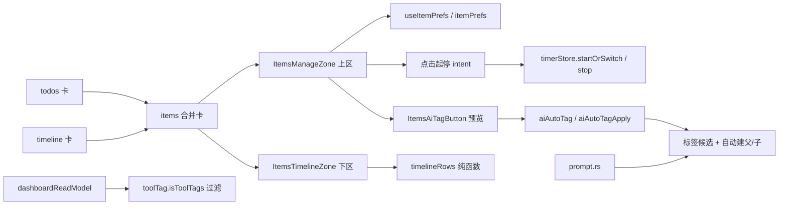

# 设计：事项管理卡合并 + AI 打标优化（0.12.6 · Windows）

> 基线：`docs/prd/2026-11-20-item-card-ai-tagging.md`。本文只落设计方案与任务分解，不含完整代码。
> 已核实事实：`CARD_IDS`/`KIND_SPECS` 见 `layout/contract.ts`；出厂布局 `timeline=uid4(24,344,340,424)`、`todos=uid5(380,344,330,424)`（`defaultLayout.ts`）；`TAG_TOP_LEVELS = ["生活","工作","学习","娱乐","复盘"]`（`services/ai/prompt.rs:29`）；读模型统计口径集中在 `services/dashboardReadModel.ts`（`totalTrackedTime` / `topApplications` / `categoryDist`）。

## ① 方案总览



数据流：事项点击 → host intent（`start_timer_for_item` / `stop_timer`）→ `timerStore` → `timer:state-changed` 事件收敛 → 下区行状态回填。统计流：后端桶 → `dashboardReadModel` → 用 `counted`（剔除 `工具`）算总量/分布/排行，排行额外带 `isTool` 标记。

## ② 契约与迁移

**`layout/contract.ts`**
- `CARD_IDS`：删除 `"todos"`、`"timeline"`，新增 `"items"`（放在原 timeline 位置附近，顺序不影响行为）。
- `KIND_SPECS.items`：`label:"事项"`，`hint:"常用/历史事项 + 今日时间线"`，`minW:296, minH:360`，`sizes: S[296,360] M[340,520] L[500,520]`。
- `KIND_SPECS` 仍以 `Record<CardKind, KindSpec>` 全量约束 —— 删两个 key 会编译期报错，正好当迁移清单。

**`layout/defaultLayout.ts`（出厂）**：把 uid4 + uid5 合成一张 `items`，矩形 `x=24,y=344,w=340,h=424`（`tier:"M"`）。**位置取原 timeline（24/344）而非 todos（380/344）**：第三列 `trend/heatmap` 的 x=726、宽 500 占满右列，若 items 落在 380 且升级到 L 档（w=500）会延伸至 880 与右列重叠；左列 24 + 340 只有右缘 364，留 16pt 间隙，且左列宽度大于第二列的 330，合并卡更适合放左列。原 `notes` 在 726/584，items 升 L（h=520）时下缘到 864 < notes 上缘，不冲突；向下延伸落入画布空白区。

**`layout/normalizeLayout.ts`（迁移）**：在 `migrateFromGrid` 之后、`clampRect` 之前插一个 `migrateTodoTimelineToItems(cards)`：

```
hits = cards.filter(kind in {"todos","timeline"})
if hits 为空: 原样返回
keep = hits 按 (y, x, uid) 升序取第一个        // 保留视觉上第一张，符合"位置不丢"
rect = keep 的 x/y/w/h                        // 只有一种卡时直接沿用其矩形
out  = 其余卡 filter 掉 kind in {"todos","timeline"}  // 第二张起一律丢弃，不新增卡
out  插入 { uid: min(hits.uid), kind:"items", tier: keep.tier, x/y/w/h: rect }
nextId = max(out.uid) + 1
reason = "migrated-todos-timeline"
```
- 只有一种卡：同样换成 `items` 并沿用其矩形（不做补位）。
- `w/h` 小于 items 的 `minSize` 时不在这里夹，交给已有的 `clampRect` 统一收口（保持单一职责）。
- `repaired=true` 强制回写，避免每次启动重复迁移；迁移幂等（第二次扫不到 todos/timeline）。

**两条新 host intent（两侧各写一份类型，命名对齐现有 intent 文件）**

| intent | 载荷 | 执行端 |
| --- | --- | --- |
| `start_timer_for_item` | `{ action:'start_timer_for_item'; itemId:number }` | `timerStore.startOrSwitch(itemId)` |
| `stop_timer` | `{ action:'stop_timer' }` | `timerStore.stop()` |

改动点两侧对称：前端 intent 类型联合 + dispatch 执行端；Rust 侧 intent 枚举/反序列化 + 执行端镜像；两处各加一条「同一 action 字符串」的镜像测试（防止两侧字面量漂移）。**不做乐观切换**：行上 `busy` 用 `useRef` 锁防重复点击，"正在计时" 以 `timerStore.session.itemId === itemId` 判定，状态由 `timer:state-changed` 收敛。

## ③ 逐文件模块设计

| 文件 | 动作 | 理由 |
| --- | --- | --- |
| `layout/contract.ts` | 改 | 卡类型的唯一真源；删 key 让所有引用点编译期暴露 |
| `layout/defaultLayout.ts` | 改 | 出厂布局决定新装用户首屏，必须与迁移结果一致 |
| `layout/normalizeLayout.ts` | 改 | 老用户升级不丢摆位；纯函数可测 |
| `layout/__tests__/normalizeLayout.test.ts` | 改 | 补 4 例：两卡都在 / 只有 todos / 只有 timeline / 无卡 |
| `services/timelineRows.ts` | 新建 | `buildTimelineRows`、`todayTimedItemIds` 从卡壳里搬到服务层，供下区与旧测试共同 import，删卡壳不删测试 |
| `components/ItemsCard.tsx` | 新建 | 卡头 + 上区 + 浅分隔线 + 下区；只装配，≤180 行 |
| `components/ItemsManageZone.tsx` | 新建 | 常用/历史两组、行内起停、绑定标记、空态；复用 `hooks/useItemPrefs` + `services/itemPrefs.ts` 的 `pinnedItems/recentItems` |
| `components/ItemsTimelineZone.tsx` | 新建 | 未开始待办行 + 进行中 + 已完成 + 撤销条；复用 `TimelineChildRows`/`TodoRow`/`buildTimelineRows` |
| `components/ItemsAiTagButton.tsx` | 新建 | 上区按钮 + 预览弹层；只列 `tags.length===0` 的事项，可逐条摘除、可取消；落库走 `applyItemAutoTags` + `persistNewTagDefinitions`，完成后提示条数。**不复用/不改造 `AiAutoTagButton`**：它管「应用 + 事项全量」，语义不同 |
| `components/DashboardCards.tsx` | 改 | 删 `case "todos"`/`case "timeline"`，加 `case "items"` 装配两区；`useTodayItems`/`useTodayTodos` 已在 `Dashboard.tsx` 提起，不重复取数 |
| `components/TodosModule.tsx` / `TimelineCard.tsx` | 删（卡壳） | 只保留可复用内部组件，纯函数已迁 `services/timelineRows.ts` |
| `shared/classification/toolTag.ts` | 新建 | `isToolTags(tags): boolean`（`工具` 或 `工具/...`），纯函数、可单测 |
| `services/dashboardReadModel.ts` | 改 | 统计过滤的**唯一**位置：stats 拆 `counted` / `toolExcluded`；`totalTrackedTime`/`categoryDist`/`topApplications` 用 `counted`；`topApplications` 项加 `isTool` |
| `services/ai/prompt.rs` | 改 | 规则与白名单；`TAG_TOP_LEVELS` 追加 `"工具"`。`AiTagTarget.text` 不开新字段，只在应用侧拼入「名称 / exe / 窗口标题里的英文名」 |
| `components/ItemAppBindingField.tsx` | 改 | 绑定成功后先 `saveAppItemBinding` 同步 1:1 主值，再补 `override.itemBindings` 镜像（缺口所在） |
| `copy.ts` / `copyTimeline.ts` / `copyTodos.ts` | 改 | 四个 Locale 的 `Record` 键齐备；不新增 i18n generated 键 |

**提示词规则变更（`prompt.rs`）**
- 应用侧：依据改为「软件名称 + exe + 用途/简介」；多功能可多一级标签（Chrome → 工作/生活/学习/娱乐）；游戏只给「娱乐」；下载器/终端/截图/系统工具给「工具」；知识管理（Obsidian）可 生活/学习/娱乐；最多 `maxTags` 个并按相关度降序。
- 事项侧：未打标事项自动建「父/子」两级（吃饭 → 生活/吃饭）；先匹配已有候选（含用户历史标签），匹配不上才新建；同类事项稳定命中同一标签，不漂移。

**双向绑定现状**：已是 `1:1 ∪ override.itemBindings` 并集并镜像进 `item_app`；缺的只是事项侧绑定后 1:1 主值不更新（应用排行行标记看不到）。自动计时只认 `item_app`，Rust 侧无需改。

## ④ 任务列表

| ID | 任务 | 文件 | 验收点 | 预估 | 依赖 | parallel |
| --- | --- | --- | --- | --- | --- | --- |
| T1 | 卡契约 + 布局迁移 | `contract.ts`, `defaultLayout.ts`, `normalizeLayout.ts`, `normalizeLayout.test.ts` | 类型编译通过；四例迁移测试绿；旧布局升级后仅一张 items 且位置=原 timeline | ~220 行 | — | 与 T5 并行 |
| T2 | 时间线纯函数抽取 + 下区 | `services/timelineRows.ts`, `ItemsTimelineZone.tsx`, 删 `TimelineCard.tsx` 卡壳 | 未开始/进行中/已完成/撤销条四态渲染；原测试改 import 后仍绿 | ~320 行 | T1 | 是 |
| T3 | 上区 + 卡壳 + 装配 | `ItemsManageZone.tsx`, `ItemsCard.tsx`, `DashboardCards.tsx`, `copyTimeline.ts` | 常用/历史分组、置顶在前、空态；两区分隔线固定不随滚动；`case "items"` 通 | ~380 行 | T1, T2 | 否 |
| T4 | 点击起停 intent + AI 一键分类 | intent 类型/执行端（前后端各一）、镜像测试, `ItemsAiTagButton.tsx`, `copy.ts` | 点一下起计时、再点落库；连点不产生第二条（busy 锁）；预览可摘除/取消零写入、落库提示条数 | ~300 行 | T3 | 否 |
| T5 | 工具标签 + 统计过滤 + 提示词 + 绑定补 1:1 | `prompt.rs`, `toolTag.ts`, `dashboardReadModel.ts`, `ItemAppBindingField.tsx`, `copy.ts` | 打「工具」的应用时长从总量/分布/排行之和消失、排行行仍显示并标注；4 个样例输出符合规则；事项侧绑定后应用排行标记立即出现 | ~280 行 | — | 与 T1 并行 |

取数说明：T5 与 T1 无代码交集，可并行开工。T2/T3 有线性依赖（下区先于装配），因此合计 5 个任务、不做更细拆分。

## ⑤ 回归面

**受影响测试/门禁**
1. `layout/__tests__/normalizeLayout.test.ts`、`defaultLayout` 快照/断言 —— kind 集合变更必挂。
2. 时间线相关单测（原 `buildTimelineRows`/`todayTimedItemIds` 的 import 路径）—— 迁到 `services/timelineRows.ts` 后改路径即可，**不要删测试**。
3. 读模型 `dashboardReadModel` 的统计断言 + 应用排行组件快照 —— 加 `isTool` 字段与 `counted` 口径会变。
4. 行数门禁（每文件 ≤600 有效行）：`DashboardCards.tsx` 删两个 case 后应下降；新组件单个不得越过 600。

**Top3 坑**
1. **迁移重复执行**：迁移后必须 `repaired=true` 回写，否则每次启动都跑一遍，若中途 `nextId` 计算不一致会发号漂移。
2. **第二张卡丢弃导致重复**：`hits` 排序必须确定（y → x → uid），否则同一份布局两次迁移得到不同结果，`keep` 不稳定。
3. **统计扣除口径不一致**：趋势/热力图来自后端桶并集，无法逐应用扣除工具时长 —— **本轮明确不排除**，与「总量/分布/排行已扣除」并存；UI 文案不要承诺趋势已剔除工具类，避免验收被判不一致。

## ⑥ 待明确

1. **一个应用绑多个事项时自动计时的归属**：默认取 `item_app` 中最近绑定的一条，不弹选择（PRD 待确认 1；冲突提示留 P2）。
2. **「工具」是否细分二级**：默认**不细分**，只做单层 `工具`；`isToolTags` 已按前缀匹配，将来加 `工具/下载` 无需改过滤点。
3. **删除常用事项是否保留历史时间线**：默认**保留**历史记录、只解除 `item_app` 引用（PRD 待确认 3）。

---

## ⑦ 口径修订（2026-11-20 09:02，用户澄清；本节优先于 ①–④）

上一版把「事项管理」当成合并卡的上区，**理解反了**。正确结构是**两张卡**：

1. `timeline`（今日时间线卡）= 原「待办事项」+ 原「今日时间线」合并：上区待办、下区时间线、中间浅横线。
2. `manage`（事项管理卡）= **全新独立卡**：常用/历史事项、增删改管、AI 一键分类、绑定标记、点击起停。
3. `items`（上一版造的合并 kind）作废；`todos` 仍从 `CARD_IDS` 移除。

契约（取代 ② 对应段）：
- `CARD_IDS = ["timer","apps","timeline","manage","notes","trend","heatmap","reminder"]`。
- `KIND_SPECS.timeline` 沿用原值（minW 280 / minH 200；S 280×200 / M 340×424 / L 500×424）。
- `KIND_SPECS.manage`：label「事项管理」、hint「常用/历史事项，点一下就开始计时」、minW 296 / minH 216、S 296×216 / M 330×304 / L 500×304。
- 出厂布局：timeline `24/344/340/424/M` + manage `380/344/330/304/M`，uid 4/5，`nextId` 8。

迁移（取代 ② 的伪代码）：
```
legacy = cards 里 kind ∈ {todos, timeline, items}
若无 legacy → 原样
timelineRect = 最早的 timeline（(y,x) 升序）→ 否则最早的 items → 否则最早的 todos
manageRect   = 存在 todos 且未被 timelineRect 占用 → 它的矩形；
               否则存在 items → 取该矩形；否则 null（不自动加卡）
输出 = 非 legacy 卡 + timeline(timelineRect) + (manageRect ? manage(manageRect) : 空)
uid：timeline 取 legacy 最小 uid；manage 取剩下的最小 uid，没有就 max+1
reason = "migrated-todos-timeline"；repaired = true；幂等
```
只有一张旧卡时**不自动加**事项管理卡（用户自己从「加卡」里加），避免凭空多卡与重叠。

组件拆分（取代 ③ 的 ItemsCard 行）：
- `TimelineTodosCard.tsx`：卡头 + `TodosZone` + 分隔线 + `TimelineZone`。
- `TodosZone.tsx`：原 `ItemsTimelineZone` 的待办部分（列表/新建/编辑/删除/撤销/溢出测量）。
- `TimelineZone.tsx`：原 `ItemsTimelineZone` 的记录部分（进行中 + 已完成 + 改起止）。
- `ManageCard.tsx`：卡头 + `ItemsManageZone`（原 `ItemsCard` 去掉下区与分隔线）。
- 卡底「新建事项 / 编辑事项 / 事项管理」三入口**移入事项管理卡**；时间线卡只保留「新建待办」。
