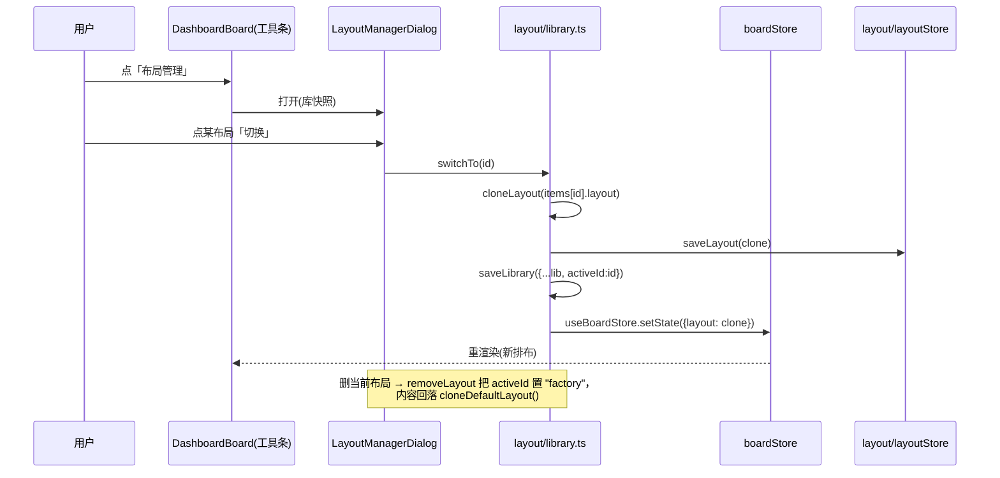
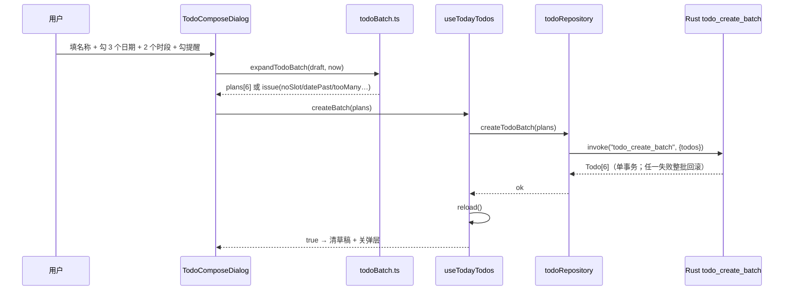
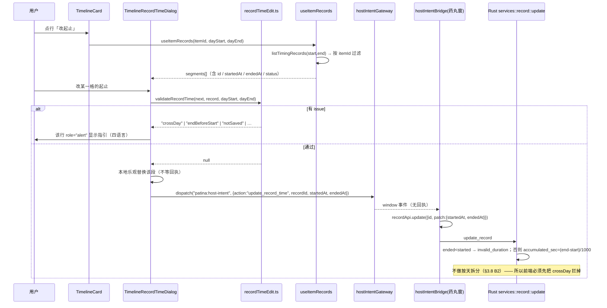
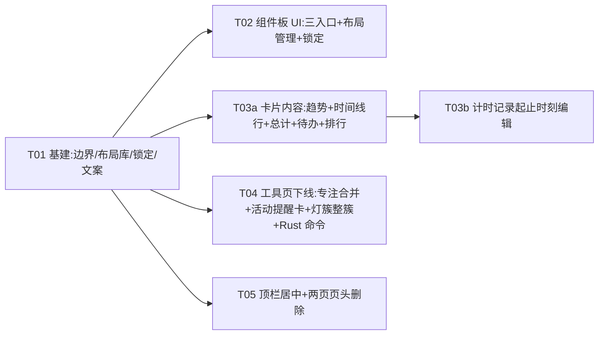

# 主界面 / 分析窗（patina）第二轮改造 —— 增量设计 + 任务分解

| 项 | 值 |
|---|---|
| 仓库 | `D:/101-Workshop/261111-Timing` |
| 分支 / HEAD | `master` @ `fcbbab5` |
| 设计者 | 架构师 高见远 |
| 实现者 | 工程师 寇豆码 |
| 验证者 | QA 严过关 |
| 依据 | 主理人《第二轮改造需求》13 条 + 逐条裁决 |
| 本文性质 | **只出设计**。除本文档外不改任何源文件 |

> **阅读顺序建议**：先看 §2 现状核对。本轮 13 条需求里，**有 4 条在代码层面已经实现**（1.1 分类删除、1.6 的名称+默认时长编辑、1.7 的时间+提醒创建、提醒调度链路）。如果不先对齐这一点，工程师会把已经能用的东西重写一遍，并且很可能改坏既有判据。

---

## 1. 范围与非目标

### 1.1 本轮范围（In scope）

| 编号 | 需求 | 落地位置 |
|---|---|---|
| 1.1 | 应用排行卡：分类支持删除 | `features/dashboard/components/AppsModule.tsx` + `features/classification/**` |
| 1.2 | 计时分布卡无数据时「窗口全黑 + 无法返回」（bug） | `shell/**` 渲染兜底 + `features/dashboard/components/TimerModule.tsx` |
| 1.3 | 锁定布局（入口左上角，锁定后不响应拖动/改尺寸/整理） | `features/dashboard/layout/**` |
| 1.4 | 工具栏三入口：添加组件 / 布局管理 / 锁定布局；布局管理支持查看/切换/删除/新建 | `features/dashboard/layout/**` |
| 1.5 | 今日活动趋势横轴铺满 00:00–24:00 | `services/trendDays.ts` + `components/TrendModule.tsx` |
| 1.6 | 今日时间线：去两个右上入口、底部三入口、编辑口径对齐药丸、行显示「名称-起止-总用时」、右上总计；**并新增「改这条计时记录的起止时刻」**（Q1 裁决 = 两个都要，见 §3.8） | `components/Timeline*.tsx` + `hooks/useTodayItems.ts` + `hooks/useItemRecords.ts` + `services/recordTimeEdit.ts` |
| 1.7 | 待办卡：显示全部未完成、增删改、多日期×多时段统一添加 | `components/TodosModule.tsx` `TodoComposeDialog.tsx` `hooks/useTodayTodos.ts` `services/todoDraft.ts` + Rust |
| 2 | 删「工具」页；专注合并进计时；提醒并入待办；活动提醒迁成组件卡 | `shell/**` + `features/tools/**` + `features/dashboard/**` + Rust 权限 |
| 3 | 顶栏导航居中 | `shell/components/AppTitleBar.tsx` + `AppTopNav.tsx` + `styles/topbar.css` |
| 4 | 删数据页/设置页页头；设置保存取消归位；锚点偏移对齐 | `features/data/components/Data.tsx` + `features/settings/components/Settings*.tsx` + `SettingsGroupNav.tsx` |

### 1.2 非目标（Out of scope，本轮明确不碰）

1. **药丸窗（`src/windows/timing/**`）的 UI 一行不改**。唯一的例外是 `src/windows/timing/services/hostIntentBridge.ts` —— 它是意图桥的**执行端**，新增意图必须在这里加分支（这不是 UI）。
2. **历史页（`features/history/**`）不动**。专注历史记录照旧显示（见 §3.4）。
3. **数据页的图表本体不动**，只删页头那一行（`Data.tsx:1044-1047`）。
4. **`features/destination/**`（目标详情）不动**。
5. **不合并两个 SQLite 库**：`timing.db`（宿主：items / time_records / todos / notes / settings）与 `patina.db`（insight：tool_reminders / pomodoro / activity rules / app_usage）保持独立。
6. **不新增 Rust 事件**（`scripts/check-contract.mjs:260` 的 `EXPECTED_EMIT_SITES = 18` 是硬编码）。跨窗动作一律走既有的 `patina:host-intent` —— 它是 `window.dispatchEvent` 的**前端**事件，Rust 侧没有对应 `emit`，所以不进那个计数（详见 §3.8 的"用事件不用命令"结论）。
7. **不改 `tool-notification` 窗与 `mini` 窗的运行时管线**。`mini` 窗**要**补错误边界与灯簇清理（Q3/Q4 裁决，见 §3.6 F1、§4.3），但它的窗口创建 / 尺寸 / 过渡（`useMiniWindow` / `useMiniTransition` / `useMiniTracking`）一行不动。
8. **`tool-notification` 窗本轮不删**（**Q4 已裁决 = (A) 本轮保留**，下一轮随「提醒投递方式收敛」一起处理）：它不是工具页的产物，而是**活动提醒到点的投递通道**（`app/insight/tool_notifications.rs:71-76` 的 `Delivery::Notification → WINDOW_LABEL`）。工具页下线后 `ToolAlertKind::ActivityReminder` 仍然有效，删窗等于让活动提醒**静默失声**。T04 的「不许碰」清单 + 判据 V-2h 专守这条。

---

## 2. 现状核对（逐条打开文件核对，含行号）

> 主理人给的行号我逐条核过：`DashboardBoard.tsx` 的工具条实际在 **77–104**（不是 79–101），`Data.tsx` 页头 **1044–1047** ✔️，`Settings.tsx` 页头 **150–153 / 171–183**（不是 171–184）、`AppSidebar.tsx` 导航项 **33–41** ✔️（`tools` 在 38 行）。

### 2.1 已经实现、本轮只需核对与微调的 4 条

| 需求 | 真实代码 | 现状结论 |
|---|---|---|
| **1.1 分类删除** | `features/classification/components/QuickClassificationCategoryMenu.tsx:136-157`（删除区，只给 `custom:` 前缀）；`components/QuickClassificationSurface.tsx:243-253, 309-310`（`useQuickClassificationCategoryAdmin` 接线）；`hooks/useQuickClassificationCategoryAdmin.ts:156-198`（编排）；`services/categoryDefinitionMutations.ts:62-127`（`buildCategoryMemberFallbackMutations` + `buildDeleteCategoryBatchMutations`，含 web domain 回落） | **已实现**。应用排行卡走的就是这套 `QuickClassificationEntry`（`AppsModule.tsx:9-10, 66-107, 207-216`），所以「点行 → 改分类 → 删除分类」这条路径**在代码上已经存在**。本轮要做的不是"实现删除"，而是 **QA 实测确认 + 补一条渲染层回归判据**（见 T03a 判据 V-1.1） |
| **1.6「编辑事项」的名称 + 默认时长** | `components/TimelineItemRows.tsx:121-191`（行内编辑：名称 + 默认分钟数）；`TimelineManage.tsx:184-294`（新建/管理两个弹层）；`hooks/useItemPrefs.ts`；意图 `update_item` 已在桥两端（`hostIntentGateway.ts` / `hostIntentBridge.ts` 的 `HostIntent` 联合） | **能力已实现**。与药丸窗口径一致：药丸的「编辑事项」= `ItemsPrefsForm.tsx:44-60`（名称 + 默认倒计时分钟数），落 `settings.itemsTimers`；分析窗写的是同一个 `update_item.timerMinutes` 三态。**差的只是入口结构与行显示** |
| **1.7 时间 + 提醒的创建** | `components/TodoComposeDialog.tsx:175-220`（计划时间 + 「提醒我」勾选）；`services/todoDraft.ts:121-154`（`validateTodoDraft` / `planTodoWrite`：`remindAt = remind ? plannedAt : null`）；`hooks/useTodayTodos.ts:116-135`；`platform/persistence/todoRepository.ts:createTodo(title, plannedAt, remindAt)` | **已实现**。`todos` 表也早有提醒列（`0002_v020.sql:99-114` + `infra/migrate.rs:38-44` 的 `MIGRATE_COLUMNS_V4`：`remind_stage` / `auto_start`） |
| **2 提醒调度复用** | `jobs/nudge.rs:45-115`（15 s `scan_once` → `expire` / 两级 `due`+`mark` / `autostart` / `purge_overdue`）；`services/todo_nudge.rs:24-63`；`repositories/todo_nudge.rs:14-30`；`repositories/todo.rs:122-133`（改 `remind_at` 时自动复位 `reminded_at` + `remind_stage = 0`） | **已实现且足够**。⚠️ **纠正主理人口径**：待办提醒的宽限是 `TODO_NUDGE_GRACE_MS = 10 * 60 * 1000`（`models/constants.rs:161`），扫描周期 `REMINDER_SCAN_INTERVAL_SECS = 15`（同文件 :149）。我在全仓**没有找到**「±60 秒聚合」的实现 —— 事项提醒（`jobs/reminder.rs:41-60`）的判据是 `remind_at <= now AND reminded_at IS NULL`，聚合只发生在**同一次 tick 的通知正文**里（`AGGREGATE_TITLE_LIMIT = 3`）。设计按真实代码写，不按「±60 s」写 |

### 2.2 部分实现 / 需要改造

| 需求 | 真实代码 | 现状结论 |
|---|---|---|
| **1.2 无数据全黑** | `patina` 窗入口 `shell/main.tsx`（无任何 ErrorBoundary）；对照药丸窗 `timing/entry/main.tsx:79,128-130`（有 `AppErrorBoundary` + `installGlobalErrorHooks`）；`components/ModuleShell.tsx:163-166`（empty 态 + 恒在 footer）；`components/TimerModule.tsx:100-103`（`total` 与 `moduleState`） | **结构性缺口已定位**：全仓 `grep -rn "ErrorBoundary"` 只命中 `src/windows/timing/**`，**分析窗是唯一没有错误边界的窗**。渲染期一抛异常，React 19 会卸载整棵根树 → `#root` 空 → 露出 WebView 的深色底 = 「全黑」，且导航/返回键随树一起消失 = 「无法返回」。具体是哪一句抛，需要按 §3.6 的三步判别定位 |
| **1.5 趋势横轴** | `services/trendDays.ts:71-115`：`for (let hour = 0; hour <= now.getHours(); …)`（:80），末窗 `endMs = Math.min(下一整点, cutoffMs)`（:89）；`components/TrendModule.tsx:70-102`（末柱 `isNow` + 只看首/中/末三处轴字） | **确认是「末端 = 当前时间」**。改法见 §3.5 与 §5.1（**查询边界不许推到未来**，否则撞 `activity_read_model/mod.rs:189-203` 的边界校验/覆盖率） |
| **1.6 时间线行** | `TimelineCard.tsx:41-59`（`buildTimelineRows`：只取 `firstStart`，无结束时刻）；`:108-126`（卡头两颗 `itemsMenu` / `commonItems`）；`:127-144`（footer 两颗：新建 / 管理）；`useTodayItems.ts:22-32`（`TodayItemRow` 只有 `firstStart`，无 `lastEnd`）、`:179`（`total` 已算好但没传出去） | 行格式、结束时刻、总计、三入口都要改；**编辑能力不用重写**，复用 `TimelineItemRows` |
| **1.7 全部未完成 / 增删改** | `repositories/todo.rs:24-41`（`list` **没有**日期过滤，只有 `include_done`）；`platform/persistence/todoRepository.ts:listPendingTodos` 传 `{ includeDone: false }` | 「只取今天」**在代码里查不到**。两个可能的真实来源：(a) `jobs/nudge.rs:105-115` 的 `purge_overdue` 每 15 s 把 `planned_at < 今天 0 点` 的未完成待办**软删除**（`repositories/todo_nudge.rs:14-30`），(b) 未来待办排在 `sort_order` 尾部、被卡高裁掉。**"改"完全缺失**：`todo_update` 命令存在且已进四处契约，但没给 `patina` 权限（见 §5.3） |
| **2 工具页** | `shell/types/view.ts`（`View` 含 `"tools"`）；`shell/components/AppShellViews.tsx:18,40,211-220`；`shell/AppShell.tsx:146,220,230`；`shell/components/AppTopNav.tsx:35-43`（`tools → dashboard`）；`shell/services/viewChunkPreloadService.ts:13`；`shell/hooks/useAppShellRenderedView.ts:23-31`；`shell/hooks/useAppShellRuntimeLifecycle.ts:4`；`shell/hooks/useImportClassificationCoordinator.ts:9`；`shell/mini/MiniToolStatus.tsx:3-5`；`shell/tool-notification/ToolNotificationShell.tsx:4-5`；`shell/services/startupWarmupService.ts:16-18` | ⚠️ **`AppSidebar.tsx` 是死代码**：`AppShell.tsx` 已经不再渲染它（`AppShell.tsx:205-211` 的注释「侧栏已下线」），只有 `useAppSidebarState.ts:2-29` 还在引它的 **props 类型**。所以「侧边栏 7 项里删掉 tools」= 删文件 + 删那个 hook 的类型来源；真正的 `tools` 入口是 **`AppShell.tsx:220` 的 `ToolsStatusEntry`（标题栏灯簇）** 与 `View` 联合类型 |
| **3 顶栏居中** | `AppTitleBar.tsx:91-96`（brand 114）→ `:99`（drag 96）→ `:101`（`navigationSlot`）→ `:106-120`（status `flex:1`）→ `:122-155`（controls 152）；段宽锁死见 `styles/topbar.css:105,116,151`（`.app-titlebar-brand` / `-drag-region` / `.qp-topbar-nav`，文件共 252 行） | 导航被 brand+drag 的 210 px 顶到左侧。拖拽判据在 `AppTitleBar.tsx:68-71`（`isInteractive` = `button, a, input, textarea, select, [data-no-drag]`），**改布局不许碰这条** |
| **4 页头** | `Data.tsx:1044-1047`（1197 行，冻结基线 1197）；`Settings.tsx:147-166`（loading 分支页头 150-153）+ `:171-183`（主页头）+ `:185`（`SettingsGroupNav`）；`SettingsHeaderActions.tsx:26-79`（保存/取消，`QuietButton size="large"`）；`styles/features/settings-handles.css:17-21`（`scroll-margin-top: 60px`，注释自认是「页头高度的经验值」）；`SettingsGroupNav.tsx:19`（`ACTIVE_OFFSET = 56`） | 页头删除后 **60 / 56 两个数都失配**，且这两个数是两份手抄常量（`scroll-margin-top: 60` 与 `ACTIVE_OFFSET = 56` 已经不一致） |

---

## 3. 关键决策

### 3.1 事项菜单跨窗复用怎么做（L9 硬约束下）

**约束复述**：药丸的事项菜单在 `src/windows/timing/components/menu/**`（`ItemMenu.tsx` 172 行、`ItemsPrefsMenu.tsx` 299 行、`ItemsPrefsForm.tsx` 71 行）；分析窗在 `src/windows/patina/features/**`。`scripts/check-layers.mjs` 的 **L9 例外表已清空**（`L9_ALLOWED_TARGETS = new Set([])`），两条路径集合都不许互相 import；`L10` 又规定 `windows/shared` 不得引 `timing|patina` —— 即**共享层不能 import 意图桥**（`hostIntentGateway` 在 `patina/platform/runtime/`）。

| 方案 | 做法 | 对 L9 | 对 L10 | 对 300 行 | 对测试 |
|---|---|---|---|---|---|
| **A. 下沉组件到 `windows/shared/` + 两侧转发壳** | 把「事项编辑表单」抽成 `windows/shared/components/ItemEditForm.tsx`，两窗各自包一层喂数据 | ✅ 不破（第三棵子树） | ❌ **半破**：表单要发写动作，而 shared 不能引 intent 桥、也不能引 `ipc`（L1/L3 的等价约束）→ 只能把 `onSubmit` 全部注入。注入点一多，这个"共享组件"退化成**一个三字段受控表单**，复用收益≈0 | ⚠️ 新增 2 文件（表单 + 转发壳），两侧壳各 ~40 行；`ItemsPrefsMenu.tsx` 299 行会被迫先减后加 | ⚠️ 两侧都要改测试；且两窗的**语言系统不同**（药丸是中文字面量 + `UI_TEXT`，分析窗是四语言 `Record<Locale,…>` 表），共享组件的文案来源必须再抽一层 |
| **B. 只下沉纯函数与类型** | 把 `ITEM_NAME_MAX_LEN` / `checkItemName` / `ItemTimerTri` 放进 `windows/shared/`，呈现各写一份 | ✅ | ✅ | ➖ 净增 0（现有 `timelineItemName.ts` 44 行整体搬走） | ⚠️ 现有 `hostIntentMirror.test.ts` / `todoDraft.mirror.test.ts` 这两条 **source test** 的写法就要改 |
| **C. 独立实现 + 用 source test 钉语义相等** | 分析窗继续用自己那份（`timelineItemName.ts` + `TimelineItemRows`），药丸不动；靠一条 source test 断言两边的常量/校验分支相等 | ✅ | ✅ | ✅ 零新增文件 | ✅ 已有两条同型先例（`features/dashboard/services/hostIntentMirror.test.ts` 钉 `HostIntent` 联合、`todoDraft.mirror.test.ts` 钉 `TODO_TITLE_MAX_CHARS`），第三条是复制既有套路 |

**选定：C。**

**理由（三条，按权重排序）**：
1. **"复用"在本轮是伪需求**：§2.1 已核对，分析窗的编辑能力（名称 + 默认分钟数）**已经和药丸等价**，且写的是同一个 `update_item.timerMinutes` 三态。真正缺的是**入口结构与行显示**，那是分析窗自己的呈现问题，与药丸的 `GlassMenu` / `ItemsPrefsForm` 无关。
2. **A 方案会被 L10 逼成一个假组件**：共享层拿不到意图桥、也拿不到 `ipc`（L1/L3 对 components 的限制同理），所有副作用只能靠 props 注入。一个「受控表单 + 5 个回调」的下沉，换不来任何东西，却把 P0 的"两窗隔离"从物理保证降级成"约定"。
3. **两侧的语言/皮肤体系不同**：药丸 `ItemsPrefsForm` 是中文字面量 + `.items-prefs__` 皮肤；分析窗是 `BOARD_COPY`/`copyTimeline.ts` 的四语言 `Record<Locale,…>` + `.qp-*` 皮肤。强行共享，要么让分析窗的中文硬编码（违反"四语言不许静默降级"），要么把四语言表搬进药丸（越界）。

**升级触发条件（写给下一轮）**：出现**第三处**入口，或两窗需要共享同一套**多分支校验**（例如「事项名查重 + 保留名冲突」）时，改走 B（下沉纯函数），而不是 A。

**C 的验收判据**：新增 `features/dashboard/services/itemMenuMirror.test.ts`：读 `src/windows/timing/components/menu/ItemsPrefsForm.tsx` 与 `features/dashboard/services/timelineItemName.ts` 两侧源码，断言「默认时长留空 = 正计时」的语义（药丸侧 `minutes` 空串 → 不写 `itemsTimers`；分析窗侧 `clampItemMinutes("") === null`）。变异验证：把分析窗的 `""` 分支改成返回 `0`，测试必须红。

---

### 3.2 待办「多日期 × 多时段」的建模

| 方案 | 数据形态 | 迁移影响 | 查询/写影响 |
|---|---|---|---|
| **A. 展开成 N 行** | 3 个日期 × 2 个时段 = 6 条 `todos`，各自 `planned_at`（必要时 `remind_at`），标题相同 | **零迁移**：`todos` 已有 `planned_at`/`remind_at`/`remind_stage`/`auto_start`（`0002_v020.sql:99-114`、`migrate.rs:38-44`） | 全部既有不变量原样成立：`todo_toggle(id)` / `todo_delete(id)` / 3 s 撤销 / `remind_stage` 单调去重 / `purge_overdue` 按 `planned_at` / md 同步按行 |
| **B. 单条 + 重复规则** | `todos.recurrence`（JSON RRULE 子集）+ 读取时展开 | **要迁移**：`0009` 加列 + 整个 `migrate.rs` 的版本门（`schema_version(pool) < 9`）+ `settings.schema.version` 推进到 9 | ❌ 五处全部要改：`reminded_at`/`remind_stage` 在**行**上，而"实例"才有"这一天的提醒该不该弹"；`purge_overdue` 会把规则行当过期待办删掉；`todo_toggle` 无法表达"只完成这一次"；`md_sync` 单表同步要序列化规则 |

**选定：A。**

**理由**：本仓待办的所有既有不变量都是**按行**的（id 级勾选/删除/撤销、`remind_stage` 的 0→1→2 单调、`purge_overdue` 的 `planned_at < 今天 0 点`、md 同步逐行 diff）。B 会把它们逐个改成"按实例"，成本远大于收益（收益仅是"少几行数据"）。

**连带决策**：
- **新增 `todo_create_batch` 命令**（Rust 侧**单事务**插入 N 行）。理由：前端循环调 N 次 `todo_create` 会出现**部分成功**（第 3 条失败 → 用户看到"只加了一半"，且没有回滚手段），而"统一添加"这个动作的语义就是原子。上限 `MAX_BATCH = 60`（5 日期 × 12 时段已足够，超出直接由前端拦）。
- **"时段"= 一个时刻点**，不新增字段：`todos` 只有 `planned_at`（一个时刻），没有时长。若用户坚持要"起-止区间"，那需要 `planned_end_at` + `0009` —— **Q2 已裁决为「时刻点集合」：不加该列、不写 `0009`**（见 §7）。
- **日期下限**：`planned_at` 必须 `>= 今天 0 点`，否则 `purge_overdue` 会在 15 s 内把刚建的待办软删除（`repositories/todo_nudge.rs:14-30`），表现为"建了立刻消失"。这条要写进 `validateTodoDraft`（扩 `timePast` 的语义，见 §5.2）。
- **查询**：不新增参数。`todo_list{includeDone:false}` 已经是"全部未完成"（`repositories/todo.rs:24-41`）。需求 1.7 第一条只需**去掉卡上的取前 N 条**并核对 `purge_overdue` 的副作用（T03a 判据 V-1.7a）。

---

### 3.3 提醒合并的复用边界（哪些搬、哪些删、为什么不新写）

**复用的函数（一个都不新写）**：

| 层 | 函数 | 位置 |
|---|---|---|
| 调度器 | `spawn_nudge_watcher` / `scan_once` | `jobs/nudge.rs:26-70` |
| 业务 | `due(pool, stage, now)` / `autostart_due` / `mark` / `expire` | `services/todo_nudge.rs:24,39,53,62` |
| 仓储 | `nudge_due` / `expire_stale` / `soft_delete_overdue_before` | `repositories/todo_nudge.rs` |
| 去重 | `reminded_at` 置位 + `remind_stage`（0/1/2 单调） | `repositories/todo.rs:122-133`（改 `remind_at` 自动复位） |
| 常量 | `REMINDER_SCAN_INTERVAL_SECS = 15`、`TODO_NUDGE_GRACE_MS = 10 min` | `models/constants.rs:149,161` |

**为什么不是新写一套**：新写 = 第二个 15 s ticker + 第二份去重状态。`remind_stage` 的单调性是"同一条不重弹"的**唯一**保证；两套调度共写一列必然出现「同一条弹两次」或「都不弹」，而这两种故障都不报错。

**删的边界（关键）**：
- 删 `features/tools/components/ReminderToolPanel.tsx` 的**「定时提醒」分区**（`tool_reminders` 的新建/编辑/取消 UI）与 `TimedReminderEditor.tsx` / `ReminderScheduleFields.tsx`。
- **保留** `patina.db` 的 `tool_reminders` 表与 engine 的 `fire_due_reminders`（`services/insight/data/tools_store.rs:58`）：已经排定的旧提醒照旧到点响、并可在弹窗上确认/推迟。**绝不静默丢弃**（用户已经答应的提醒必须响完）。CHANGELOG 写明「定时提醒已并入待办；旧的排定提醒仍会响一次，之后不再产生新的」。
- **待办侧不需要任何迁移**：`remind_at`/`remind_stage`/`auto_start` 全在（`0002_v020.sql:99-114` + `MIGRATE_COLUMNS_V4`）。**本轮不写 `0009`**（理由与判据见 §5.4）。
- 「是否提醒」的 UI 已在（`TodoComposeDialog.tsx:201-220`），本轮补的是**编辑时也能改**（`todo_update` 的 `remind_at` 三态 `Some(None)` 已能清空并复位 stage）。

---

### 3.4 番茄 / 专注的合并口径

主理人裁决：「专注功能即为计时功能，日常启用靠小窗，功能应合并」。四个子问题逐条给结论：

| 子问题 | 结论 | 理由 |
|---|---|---|
| 番茄会话数据是否保留 | **保留，且不迁移** | `patina.db` 的 `pomodoro_*` / `focus_history_*` 表与 engine tick 全留。合并两张表要重写"倒计时 vs 正计时"两套时长语义，收益只是少一张表，风险是用户历史被改写 |
| 历史里的专注记录怎么显示 | **不动**（`features/history/**` 是本轮非目标） | `focusHistoryGateway` / `focus_history.sql` 的只读视图原样 |
| `focusDimension.ts` 与计时语义的关系 | **无关，改都不要改** | 它是**计时分布卡的维度枚举**（`category` / `app` / `item`，见 `services/focusDimension.ts:15-17`），只是名字里带 "focus"。与番茄是两件事，误改会打断三张卡的联动 |
| 要不要保留后端表 | **保留** | 同第一条；另外 `tool-notification` 窗（`shell/tool-notification/ToolNotificationShell.tsx`）依赖 `ToolAlert.kind` 的四类分支，删表会让旧 alert 反序列化失败 |

**"合并"落在哪一层**：**交互层**。具体是——
- 删除产生新番茄/新自由专注的**全部入口**（`PomodoroToolPanel.tsx`、`FreeFocusContent.tsx`、`FreeFocusRestPicker.tsx`、`FreeFocusTaskEditor.tsx`、`PomodoroTaskEditor.tsx`、`PomodoroTaskRow.tsx`、`PomodoroSettingsPicker.tsx`、`FocusAlertDialog.tsx`、`FocusSessionLedgerNote.tsx`，以及 `hooks/useToolsPageState.ts` 里的番茄分支）。
- 用户要"专注 25 分钟"改用**药丸的倒计时计时**（`time_records.mode='countdown'`，`0002_v020.sql:60-61` 已有该列）—— 这就是"专注即计时"的字面落地。
- **保留** `ToolAlertDialog.tsx` 的 `Pomodoro` / `FreeFocus` 渲染分支（旧数据仍可能出现），只是不再产生新的。

---

### 3.5 布局管理的数据模型（多布局存哪 / 切换怎么生效 / 删除当前怎么兜底 / 锁定存哪）

现状：`layoutStore.ts` 两键 —— 当前排布 `LAYOUT_STORAGE_KEY`（`contract.ts:172`，`patina:dashboard-layout:v3`）与用户默认版 `DEFAULT_LAYOUT_STORAGE_KEY`（`layoutStore.ts:28`）。`boardStore.ts` 的动作面 32–55、`tidy` 180–183、`saveAsDefault` 185–194、`reset`/`resetToFactory` 196–207。

**决策 1：多布局库 = 一个独立键，不与"当前排布"合并。**

```
patina:dashboard-layout:library:v1  →  {
  version: 1,
  activeId: "factory" | "<uuid>",
  items: [{ id, name, createdAt, updatedAt, layout: DashboardLayout }]
}
```
- 为什么不塞进 `LAYOUT_STORAGE_KEY`：当前排布**每拖一下就写一次**（`boardStore.ts:63-66` 的 `persist`），而库是一组必须原子读写的快照。混在一个键里，每次拖动都要把整库重写一遍（`layoutStore.ts:7-11` 已经为同一个理由把默认版拆出去了，本轮延续）。
- 为什么不拆成"每布局一个键"：`activeId` 与 `items` 必须同批生效，拆键一定会出现"新 activeId 配旧 items"（同一个理由见 `layoutStore.ts:12-14`）。

**决策 2：切换布局 = 深拷贝写入当前排布键 + 改 `activeId`。**

`switchTo(id)`：`saveLayout(cloneLayout(items[id].layout))` → 写库（`activeId = id`）→ `useBoardStore.setState({ layout })`。必须深拷贝（`defaultLayout.ts:38-46` 的 `cloneLayout`），否则切换后拖卡会把库里的那一份也改掉。

**决策 3：删除当前布局的兜底 = 落到虚拟条目 `factory`。**

- `factory` 是**内置、不可删、不可改名**的一条，内容 = `cloneDefaultLayout()`（`defaultLayout.ts:54-56`）。它是唯一永远存在的落点，所以"删当前"不需要问用户"你要去哪"。
- 若库里还剩别的布局，删完仍落 `factory`（**不猜**"用剩下的最近一条"）：猜错会让用户以为自己删错了东西。删完在工具条上给一句 toast（`boardCopy` 新增键，四语言齐）。
- **迁移**：启动时若 `library:v1` 不存在但 `DEFAULT_LAYOUT_STORAGE_KEY` 存在（老用户存过默认版），把它作为 `items[0]` 导入（名 = 四语言表里的一句话，**只生成一次并存成字符串** —— 名字是用户数据，不随切语言变），`activeId = items[0].id`。旧键**不删**（删了等于替人清数据，与 `layoutStore.ts:16-17` 对 v2 键的处理同一条纪律）。

**决策 4：锁定 = 独立键，不进 `DashboardLayout`。**

```
patina:dashboard-layout:locked:v1  →  "1" | "0"
```
- 为什么**不**放进 `DashboardLayout`：放进去就得升 `LAYOUT_VERSION`（`contract.ts:170`），而升版本会触发 `normalizeLayout` 的**全量自愈路径**（`layoutStore.ts:55-91`）—— 用户的排布会被"修"一次。为了一个布尔值付这个风险不值得。
- 为什么也不跟布局库走：锁是"这台机器现在的操作模式"，不是布局的属性。切换布局不该把锁定状态改掉（否则"换个布局"会悄悄解锁/上锁）。
- `DashboardLayout.snap` 已有同型先例（8px 吸附开关就存在 layout 里），但它当初就是与布局一起存的；锁定是后来者，按上面的理由单独立键。

**决策 5：三项动作的归属（避免出现死代码）。**

| 现有动作 | 本轮归属 |
|---|---|
| `add`（加卡） | 工具条第 1 项「添加组件」；**锁定态禁用**（Q5：结构锁） |
| `tidy`（整理） | **移进「布局管理」弹层**，作为一条动作按钮。需求说工具栏只留三项，但"整理"是用户把卡拖乱后唯一的退路（`boardStore.ts:47-48` 的注释：「我把卡拖乱了」的退路），直接删掉会制造新问题 |
| `saveAsDefault`（保存为默认） | **移进「布局管理」**：`新建布局` = 把当前排布存成库里的新一条 + 设为 active；**锁定态禁用** |
| `reset` / `resetToFactory` | **删**（`BoardActions` 的两个方法 + `DashboardBoard` 的两颗按钮 + `boardCopy` 的 `reset`/`saveLayout`/`saveHint`/`savedAsDefault`/`saveEmpty`/`resetToSaved`/`factory`/`factoryHint`/`factoryDone` 九个键，四语言同批删）。「出厂」在 UI 上改名为库里的 `factory` 条目 |
| `remove` / `duplicate` / `setTier` / `setTitle` / `setOption` | 留在卡头 `⋯`（`CardMenu.tsx`）；**锁定态一律按 Q5 处理，见下面的范围表** |

**锁定 = 几何锁 + 结构锁（Q5 裁决，逐条列清，不许工程师自己扩大或缩小）**

锁定时**禁止**（8 项，每一项都要有守卫，缺一项就等于没锁）：
1. 拖动卡片（`BoardCardFrame` 的 drag 手柄与卡面拖动）
2. 改卡片尺寸（`.qp-card` 的 `[data-resize]` 三根手柄）
3. 整理（`boardStore.tidy`）
4. **添加组件**（工具条第 1 项 + `AddCardDialog` 入口）
5. **删除卡片**（卡头 `⋯` 的 remove）
6. **复制卡片**（卡头 `⋯` 的 duplicate）
7. **换尺寸档**（卡头 `⋯` 的 `setTier` S/M/L）
8. **切换 / 删除 / 新建布局**（`LayoutManagerDialog` 的三颗动作键；查看列表仍可滚动阅读 —— 看不是改）

锁定时**允许**（2 项，故意保留）：
1. **改卡标题**（`setTitle`）
2. **改卡内参数**（`setOption`，例如计时分布卡的维度切换、待办卡的勾选、活动提醒卡的开关与阈值）

> 这两条是「锁几何 + 锁结构，不锁内容」的分界线。把 `setOption` 也锁掉会出一个真 bug：活动提醒卡的**开关**也是 `setOption`，锁上之后用户既不能拖卡也不能关掉一个到点就弹的提醒 —— 那就变成"锁了布局，吵了一整天"。

**死锁风险（必须写进实现，Q5 明确点了这条）**：锁定后工具栏的三颗按钮**必须仍然可点**。现有 `.qp-dashboard-toolbar` 是 `opacity: 0.45`（`dashboard-layout.css:37`）→ hover/focus-within 全显（:41-44）。锁定态**不许**加 `pointer-events: none`（也不许用 `visibility: hidden` / `display: none` / 条件不渲染来"藏起来"），否则用户永久无法解锁（只能删 localStorage）。判据：T02 的 V-1.3c。

**布局库的交互边界（Q6 裁决）**：本轮**不做**重命名、**不做**导入/导出。"新建布局"给一个默认名（`boardCopy.newLayoutName(n)` → 「布局 1 / 布局 2 …」，四语言齐），**允许重名**（不做查重弹窗：名字只是用户给自己的记号，查重会把"快速存一下"变成一次对话）。


---

### 3.6 1.2「无数据时全黑 + 无法返回」的根因假设与验证手段

**已知事实（不是猜测）**：
1. 分析窗入口 `shell/main.tsx` 与 `shell/App.tsx` **没有任何 ErrorBoundary**；全仓 `grep ErrorBoundary` 只命中 `src/windows/timing/**`（药丸窗 `timing/entry/main.tsx:79,128-130`）。→ **任何渲染期异常都会卸载整棵根树**，`#root` 变空，露出 WebView 深色底（"全黑"），导航与返回键随树消失（"无法返回"）。
2. 拖窗热区在 `.qp-board-scroll` 上（`BoardCanvas.tsx:45-53`，判据是 `currentTarget` / `.qp-board-stage` / `.qp-board-canvas` 三者之一），**卡内空白区域也能拖窗**。窗口被拖到屏幕外时，标题栏不可见 = 也能表现为"回不来"。
3. 窗未"就绪"时宿主不揭示它：`useMainWindowReady.ts:70-101` 的 `markCurrentMainWindowReady` 失败会 `console.error("window will remain hidden")`，此时用户看到的是宿主给的兜底底色。

**三个候选根因（按可能性排序）+ 各自的判别手段**（QA 按顺序做，一步能排除一个）：

| # | 假设 | 判别手段 | 若命中，证据长什么样 |
|---|---|---|---|
| H1 | **渲染期抛异常 → 无边界 → 根树卸载** | 装 Electron/WebView2 远程调试，把 `console` 与 `window.onerror` 录制；把时钟改到"今天 0 条 `time_records`"的库上启动 | 控制台出现一条未捕获 `Error`（React 19 会打印 "The above error occurred in…"），且 `#root.innerHTML === ""` |
| H2 | **窗口揭示门未通过**（`contentReady=false` 或帧不可渲染） | 在 `useMainWindowReady` 的两条 `console.error` 上打点（临时 `console.info` 到 DEV），复现时看有没有这两条 | 命中时页面其实**渲染过**（DOM 有内容但 opacity/隐藏），且能读到 "window will remain hidden" |
| H3 | **纯样式/几何**（卡内一片黑，但导航还在） | 截图对比：有数据 vs 无数据两张全窗截图 | 命中时左侧导航栏仍在，只有卡内区域变色 → 与"无法返回"描述不符，可直接降级 |

**结构化修法（无论 H1/H2/H3 哪个成立都必须做，缺一条就不算修完）**：
- **F1 补错误边界（治 H1）**：新增 `src/windows/shared/AppErrorBoundary.tsx`（把药丸窗 `timing/components/ui/AppErrorBoundary.tsx` 的实现**下沉**一份到这里），由 `patina/shell/App.tsx` 包住整个子树。下沉而不是复制：一份实现两个消费者，避免两套兜底文案漂移。代价：药丸窗 `timing/entry/main.tsx:79` 的 import 路径改 1 行（**不是 UI 改动**）。
- **F2 空态兜底（治 H1 的"看起来没坏"版本）**：`TimerModule` 在 `moduleState === "empty"` 时**仍渲染环的底圈 + 「今日 0m」**，而不是只渲染一句 `qp-empty`。理由：用户描述的是"计时分布卡"，而卡的 empty 分支正是 no-data 时唯一走的分支（`ModuleShell.tsx:163-165`）。
- **F3 返回可用的兜底（治"无法返回"）**：错误边界 fallback 里必须有 **「回到主界面」** 与 **「重新加载」** 两颗键，且导航栏在边界**外面**（`AppTitleBar` + `AppTopNav` 在 `AppShell` 顶层，边界只包 `AppViewOutlet` 的子树）。这样单页崩了不影响换页。
- **F4 拖窗兜底（治 H2 的变体）**：`BoardCanvas` 的 `dragWindowOnBackdrop` 只在**至少一张卡**时开启；空板不挂拖窗（空板全屏都是空白 → 用户一点一拖就把窗推走）。

**这条需求的验收判据**：T01 判据 V-1.2a（用一条故意抛错的测试组件包在边界里，断言 fallback 渲染且导航仍在）+ V-1.2a2（mini 窗同批覆盖）+ T03a 判据 V-1.2b（用 0 数据渲染 `TimerModule`，断言既有 `data-state="empty"` 又有 `qp-donut` 底圈）。

---

### 3.7 按钮口径：`QuietButton` vs `qp-link-btn`（需求 4 的核对结论）

| | `qp-link-btn`（主界面工具栏在用） | `QuietButton`（设置页保存/取消在用） |
|---|---|---|
| 定义 | `styles/features/dashboard.css:145-165` | `shared/components/QuietButton.tsx:18-33` → `styles/quiet-pro.css:805-854` |
| 边框/底色 | 无（`border: 0; background: none`） | 有（`-secondary` 有边框 + 面板底；`-primary` 有 accent 底） |
| 最小高度 / 字号 | 无最小高，`caption` 字号 | 30 / 32 / 34，`body` 字号 |
| 光标 | `cursor: default` | 默认（`button` 自带） |
| 语义 | **轻入口**（"加一张卡"、"全部分类…"，错了也不破坏数据） | **主/次操作**（保存 / 取消，是有代价的确认） |

**结论：不能把设置的保存/取消降级成 `qp-link-btn`。** 保存是"改设置前必须显式确认"的主操作，`qp-link-btn` 没有边框/底色/最小高，在设置页那种满屏输入控件的密度里读不出"这是最后一步"；而且它比现在矮 34→~16px，误触成本直接落到"改错设置"。

**"统一"落在正确的维度上**：统一的是**工具条这个容器**（位置、`opacity .45` 常驻 + hover/focus 全显的交互、与内容不抢几何的绝对定位），不是按钮皮。落地：
- 新增 `shell/components/QuietPageToolbar.tsx`（~50 行）：**复用** `.qp-dashboard-toolbar` 那一套几何/淡显规则（把该规则从 `dashboard-layout.css:22-44` 提成 `.qp-page-toolbar` 一族，dashboard 与 settings 各挂一个修饰类）。
- 设置页的保存/取消仍用 `QuietButton`（`tone="primary"` / `secondary`，`size="compact"` 从 `large` 降一档，与工具条 30px 高对齐）。

---

### 3.8 计时记录「起止时刻」的编辑（Q1 裁决 (b) 的落地口径）

> **为什么单独成节**：§3.1 说的是"跨窗怎么复用"，§3.2 是待办的建模。Q1 裁决为"两个都要"之后，**(b) 这一项是本轮唯一会改写历史数据语义的动作**，它的边界规则不能散落在任务描述里 —— 散着写，工程师一定会漏掉"跨零点"那一条，而它出错时**不报错**。

**能力边界（六条，缺一条就会写出"改完账对不上"的 bug）**

| # | 规则 | 代码依据 | 违反后的现象 |
|---|---|---|---|
| **B1** | `startedAt < endedAt`（严格小于） | `services/record.rs:68-72`：`ended_at < started → invalid_duration` | 前端不拦就变成"点保存 → 弹一个 `invalid_duration` 的英文码"（`errorText()` 有映射但没有中文语境的引导） |
| **B2** | 起止必须落在**同一个本地日** | `services/timer_split.rs` 文件头写死了这条纪律：「落库时就拆开，后面的所有路径（列表 / 统计 / md 导出 / md 导入）都不必知道这件事。」而 `services/record.rs:54-98` 的 `update` **不做按天拆分** | 造出一条跨零点的行 → `hooks/useTodayItems.ts:72` 的 `record.startedAt < from \|\| record.startedAt >= to` 会把**整天**时长算给起始日，另一天为 0，**而且不抛异常、不进日志** |
| **B3** | 只允许改 `status === "saved"` 的记录 | `services/record.rs:58-60`：非 `SAVED` 直接返回 `item_not_found` | 进行中的记录在服务端就改不了，但报的是"目标不存在"（`ITEM_NOT_FOUND`）—— 前端必须自己先禁用，否则用户读到的是误导性错误 |
| **B4** | 时长**不需要**单独重算，`duration` 也不存在 | `services/record.rs:73-79`（ADR-030 注释）：`patch.started_at.is_some() \|\| patch.ended_at.is_some()` → `accumulated_sec = ((end - start) / 1000).max(0)`；`repo::SavedTimes` 只有 `started_at` / `ended_at` / `accumulated_sec` 三个字段 | 若前端自己算一遍再写，会和 Rust 的口径（整秒截断 `.max(0)`）差 1 秒；更糟的是前端算的值**根本发不出去**（`RecordPatch` 没有这个字段），于是"算了但没用"变成死代码 |
| **B5** | 同一天的多段记录**逐条改，不合并** | `uq_records_open` 是**部分唯一索引**，只按 `status='active'` 建（`services/record.rs:101-105` 的注释），`saved` 之间没有唯一约束 | 合并会丢掉其中一个 `id`，用户改完发现"少了一段" |
| **B6** | 跨零点的记录**不生成，只给指引** | B2 | 见下 |

**「改完是否重算 `duration` 字段」的明确答复**：`time_records` **没有独立的 `duration` 列**。时长的唯一来源是 `accumulated_sec`，而它已经由 `services/record.rs:75-79` 按新区间重算。**前端与设计都不需要新增任何重算逻辑** —— 这一条写在这里，是为了防止工程师在弹层里"顺手"算一遍再塞进 payload（payload 里没这个位置，塞了会被 serde 忽略，属于静默死代码）。

**跨天 / 跨零点怎么提示（结论：不允许生成，而不是生成后提示）**
- 校验层给一个新 issue `crossDay`，文案 `copyTimeline.crossDayHint` = 「跨零点的记录请在两天里分别修改」（四语言齐）。
- 为什么不做"提示 + 允许"：允许之后只有两条路 —— ① 在 `update` 里补一次 `split_by_day`；② 让账单永久错一天。①的问题是 `services/record.rs` 是**宿主共享服务**（手机端也编这一份），`timer_split` 从没在 `update` 路径里被调用过，等于改了一条所有调用方都依赖的语义；②不用讨论。两者都比"拒绝 + 一句指引"贵。
- 提示文案要落在**校验失败的那一行**（`role="alert"`），不是 toast：用户在弹层里改数值，视线在输入框上。

**契约影响（关键结论：命令面零改动，走事件）**

| 项 | 结论 |
|---|---|
| **新 HostIntent** | `{ action: "update_record_time"; recordId: number; startedAt: number; endedAt: number }`。两侧各写一份、字段逐字相同（L9 禁 import）：分析窗 `platform/runtime/hostIntentGateway.ts:31-81` 的联合 + 药丸 `timing/services/hostIntentBridge.ts:42-60` 的联合；执行分支进 `hostIntentBridge.ts` 的 `handleIntent` switch（:206 起，现有 12 个 case） |
| **Rust 命令** | **零新增**。复用 `update_record`：`commands/record_cmd.rs:92` + `models/record.rs:29-37` 的 `RecordPatch { item_id, started_at, ended_at, note }`。payload 映射为 `{ id: recordId, patch: { startedAt, endedAt } }` |
| **四处命令表** | **零改动**。`update_record` 早已四处齐全：`ipc_commands.rs` 的 `generate_handler!`、`types/domain/ipc.ts:160`、`services/ipc.ts:181`、`mocks/browserMock*.ts` |
| **权限文件** | **零改动**。`update_record` 在 `permissions/host-commands.toml:98`，执行端是药丸窗，本来就有；分析窗**不新增任何宿主写命令授权** |
| **`EXPECTED_EMIT_SITES = 18`** | **不变**。明确结论：**用事件，不用命令**。`patina:host-intent` 是 `window.dispatchEvent` 的前端事件，Rust 侧既没有 `emit` 也没有 `listen`，而 `check-contract.mjs:260` 数的是 **Rust 的 `emit` 点**，所以它从来不在这个计数里。反过来若让分析窗直接 `invoke('update_record')`，就要往 `patina-todo-notes.toml` 加一条宿主写命令 —— 那等于**在分析窗上开一个写面**，与 §1「分析窗读为主」的核心纪律正面冲突。这条不是"绕开"，是本来就该这么走 |
| **错误码** | 零新增（复用 `INVALID_DURATION` / `ITEM_NOT_FOUND`）。⚠️ B3 命中时返回的 `ITEM_NOT_FOUND` 语义不精确，**本轮不改**：错误码是两处对齐的（`error.rs` + `errorText()`），还牵手机端，收益不抵风险。前端靠"禁用 + 提示先停止计时"规避 |
| **无回执的代价** | 与既有改名同型，有先例可抄：本地乐观 + 待确认集合（`hooks/useTodayItems.ts:107-110, 129-140` 的 `pendingRenamesRef` 就是模板）。改时刻的乐观值更简单 —— **区间整体替换**，不需要"等宿主对账" |

**读侧够不够：够，但不要塞进轮询**

- `platform/persistence/timingReadRepository.ts:34-42` 的 `TimingRecord` 已含 `id / itemId / startedAt / endedAt / accumulatedSec / status` → **读侧零改动**。
- 但 `useTodayItems` 只有聚合值（`hooks/useTodayItems.ts:60-101` 把多段并成一行），拿不到"第几段"。→ 新增 `hooks/useItemRecords.ts`：**只在编辑弹层打开时**对同一个日区间调一次 `listTimingRecords(start, end)`，再按 `itemId` 过滤。理由：把原始段塞进 `TodayItemRow` 会让 30 s 轮询每一趟都多背 200 行（`listTimingRecords` 上限 200），而用户绝大多数时候不看这个弹层。这与 `useTodayNotes` 的"按需拉"同型。

**边界校验写成纯函数（可单测，且是唯一的判据落点）**

```ts
// features/dashboard/services/recordTimeEdit.ts（新）
export interface RecordTimeBounds { startedAt: number; endedAt: number | null; status: string }
export type RecordTimeIssue = "notSaved" | "endMissing" | "sameInstant" | "endBeforeStart" | "crossDay";
export function validateRecordTime(
  next: { startedAt: number; endedAt: number },
  record: RecordTimeBounds,
  dayStart: number, dayEnd: number,   // 本地日的 [0 点, 次日 0 点)
): RecordTimeIssue | null;
```

判定顺序（顺序本身是判据，不许打乱）：`notSaved`（B3）→ `sameInstant`（`end === start`，给"时长为 0 的记录不算记录"这条语义）→ `endBeforeStart`（B1）→ `crossDay`（B2，判 `startedAt < dayStart || endedAt > dayEnd`）。

---

## 4. 文件清单

> 标注 **[近 300]** 的文件当前行数已接近硬顶（`scripts/check-size.mjs` 的 `LIMIT = 300`），改动必须**先减后加**或按下面的语义拆分。

### 4.1 新增（前端）

| 路径 | 行数估 | 内容 |
|---|---|---|
| `src/windows/shared/AppErrorBoundary.tsx` | ~90 | 从 `timing/components/ui/AppErrorBoundary.tsx` 下沉；两窗共用（治愈 §3.6 的 H1） |
| `src/windows/patina/features/dashboard/layout/library.ts` | ~120 | 多布局库：读/写/迁移（`DEFAULT_LAYOUT_STORAGE_KEY` → `library:v1`）/`switchTo`/`remove`/`create`；纯函数 + 存储，无 React |
| `src/windows/patina/features/dashboard/layout/library.test.ts` | ~150 | 库的判据：迁移、坏 JSON 自愈、删当前回落 factory、深拷贝隔离 |
| `src/windows/patina/features/dashboard/layout/LayoutManagerDialog.tsx` | ~180 | 「布局管理」弹层：列表（当前高亮）、切换、删除（二次确认）、新建、整理 |
| `src/windows/patina/features/dashboard/layout/lockPreference.ts` | ~40 | 锁定开关的独立键读写（§3.5 决策 4） |
| `src/windows/patina/shell/components/QuietPageToolbar.tsx` | ~50 | 页级工具条容器（dashboard 与 settings 共用几何/淡显） |
| `src/windows/patina/features/dashboard/components/reminder/ReminderModule.tsx` | ~160 | **活动提醒卡**（新 `CardKind: "reminder"`）：规则列表 + 开关 + 新建入口 |
| `src/windows/patina/features/dashboard/hooks/useActivityReminders.ts` | ~120 | 活动提醒卡的数据/写动作（经 `platform/runtime/toolsRuntimeGateway`，L1 合规） |
| `src/windows/patina/features/dashboard/components/TimelineEditDialog.tsx` | ~170 | 「编辑事项」弹层：先选事项，再改名称 + 默认时长（复用 `TimelineItemRows` 的编辑态） |
| `src/windows/patina/features/dashboard/services/recordTimeEdit.ts` | ~70 | **§3.8 的边界校验纯函数** `validateRecordTime`（`notSaved`/`sameInstant`/`endBeforeStart`/`crossDay` 四个 issue，判定顺序即判据） |
| `src/windows/patina/features/dashboard/services/recordTimeEdit.test.ts` | ~90 | 四个 issue + `null` 的用例（含 23:50–01:10 被 `crossDay` 拦下） |
| `src/windows/patina/features/dashboard/hooks/useItemRecords.ts` | ~80 | 某事项当天的原始记录段（`listTimingRecords` 按 `itemId` 过滤，**只在弹层打开时拉**） |
| `src/windows/patina/features/dashboard/components/TimelineRecordTimeDialog.tsx` | ~190 | 「改起止时刻」弹层：列出该事项今天每一段（起–止–时长），逐段编辑；保存发 `update_record_time` 意图 |
| `src/windows/patina/features/dashboard/services/todoBatch.ts` | ~110 | 多日期 × 多时段的展开：`expandTodoBatch(dates[], times[], now) → TodoWritePlan[]`，纯函数（可单测） |
| `src/windows/patina/features/dashboard/components/TodoBatchFields.tsx` | ~150 | 多日期多时段的表单控件（从 `TodoComposeDialog` 拆出，见 4.2 的行数理由） |
| `src/windows/patina/shell/styles/features/dashboard-r2.css` | ≤200 | 本轮新增选择器：左上工具条修饰类、锁态、布局管理弹层、活动提醒卡、待办批量表单、点状时间轴 |
| `src/windows/patina/features/dashboard/services/itemMenuMirror.test.ts` | ~60 | §3.1 方案 C 的语义 mirror 判据 |
| `src/windows/patina/shell/components/AppErrorBoundary.test.tsx` | ~80 | 边界自身判据（抛错 → fallback + 导航仍在） |

### 4.2 修改

| 路径 | 改动要点 | 行数风险 |
|---|---|---|
| `layout/contract.ts`（206 行） | `CARD_IDS` 加 `"reminder"`（§5.2）；`KIND_SPECS` 加对应尺寸；**不动** `LAYOUT_VERSION` | **[近 300]** 加 ~12 行后 ~218 |
| `layout/boardStore.ts`（215 行） | 删 `reset`/`resetToFactory`；`tidy` 加锁守卫；`add`/`remove`/`duplicate`/`setTier`/`moveTo` 全部加 `locked` 早退；新增 `locked` 状态与 `setLocked` | 净减（删 12 行、加 18 行）→ 约 221 |
| `layout/layoutStore.ts`（175 行） | 保留现有两键读写；新增 `loadLibrary`/`saveLibrary`/`migrateLegacyDefault`（或全部搬进新的 `library.ts`，本文件只留 re-export）。**倾向搬走**，本文件只加 3 行 re-export | +3 |
| `layout/DashboardBoard.tsx`（144 行） | 工具条重写为三入口（添加 / 布局管理 / 锁定）；删 `saveDefault`/`restoreDefault`（:59-73）；`dragging` 与 `drag.begin` 在锁定时不挂（:119-122） | 净减 → 约 150 |
| `layout/BoardCardFrame.tsx`（109 行） | 新增 `locked` prop：`onPointerDown` 首行早退、三根手柄不渲染（`handle()` 里判）、`data-locked` | +12 |
| `layout/BoardCanvas.tsx`（84 行） | `dragWindowOnBackdrop` 只在 `cards.length > 0` 时生效（§3.6 F4） | +3 |
| `layout/boardCopy.ts`（173 行） | 删 9 键（reset/saveLayout/saveHint/savedAsDefault/saveEmpty/resetToSaved/factory/factoryHint/factoryDone）；加 ~14 键（`manageLayout`/`lockLayout`/`unlockLayout`/`layoutLocked`/`newLayout`/`switchTo`/`deleteLayout`/`deleteConfirm`/`layoutName`/`tidyInManager`/`layoutSaved`/`layoutDeleted`/`layoutCount`/`factoryLayoutName`），**四语言必须齐全** | +~30 → 约 195 |
| `layout/normalizeLayout.ts`（236 行） | 只在 `CARD_IDS` 扩了之后确认未知 kind 丢弃逻辑仍然正确（`isCardId`） | ±0 |
| `layout/defaultLayout.ts`（56 行） | 出厂布局**不加**新卡（新卡由用户自己加） | ±0 |
| `components/Dashboard.tsx`（165 行） | 传 `total`/`locked`/`layoutManager` 给子组件；活动提醒卡的 props | +10 → 175 |
| `components/DashboardCards.tsx`（123 行） | `switch` 加 `case "reminder"` | +8 |
| `features/dashboard/copy.ts`（~230 行） | 删 `itemsMenu` / `commonItems`（时间线卡头两入口下线，四语言各删 2 键）；加 `reminderTitle` / `reminderEmpty` / `reminderAdd` / `reminderLimitLabel` 等（活动提醒卡，四语言齐） | 净 +6 |
| `features/dashboard/copyTimeline.ts`（~173 行） | 加 `timelineEditItem`（新入口）/`timelineTotal(text)`（右上总计）/`timelineRange(start,end)`（起止列）/`timelineNoEnd`（进行中）；`timelineManageItems` 保留 | +12 |
| `features/dashboard/copyTodos.ts` | 加 `todoEdit` / `todoBatchDates` / `todoBatchTimes` / `todoBatchAddTime` / `todoBatchTooMany` / `todoBatchDatePast`（四语言齐） | +18 |
| `components/TimerModule.tsx`（229 行） | empty 态仍画底圈 + 「今日 0m」（§3.6 F2） | +15 → 244 **[近 300]** |
| `services/trendDays.ts`（143 行） | 拆出 `buildTodayTrendPlan`（查询计划 + 24 窗展示轴），保留 `buildTodayHourPlan` 供查询 | +45 → 188 |
| `hooks/useTrendDays.ts`（61 行） | 用 `plan.query` 查询、`plan.windows` 累加 | +6 |
| `components/TrendModule.tsx`（125 行） | `isNow` 改为"覆盖 now 的那一桶"；轴字改为 00 / 06 / 12 / 18 / 24；空态文案区分"今天还没开始" | +20 → 145 |
| `components/TimelineCard.tsx`（157 行） | 删卡头两入口（:108-126）；footer 改三颗（新建 / 编辑 / 管理）；卡头 `meta` 换「总计 x」（`useTodayItems.total`）；行改三列（名称 / 起止 / 总用时） | 净 +5 → 162 |
| `components/TimelineItemRows.tsx`（291 行） | **不动逻辑**，只把编辑态表单抽成可独立挂载的 `ItemEditForm`（供新弹层复用） | **净减**（-60 → 231） |
| `components/TimelineManage.tsx`（295 行） | 只保留「新建」与「管理」两个 mode；`mode` 联合去掉 `"edit"` 的占位（新增的编辑走 `TimelineEditDialog`） | 净减 → 约 270 |
| `hooks/useTodayItems.ts`（181 行） | `TodayItemRow` 加 `lastEnd`（今天最后一段的结束时刻；进行中 = now）；`buildTodayItemRows` 同步维护 | +18 → 199 |
| `components/TodosModule.tsx`（270 行） | footer 加「全部/编辑」入口；行加编辑键；**改掉"取前 N 条"的裁切**（若有） | +15 → 285 **[近 300]**，超出则把行渲染抽成 `TodoRow.tsx` |
| `components/TodoComposeDialog.tsx`（226 行） | 时间区换成「多日期 + 多时段」组件（`TodoBatchFields`）；提交走 `createBatch` | 净减 → 约 190（把时间/提醒两块搬走） |
| `services/todoDraft.ts`（161 行） | 加 `validateBatchDraft`（日期下限 = 今天 0 点、条数上限 60、时段去重）；`planTodoWrite` 保持不变 | +50 → 211 |
| `hooks/useTodayTodos.ts`（192 行） | 新增 `createBatch(plans)`；`create` 保留（单条路径不删，undo/toggle 依赖它） | +30 → 222 |
| `shell/App.tsx`（32 行） | 用 `AppErrorBoundary` 包住**两个窗的根**（Q4）：`main` → `<AppErrorBoundary><AppShell/></AppErrorBoundary>`、`mini` → `<AppErrorBoundary><MiniShell/></AppErrorBoundary>`；`tool-notification` 分支本轮**不加**（该窗本轮不删，见 §7 Q4，边界留给下一轮）。外层边界是最后一道网；页面级边界另有一层，见 `AppShell.tsx` 行 | +10 |
| `shell/AppShell.tsx`（287 行） | ① 删 `ToolsStatusEntry` 的 import（:46）与使用（:220）/`useMainToolsNavigation`（:146）/`toolsInitialTarget`；② **新增内层边界**：只包 `AppViewOutlet`（:233）的子树，`AppTitleBar` + `AppTopNav` 留在边界外（§3.6 F3：单页崩了还能换页）；③ `ToolAlertDialog` **必须留**（:230） | 净减 → 约 262 |
| `shell/components/AppShellViews.tsx`（270 行） | 删 `Tools` 常量与 `tools` 视图（:18,40,211-220）；删 `toolsInitialTarget`/`onToolsInitialTargetConsumed`/`showToolNavigationLabels` 三个 props | 净减 → 约 230 |
| `shell/types/view.ts` | 删 `"tools"` | 1 行 |
| `shell/components/AppTopNav.tsx`（112 行） | `TAB_BY_VIEW` 删 `tools`；`nav` 结构不变（居中靠 CSS） | -1 |
| `shell/components/AppTitleBar.tsx`（158 行） | 删 `toolsStatusEntry` prop（标题栏灯簇下线）；布局改三栏 grid（见 T05）；**`isInteractive`（:68-71）一字不动** | 净减 → 约 140 |
| `shell/components/AppSidebar.tsx` | **整个删除**（死代码，`AppShell.tsx:205` 已不渲染） | 删文件 |
| `shell/hooks/useAppSidebarState.ts` | 依赖 `AppSidebarProps` 类型 → 改为本地接口或删除（`navigationMode` 仍被 `AppShell.tsx:206` 用） | 小改 |
| `shell/services/viewChunkPreloadService.ts` | 删 `tools` 预加载项与其 `PreloadableView` 成员 | -3 |
| `shell/hooks/useAppShellRenderedView.ts` | 删 `view === "tools"` 的预热分支（:28）与其 `prewarmToolsRuntimeSnapshot` 引用（若 `startupWarmupService` 仍需要它则只删"切视图"那一条） | -4 |
| `shell/mini/MiniShell.tsx` | **删 `MiniToolStatus` 的 import 与挂载点**（:9、:106-107，Q3「mini 窗若引用灯簇同批清掉」）；`mini-header` 的其余三段（图标 / 拖拽区 / 窗口键）不动 | -4 |
| `shell/mini/MiniToolStatus.tsx`（29 行） | **整个删除**：它 100% 由 `ToolStatusButtons` + `buildToolStatusEntries` 组成（:3-4、:28），灯簇整簇下线后它没有任何内容可留 | 删文件 |
| `features/tools/services/toolsViewModel.ts` | 删 `buildToolsStatusChipViewModels`（:146-164）与其 `toolStatusEntries` import（:1）—— 唯一调用方 `ToolsStatusEntry` 已删；剩余 `formatCompactDuration` / `buildPomodoroViewModel` 的调用方（`FocusAlertDialog`/`FocusHistoryButton`/`PomodoroTaskRow`/`freeFocusViewModel`）也同批删除 → **本文件整体删除**，见 §4.3 | 删文件 |
| `shell/hooks/useMainToolsNavigation.ts` | ~~删~~ **缩形保留**（见 §4.3 回写：托盘/药丸落点仍依赖它，tools 落点退化为主界面） | 缩形 |
| `features/data/components/Data.tsx`（1197 行，冻结 1197） | 删 `:1044-1047` 页头 + `BarChart3` import；`<h1 class="sr-only">` 补无障碍标题 | **净减**，必须跑 `--freeze` 收紧 |
| `features/settings/components/Settings.tsx`（346 行） | 删 `:150-153` 与 `:171-183` 两处页头；保存/取消搬到新 `QuietPageToolbar`；`SettingsGroupNav` **保留** | 净减 |
| `features/settings/components/SettingsHeaderActions.tsx`（~80 行） | `size="large"` → `"compact"`（§3.7） | ±0 |
| `features/settings/components/SettingsGroupNav.tsx` | `ACTIVE_OFFSET` 改为**从 CSS 读回**：`parseFloat(getComputedStyle(anchorNode).scrollMarginTop)`（消灭手抄常量） | +8 |
| `shell/styles/features/settings-handles.css`（:17-21） | `scroll-margin-top: 60px` → `18px`（工具条高度 + 呼吸），并在注释里写明"改页头/工具条时同步" | ±0 |
| `shell/styles/topbar.css`（252 行） | 三栏 grid 居中（`.qp-topbar-nav` 改 `position: absolute; left: 50%; transform: translateX(-50%)` 或 grid 两翼等宽），**段宽变量不许动** | **[近 300]** 只改现有规则，不新增块 |
| `shell/styles/features/dashboard-layout.css`（273 行） | `.qp-dashboard-toolbar` 从 `right:` 改 `left:`；提成 `.qp-page-toolbar` 一族 | **[近 300]** ±0（原位改） |
| `src-tauri/permissions/patina-todo-notes.toml` | 加 `todo_update` / `todo_create_batch`（+ 5 条已有），补「各自唯一调用点」注释 | 小改 |
| `src-tauri/src/commands/todo_cmd.rs`（~75 行） | 新增 `todo_create_batch`（单事务，`MAX_BATCH = 60`，一次 `dirty::mark("todo")`） | +45 → 120 |
| `src-tauri/src/services/todo.rs` | 新增 `create_batch`（逐条 `normalize_title`，全过才插入；任一失败整批回滚） | +55 → 175 |
| `src-tauri/src/repositories/todo.rs` | 新增 `insert_many(tx, …)`（复用 `insert` 的列与 `sort_order` 递增） | +40 → 190 |
| `scripts/vendored-allowlist.json` / `scripts/vendored-baseline.json` | 本轮 vendored 侧动 **103 个文件**（21 增 / 44 改 / 38 删）→ 按 `check-vendored-diff.mjs:37-46` 的 >10 档走**重锚**（`--refresh <本轮最后一个提交 sha>` + 一条 `_reanchor`），**不是**逐条登记。清单见 §8.2 | 账本 1 步 |

### 4.3 删除

> 这张表按「**删完之后不许有任何文件只剩一个死掉的 import**」为口径列的（Q4 的「不许静默留孤儿」）。分三组：**A 直接删**（工具页下线，18）、**B 灯簇整簇**（Q3 裁决，5）、**C 孤儿闭合**（A/B 删完后 0 引用，12）—— 三组合计 **35 个文件**，另加**搬迁 3 个**（删除旧路径、新增新路径，见 §4.1）。
>
> **这张表是抄写清单，不是"参考"**：工程师按行执行，不许现场重新推 import 图（推一遍要半小时，且漏掉的恰恰是最安静的那几个 —— `toolsNumberInput` / `reminderTimeInput` 这种只被删掉的组件引用的工具函数）。

**A 组 · 工具页下线（18）**

| 路径 | 理由 |
|---|---|
| `src/windows/patina/shell/components/AppSidebar.tsx` | 死代码（`AppShell.tsx:205-211` 已不渲染） |
| `features/tools/components/Tools.tsx` | 工具页整页下线 |
| `features/tools/components/ReminderToolPanel.tsx`（490 行） | 提醒并入待办；活动提醒部分迁到新卡 |
| `features/tools/components/TimedReminderEditor.tsx` | 定时提醒 UI（新建/编辑） |
| `features/tools/components/ReminderScheduleFields.tsx` | 定时提醒的重复规则字段 |
| `features/tools/components/PomodoroToolPanel.tsx` | 番茄入口（§3.4） |
| `features/tools/components/PomodoroTaskEditor.tsx` | 同上 |
| `features/tools/components/PomodoroTaskRow.tsx` | 同上 |
| `features/tools/components/PomodoroSettingsPicker.tsx` | 同上 |
| `features/tools/components/FocusAlertDialog.tsx` | 番茄/专注到点弹窗的**新建**入口随之下线（旧 alert 由 `ToolAlertDialog` 渲染，见 §4.4） |
| `features/tools/components/FocusSessionLedgerNote.tsx` | 专注台账说明（只被番茄面板用） |
| `features/tools/components/FreeFocusContent.tsx` | 自由专注入口 |
| `features/tools/components/FreeFocusRestPicker.tsx` | 同上 |
| `features/tools/components/FreeFocusTaskEditor.tsx` | 同上 |
| `features/tools/components/ToolsSettingsDialog.tsx` | 工具页设置弹层（唯一调用方是 `Tools.tsx`） |
| `features/tools/hooks/useToolsPageState.ts` | 页面编排（页没了） |
| ~~`shell/hooks/useMainToolsNavigation.ts`~~ | **【2026-11-13 QA 验收后回写】原列删除，实测错误**：它同时承载托盘/药丸的 history/settings/overview 落点（`AppShell.tsx:142` 仍接线），整删会断托盘跳日/托盘设置/总览跳转。实施为**缩形保留**：tools 落点退化为 `navigate("dashboard")`，不静默丢弃 |
| `shell/styles/features/tools.css`（1195 行，冻结） | 页没了；`--freeze` 会自动把它移出基线 |

**B 组 · 灯簇整簇下线（Q3 裁决，4）**

| 路径 | 理由 |
|---|---|
| `features/tools/components/ToolsStatusEntry.tsx` | 标题栏灯簇本体（`AppShell.tsx:46,220` 唯一的消费点，同批删） |
| `features/tools/components/ToolStatusButtons.tsx` | 灯簇的按钮排（`ToolsStatusEntry.tsx:71` + `MiniToolStatus.tsx:28` 两处消费，同时消失） |
| `features/tools/services/toolStatusEntries.ts` | 灯簇的条目构造与 `startStatusClock`（消费方只有上面两个 + `toolsViewModel.ts:1`） |
| `features/tools/components/ToolsStatusChip.tsx` | 单颗灯（消费方：`ToolsStatusEntry` / `ToolStatusButtons` / `toolsViewModel`，三者同批消失） |
| `shell/mini/MiniToolStatus.tsx` | **mini 窗的灯簇挂载点**（Q3「mini 窗若引用灯簇同批清掉」）：29 行全部由 `ToolStatusButtons` + `buildToolStatusEntries` 组成，没有可保留的内容 |

**C 组 · 孤儿闭合（A/B 删完后 0 引用的文件，必须同批删；12）**

| 路径 | 谁曾经引用它 | 现在为什么是孤儿 |
|---|---|---|
| `features/tools/services/toolsViewModel.ts` | `ToolsStatusEntry` / `useToolsPageState` / `FocusAlertDialog` / `FocusHistoryButton` / `PomodoroTaskRow` / `freeFocusViewModel` | **全部在 A/B 组**。它只剩 `formatCompactDuration` + `buildPomodoroViewModel` + `buildToolsStatusChipViewModels`，三者的调用方一个不剩 |
| `features/tools/components/FocusHistoryButton.tsx` | `FreeFocusContent` / `PomodoroTaskRow` | 两者在 A 组 |
| `features/tools/components/HostTimingStatusRow.tsx` + `.test.tsx` | `Tools.tsx` / `focusSessionCopy.ts` / `timingSemantics.test.ts` | 三者在 A 组 / 本组 |
| `features/tools/components/ToolDurationInput.tsx` | `PomodoroSettingsPicker` | 在 A 组 |
| `features/tools/services/focusSessionCopy.ts` | 四个专注组件 + `timingSemantics.test.ts` | 全在 A 组 |
| `features/tools/services/timingSemantics.test.ts` | ——（它自己是判据） | 它的判据是「专注会话侧四个组件不许出现『计时』+ 工具页真的挂上了状态行」，**判据对象整批不存在了**。删掉，换成 T04 的一条更窄判据（见 V-2g） |
| `features/tools/services/freeFocusViewModel.ts` / `freeFocusPreferenceStorage.ts` / `toolsLayoutPreferenceStorage.ts` | 前者只被 `FreeFocusContent`；后两者只被 `Tools.tsx` / `ReminderToolPanel` | 全在 A 组 |
| `features/tools/services/toolsNumberInput.ts` | `PomodoroSettingsPicker` / `PomodoroTaskEditor` / `PomodoroToolPanel` | 三者全在 A 组 |
| `features/tools/services/reminderTimeInput.ts` | `ReminderToolPanel` / `TimedReminderEditor` | 两者在 A 组；迁到新卡的三件套（`ActivityReminder*`）本来就不用它 |

**⚠️ 这三个「看着像孤儿、其实必须留」**（写在这里防误删）：`TimedReminderAlertDialog.tsx`（唯一调用方是**保留**的 `ToolAlertDialog.tsx`，旧定时提醒仍要能弹）、`toolsRuntimeService.ts` / `toolsLabels.ts`（仍被 `ActivityReminderAlertDialog` + `TimedReminderAlertDialog` + 迁走的三件套引用）。逐条见 §4.4。


### 4.4 明确保留（不许"顺手"删）

| 路径 | 为什么留 |
|---|---|
| `features/tools/components/ToolAlertDialog.tsx` + `ActivityReminderAlertDialog.tsx` | 活动提醒到点必须能弹（挂在 `AppShell.tsx:230`） |
| `features/tools/components/TimedReminderAlertDialog.tsx` | **看着像孤儿，其实不是**：唯一调用方是 `ToolAlertDialog.tsx`，而 `ToolAlertDialog` 是保留的。旧定时提醒照旧响一次（§3.3），弹窗本体就得在 |
| `features/tools/components/ActivityReminderRuleEditor.tsx` / `ActivityReminderDurationPicker.tsx` / `ActivityReminderTargetPicker.tsx` | 新活动提醒卡**复用**这三个（**搬迁**到 `features/dashboard/components/reminder/` 下 —— 搬，不是引：§附录第 4 条） |
| `features/tools/hooks/useToolPresentation.ts` + `features/tools/services/toolPresentationStore.ts` | `shell/tool-notification/ToolNotificationShell.tsx:4` 在用（该窗本轮保留，见 §7 Q4） |
| `features/tools/services/toolsRuntimeSnapshotStore.ts` | `shell/hooks/useAppShellRenderedView.ts:22-23,69` 与 `shell/services/startupWarmupService.ts:18` 在用 |
| `features/tools/services/toolsCacheLifecycle.ts` | `shell/hooks/useAppShellRuntimeLifecycle.ts:4` 与 `useImportClassificationCoordinator.ts:9` 在用 |
| `features/tools/services/toolsRuntimeService.ts` | 被**保留**的 `ActivityReminderAlertDialog` / `TimedReminderAlertDialog` / `toolsRuntimeSnapshotStore` 三条链引用 |
| `features/tools/services/toolsLabels.ts` | 被**保留**的 `ActivityReminderAlertDialog` / `TimedReminderAlertDialog` 与被**迁走**的 `ActivityReminderDurationPicker` 引用 |
| `features/tools/services/activityReminderTargetCandidates.ts` / `activityReminderTargetOptions.ts` | 活动提醒卡的候选目标读取（迁走的三件套依赖） |
| `platform/runtime/toolsRuntimeGateway.ts`（全部命令） | `main-window-commands` 权限面与 engine 不动 |
| `src-tauri/src/services/insight/**`（pomodoro / focus_history / timed_reminders / tool_reminders） | §3.4、§3.3（旧数据仍要能读、旧提醒仍要能响） |
| `src-tauri/src/app/insight/tool_notifications.rs` + `native.rs` + `webview_recovery.rs` 的 `WindowKind::ToolNotification` 分支 | `tool-notification` 窗本轮不删（§7 Q4）；**这四个文件本轮零改动** |

**⚠️ 从上一版删掉的三条（原写着"保留"，核查后确认必须删）**：`toolStatusEntries.ts`（Q3 整簇下线）、`toolsViewModel.ts`（消费方全灭）、`focusSessionCopy.ts`（四个专注组件 + 它自己那条测试全灭）。上一版这三条列在"保留"里是错的 —— 保留它们等于留一堆只有 import 没有调用点的死代码，`npm run lint` 不会报，但下一个人会以为它们还在用。


---


> **【2026-11-13 收口回写】删除账目终局（QA 独立复核后）**：实删 36 + QA 建议修补删 3（`features/tools/components/ActivityReminder{RuleEditor,DurationPicker,TargetPicker}.tsx`——三件套是复制不是搬迁，旧副本零引用，按「搬迁=删除旧路径」红线补删）= **39**。其中清单外 3 个：`useAppSidebarState.ts`（§2.2 提及、本表漏列）、`sidebarNavigationPreferenceStorage.ts`（完全漏列，实测 0 引用真孤儿）、上述 3 个补删副本。`useMainToolsNavigation.ts` 从删除清单移除（见上）。

## 5. 数据结构与接口

### 5.1 前端类型（新增 / 变更）

```ts
// ── layout/contract.ts ──
export const CARD_IDS = [
  "timer", "apps", "todos", "notes", "trend", "timeline", "heatmap",
  "reminder",            // [本轮新增] 活动提醒（原工具页「活动提醒」分区）
] as const;

// KIND_SPECS.reminder —— 尺寸照抄其他窄卡（与 todos 同列宽同高，便于并排）。
// [T04 实施裁定] minH/S 档由 200 改 216：本仓尺寸口径是"逐值照抄 timing-board.exe"，
// reminder 是新卡没有 exe 对应值；200 是文档估算。实施取 216 与同列宽的 todos 对齐
//（todos minH/S = 216），同列两张窄卡 S 档才能等高并排；内容侧 S 档下卡头 + 目标/时长
// 双字段表单 + 动作行实测需要 216，200 连表单都放不利索（列表本来就走滚动）。
reminder: { label: "活动提醒", hint: "某个应用/分类/网页用超时提醒你",
            minW: 296, minH: 216, sizes: { S: [296, 216], M: [330, 304], L: [500, 304] } },

// ── layout/library.ts（新）──
export interface SavedLayout {
  id: string;                    // "factory" 为保留值，其余用 crypto.randomUUID()
  name: string;                  // 用户数据：写入后不随语言变
  createdAt: number;
  updatedAt: number;
  layout: DashboardLayout;
}
export interface LayoutLibrary {
  version: 1;
  activeId: string;              // "factory" | SavedLayout.id
  items: SavedLayout[];          // 不含 factory（factory 是虚拟条目）
}
export const LIBRARY_STORAGE_KEY = "patina:dashboard-layout:library:v1";
export const LOCKED_STORAGE_KEY  = "patina:dashboard-layout:locked:v1";

export function loadLibrary(): { library: LayoutLibrary; migrated: boolean };
export function saveLibrary(library: LayoutLibrary): void;
export function libraryEntries(library: LayoutLibrary): Array<SavedLayout | { id: "factory"; name: string }>;
export function upsertLayout(library: LayoutLibrary, name: string, layout: DashboardLayout, now: number): LayoutLibrary;
export function removeLayout(library: LayoutLibrary, id: string): LayoutLibrary;   // 删 activeId 时 activeId → "factory"
export function readLocked(): boolean;
export function writeLocked(locked: boolean): void;

// ── services/trendDays.ts（拆分，查询与展示解耦）──
export interface TodayTrendPlan {
  /** 查询用：边界裁到此刻（沿用 buildTodayHourPlan 的语义，绝不把 endMs 推到未来） */
  query: TrendQueryPlan;
  /** 展示用：24 个整点桶 00:00–24:00；未来桶时长恒 0 */
  windows: TrendWindow[];
}
export function buildTodayTrendPlan(nowMs: number, stampHour?: LocalHourStamp): TodayTrendPlan;

// ── hooks/useTodayItems.ts ──
export interface TodayItemRow {
  itemId: number; name: string; color: string;
  value: number;        // 今天累计
  firstStart: number;   // 今天第一段开始
  lastEnd: number;      // [新增] 今天最后一段结束（进行中 = now）
  segments: number;
}

// ── services/todoBatch.ts（新）──
export interface TodoBatchDraft {
  title: string;
  dates: string[];      // "YYYY-MM-DD"（本地日）
  times: string[];      // "HH:mm"（本地时刻；空数组 = 只排日期不排时刻）
  remind: boolean;
}
export const TODO_BATCH_MAX = 60;
export function expandTodoBatch(draft: TodoBatchDraft, nowMs: number):
  { plans: Array<{ title: string; plannedAt: number | null; remindAt: number | null }>; issue: TodoBatchIssue | null };
export type TodoBatchIssue = "emptyName" | "nameTooLong" | "noSlot" | "tooMany" | "datePast" | "timeInvalid" | "remindPast";

// ── hooks/useItemRecords.ts（新，Q1(b) 的读侧）──
// 只在「改起止时刻」弹层打开时拉一次；**不进** useTodayItems 的 30s 轮询。
export interface ItemRecordSegment {
  id: number;
  startedAt: number;
  endedAt: number | null;   // null = 进行中（不可编辑，§3.8 B3）
  accumulatedSec: number;   // 时长唯一来源，见 §3.8 B4
  status: string;           // "saved" | "active"
}
export function useItemRecords(itemId: number | null, dayStart: number, dayEnd: number): {
  segments: ItemRecordSegment[];
  status: LoadStatus;
  reload: () => void;
};

// ── services/recordTimeEdit.ts（新，§3.8 的边界校验；签名的完整版见 §3.8 末尾）──
export type RecordTimeIssue = "notSaved" | "endMissing" | "sameInstant" | "endBeforeStart" | "crossDay";
export function validateRecordTime(
  next: { startedAt: number; endedAt: number },
  record: { startedAt: number; endedAt: number | null; status: string },
  dayStart: number, dayEnd: number,
): RecordTimeIssue | null;
```

### 5.2 变更的 Rust 命令 / 权限

| 命令 | 变更 | 四处契约 | 权限 |
|---|---|---|---|
| `todo_update` | **不变**（已存在：`commands/todo_cmd.rs:33-37`，`patch.remind_at` 支持 `Some(None)` 清空并复位 `remind_stage`） | 不动 | `patina-todo-notes` **新增放行** |
| `todo_create_batch` | **新增**：`(todos: Vec<TodoCreateInput>) -> Vec<Todo>`，单事务，`1..=60` 条；任一条校验失败整批回滚并返回 `ITEM_NAME_EMPTY` / `TEXT_TOO_LONG` | ⚠️ 四处都要加：`ipc_commands.rs` 的 `generate_handler!`（宿主段）、`types/domain/ipc.ts` 的 `IpcApi`、`services/ipc.ts` 的 `call('todo_create_batch', …)`、`mocks/browserMock*.ts` 的处理器 | `patina-todo-notes` 新增放行 |

**错误码**：不新增（复用 `ITEM_NAME_EMPTY` / `TEXT_TOO_LONG` / `TODO_NOT_FOUND`）。→ `error.rs` 与 `errorText()` 都不用改。

**事件**：**零新增**。新意图继续走 `patina:host-intent`（前端事件，不进 Rust 事件表，`EXPECTED_EMIT_SITES = 18` 不变）。

**新增的 HostIntent**（Q1 裁决后**确定要加**，两侧各写一份、字段逐字相同，L9 禁 import）：

```ts
// hostIntentGateway.ts(:31-81 的联合) 与 hostIntentBridge.ts(:42-60 的联合) 都要加
| { action: "update_record_time"; recordId: number; startedAt: number; endedAt: number }
```

- 桥的执行分支进 `hostIntentBridge.ts` 的 `handleIntent` switch（:206 起，现有 12 个 case 之后），调 `recordApi.update({ id: recordId, patch: { startedAt, endedAt } })`（`services/api.ts:56` 的 `recordApi` → `ipc.ts:181`）。
- **不需要**新命令、不需要动四处命令表、不需要动 `host-commands.toml`（`update_record` 在 :98 已在册）。完整依据见 §3.8。
- `update_item.timerMinutes`（Q1 的 (a) 那一半）**不新增任何意图** —— 它已存在。

### 5.3 权限文件改动（`src-tauri/permissions/patina-todo-notes.toml`）

```
commands.allow = ["note_list", "todo_list", "todo_create", "todo_toggle", "todo_delete",
                  "todo_update", "todo_create_batch"]
```
注释里按现有体例补两行"唯一调用点"，否则下一个人会以为可以随便加（该文件 :140-153 的注释就是为此写的）。

### 5.4 SQLite：**本轮不新建 `0009`**（重要结论 + 反悔条件）

- `todos` 的提醒字段全在（`0002_v020.sql:99-114` + `migrate.rs:38-44` 的 `MIGRATE_COLUMNS_V4`：`remind_stage` / `auto_start`；`MIGRATE_COLUMNS_V5` 的 `item_id`）。
- 多日期多时段是**多行**，不新增列（§3.2）。
- 编辑复用 `todo_update` 的三态。
- 因此 `settings.schema.version` 停在 **8**（`0008_v01300.sql` 末行的 `UPDATE settings SET value='8'`），`migrate.rs:97-101` 的版本门（`if schema_version(pool).await? < 8`）不动。

**反悔条件（QA 实测命中就写 0009）**：`todo_list{includeDone:false}` 在 **`todos` 行数 > 2 万**时 P95 > 50 ms。那时 `0009` 只做一件事：`CREATE INDEX IF NOT EXISTS idx_todos_pending ON todos(sort_order, planned_at) WHERE done_at IS NULL AND deleted_at IS NULL;` + `schema.version = 9`，并在 `migrate.rs` 加 `if schema_version(pool).await? < 9 { … }`（照 0007/0008 的写法）。

### 5.5 关键调用流（布局切换）



### 5.6 关键调用流（多日期多时段建待办）



### 5.7 关键调用流（改一条计时记录的起止时刻 · Q1(b)）




---

## 6. 依赖图与实现顺序（任务分解，共 6 个）



**为什么 T03 要拆两片（Q1 = 两个都要之后的直接影响）**：
- **T03a** 是"已经有能力、只补呈现"的那一半 —— 事项改名与默认时长（`update_item.timerMinutes` 已有）、行三列显示、右上总计、待办增删改与批量、趋势 24 轴、应用排行删除判据。**零新增契约面**。
- **T03b** 是"本轮唯一改写历史数据语义"的那一半 —— 新 HostIntent `update_record_time` + 药丸侧执行分支 + 六条边界规则（§3.8）。它会碰 `time_records`，风险等级与前一半完全不同，**混在一个任务里就没法单独回滚**。
- 顺序**必须** T03a → T03b：T03b 的入口挂在 T03a 重做的时间线行/底部三入口上（`TimelineRecordTimeDialog` 从新行菜单进）。反过来做，T03a 重写行结构时会把 T03b 的入口连根拔掉。

**文件归属矩阵**（防并行冲突）：`contract.ts` / `KIND_SPECS` = **T04**（新增 CardKind）；`boardCopy.ts` = **T01**（一次改完四语言）；`DashboardCards.tsx` = **T04**（加 case）；`dashboard.css` / `dashboard-layout.css` 原位小改 = **T02**；新增样式一律进 `dashboard-r2.css`（T01 建空文件，T02/T03a/T03b/T04 各自追加自己的段并标注任务号）；`TimelineCard.tsx` = **T03a**（T03b 只在它上面加一颗入口，见 T03b 的文件说明）。

---

### T01 · 项目基础设施与结构兜底（P0）

**改哪些文件**
- 新增：`src/windows/shared/AppErrorBoundary.tsx`、`shell/components/AppErrorBoundary.test.tsx`、`features/dashboard/layout/library.ts`、`library.test.ts`、`lockPreference.ts`、`shell/components/QuietPageToolbar.tsx`、`shell/styles/features/dashboard-r2.css`
- 修改：`shell/App.tsx`（包**两个窗的根**：`main` 与 `mini`，Q4）、`shell/AppShell.tsx`（**只加内层边界**：包 `AppViewOutlet` 的子树，`AppTitleBar`/`AppTopNav` 留在边界外；**灯簇删除归 T04，本任务不碰**）、`layout/layoutStore.ts`（re-export 迁走的部分）、`layout/boardStore.ts`（`locked` + 8 项守卫 + 删 `reset`/`resetToFactory`）、`layout/boardCopy.ts`（四语言：删 9 键、加 14 键 + `newLayoutName(n)`）
- 登记：`scripts/vendored-allowlist.json`（见 §8.2，本轮走**重锚批次**，不是逐条登记）

**验收判据**
- **V-1.2a**：`AppErrorBoundary.test.tsx` —— 塞一个必抛的子组件，断言 fallback 渲染、`重新加载` 键存在、**导航区（`AppTitleBar`）不在 fallback 内**（用集成渲染 App + 注入抛错视图）。
- **V-1.2a2**（Q4：mini 窗也要有边界）：把 `document.body.dataset.windowLabel` 设成 `"mini"` 渲染 `App`，注入一个必抛的 `MiniShell` 替身 → 断言 fallback 出现且**没有** `AppTitleBar`（mini 窗本来就没导航，fallback 只给「重新加载」）；再断言 `"tool-notification"` 分支本轮**没有**边界 —— 这条是**故意断言的"尚未覆盖"**，写下来是为了让下一轮知道它还是缺口，而不是让下一个人以为已经包了。
- **V-1.2b**：`TimerModule` 用 0 数据渲染（`status="ready"`, `categoryDist=[]`），断言同时出现 `data-state="empty"` 与 `.qp-donut` 底圈元素；再断言 `document.body` 无未捕获异常（`vi.spyOn(console,"error")` 零调用）。
- **V-1.3a**：`boardStore` 单测 —— `locked=true` 时 `moveTo/setTier/tidy/add/remove/duplicate` 全部**不改 `layout` 引用**（`expect(getState().layout).toBe(before)`）。
- **V-1.4a**：`library.test.ts` —— 迁移（有 `DEFAULT_LAYOUT_STORAGE_KEY` 无 `library:v1` → 生成一条并 `activeId` 指向它）、坏 JSON 自愈、`removeLayout(activeId)` → `activeId === "factory"`、`upsert` 后 `cloneLayout` 隔离（改当前排布不影响库）。
- **V-1.4b**：`boardCopy` 四语言键集相等（`Object.keys(BOARD_COPY["zh-CN"]).sort()` 与其余三语逐项相等，且函数键的数量相同）。

**变异验证（证明判据不是空转）**
1. 把 `AppErrorBoundary` 从 `App.tsx` 摘掉 → V-1.2a 必须红（说明边界真的在生效路径上）。
2. 把 `App.tsx` 里 `mini` 那支的边界去掉（只包 `main`）→ V-1.2a2 必须红（这正是 Q4 裁决前的状态）。
2. 把 `boardStore.moveTo` 的 `locked` 早退删掉 → V-1.3a 必须红。
3. 把 `boardCopy` 的 `ru-RU.deleteConfirm` 删掉（`tsc` 会先报，那就改成给 `es` 塞一句英文）→ V-1.4b 必须红。
4. 把 `library.removeLayout` 里 `activeId = "factory"` 改成 `items[0]?.id ?? "factory"` → V-1.4a 的"删当前"用例必须红。

---

### T02 · 组件板 UI：三入口 + 布局管理 + 锁定（P0，依赖 T01）

**改哪些文件**
- 新增：`layout/LayoutManagerDialog.tsx`
- 修改：`layout/DashboardBoard.tsx`（工具条三入口、删 save/restore、锁态不挂拖拽）、`layout/BoardCardFrame.tsx`（`locked`）、`layout/BoardCanvas.tsx`（空板不拖窗）、`layout/contract.ts`（**只加 `LIBRARY/LOCKED` 常量导出**，不动 `CARD_IDS`）、`features/dashboard/layout/AddCardDialog.tsx`（锁定时入口隐藏/禁用）、`styles/features/dashboard-layout.css`（`.qp-dashboard-toolbar` → 左上 + 提 `.qp-page-toolbar`）、`dashboard-r2.css`（锁态/弹层段）

**验收判据**
- **V-1.3b**（Q5 的 8 禁 + 2 许，逐项）：锁定态下 —— ① 卡头 `⋯` 里 `移除/复制/尺寸` 三项 `disabled`；② `标题` 仍可用；③ 卡内参数（以计时分布卡的维度切换为样本）仍可用；④ 工具条第 1 项「添加组件」`disabled`；⑤ `LayoutManagerDialog` 里 `切换/删除/新建` 三颗 `disabled`，`整理` 也 `disabled`（锁定时不许重排），**列表仍可滚动**（看不是改）。
- **V-1.3c**（死锁，Q5 明确点了）：`locked=true` 时三颗工具条按钮 `disabled === false` 且 `getComputedStyle(btn).pointerEvents !== "none"`、`getComputedStyle(toolbar).pointerEvents !== "none"`、`getComputedStyle(toolbar).visibility !== "hidden"`、`offsetParent !== null`。四项一起断，是因为"藏起来"有四种写法，只断 `pointer-events` 会让 `visibility: hidden` 溜过去。
- **V-1.3e**（Q6：不做重命名 / 导入导出）：`LayoutManagerDialog` 的动作键集恰为 `{切换, 删除, 新建, 整理, 关闭}`（`Object.keys` 断言，多一个就红）；`boardCopy` 四语言里**不存在** `renameLayout` / `exportLayout` / `importLayout` 三键。
- **V-1.3d**（Q6：默认名 + 可重名）：连点两次「新建布局」→ 库里有两条，名字分别为 `copy.newLayoutName(1)` / `copy.newLayoutName(2)`，且**不弹任何查重对话框**（`screen.queryByRole("dialog", { name: /重名|已存在/ }) === null`）。
- **V-1.4c**：工具栏**只有三颗**按钮（`toolbar.children.length === 3`），且文案分别等于 `BOARD_COPY[locale].addCard/manageLayout/lockLayout`。
- **V-1.4d**：布局管理弹层里存在「整理」动作，点它调 `layout.tidy`（锁定时该键 disabled）。
- **V-3a**（回归）：拖窗判据不许坏 —— `BoardCardFrame` 里 `target.closest("button, a, input, …")` 早退的分支**仍在**（source test 或渲染测试：在卡内 input 上 pointerdown 不触发 `onBegin`）。

**变异验证**
1. 给 `.qp-dashboard-toolbar` 加 `pointer-events: none`（模拟"锁定后藏起来"的错误实现）→ V-1.3c 必须红。
2. 把工具条 `right:` 改回右侧 → V-1.4c 的"左上角"断言（`rect.left < window.innerWidth/2`）必须红。
3. 把 `BoardCardFrame` 的 `locked` 早退只加在 `move` 分支、不拦 `data-resize` 手柄 → V-1.3b 必须红。

---

### T03a · 卡片内容改造（趋势 / 时间线 / 待办 / 应用排行）（P0，依赖 T01）

**改哪些文件**
- 新增：`components/TimelineEditDialog.tsx`、`components/TodoBatchFields.tsx`、`services/todoBatch.ts`（+test）、`services/itemMenuMirror.test.ts`
- 修改：`services/trendDays.ts`、`hooks/useTrendDays.ts`、`components/TrendModule.tsx`、`components/TimelineCard.tsx`、`components/TimelineItemRows.tsx`（抽 `ItemEditForm`）、`components/TimelineManage.tsx`、`hooks/useTodayItems.ts`、`components/TodosModule.tsx`、`components/TodoComposeDialog.tsx`、`services/todoDraft.ts`、`hooks/useTodayTodos.ts`、`features/dashboard/copy.ts` / `copyTimeline.ts` / `copyTodos.ts`（四语言）
- Rust：`commands/todo_cmd.rs`、`services/todo.rs`、`repositories/todo.rs`、四处契约、`permissions/patina-todo-notes.toml`
- **本任务不碰的**：`time_records` 的任何写路径、任何 HostIntent（T03a 只发已存在的 `update_item` 与 `todo_*`）

**验收判据**
- **V-1.1**（应用排行删除分类）：一条渲染判据 —— 打开应用排行某行的快捷分类 → 分类子菜单里存在 `[data-qp-delete-category]`（仅自定义分类），点它 → 断言调用 `commitClassificationSettingMutations` 一次且批次里**同时**含成员回落与定义清理（复用 `useQuickClassificationCategoryAdmin.test.tsx` 的写法，挂在 `AppsModule` 上）。
- **V-1.5**：`buildTodayTrendPlan(now)` 在 `now = 今日 09:30` 时返回 **24** 个窗口，首窗 `00:00–01:00`、末窗 `23:00–24:00`；`query.endMs === nowMs`（**不许**是明日 0 点）；`render` 后 `.qp-trend` 的 `data-trend-days === 24`，轴字落在 5 处（`00:00` / `06:00` / `12:00` / `18:00` + 末端不写字，或按设计定稿改写；**判据是"轴字数量 = 5 且首字为 00:00"**），且"当前这一桶"的判定是"覆盖 now 的桶"而不是"最后一桶"。
- **V-1.6a**：`TimelineCard` 卡头**没有** `事项菜单` / `常用` 两颗按钮；footer 恰有三颗（`新建事项`/`编辑事项`/`事项管理`）；卡头 `meta` 文本等于 `copy.timelineTotal(总计)`。
- **V-1.6b**：`buildTimelineRows` 输出的行含 `startLabel`/`endLabel`/`duration` 三列；`lastEnd` 为 `null`（进行中）时显示 `now`。
- **V-1.6c**：`TimelineEditDialog` 选一条事项 → 改名 + 改分钟数 → 断言发出的 `HostIntent` 是 `{action:"update_item", id, name, timerMinutes}`（一次，不多发）。
- **V-1.7a**：`useTodayTodos` 返回的行数 = 后端返回行数（无前端裁切）；构造 8 条未完成 → 卡内 `li` 数 = 8。
- **V-1.7b**：`expandTodoBatch({dates:[d1,d2,d3], times:["09:00","21:00"], remind:true}, now)` → 6 条 plan，`plannedAt === remindAt`；任一日期 `< 今天 0 点` → `issue === "datePast"`；条数 > 60 → `"tooMany"`。
- **V-1.7c**（Rust）：`todo_create_batch` 传 3 条、第 2 条标题为空 → 返回 `ITEM_NAME_EMPTY` 且**库里 0 行新增**（`cargo +1.100.0 test -p timing todo` 里加一条集成测试）。

**变异验证**
1. 把 `buildTodayTrendPlan` 的展示轴改成 `hour <= now.getHours()` → V-1.5 必须红。
2. 把 `query.endMs` 改成明日 0 点 → V-1.5 的 `query.endMs === nowMs` 必须红（并附注：这条一旦放开，`activity_read_model/mod.rs:189-203` 的边界校验会拒绝或读到空）。
3. 把 `expandTodoBatch` 的 `remindAt` 改成"恒等于 plannedAt" → V-1.7b 里"不勾提醒"的用例必须红。
4. 把 `todo_create_batch` 改成循环调用（非事务）→ V-1.7c 必须红（第 1 条会落库）。

---

### T03b · 计时记录起止时刻编辑（P0，依赖 T03a）

> 这一片的全部依据是 **§3.8**（六条边界规则 + 契约影响）。实现前先读那一节，不要照直觉写。

**改哪些文件**
- 新增：`services/recordTimeEdit.ts` + `.test.ts`、`hooks/useItemRecords.ts`、`components/TimelineRecordTimeDialog.tsx`
- 修改：`components/TimelineCard.tsx`（行菜单加一颗「改起止」，挂在 T03a 重做后的行结构上）、`features/dashboard/copyTimeline.ts`（`editRecordTime` / `crossDayHint` / `endBeforeStart` / `onlySavedEditable` / `recordSaved` / `recordSaveFailed`，四语言齐）、`platform/runtime/hostIntentGateway.ts`（联合加一条）、`features/dashboard/services/hostIntentMirror.test.ts`（两侧联合的 mirror 判据要跟着扩）
- 修改（药丸窗，**非 vendored**）：`src/windows/timing/services/hostIntentBridge.ts`（联合 + `handleIntent` 的一个 case，调 `recordApi.update`）
- **不动**：`services/record.rs`（B4 的重算已在）、`models/record.rs`、`commands/record_cmd.rs`、四处命令表、`host-commands.toml`

**验收判据**
- **V-1.6d**（边界纯函数）：`validateRecordTime` 六态全覆盖 —— `status:"active"` → `notSaved`；`end === start` → `sameInstant`；`end < start` → `endBeforeStart`；改到 `23:50–次日 01:10` → `crossDay`；合法 → `null`；判定顺序断言：同时满足 `notSaved` 与 `crossDay` 时返回 `notSaved`（顺序即判据）。
- **V-1.6e**（意图恰一次）：弹层里改一段并保存 → `dispatch` 被调用**恰一次**，detail 为 `{action:"update_record_time", recordId, startedAt, endedAt}`；字段名是 camelCase（`startedAt` 不是 `started_at`）。
- **V-1.6f**（Rust 侧反向保证，证明 B4 不是前端在算）：Rust 集成测试 —— 给 `update_record` 传一个把 `ended_at` 后移 600 s 的 patch，断言落库后 `accumulated_sec` 恰等于 `(new_end - started)/1000`，且**与 patch 里有没有时长字段无关**（`RecordPatch` 里本就没有该字段，这条测试的作用是把"前端别自己算"钉成事实）。
- **V-1.6g**（进行中不可编辑）：`segments` 里 `endedAt === null` 的那一段，保存键 `disabled === true`，且该行显示 `copyTimeline.onlySavedEditable`（不是空白，也不是英文错误码）。
- **V-1.6h**（门禁）：`node scripts/check-contract.mjs` 全绿（`EXPECTED_EMIT_SITES` 仍为 18）—— 这条判据专门防"顺手加了个 Rust emit"。

**变异验证**
1. 删掉 `crossDay` 判据（允许写到次日）→ V-1.6d 必须红。**并留一条实测记录**：改完后打开趋势卡，起始日的今日总计比改前多出那 70 分钟，次日一条都没有 —— 这就是 §3.8 B2 说的"不报错"。
2. 让弹层自己算 `accumulatedSec` 并塞进 patch → Rust 的 `deny_unknown_fields`（`RecordPatch` 是强类型 struct，serde 忽略未知字段）会**静默丢弃**，V-1.6f 仍绿 —— 这正是为什么判据不能只靠"看 Rust 收到什么"，而要断言"落库值 == 区间推导值"。把这一条写进 PR，防止下一个人以为"算一下也无害"。
3. 把 `hostIntentBridge.ts` 那个 case 的 `recordApi.update` 注掉（只留 break）→ V-1.6e 仍绿（前端事件发出去了），**但手工回归会发现改完刷新就变回去**。所以 T03b 额外要求一条端到端手工步骤写进 PR：改完 → 等一次 30 s 刷新 → 值仍为新值。
4. 把 `EXPECTED_EMIT_SITES` 从 18 改成 19 去"配平"一个新 emit → V-1.6h 必须红（该数字是手工常量，改它等于关掉整条事件门禁）。

---

### T04 · 工具页下线：专注合并 + 提醒并入待办 + 活动提醒卡（P1，依赖 T01）

**改哪些文件**
- 新增：`features/dashboard/components/reminder/ReminderModule.tsx`、`hooks/useActivityReminders.ts`；**搬迁**三个活动提醒组件（`ActivityReminderRuleEditor` / `-DurationPicker` / `-TargetPicker`）到 `features/dashboard/components/reminder/`
- 修改：`shell/types/view.ts`、`AppShellViews.tsx`、`AppShell.tsx`（删灯簇 import/使用）、`AppTopNav.tsx`、`AppTitleBar.tsx`（删灯簇 prop）、`viewChunkPreloadService.ts`、`useAppShellRenderedView.ts`、`shell/mini/MiniShell.tsx`（删 `MiniToolStatus` 挂载）、`layout/contract.ts`（`CARD_IDS` + `KIND_SPECS`）、`components/DashboardCards.tsx`、`components/Dashboard.tsx`、`copy.ts`（reminder 卡文案，四语言）
- 删除：见 §4.3 **全部 35 条（A 18 + B 5 + C 12）**
- 保留：见 §4.4
- **不许碰（Q4 裁决 = (A) 本轮保留，逐项点名）**：
  - `src/windows/patina/shell/tool-notification/ToolNotificationShell.tsx`（前端壳）
  - `src/windows/patina/platform/runtime/toolNotificationGateway.ts`（前端网关）
  - `src-tauri/src/app/insight/tool_notifications.rs`（`WINDOW_LABEL` + `target()` + `ensure_notification` + 整套 `recover/ready/action/save`）
  - `src-tauri/src/app/insight/tool_notifications/native.rs`（建窗与定位）
  - `src-tauri/src/app/insight/webview_recovery.rs` 的**六个** `WindowKind::ToolNotification` 点（:21 enum 成员本身保留、:169 / :225 / :317 / :323 / :379 五处分支）
  - `src-tauri/capabilities/patina-tool-notification.json`
  - `src-tauri/permissions/window-commands.toml` 的 `tool-notification-commands` 段
  - `src-tauri/src/tests/main_window_profile.rs`（:18/:48 的 `include_str!` 覆盖该 capability）
  - **一句话口径**：T04 只删"工具页与灯簇"，一个字节都不许碰到"提醒投递方式"这条链。判据 V-2h 专抓这条。

**验收判据**
- **V-2a**：`View` 联合不再含 `"tools"`；`buildAppShellViews` 的返回对象**没有** `tools` 键（`tsc` 会保证，另加一条 `expect(Object.keys(views).sort()).toEqual([...])`）。
- **V-2b**：`AppTopNav` 三 tab 不变；`TAB_BY_VIEW` 不含 tools（source test 或类型级断言）。
- **V-2c**：活动提醒卡可加（`AddCardDialog` 列表含 `reminder`）、可开关规则、可改阈值；写动作经 `useActivityReminders` → `platform/runtime/toolsRuntimeGateway`，**组件目录里 0 处 `invoke(`**（L1 门禁 + 一条 grep 判据）。
- **V-2d**：`ToolAlertDialog` 仍挂在 `AppShell`（活动提醒到点要弹）；用一条渲染判据断言它在 DOM 里（`data-tool-alert-dialog` 或既有选择器）。
- **V-2e**：**旧定时提醒不静默丢** —— 构造一条 `tool_reminders` 待触发行 → engine tick 后仍产生 `ToolAlertKind::Reminder`（Rust 集成测试或 `tools_store_mod_tests` 同型用例）。
- **V-2f**：`node scripts/check-layers.mjs` 全绿（L9 例外表仍为空；`features/dashboard/**` 不引 `features/tools/**` 之外的越界项）；`node scripts/check-contract.mjs` 全绿。
- **V-2g**（替代被删的 `timingSemantics.test.ts`）：一条更窄的判据 —— ① `src/windows/patina/shell/**` 与 `features/dashboard/**` 里 `grep "ToolsStatusEntry\|ToolStatusButtons\|toolStatusEntries\|MiniToolStatus"` **零命中**；② `features/tools/components/` 下每个剩余文件的相对 import 都能解析到存在文件（防"删了父、留了子"）；③ 全仓 `grep -c "from \"\\.\\./\\.\\./features/tools/"` 在 `shell/mini/**` 下为 0。原判据的四个专注组件与"工具页状态行"都已被 §3.4/§4.3 删除，判据对象不存在了 —— 换，不是删。
- **V-2h**（Q4 = (A) 的守门判据）：上面「不许碰」那 8 个路径，`git diff --name-only <T04 基线>..HEAD --` 结果**为空**（`webview_recovery.rs` 若因别的原因必须动，只许动非 `ToolNotification` 的行，并在 commit message 里点明动的是哪一行）。另加一条计数：`grep -c 'WINDOW_LABEL\|WindowKind::ToolNotification'` 在 `src-tauri/src/app/insight/**` 下与改动前**相等**。

**变异验证**
1. 把活动提醒卡直接写 `invoke("cmd_create_activity_reminder_rule")` → `check-layers.mjs` 的 L1 必须红。
2. 从 `AppShell` 删掉 `<ToolAlertDialog />` → V-2d 必须红。
3. 把 `toolsStore` 的 `fire_due_reminders` 调用注掉 → V-2e 必须红（旧提醒丢失）。
4. 在 `View` 里把 `"tools"` 加回来但不加视图 → V-2a 的键集断言必须红。
5. **只删 `AppShell.tsx` 那侧的灯簇、留着 `MiniToolStatus.tsx`**（最常见的"改一半"）→ V-2g ③ 必须红；把 `toolStatusEntries.ts` 留着 → V-2g ② 靠 `tsc --noEmit` 报"找不到导出"也红。这条变异专门证明"整簇下线"是**一个动作**，不是"删能看见的那一半"。
6. 顺手把 `ToolAlertDialog` 里的 `TimedReminderAlertDialog` 分支删掉（以为定时提醒没了就不用弹）→ V-2e 的旧提醒用例必须红。
7. **把 `tool_notifications.rs` 的 `target()` 改成恒返 `"patina"`**（"反正工具页没了，Notification 也没用了"）→ V-2h 必须红。这条变异是 Q4 的全部理由：改了它，用户偏好是 Notification 的活动提醒会**静默不弹**，而错误信息恰好只写在这个窗才能读到的 snapshot 里。

---

### T05 · 顶栏居中 + 数据/设置页头删除（P1，依赖 T01）

**改哪些文件**
- 修改：`shell/components/AppTitleBar.tsx`、`shell/styles/topbar.css`、`features/data/components/Data.tsx`、`features/settings/components/Settings.tsx`、`SettingsHeaderActions.tsx`、`SettingsGroupNav.tsx`、`styles/features/settings-handles.css`
- 新增：无（`QuietPageToolbar` 在 T01 已建）

**验收判据**
- **V-3b**（居中）：在 1100 宽下，`.qp-topbar-nav` 的中心 `|centerX - window.innerWidth/2| <= 2`；且 `.app-titlebar-brand` 宽仍为 114、`.app-titlebar-controls` 宽仍为 152（段宽变量没被改）。
- **V-3c**（拖窗）：在 topbar 空白处 pointerdown 触发 `startDragging`（mock 计数 +1）；在 tab / 窗口控件 / `[data-no-drag]` 上 pointerdown **不触发**。
- **V-4a**：`Data` / `Settings` 的 DOM 里**没有** `QuietPageHeader` 的根节点；两页都有 `h1.sr-only`（无障碍不许丢）。
- **V-4b**：设置的保存/取消仍在，且位于 `QuietPageToolbar` 内；`QuietButton` 的 `size` 为 `compact`（class 含 `qp-button-compact`）。
- **V-4c**（锚点）：点 `SettingsGroupNav` 第 3 组 → 目标卡片 `getBoundingClientRect().top` 与滚动容器顶的差在 `[-2, +6]` 内；`ACTIVE_OFFSET` 读自 CSS（改 CSS 的 `scroll-margin-top` 为 200 → 高亮结果随之变化，证明不是第二个手抄常量）。

**变异验证**
1. 把 `.qp-topbar-nav` 改回 `flex` 顺序排布（不居中）→ V-3b 必须红。
2. 把 `isInteractive` 的 `button` 从选择器里删掉 → V-3c 的"tab 上不拖"必须红（点 tab 会拖窗）。
3. 把 `SettingsGroupNav` 的 `ACTIVE_OFFSET` 改回写死 `56` → V-4c 的"改 CSS 跟着变"必须红。

---

## 7. 已裁决（Q1–Q6 全部有结论，含影响面变化）

> 主理人已对六项逐条裁决。下表每条都写三件事：**结论** / **我原来的建议是否被改** / **影响面变化（改了哪几节、多/少了哪些文件）**。所有结论都已写回正文（§3.5 / §3.8 / §4 / §5.2 / §6），本节只做索引，不重复细节。

| # | 结论（已定，不再讨论） | 与原建议 | 影响面变化 |
|---|---|---|---|
| **Q1** | **两个都要**。(a) 保留「名称 + 默认计时时长」（`ItemsPrefsForm` / `update_item.timerMinutes`）**(b) 另加「改这条计时记录的起止时刻」** | 原建议**只做 (a)**，被改。我当时的理由是 (b) 要"新意图 + 药丸侧新写面，工作量翻倍"。核查后这个理由**有一半不成立**：药丸侧的记录写面**已经存在**（`update_record` + `RecordPatch` + `ipc.updateRecord` 四处齐全），(b) 的真实成本是"1 个前端意图 + 1 个桥 case + 6 条边界规则"，不是"翻倍" | ① **§3.8 新增一整节**（六条边界规则 B1–B6 + 契约影响 + 读侧结论 + 纯函数签名）；② **§6 任务从 5 个变 6 个**：`T03` 拆成 `T03a`（现有能力 + 行显示 + 总计）与 `T03b`（起止时刻编辑），T03b 排 T03a 之后；③ 新增文件 4 个（`recordTimeEdit.ts` / `.test.ts` / `useItemRecords.ts` / `TimelineRecordTimeDialog.tsx`）；④ 新 HostIntent `update_record_time`（两侧联合各加一条 + 桥加一个 case）；⑤ **四处命令表零改动**（复用 `update_record`）；⑥ `EXPECTED_EMIT_SITES` 仍 18（**用事件不用命令**，理由见 §3.8 表格该行）；⑦ 不写 `0009`（Q2 的结论不受影响） |
| **Q2** | **时刻点集合**：不加 `planned_end_at`，**不写 `0009`** | 与原建议一致 | 无变化。§3.2 的"时段 = 一个时刻点"、§5.4 的"本轮不新建 0009"、§3.3 的"待办侧零迁移"全部维持；`settings.schema.version` 停在 **8**，`migrate.rs:97-101` 的版本门不动 |
| **Q3** | **灯簇整簇下线**：`ToolsStatusEntry` 与 `toolStatusEntries.ts` 一并删除，活动提醒状态收进新卡；**`mini` 窗若引用灯簇同批清掉** | 与原建议一致，但**范围比我写的更宽**：我原来只点名了 `ToolsStatusEntry`，裁决要求"整簇"，核查后发现簇是 **5 个文件**（`ToolsStatusEntry` / `ToolStatusButtons` / `toolStatusEntries` / `ToolsStatusChip` / `mini/MiniToolStatus`），且牵连出 **3 个孤儿**（`toolsViewModel` / `FocusHistoryButton` 的调用链） | ① §4.3 新增 **B 组（5 文件）** 与 **C 组孤儿闭合（12 文件）**，并把删除总数从"约 20"钉成 **35 条**；② §4.2 新增三行（`MiniShell.tsx` 删挂载 / `MiniToolStatus.tsx` 删文件 / `toolsViewModel.ts` 删文件）；③ §4.4 **删掉三条原写着"保留"的错项**（`toolStatusEntries` / `toolsViewModel` / `focusSessionCopy`）—— 保留它们等于留一堆只有 import 没有调用点的死代码；④ T04 新增判据 **V-2g**（替代被删的 `timingSemantics.test.ts`） |
| **Q4** | **主窗与 mini 窗都包 `AppErrorBoundary`**；`tool-notification` 窗 —— **裁决结果 = (A) 本轮保留，下一轮随「提醒投递方式收敛」一起处理**（理由：它是 `ToolAlert` 的**投递通道**而不是工具页的产物；删了 `target()` 不改就是"规则设了、到点什么都没发生"的静默失声，而 `ensure_notification` 的失败信息恰好**只能靠这个窗显示**） | 原建议只包主窗，被改（多包 mini）。`tool-notification` 这一半我按你的「先报告再决定」先报了，你裁定 (A) —— 与本设计的默认取向一致 | ① §4.2 的 `shell/App.tsx` 从"只包 `AppShell`"改为"包 `main` 与 `mini` 两个分支"，`+6` 行改 `+10`；② T01 新增判据 **V-1.2a2**（mini 窗边界 + 显式断言 `tool-notification` **尚未**覆盖）与一条对应变异；③ §1.2 非目标第 7 条改写、**新增第 8 条**（`tool-notification` 本轮不删）；④ **T04 新增「不许碰」的 8 项逐条点名**（`ToolNotificationShell.tsx` / `toolNotificationGateway.ts` / `tool_notifications.rs` / `native.rs` / `webview_recovery.rs` 的六个点（5 个分支 + enum 成员）/ `capabilities/patina-tool-notification.json` / `window-commands.toml` 的 `tool-notification-commands` / `tests/main_window_profile.rs`）+ **判据 V-2h**（diff 为空 + 计数相等）+ **变异 7**（把 `target()` 改恒返 `"patina"` 必须红）；⑤ §4.4 明写"这四个后端文件本轮零改动" |
| **Q5** | 锁定 = **几何锁 + 结构锁**。**禁**：拖动 / 改尺寸 / 整理 / 添加组件 / 删除 / 复制 / 换尺寸档 / 切换布局 / 删除布局 / 新建布局；**许**：改卡标题与卡内参数。**锁定后工具栏必须仍可点（禁 `pointer-events:none`），解锁入口不能被锁住** | 原建议只禁 `remove/duplicate/setTier/tidy`，被**明确扩大**。我漏掉的是「添加组件」与「布局管理三键」—— 这两处一漏，用户锁定后仍然能把板子改得面目全非，等于没锁 | ① §3.5 决策 5 的表格行全部重写，并新增「8 禁 / 2 许」的逐项清单 + 为什么 `setOption` 必须留（活动提醒卡的开关就是 `setOption`，锁掉会"吵一整天"）；② T02 的 **V-1.3b** 从 2 条扩到 5 条；③ **V-1.3c** 从断 1 个属性扩到断 4 个（`pointerEvents` / `visibility` / `offsetParent` / `disabled`）—— "藏起来"有四种写法 |
| **Q6** | **不做重命名与导入导出**；新建布局给默认名（**可重名**） | 与原建议一致 | ① §3.5 末尾新增"布局库的交互边界"一段（默认名 `boardCopy.newLayoutName(n)`，**不做查重弹窗**）；② T02 新增判据 **V-1.3d**（连点两次 → 两条默认名、无查重弹窗）与 **V-1.3e**（动作键集恰为 5 个 + 文案表里不存在 `renameLayout`/`exportLayout`/`importLayout`） |

### ⚠️ Q4 前置报告：`tool-notification` 窗**有非工具页使用方**

裁决写的是「随工具页下线一起删除（若还有非工具页使用方，先报告再决定）」。我按这条查了，**结论是它有，且不是工具页**：

| 事实 | 代码 |
|---|---|
| 这个窗**不是**工具页的一部分，它是 `ToolAlert` 的**投递通道**之一 | `app/insight/tool_notifications.rs:71-76`：`fn target(delivery) { Notification => WINDOW_LABEL, Dialog => "patina" }` —— 用户选的提醒投递方式决定弹在哪个窗 |
| 工具页下线后，**活动提醒仍然存在** | §3.4 + §4.4：`ToolAlertKind::ActivityReminder` 保留，`ToolAlertDialog` 保留，`ActivityReminderAlertDialog` 保留。活动提醒到点，若用户偏好是 `Delivery::Notification`，就要开这个窗 |
| 删窗的后果是**静默失声**，不是报错 | `tool_notifications.rs:214-281` 的 `ensure_notification`：建窗失败只把 `snapshot.error` 写成 `"Notification window retry limit reached"`，而这个 snapshot **恰好要靠这个窗来显示** —— 用户侧表现为"规则设了、时间到了、什么都没发生" |
| 牵连面 4 处（不是 1 处） | ① `app/insight/tool_notifications.rs`（`WINDOW_LABEL`）；② `tool_notifications/native.rs:52`；③ `app/insight/webview_recovery.rs:21,169,225,317,323,379`（`WindowKind::ToolNotification` 六个点）；④ `src-tauri/src/tests/main_window_profile.rs:18,48`（`include_str!` 覆盖 capability）+ `capabilities/patina-tool-notification.json` |

**所以本设计采取的做法**：**本轮不删**，§1.2 非目标新增第 8 条把这件事写死，§4.4 明确"这四个后端文件本轮零改动"，T04 的"不许碰"清单里也逐项点名了，并配了判据 V-2h。

**✅ 已裁决 = (A) 本轮保留**（主理人裁定，2026-11）。落地口径：本轮只给**主窗与 `mini` 窗**包错误边界；`tool-notification` 窗连同它的整条投递链**一个字节不动**；等下一轮做「提醒投递方式收敛」（比如只保留 `Dialog` 一种投递）时一起处理 —— 那时删的是一条**功能**，不是一个**窗**。

**如果将来要删（记下来，别重新想一遍）**，必须同批做三件事，否则等于挖坑：
① `Delivery::Notification` 分支回落到 `Delivery::Dialog`（`target()` 恒返 `"patina"`），DB 里已存的 `delivery` 值**不改写**（旧值要能被读成 Dialog，否则老用户设置静默失效）；
② 清 `webview_recovery` 的 `WindowKind::ToolNotification` 五个分支点（:169 / :225 / :317 / :323 / :379）+ enum 成员（:21）+ `main_window_profile.rs:18,48` 的 `include_str!`；
③ 删 `capabilities/patina-tool-notification.json` 与 `permissions/window-commands.toml` 的 `tool-notification-commands` 段，并补一条"活动提醒在 Notification 偏好下仍会弹"的回归判据。

> 无论哪一轮删，**都不许**"删了窗但不改 `target()`"—— 那是本仓最典型的静默故障形态（`snapshot.error` 写进了没人能看见的地方）。


---

## 8. 契约与门禁影响清单

### 8.1 需要同步的四处命令表（只对 `todo_create_batch`）✅ 已逐处写明

| 位置 | 改什么 |
|---|---|
| `src-tauri/src/ipc_commands.rs` | `generate_handler![… crate::commands::todo::todo_create_batch, …]`（**宿主段**，不是 `insight::` 段） |
| `src/windows/timing/types/domain/ipc.ts:160` 附近 | `IpcApi` 加 `todoCreateBatch(todos: TodoCreateInput[]): Promise<Todo[]>` |
| `src/windows/timing/services/ipc.ts:181` 附近 | `todoCreateBatch: (p) => call<Todo[]>('todo_create_batch', { todos: p.todos })` |
| `src/windows/timing/mocks/browserMockV020.ts`（及 `browserMock*`） | 加 `todo_create_batch:` 处理器，**严格 4 空格缩进**（`check-contract.mjs` 的 mock 键正则是 `^ {4}([a-z][a-z0-9_]*):`） |

> `todo_update` **不动**（已四处齐全）。`update_record` 也**不动**（Q1 的 (b) 走事件桥，不新增命令）。
>
> **这一节已被复核确认**：`todo_create_batch` 是**本轮唯一**新增命令，四处 + mock 全部列出，无遗漏；`todo_update` 只改权限面（`patina-todo-notes.toml` 加放行），契约文件零改动。

### 8.2 vendored 差异：**具体条目数与逐文件清单**（不再写"约 70 条"）

**先说结论（两种走法，推荐第一种）**

| 走法 | 条目数 | 依据 |
|---|---|---|
| **① 重锚批次 —— ✅ 已裁决采纳** | **1 条 `_reanchor`，逐文件条目 0 条** | `scripts/check-vendored-diff.mjs:37-46` 的分档规则：**≤10 个文件**走 allowlist 逐条；**>10 个文件或纯机械批量**走 `--refresh <sha>` 重锚 + `_reanchor`（`step / scope / changed / why / sha`）。本轮 vendored 侧动 **103 个文件**，远在 >10 档。**主理人已裁定按此执行**，理由与配套硬要求见下 |
| ② 逐文件登记（未采纳，仅备查） | 103 条 = `added 21` + `modified 44` + `deleted 38` | 每条的 `owner` 必填（`check-vendored-diff.mjs:492` 是**整表**约束，缺 owner 直接红）。不采用的理由见下 |

**为什么推荐 ①**：现有 `scripts/vendored-allowlist.json` 已经有 **215 条**（added 125 / modified 80 / deleted 10）。再堆 103 条 → 318 条，`npm run check` 每次都会打印 `白名单 318 条`，这个数字一大就没人看了，而它本来是"异常清单"。重锚的代价是逐文件 `why` 只能靠人工留痕 —— 所以**配套硬要求**：38 个删除的清单必须**原文落地**，落点是 **commit message + `CHANGELOG.md` 同一节**（本仓是**直推 master，没有 PR**，所以不能写"贴进 PR 描述"）。删除最需要审计，而 `_reanchor` 只留 `changed` 数量。

**逐文件清单（103 个，全部在 `ROOTS` 内，`node scripts/check-vendored-diff.mjs` 的 9 个根）**

> 前缀约定：`D` = `src/windows/patina/features/dashboard/`，`T` = `src/windows/patina/features/tools/`，`S` = `src/windows/patina/shell/`。

**added（21）**

```
D/layout/library.ts                                  多布局库（读写/迁移/switchTo/remove/create）
D/layout/library.test.ts                             库的判据
D/layout/lockPreference.ts                           锁定独立键
D/layout/LayoutManagerDialog.tsx                     布局管理弹层
D/components/TimelineEditDialog.tsx                  「编辑事项」（名称 + 默认时长）
D/components/TimelineRecordTimeDialog.tsx            「改起止时刻」（T03b）
D/components/TodoBatchFields.tsx                     多日期 × 多时段表单
D/components/reminder/ReminderModule.tsx             活动提醒卡
D/components/reminder/ActivityReminderRuleEditor.tsx     ← 搬迁（原 T/components/ 下）
D/components/reminder/ActivityReminderDurationPicker.tsx ← 搬迁
D/components/reminder/ActivityReminderTargetPicker.tsx   ← 搬迁
D/services/todoBatch.ts                              expandTodoBatch 纯函数
D/services/todoBatch.test.ts
D/services/recordTimeEdit.ts                         validateRecordTime 纯函数（T03b，§3.8 B1–B6）
D/services/recordTimeEdit.test.ts
D/services/itemMenuMirror.test.ts                    §3.1 方案 C 的语义 mirror 判据
D/hooks/useItemRecords.ts                            某事项当天原始记录段（T03b）
D/hooks/useActivityReminders.ts                      活动提醒卡的数据/写动作
S/components/QuietPageToolbar.tsx                    页级工具条容器
S/components/AppErrorBoundary.test.tsx               边界自身判据
S/styles/features/dashboard-r2.css                   本轮新增样式（单文件收口）
```

**modified（44）**

```
D/layout/contract.ts                CARD_IDS += reminder（T04）；LIBRARY/LOCKED 常量（T02）；LAYOUT_VERSION 不动
D/layout/boardStore.ts              locked 状态 + 8 项守卫 + 删 reset/resetToFactory
D/layout/layoutStore.ts             re-export 迁走的部分
D/layout/DashboardBoard.tsx         工具条三入口（左上）+ 删 saveDefault/restoreDefault + 锁态不挂拖拽
D/layout/BoardCardFrame.tsx         locked prop（onPointerDown 早退 + 手柄不渲染 + data-locked）
D/layout/BoardCanvas.tsx            空板不挂拖窗（§3.6 F4）
D/layout/boardCopy.ts               删 9 键 / 加 14 键，四语言齐
D/layout/AddCardDialog.tsx          锁定态入口禁用
D/components/Dashboard.tsx          传 total/locked/layoutManager/reminder props
D/components/DashboardCards.tsx     switch 加 case "reminder"
D/components/TimerModule.tsx        empty 态仍画底圈 + 今日 0m（§3.6 F2）
D/components/TrendModule.tsx        isNow = 覆盖 now 的桶；轴字 5 处；空态文案
D/components/TimelineCard.tsx       删卡头两入口 / footer 三入口 / 右上总计 / 行三列 / 「改起止」入口
D/components/TimelineItemRows.tsx   只抽 ItemEditForm（净减 ~60 行）
D/components/TimelineManage.tsx     只留 新建 + 管理 两个 mode
D/components/TodosModule.tsx        footer 全部/编辑入口 + 行编辑键 + 去掉取前 N 条
D/components/TodoComposeDialog.tsx  时间区换 TodoBatchFields，提交走 createBatch
D/copy.ts                          删 itemsMenu/commonItems；加 reminder 卡四语言文案
D/copyTimeline.ts                  加 timelineEditItem/timelineTotal/timelineRange/timelineNoEnd/editRecordTime/crossDayHint…
D/copyTodos.ts                     加 todoEdit/todoBatch* 六键
D/services/trendDays.ts             拆 buildTodayTrendPlan（query 与 windows 解耦）
D/services/todoDraft.ts             加 validateBatchDraft（日期下限/条数上限/时段去重）
D/services/hostIntentMirror.test.ts 两侧联合扩 update_record_time（T03b）
D/hooks/useTrendDays.ts             用 plan.query 查询、plan.windows 累加
D/hooks/useTodayItems.ts            TodayItemRow 加 lastEnd；buildTodayItemRows 同步
D/hooks/useTodayTodos.ts            新增 createBatch(plans)
src/windows/patina/platform/runtime/hostIntentGateway.ts   联合 += update_record_time（T03b）
S/App.tsx                           main + mini 两窗各包 AppErrorBoundary（Q4）
S/AppShell.tsx                      删灯簇 import/使用 + 删 useMainToolsNavigation；加内层边界（只包 AppViewOutlet）
S/components/AppShellViews.tsx      删 Tools 常量与 tools 视图 + 三个 props
S/components/AppTitleBar.tsx        删 toolsStatusEntry prop；三栏 grid 居中容器；isInteractive 一字不动
S/components/AppTopNav.tsx          TAB_BY_VIEW 删 tools
S/types/view.ts                     删 "tools"
S/hooks/useAppSidebarState.ts       脱离 AppSidebarProps 类型（AppSidebar 已删）
S/hooks/useAppShellRenderedView.ts  删 tools 预热分支（只删"切视图"那条）
S/services/viewChunkPreloadService.ts  删 tools 预加载项
S/mini/MiniShell.tsx                删 MiniToolStatus 的 import 与挂载点（Q3）
S/styles/topbar.css                 .qp-topbar-nav 居中；段宽变量不动
S/styles/features/dashboard-layout.css  .qp-dashboard-toolbar right→left；提成 .qp-page-toolbar 一族
S/styles/features/settings-handles.css  scroll-margin-top 60px → 18px + 注释
src/windows/patina/features/data/components/Data.tsx              删 1044-1047 页头 + h1.sr-only
src/windows/patina/features/settings/components/Settings.tsx      删两处页头 + 保存取消搬进 QuietPageToolbar
src/windows/patina/features/settings/components/SettingsHeaderActions.tsx  size large → compact
src/windows/patina/features/settings/components/SettingsGroupNav.tsx      ACTIVE_OFFSET 改为从 CSS 读
```

**deleted（38）** —— `§4.3` 的 A(18) + B(5) + C(12) + 搬迁旧路径(3)

```
A 组（18） T/components/Tools.tsx
           T/components/ReminderToolPanel.tsx
           T/components/TimedReminderEditor.tsx
           T/components/ReminderScheduleFields.tsx
           T/components/PomodoroToolPanel.tsx
           T/components/PomodoroTaskEditor.tsx
           T/components/PomodoroTaskRow.tsx
           T/components/PomodoroSettingsPicker.tsx
           T/components/FocusAlertDialog.tsx
           T/components/FocusSessionLedgerNote.tsx
           T/components/FreeFocusContent.tsx
           T/components/FreeFocusRestPicker.tsx
           T/components/FreeFocusTaskEditor.tsx
           T/components/ToolsSettingsDialog.tsx
           T/hooks/useToolsPageState.ts
           S/hooks/useMainToolsNavigation.ts
           S/styles/features/tools.css
           S/components/AppSidebar.tsx
B 组（5）  T/components/ToolsStatusEntry.tsx          ← Q3
           T/components/ToolStatusButtons.tsx         ← Q3
           T/services/toolStatusEntries.ts            ← Q3
           T/components/ToolsStatusChip.tsx           ← Q3
           S/mini/MiniToolStatus.tsx                  ← Q3（mini 窗同批清）
C 组（12） T/services/toolsViewModel.ts
           T/components/FocusHistoryButton.tsx
           T/components/HostTimingStatusRow.tsx
           T/components/HostTimingStatusRow.test.tsx
           T/components/ToolDurationInput.tsx
           T/services/focusSessionCopy.ts
           T/services/timingSemantics.test.ts
           T/services/freeFocusViewModel.ts
           T/services/freeFocusPreferenceStorage.ts
           T/services/toolsLayoutPreferenceStorage.ts
           T/services/toolsNumberInput.ts
           T/services/reminderTimeInput.ts
搬迁（3）  T/components/ActivityReminderRuleEditor.tsx      → D/components/reminder/ 同名
           T/components/ActivityReminderDurationPicker.tsx → D/components/reminder/ 同名
           T/components/ActivityReminderTargetPicker.tsx   → D/components/reminder/ 同名
```

**⚠️ 不在 vendored 范围、`check-vendored-diff.mjs` 不要求登记（但 PR 里要说明）**

```
src/windows/shared/AppErrorBoundary.tsx           新增（windows/shared 不在 ROOTS，是共享层）
src/windows/timing/services/hostIntentBridge.ts   修改（＋update_record_time 联合与 handleIntent case）
src/windows/timing/types/domain/ipc.ts            修改（todoCreateBatch 声明）
src/windows/timing/services/ipc.ts                修改（todoCreateBatch call）
src/windows/timing/mocks/browserMockV020.ts       修改（todo_create_batch 处理器）
src-tauri/src/ipc_commands.rs                     修改（generate_handler 宿主段 +1）
src-tauri/src/commands/todo_cmd.rs                修改（新增 todo_create_batch 命令）
src-tauri/src/services/todo.rs                    修改（create_batch 单事务）
src-tauri/src/repositories/todo.rs                修改（insert_many）
src-tauri/permissions/patina-todo-notes.toml       修改（+todo_update +todo_create_batch）
scripts/vendored-allowlist.json | vendored-baseline.json   账本本身
```

> 上一版写"约 30 条 modified + 约 20 条 added + 约 20 条 deleted（合计约 70）"是**估的，且低估了 33 个文件**。真实值是 **44 / 21 / 38 = 103**。差的那 33 个主要是 §4.3 C 组孤儿闭合（12）与 §4.2 里被我漏算的 copy 三件套 + shell hooks（`copy.ts` / `copyTimeline.ts` / `copyTodos.ts` / `useAppSidebarState` / `useAppShellRenderedView` / `viewChunkPreloadService` / `MiniShell`）。**这正是"不许现场数"的原因**：凭印象数会漏，而且漏的总是改名前后的那一对。

**收口口径（这条优先于上面的数字）**：上表是**设计时基线**。真正合并前用一次命令取实际集合，**只许多、不许少**，多出来的每个文件都要在 commit message 里写一句理由：

```
git diff --name-only <基线 sha>..HEAD -- \
  src/windows/patina/shell/ src/windows/patina/features/ src/windows/patina/platform/ src/windows/patina/shared/ \
  src-tauri/src/app/insight/ src-tauri/src/commands/insight/ src-tauri/src/infra/insight/ \
  src-tauri/src/models/insight/ src-tauri/src/services/insight/
```

> 为什么这句必须写：实现过程中几乎一定会**多出几个设计时没想到的文件**（例如把边界文案抽成 `shell/components/appBoundaryCopy.ts`、或者顺手改了 `AppViewOutlet.tsx` / `AppShellLocaleRoot.tsx` / `useDashboardLayout.ts` / `CardMenu.tsx` / `SettingsBoardPanel.tsx` / `App.css` —— 这些都在 vendored 范围内，都是合理的，但都不在我上面那 103 个里）。**多出来不是问题，多出来又不写理由才是问题** —— 那正是这条门禁存在的全部意义。

**「38 个删除」的落地格式（直推 master，没有 PR，写在这里防止它变成口头约定）**：把上面 `deleted（38）` 那段**原文**（保留分组与路径，不必复制注释）同时写进两处 —— ① 本轮的 **commit message**（第二个提交，即修账本那个提交的正文）；② **`CHANGELOG.md` 里「主界面 / 分析窗第二轮改造」那一节**的「移除」列表。两处内容必须一致，`_reanchor.scope` 里的 `38 deleted` 与它们对得上。这样做的理由是：重锚之后基线里那 38 个路径**直接消失**，除这两处之外没有任何地方还留着"我们删了什么"。


### 8.3 可能触发的分层规则

| 规则 | 风险点 | 正确做法 |
|---|---|---|
| **L1** 组件不 `invoke` | 活动提醒卡要写规则 | 一律经 `hooks/useActivityReminders.ts` → `platform/runtime/toolsRuntimeGateway` |
| **L2** stores 不碰 `ipc.` | `library.ts` 若被当 store 用 | 它是"存储 + 纯函数"，**不写 React store**；需要响应式就放 `boardStore` |
| **L9** 两窗不互相 import | 事项编辑想复用 `ItemsPrefsForm`；`update_record_time` 的联合要写两遍 | 走 §3.1 的 C：**不 import**；靠 source test 钉语义。新意图的联合**必须两处各写一份、字段逐字相同**（`platform/runtime/hostIntentGateway.ts:31-81` / `timing/services/hostIntentBridge.ts:42-60`），由 `features/dashboard/services/hostIntentMirror.test.ts` 逐字对比（T03b 要扩这条测试） |
| **L10** `patina/platform` 不引 `features`/`shell`；`patina/shared` 不引 `features`/`shell`/`platform`；`windows/shared` 不引 `timing`/`patina` | `AppErrorBoundary` 放 `windows/shared` 后，它的 fallback 文案不能引 patina 的 i18n | 边界只接收 `ReactNode` + 两个回调 + 两段文案 props（文案由各窗自己给） |
| **L8** `dirty::mark(` 只在 `commands/` | `todo_create_batch` 的脏标记 | 只在 `commands/todo_cmd.rs` 里标一次（整批一条标） |
| **L6** 禁 `eprintln!` | 新 Rust 代码 | 用 `crate::log_warn!` / `log_info!` |
| **300 行棘轮** | `boardCopy.ts`(173→~195) / `copyTimeline.ts`(173→~185) / `contract.ts`(206→~218) / `TimerModule.tsx`(229→244) / `TodosModule.tsx`(270→285) / `TimelineManage.tsx`(295) / `TimelineItemRows.tsx`(291→231) / `boardStore.ts`(215→~221) / `dashboard-layout.css`(273) / `topbar.css`(252) | 先减后加；`TimelineItemRows` 抽出表单（-60）；新样式只进 `dashboard-r2.css`；`TodosModule` 若超 300 就把行渲染抽成 `TodoRow.tsx`；改完例行 `node scripts/check-size.mjs --freeze`（只许收紧） |
| **契约：`EXPECTED_EMIT_SITES = 18`** | 新增事件 | **不新增**；跨窗动作走 `patina:host-intent` |
| **契约：mock 键正则 `^ {4}([a-z][a-z0-9_]*):`** | 新 mock 处理器缩进写错 | 严格 4 空格 |
| **release `panic=abort`** | 用户可达路径禁 `expect`/`unwrap` | 新 Rust 代码一律 `map_err(AppError::db)`；前端禁非空断言 `!` |

### 8.4 工具链与验证命令（工程师自查清单）

```
node scripts/check-size.mjs
node scripts/check-layers.mjs
node scripts/check-contract.mjs
node scripts/check-vendored-diff.mjs      # 本轮：改完会红（103 个未登记）—— 这是预期的，见下
npm run lint && npx tsc --noEmit && npx vitest run
cargo +1.100.0 test -p timing              # rust-toolchain.toml 钉 1.100.0
```

**收口时序（`check-vendored-diff.mjs` 必红 → 重锚 → 再提交，共两个提交）**

> **先说清一件事，否则会卡住**：`--refresh <sha>` **需要一个已存在的 sha**。而本轮改动没提交之前，工作树里没有那个 sha。所以必然是「先提交一次（哪怕门禁红）→ 用新 sha 重锚 → 第二个提交把账本补上」。**门禁红不是"不许提交"，而是"这一提交之后必须再补一个提交"** —— 本仓所有结构批都是这个两步节奏。

| 步 | 动作 | 此时 `check-vendored-diff` | 说明 |
|---|---|---|---|
| **1** | 六个任务落地，按 `T01 → T02 → T03a → T03b → T04 → T05` 顺序提交（可以是一个提交也可以是六个，建议六个便于二分）。**每个提交前跑** `check-size` / `check-layers` / `check-contract` + `lint / tsc / vitest / cargo test` | **红**（103 个未登记）—— **预期，不是阻塞** | 这三条门禁与 vendored 无关，必须绿；vendored 那条此时红得有理由。提交信息里写清"vendored 账本待第二个提交补" |
| **2** | 取上一步的 sha：`git rev-parse HEAD` | 红 | 记下它，下一步要用 |
| **3** | `node scripts/check-vendored-diff.mjs --refresh <第 2 步的 sha>` | —— | 重建基线。脚本会先打印"注意：这次重建会把 **44** 处改动 / **38** 处删除固化进基线"。**这两个数必须与 §8.2 的 `modified 44` / `deleted 38` 逐一相等再继续**（`refresh` 只统计"基线里有记录的文件"，所以 `added 21` 不参与这行提示 —— 看到 21 出现在这里反而是错的） |
| **4** | 在 `vendored-baseline.json` 的 `_reanchor` 里追加一步：`step: "DASHBOARD-R2"` / `scope: "103 files: 21 added, 44 modified, 38 deleted"` / `why: "第二轮改造六项裁决（Q1–Q6），详见 docs/design/DASHBOARD-R2-ARCH.md §7"` / `sha: <第 2 步>` | —— | 这一步是**手写**的（脚本只重建 `files`，不写 `_reanchor`） |
| **5** | 第二个提交：`vendored-baseline.json` + `CHANGELOG.md`。**commit message 正文原文贴 §8.2 的 `deleted（38）` 清单** | **绿** | 落地格式见 §8.2 末尾那段 |
| **6** | 终局自查：`node scripts/check-vendored-diff.mjs` 输出 `OK — … 改 0 / 增 0 / 删 0`，且 `白名单` 条数**仍是 215**（没涨） | **绿** | 条数没涨就是"没往 allowlist 里堆东西"的机器证据 |

**三条禁令**

1. **不要在中间某个任务后跑 `--refresh`** —— 它会用那个 ref 的完整状态重建基线，中途跑会把后面任务还没做的文件"当作不存在"，等后面做完了又全变成 `added`。
2. **不要在第 1 步之前跑 `--refresh`**（拿不到 sha，只能拿旧 ref，等于把别人的历史洗进基线）。
3. **不要用 `--refresh` 顺手"洗白"**：脚本在重建前会打印 "注意：这次重建会把 44 处改动 / 38 处删除固化进基线"，**这两个数必须与 §8.2 相等**。对不上就停下查，别继续（这一步是整条门禁唯一能被绕开的地方）。


---

## 附：本轮"不要做"的清单（最容易顺手做坏的九条）

1. 不要为了让工具栏好看去动 `.app-titlebar-brand` / `--qp-brand-w` / `--qp-controls-w`（`topbar.css:37-40` 的五段配平是实测值，改了 tab 会顶到 0）。
2. 不要为了"少一次查询"把趋势的 `query.endMs` 推到未来（`activity_read_model/mod.rs:189-203` 的边界校验 + 覆盖率会让卡片变空且不报错）。
3. 不要把 `qp-link-btn` 换成 `QuietButton`（或反向），除非同时改掉 §3.7 那张表的语义定义。
4. 不要在 `features/dashboard/**` 里 import `features/tools/**` 的 UI 组件（活动提醒三件套要**搬**过来，不是引过来）。
5. 不要删 `patina.db` 的任何表，也不要跑跨库迁移（两个库物理分离：`timing.db` vs `patina.db`，见 `infra/appdata_migrate/paths.rs:23` 与 `infra/insight/storage_paths.rs:5`）。
6. **不要把「删工具页」外推成「删 `tool-notification` 窗」**（§7 Q4 前置报告）：那是活动提醒的投递通道，删了不报错、只是**不再弹**。等主理人在 (A)/(B) 里选定再动，且选 B 必须同批改 `tool_notifications.rs:71-76` 的 `target()`。
7. **不要在 T03b 里自己算 `accumulated_sec` 再塞进 patch**（§3.8 B4）：`RecordPatch` 没这个字段，serde 会静默丢弃 → 死代码；Rust 已按 ADR-030 用区间重算。
8. **不要为了"让数据一致"去新增 Rust `emit`**：`EXPECTED_EMIT_SITES = 18` 是手工常量，改它等于关掉整条事件门禁。跨窗一律走 `patina:host-intent`。
9. **不要把灯簇"删一半"**（只删 `AppShell` 那侧、留 `MiniToolStatus`）：Q3 是**整簇** 5 个文件 + 3 个孤儿，判据 V-2g 专抓这个。
