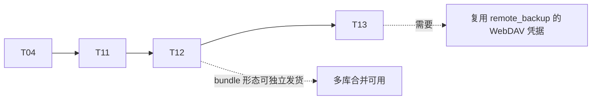
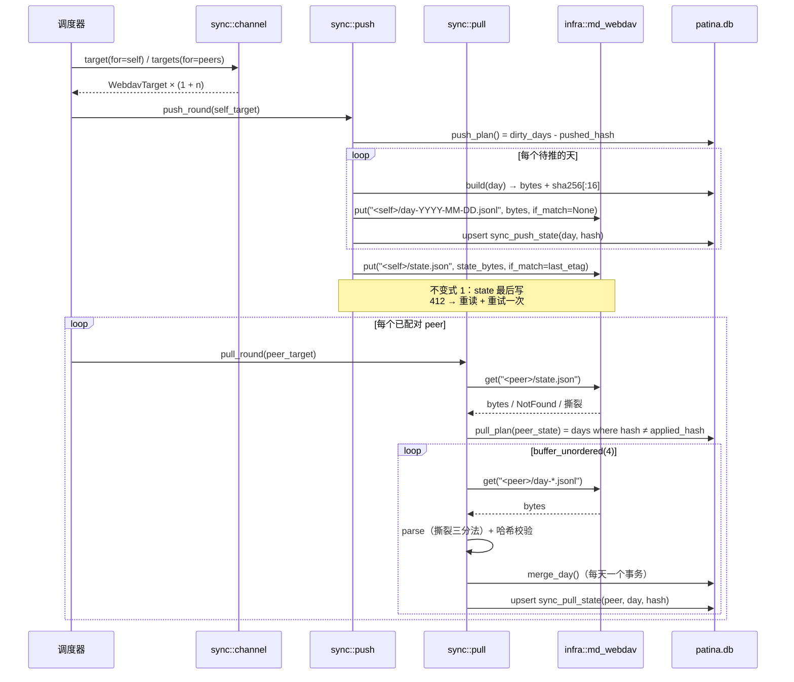

# P4 跨设备同步协议

## 0. 一句话 + 这份文档的边界

**每台设备只写自己目录下的「按天最终状态」分片，读对端的分片按 `uid` 合并；对端靠人手动配对一次 12 位设备码引入；远端只增不删。**
传输只用仓库已有的 `infra/md_webdav`（GET / PUT / MKCOL 补建，**已带 `If-Match`**），不新建服务端、不需要 PROPFIND。

本文档只覆盖 P4（T11–T13）。P1–P3 的内容在主文档，**本文不改那三阶段的任何一条**。

> 主文档 §4-A 里有两处需要按本文修正（已同步回主文档）：
> 1. 「现有 WebDAV 客户端缺条件写（`If-Match`）」——**错**。`infra/md_webdav/mod.rs::put()` 的签名就是
>    `put(target, rel, bytes, if_match: Option<&str>)`，条件写早就有了。
> 2. 「`sessions` 需要墓碑列 `deleted_at_ms`」——**改**。见 §8：墓碑走独立表 `sync_tombstone`，
>    `sessions` 保持硬删除。理由是不动读模型触发器、不动几十条 `FROM sessions` 查询。

---

## 1. 远端布局与两条不变式

```
<用户配置的 WebDAV base_path>/          ← 复用 remote_backup 的 url / username / 密码
└─ timing-sync/                          ← 独立子目录，与 md 同步、与备份快照都不共目录
   ├─ <install_id A>/
   │  ├─ state.json                     ← A 只写自己的；B 只读
   │  ├─ day-2026-11-13.jsonl
   │  └─ day-2026-11-14.jsonl
   └─ <install_id B>/
      ├─ state.json
      └─ day-2026-11-14.jsonl
```

**不变式 1（写序）**：`push` 一轮里，**先写完全部 day 分片，最后才写 `state.json`**。
于是「`state.json` 能解析」⇒「它列出的那些 day 分片已经上床」。读取方永远不需要考虑
「state 说有这一天，但文件还没传完」。

**不变式 2（单写者）**：`<install_id>/` 目录下的**每一个**文件都只有该设备写。
所以**两台设备同时 PUT 同一个 `state.json` 这件事不存在**。
`If-Match` 只用在一个地方：防止本机自己上一轮的 PUT 其实没落地（412 = 我对远端的认知过期了）。

**目录创建**：`WebdavTarget.base_path` 直接构造成 `"<用户根>/timing-sync/<install_id>"`。
`put()` 收到 409 会调 `dir::ensure_base_dir_err()` 逐级 MKCOL 后重试一次
（`MAX_LEVELS = 8`，`install_id` 是 12 位 hex，无编码问题、无 `..`）。
**所以「建子目录」这件事不需要新增任何能力**——这是选这套传输的最硬理由之一。

---

## 2. `state.json`：字段级 schema

```jsonc
{
  "schema": 1,                       // 文件格式版本。见 §2.3 的演进规则
  "installId": "a1b2c3d4e5f6",       // 12 位小写 hex，必须等于自己目录名
  "label": "台式机",                  // 用户可改，仅展示；空串合法
  "platform": "windows",             // windows | android | macos | linux
  "generatedAtMs": 1763107200123,    // 本文件生成时刻（本机时钟，只用于「对方多久没动」）
  "firstDay": "2026-03-02",          // days 里最小 / 最大 day_key，省得对端自己算
  "lastDay": "2026-11-14",
  "totalRows": 13375,                // 所有分片的行数之和（含墓碑行），仅用于展示与粗校验
  "days": {
    "2026-11-13": { "rows": 412, "bytes": 88213, "hash": "9f2c1e7d4b6a8c05" },
    "2026-11-14": { "rows": 96,  "bytes": 20477, "hash": "3a7d05c9e1b24f68" }
  }
}
```

### 2.1 字段语义必须写死的四条

1. **`days` 的键是本地日期 `YYYY-MM-DD`**（与 `activity_daily_totals.day_key`、`md` 的 `{date}.md`、
   `app_usage.local_date` 同口径）。**不是** UTC 日期，**不是**纪元日序号。
2. **`hash` = 该 day 分片文件字节的 SHA-256 取前 16 个 hex 字符**（64 bit）。
   `sha2` 已是依赖（`Cargo.toml`），不引入新 crate。
   为什么不用服务端 ETag：ETag 由服务端生成，**同一份内容重写后可能变**（部分实现带 mtime），
   会导致「内容没变却看起来变了」→ 每轮全量重拉。自算哈希与服务器无关。
   为什么不用 `crc32`：365 个文件里碰撞概率 32 bit 不够（生日界 7.7 万分之一量级）。
3. **`bytes` 与 `rows` 是给人看的粗校验**，程序判定只用 `hash`。
   （`rows` 还是「对端 366 行 vs 我 412 行」这类问题的第一条线索。）
4. **`days` 必须覆盖该设备全部有数据的天**，不是增量。
   `state.json` 的语义是「我这份数据长什么样」，不是「上次同步之后发生了什么」。
   增量状态在本地 `sync_pull_state` / `sync_push_state` 里，**不上床**。

### 2.2 对端设备列表从哪来

**不在 `state.json` 里。** 这是本设计刻意避开的坑：

- 若让 `state.json` 携带"我认识哪些设备"，两台设备同时写自己的 `state.json` 不会互相覆盖，
  但**相互认识的传递**永远是最终一致的、且有环——而 `install_id` 目录里没有"注册表"，
  谁也无法枚举 `timing-sync/` 下有哪些目录（**没有 PROPFIND**，见 `infra/md_webdav/mod.rs` 模块头：
  坚果云列举上限 750、不支持 infinity PROPFIND）。
- 所以对端列表**只在本地**：表 `sync_peer`（见 §5.4）。设备之间靠**人**引入一次。
- `state.json` 里的 `label` / `platform` 是**对端信息的唯一来源**：配对时读它回填 `sync_peer`，
  之后每轮 pull 顺手刷新（我方是只读方，不写对方的文件）。
  ⇒ 用户在 A 上改了自己设备的名字，B 下一轮就能看到。这是 `state.json` 存在的第二个理由。

### 2.3 版本号演进规则（写死，免得日后现场发明）

- `schema` 是**整数**，只在「旧读取方会解析错」时才 +1。
- 读取方规则：`schema > 本机支持的最大值` ⇒ **拒绝合并该 peer**，报「对方设备是更新版本」，
  并把该 peer 的 `last_error` 置为 `schema_too_new`（不无限重试，见 §4.4）。
- 新增**可选**字段（例如日后加 `tzOffsetMin`）**不升版本**：读取方忽略未知字段即可
  （`serde_json` 默认忽略未知字段，`deny_unknown_fields` 在同步结构体上**一律不许开**）。
- `day-*.jsonl` 的行也有自己的 `v`（见 §3），两者独立演进。

---

## 3. `day-YYYY-MM-DD.jsonl` 的行格式

### 3.1 两种行：状态行与墓碑行

**状态行**（`kind = "s"`，`sessions`）：

```jsonc
{"v":1,"kind":"s","uid":"s:a1b2c3d4e5f6:13375","deviceId":"a1b2c3d4e5f6",
 "appName":"Code","exeName":"Code.exe","appKey":"code.exe",
 "startMs":1763100000000,"endMs":1763100060000,"durationMs":60000,
 "continuityStartMs":1763100000000,"updatedAtMs":1763100060123}
```

**状态行**（`kind = "t"`，`time_records`）：

```jsonc
{"v":1,"kind":"t","uid":"t:a1b2c3d4e5f6:842","deviceId":"a1b2c3d4e5f6",
 "itemId":7,"startedAt":1763100000,"endedAt":1763101800,"accumulatedSec":1800,
 "status":"stopped","mode":"countup","targetSec":null,"updatedAtMs":1763101800456}
```

**墓碑行**：

```jsonc
{"v":1,"kind":"s","uid":"s:a1b2c3d4e5f6:13301","deletedAtMs":1763101200000}
```

判定规则：**有 `deletedAtMs` 就是墓碑，没有就是状态行**。不允许两者都有。

### 3.2 字段清单与三个"不许传"

| 字段 | 类型 | 说明 |
|---|---|---|
| `v` | int | 行格式版本，当前 `1`。未知 `v` 的行**跳过并计数**，不中断整个文件 |
| `kind` | `"s"` \| `"t"` | 表标识，与 `uid` 前缀一致（不一致 = 坏行，跳过） |
| `uid` | string | 权威身份。`s:`/`t:` + `device_id` + `:` + 本地自增 id |
| `deviceId` | string | 行归属。墓碑行**必须**带（删除时 `OLD.device_id`） |
| `appName` / `exeName` / `appKey` | string | `appKey` 是生成列的值，冗余携带，供对端**不重算**即可用（对端版本可能不认识新规则） |
| `startMs` / `endMs` / `durationMs` | int\|null | 毫秒。`endMs` 为 null = 未结束（活跃会话） |
| `continuityStartMs` | int\|null | 同设备连续段起点 |
| `updatedAtMs` | int | LWW 判据。**墓碑行没有它**，用 `deletedAtMs` |
| `deletedAtMs` | int | 仅墓碑行 |
| `itemId` / `startedAt` / `endedAt` / `accumulatedSec` / `status` / `mode` / `targetSec` | — | 仅 `kind="t"` |

**三条"不许传"**（写进 schema 注释，不是建议）：

1. **`windowTitle` 不传**（方案书 §7.1 / §7.5 的既定结论）。手机端本来就拿不到；
   PC 的标题是"你开过哪些文档"，出机器没有任何收益。
   ⇒ 分片里没有这个键，对端合并时**不覆盖**本地已有的 `window_title`（见 §6.2 的字段白名单）。
2. **派生表不传**：`activity_hourly_effective` / `activity_daily_totals` / `recorded_app_catalog`
   / `session_title_samples` / `web_activity_segments`。对端靠自己的触发器重算。
3. **`synced_*` / 本地簿记不传**：`sync_pull_state` / `sync_push_state` / `sync_peer` 是本地状态。

#### 3.2.1 `kind="t"` 的位置已留好，本轮**不产出**（已裁决，别当漏做）

主人裁决（2026-11-14）：**本轮只产 `kind="s"`**，`time_records` 暂不进分片。原因不是格式问题，
是 `item_id` 悬空——`items` 不在同步范围内，跨设备的 `items.id` **完全不在同一个域**，
对端收到 `itemId=7` 会指到另一件事（或不存在）。把它做成"未知事项"是在界面上嵌一个永久的错。

但它**不是没做，是关着**，痕迹必须留两处：

- **文档**：本节就是痕迹。`kind="t"` 的行格式（§3.1 第二段）、`uid` 前缀 `t:`、业务库 `0010`
  的 `time_records.updated_at_ms` + 触发器，T11 全部照建。**schema 已到位，日后打开不动库。**
- **代码**：T12 的 `dayfile.rs` 里留一个常量并在注释里写死：
  ```rust
  /// 本轮只产状态行 kind="s"。kind="t"（time_records）的位已留好：
  /// 打开只需把这里改成 true，不需要任何迁移（列/触发器/uid 前缀都在 0010 + 0029 里）。
  /// 前置条件：先做 items 同步 —— 否则 itemId 跨设备悬空（见 P4 文档 §3.2.1）。
  const INCLUDE_TIME_RECORDS: bool = false;
  ```
  合并侧（`merge.rs`）用**同一个常量**判：常量 `false` 时，遇到 `kind="t"` 的行
  **跳过并计入 `MergeStats.skipped_t`**，不写 `time_records`、**不算坏行**（不中断文件、
  不报错、不 panic）。但该天的 `sync_pull_state.applied_hash` **照常写入**——
  跳过是确定性策略，不是损坏；不写 hash 会让这一天**每轮都被重拉重跳**，等于把
  §4.4 的"有界重试"变成无限重试。
  常量 `true` 时同一份代码走合并分支，**没有第二处开关**。

> 留这两处痕迹的唯一目的：半年后有人看到 `dayfile.rs` 里有个 `false` 常量不会以为是漏做，
> 也不会去新写一个迁移。**导入侧必须与导出侧同源**，否则会出现"我不产 't'、但我把对端的 't'
> 写进了没有 items 的库"这种单向不对称。

### 3.3 编码与逐字节稳定的三条规则

| 项 | 规定 |
|---|---|
| 字符编码 | UTF-8，**无 BOM** |
| 换行 | 行尾一律 `\n`（LF），**最后一行也有 `\n`**，文件结尾**不额外加空行** |
| 行内容 | 单行 JSON，**不缩进、不换行**（`serde_json::to_string`，不是 `to_string_pretty`） |
| 键序 | **结构体字段声明顺序**（serde 按声明序输出；**不允许**用 `serde_json::Value`/`HashMap` 拼行，那会退化成 BTree 或随机序） |
| 数字 | 全部整数。**分片里禁止出现浮点**（`1.0` vs `1` 的序列化不唯一，会让"逐字节相同"失效） |
| 行序 | 按 **`uid` 的字节序升序**（`u8` 字典序，不是本地化 collation）。墓碑与状态行混排，同序 |
| 空文件 | **不写空文件**。某天没有任何行 ⇒ 该天不出现在 `days` 里，也不上传 |

**逐字节稳定吗？** 是。同一份数据库、同一段代码、连续导出两次 ⇒ 两个文件**逐字节相同**。
依据是上面五条：键序固定、无浮点、行序固定、无时间戳类字段（`generatedAtMs` 只在 `state.json` 里，
不在分片行里）。这是 T12「重放同一 bundle 第二次零变更」可以做**字节级**断言的前提。

### 3.4 为什么是 JSONL，不是 CSV，也不是直接传 SQLite 文件

三者都能用，逐个说清为什么不选：

**CSV 不行（三个硬伤）**
1. **转义**：`app_name` / `display_app_name` 是任意字符串（中文、逗号、引号、Windows 上还有换行）。
   CSV 要靠引号+双写引号逃生，而"我们这边按 RFC 4180 转义、对端按别的实现解析"这类不一致
   在跨版本时几乎必然发生——一行的错位会让**整份文件**的列对齐全错，且没有报错。
2. **无 schema**：加字段要读表头推断，而表头是自由文本；JSONL 的未知键天然可忽略。
3. **数值精度**：毫秒时间戳是 13 位整数（> 2^32），CSV 里是文本；一旦有人用 Excel 打开保存，
   会被转成科学计数法或丢精度。而我们的验收要求是**整数逐位相等**。

**直接传 SQLite 文件不行（四个硬伤）**
1. **合并语义冲突**：传库 = 整库覆盖，而我们要的是「按 `uid` 合并、字段级 LWW」。
   用 SQLite 做合并等于要求对端 `ATTACH` 后写合并 SQL——那实际上是把协议实现塞进 SQL 里，
   两端版本一漂就崩。
2. **schema 版本不一致**：对端可能是旧版（没有 `device_id`）或新版（多两列）。
   二进制表结构不同 → 必须现场迁移 → 迁移代码要在"读对端文件"这条路径上跑，风险极高。
3. **不可续/不可局部**：一个 100MB 的库文件，PUT 到一半断了就整份重来；按天分片断一天重一天。
4. **不可人工检查**：用户网盘里出现一个 `.db` 既不能看也不敢删；`.jsonl` 用记事本就能确认
   "这里确实是我 11 月 13 日的数据"。

**JSONL 的理由**：一行一条 ⇒ 坏一行只影响一行（可跳过、可计数、可报位置）；
流式读写 ⇒ 内存与行数无关；纯文本 ⇒ 可 diff、可人工核对、可被 `grep`；
`serde_json` 已是依赖，零新增。

---

## 4. 撕裂读：怎么判断、怎么补、会不会永久跳过

PUT 不是原子的。对端可能在 `PUT` 进行中读到半个文件。**分两种，判据不同**（这是 JSONL 相对
二进制格式的核心优势：行是有边界的）。

### 4.1 三分法

| 现象 | 判据 | 结论 | 处置 |
|---|---|---|---|
| **尾行截断** | 逐行 `split('\n')` 后，**最后一段非空且不是合法 JSON**，或者文件**不以 `\n` 结尾** | 撕裂读（对方正在写） | 等 2s，**重试一次** |
| **中间行损坏** | 某个**非末行**解析失败，但其后的行能解析 | 真损坏（网盘服务端问题 / 磁盘位翻转） | 重试一次；仍坏 ⇒ 记 `corrupt`，**不标记已应用**，报给用户 |
| **哈希不符** | 下载字节的 SHA-256 前 16 位 ≠ `state.json.days[day].hash` | 内容不完整或对方算错 | 同上：重试一次 ⇒ 记 `mismatch` |

三条都**不写 `sync_pull_state`**。这是"不永久跳过"的关键：见 §4.3。

### 4.2 `state.json` 自己也可能是半个

`state.json` 更小（~25KB），但仍可能撕裂。规则：

- 解析失败 ⇒ 等 2s 重试一次 ⇒ 仍失败 ⇒ **本轮整体跳过**（不推、不拉、不更新任何 watermark），
  记 `sync_peer.last_error = "state_unreadable"`，下一轮再来。
- 因为**不变式 1**（day 先写、state 后写），`state.json` 可解析就意味着它列出的分片都在。

### 4.3 补的机制：由「摘要比对」驱动，不是由「游标」驱动

拉取计划是**每次都重新算的**（§7.2）：

```
need(day) = state.days[day].hash != sync_pull_state[peer][day].applied_hash
```

- 某天失败了 ⇒ `sync_pull_state` 里那天的 `applied_hash` **保持旧值**（或不存在）
  ⇒ 下一轮 `need()` 依然为真 ⇒ **自动重拉**。不需要额外的"待重试队列"。
- 也因此**不存在"跳过一轮就永久丢"**：跳过只影响本轮，下一轮从摘要重新推导。

### 4.4 会不会永远停在"永远跳过"

只有一种情况会：**对端文件真的坏了且不会自愈**（`corrupt` / `mismatch` 反复出现）。
处置是**有界重试 + 显式报错**，不是静默：

- `sync_peer` 加两列 `failed_day` + `failed_attempts`；
- 同一天连续失败 ≥ 5 次 ⇒ 停止重试该天（其它天照常），`last_error = "peer_day_corrupt:<day>"`，
  界面显示一条可点的提示：「`台式机` 的 2026-11-13 数据校验不过（已重试 5 次），
  [忽略这一天] / [再试一次]」；
- 用户点「再试一次」⇒ `failed_attempts` 归零。
- **永不自动丢弃**——这符合「一段过期未同步的会话不可重造」（方案书 §7.3）。

---

## 5. 配对状态机

### 5.1 我的码在哪看

设置 → 数据 → 设备与同步（Patina 设置页新面板）：

```
本机设备码      A1B2-C3D4-E5F6      [复制]
本机名称        台式机              [改]
平台            Windows
                在另一台设备上输入这串码即可建立同步（只输一次，双向生效）
```

- 展示形态是 `XXXX-XXXX-XXXX`（3 组 4 位，大写）；**存储与传输一律小写无连字符**
  （`devices.install_id` 的口径，主文档 §6.1）。输入框自动去连字符、转小写、校验 12 位 hex。
- 码的来源就是 `devices` 表里 `is_self = 1` 那一行的 `install_id`（主文档已定：本机身份落在
  `<app_config_dir>/install_id.txt`，`devices` 是花名册）。

### 5.2 输入对端码后怎么验证

一次只读探测，**不写对端任何东西**：

```
GET <base>/timing-sync/<peer_id>/state.json
```

| 结果 | 判定 | 用户文案（要点：说清"错在哪一层"） |
|---|---|---|
| `WebdavError::NotFound` | 码格式对，但该目录下从来没有文件 | 「这个设备码在云端还没有数据——对方需要先完成一次同步。请让对端点一次『立即同步』再来配对。」 |
| `WebdavError::Auth` / `Forbidden` | 凭据或目录权限 | 「WebDAV 账号或应用密码不对，或这个目录没有写权限」（**复用现有同步配置的凭据**，所以这里要提示"在『备份』里填的那套"） |
| `WebdavError::Network(_)` / `Timeout` | 连不上 | 原文 + 建议检查网络（`redact()` 已洗过 URL） |
| `Server(4xx/5xx)` | 服务端异常 | 「服务端返回 {code}」 |
| 解析失败 / `schema` 过新 | 版本不兼容 | 「对方是更新版本的 Timing（文件格式 v{schema}），本机最高支持 v1」 |
| 12 位格式不对 **或等于自己的码** | 本地校验，不发请求 | 「设备码是 12 位字母和数字」/「这是本机自己的设备码」 |

成功 ⇒ 从对端 `state.json` 读 `label` / `platform` / `installId` 回填，写 `sync_peer`。

### 5.3 配对成功写在哪

表 `sync_peer`（§5.4）。**不写 `settings` KV**：它是结构化多行数据，
且有 `UNIQUE` 与"每 peer 一行"的语义，KV 里塞 JSON 会让"按 peer 更新 last_error"变成读改写。

### 5.4 活动库 `version 29` 里的簿记表（DDL）

```sql
CREATE TABLE IF NOT EXISTS sync_peer (
  peer_id        TEXT    PRIMARY KEY CHECK(length(peer_id) = 12),
  label          TEXT    NOT NULL DEFAULT '',
  platform       TEXT    NOT NULL DEFAULT '',
  paired_at_ms   INTEGER NOT NULL,
  last_seen_ms   INTEGER,
  last_pull_ms   INTEGER,
  last_push_ms   INTEGER,
  failed_day     TEXT,
  failed_attempts INTEGER NOT NULL DEFAULT 0,
  last_error     TEXT
);

-- 「对端的哪一天，我按哪个内容哈希应用过一次」——拉取计划的唯一判据
CREATE TABLE IF NOT EXISTS sync_pull_state (
  peer_id       TEXT NOT NULL,
  day_key       TEXT NOT NULL,
  applied_hash  TEXT NOT NULL,
  applied_at_ms INTEGER NOT NULL,
  rows          INTEGER NOT NULL,
  PRIMARY KEY (peer_id, day_key)
);

-- 「我的哪一天，我以哪个哈希推上去过」——推送计划的唯一判据
CREATE TABLE IF NOT EXISTS sync_push_state (
  day_key      TEXT PRIMARY KEY,
  pushed_hash  TEXT NOT NULL,
  pushed_at_ms INTEGER NOT NULL,
  bytes        INTEGER NOT NULL
);

-- 通道开关与远端子目录（url/user/password 复用 remote_backup 那一套，不重复存）
CREATE TABLE IF NOT EXISTS sync_channel (
  id            INTEGER PRIMARY KEY CHECK (id = 1),
  enabled       INTEGER NOT NULL DEFAULT 0 CHECK (enabled IN (0,1)),
  remote_dir    TEXT    NOT NULL DEFAULT '',   -- 空 = "<backup.remote_dir>/timing-sync"
  last_round_ms INTEGER,
  last_error    TEXT
);
```

**凭据与地址复用 `remote_backup_settings`**（`StoredConfig{url, username, remote_dir}` + DPAPI 密码）：
用户只配一次 WebDAV，否则必然有一套填错。`sync_channel.remote_dir` 是**覆盖项**，
空则取 `<backup.remote_dir>/timing-sync`。
副作用要在界面上说清：「关闭备份不影响同步；但**删除备份配置会让同步不可用**」。

> 凭据层 `infra::insight::credentials` 是 **Windows DPAPI**，非 Windows 上直接返回错误
> （`#[cfg(not(target_os = "windows"))]` 是 stub）。所以 **P4 只在 Windows 桌面上可用**，
> 这与"手机只采集、PC 做聚合与同步"的分工一致，不需要额外处理。

### 5.5 解绑的语义

- **只删本地**：`DELETE FROM sync_peer WHERE peer_id=?`（级联删 `sync_pull_state` 的同 peer 行）。
- **不删远端任何东西**，**不回删已合并的行**。
  红线出处是 `src-tauri/src/infra/md_webdav/dir.rs` 的模块头（「失败不回滚、不删远端任何东西
  …… 远端 `DELETE` 是不可撤销的破坏性动作」）与 `remove.rs`（"往期真删"的那个 DELETE 要单独走）。
  > 订正主文档与任务书的一处引用：这条红线**不在 ADR-062 正文里**。ADR-062 讲的是
  > 「MKCOL 内建 + 数据根可配指针」。红线原文在 `dir.rs` 模块头与 `remove.rs` 的注释。
- 解绑后对端仍会出现在「远端有数据」的层面上，但我们不再读它。
  重新配对是幂等的（同一个码再配一次 = UPDATE `sync_peer`）。
- **不做「撤销已合并数据」**：那是数据删除，走 P2 已有的删除路径，不归同步管。

### 5.6 状态机（写死，免得实现时发明中间态）

```
                 ┌──────────────┐
  用户输入 12 位码 │  Validating  │  GET <peer>/state.json
                 └──────┬───────┘
        NotFound ───────┼──────── 成功
        /坏格式/网络错    │          │
             ▼          │          ▼
        ┌─────────┐     │     ┌─────────┐  一轮成功
        │  Error  │     │     │ Paired  │◄──────────┐
        │(不改库)  │     │     └────┬────┘           │
        └─────────┘     │          │ 用户点解绑        │
                        │          ▼                │
                        │     ┌─────────┐           │
                        └────►│ Unpaired│───────────┘（重新配对）
                              └─────────┘
```
`Error` 状态**不落库**（`sync_peer` 只有配对成功才有一行），只在界面停留一条文案。
`Paired` 之后所有失败都写在 `sync_peer.last_error` 上，**不改状态**（不会因为网络断了就"解除配对"）。

---

## 6. 与现有 md 同步 / 备份的关系

### 6.1 分三层看

| 层 | 现有资产 | P4 怎么用 |
|---|---|---|
| **传输** | `infra/md_webdav`：`get` / `put(…, if_match)` / `delete_file` / `ensure_base_dir` / `probe`、`WebdavError` 七类、409 自动 MKCOL、`redact()` 洗日志 | **直接复用，一行不改**。`WebdavTarget::new(base_url, "<root>/timing-sync/<id>", user, password)` |
| **凭据与配置** | `services/insight/data/remote_backup_config.rs` + `repositories/remote_backup_settings`（DPAPI） | **复用 url/username/password**；`remote_dir` 由 `sync_channel.remote_dir` 覆盖 |
| **业务编排** | `services/md_cloud/**`（md 专用的 `MdSyncConfig` + `SyncPlan` + `PurgeChannel`） | **不复用**。它是 md 文件语义（文件优先、区块、purge 频道），与活动数据的 LWW 语义冲突 |

### 6.2 为什么不复用 `services/md_cloud`

`md_cloud` 的每一个抽象都绑着 md：`MdSyncConfig`、`SyncPlan{tier, saf}`、
`PurgeChannel::{Timed, Manual}`（删远端 md 的通道）、`round_folder` / `round_webdav` 的"文件优先"。
硬塞活动数据会得到两个语义互相污染的分支，而 `md_cloud` 本身是"文件优先于库"（ADR-042）——
**与 LWW 正好相反**。

反过来，**传输层复用**是零成本且必须复用的：`md_webdav` 已经解决了 TLS（webpki-roots 常量根）、
重定向（MKCOL 走 `redirect(none)`，因为 reqwest 会把 301 改成 GET）、409 补建、密码不落日志
（手写 `Debug` 抹掉 password）、坚果云 750 条限制（不发 PROPFIND）。

### 6.3 目录关系

```
<basePath>/                     ← 用户配的 WebDAV 根（例如 我的坚果云/应用/Timing）
├─ {date}.md                    ← md 同步（md_cloud，用户可改）
├─ backups/…                    ← 备份快照（remote_backup）
└─ timing-sync/<install_id>/…   ← 本轮新增，独立子目录，绝不与上面两者混
```

**不共目录**的理由：md 同步会**删/重写** `{date}.md` 与 `purge` 远端文件；备份有自己的保留策略；
把只增不删的同步分片混进去，任何一次误清空都会连带毁掉不可重造的活动事实。

### 6.4 vendored 登记状态（改之前要看）

| 文件 | 在 vendored 基线内？ | 结论 |
|---|---|---|
| `src-tauri/src/infra/md_webdav/**` | **否**（host infra，基线只管 `infra/insight/`） | 若需新增能力（本设计**不需要**），改它无需登记，但要过 `check:size` |
| `src-tauri/src/services/md_cloud/**` | **否** | 同上 |
| `src-tauri/src/infra/insight/webdav.rs` | **是**（940 行，冻结） | **不改**。P4 不用它（它只有 `WebDavClient` 的文本快照方法，且面向备份） |
| `src-tauri/src/services/insight/data/sync/**`（新增） | 新增文件 | 每条 `change:"added"` 登记，一条一个 `reason` |
| `src-tauri/src/services/insight/data/sql/0029_*.sql` | 新增文件 | 同上（`check:vendored` **不过滤扩展名**） |
| `src-tauri/src/commands/insight/sync_cmd.rs`（新增） | 新增文件 | 同上 |
| `src-windows/patina/features/settings/**`（改） | **是** | `change:"modified"` 逐条登记（≤10 条走 allowlist，不重锚） |

---

## 7. 首次同步与全量的代价

### 7.1 数字

按现网口径（`sessions` 13375 行 ≈ 一年 365 天、`activity_hourly_effective` 1924 行、
一天 200–900 条会话）：

| 量 | 值 | 依据 |
|---|---|---|
| 一天的 `day-*.jsonl` | **20–90 KB** | 每行 ~200 字节 × 96–412 行 |
| 一台设备一年 | **≈ 32 MB**（365 个文件 + 1 个 state.json） | 取中位 88 KB/天 |
| `state.json` | **≈ 25 KB**（365 个 day 条目 × 65 字节） | |
| 首次配对拉取 | **365 次 GET**（对端有多少天就拉多少） | `state.days.len()` |
| 之后每轮 | **1–2 次 GET**（今天 + 偶发的历史修正） | 摘要比对 |
| 每轮推送 | **1–2 次 PUT**（今天 + 变化的历史天）+ 1 次 PUT state.json | |

### 7.2 只看"对端有而本地没有"的天

```
pull_plan = [d for d in peer.state.days if peer.state.days[d].hash != local.applied_hash(peer, d)]
push_plan = [d for d in local_dirty_days() if local_hash(d) != local.pushed_hash(d)]
```
- `local_dirty_days()` = `SELECT DISTINCT local_day_key(updated_at_ms) FROM sessions WHERE …`
  ∪ `sync_tombstone` 的 `deleted_at_ms` 天 ∪ `time_records.updated_at_ms` 天。
- 因为 `state.days` 是**全量**的，所以"对端有而本地没有"是集合差集，**不需要游标**。
- `applied_hash` 存在 `sync_pull_state`：同一份内容重复拉取（比如对端重推）**不会重新合并**
  ——这是"重放零变更"的另一层保证。

### 7.3 首次 365 次 GET 可接受吗？——可接受，理由有三

1. **一次性**。配对是终身动作（设备不换就不重配）。
2. **可并发**。`futures_util::stream::iter().buffer_unordered(4)`（`futures-util` 已是依赖）。
   365 次 × 150ms ÷ 4 ≈ **14 秒**。加 2 次重试预算，最坏 60 秒。
3. **可见**。首轮显示进度（「正在从 `台式机` 取 365 天数据… 143/365」），
   而不是一个转圈。

### 7.4 要不要按周/月/年合片？——**不做**，并给日后触发条件

不做，因为**写放大才是常态成本**：

| 方案 | 日常写 | 首次读 | 结论 |
|---|---|---|---|
| 按天分片（本设计） | 1 个文件（~88KB） | 365 次 GET | 每天的成本 = 1 个文件 |
| 按周合片 | 1 个文件（~616KB） | 52 次 GET | 每天重写整周 → **写放大 7×**，而"今天一直在变"是每天必发生的事 |
| 按月合片 | 1 个文件（~2.6MB） | 12 次 GET | 写放大 30×；坚果云对大文件 PUT 的失败率也更高 |

分片还同时承担**幂等键**（`days[day].hash`）与**断点**（一天失败只影响一天）两个角色，
合片会把两个角色一起做粗。

**日后要改的触发条件（写死，别再现场议）**：满足任一条就重新评估年片
（`year-YYYY.jsonl`，跨年后写一次不再变，作为**只读加速通道**，不替代按天）：
- 单 peer 的 `state.days.len() > 1500`（约 4 年）；
- 首次同步实测 > 90 秒；
- `state.json` 单文件 > 256 KB。

即使那时，**push 仍写按天分片**（写放大不变），年片只是给首次配对读的镜像。

### 7.5 单轮上限：`pull` 每轮最多 **400** 个 day 文件（已裁决）

```
本轮处理的 days = pull_plan[.. min(400, len)]      // 按 day_key 升序取，先补最老的
剩余           = len - 本轮处理数
```

- **超出时不是报错，是分轮**：本轮跑完 `cmd_sync_run` 即返回成功，`sync_peer.pending_days = 剩余数`，
  设置页显示「还有 X 天待同步」。下一轮（10 分钟后）接着拉。
  首次配对 365 天 < 400 ⇒ **正常情况一次就完**，这个闸只对"换了新机器 + 3 年历史"或"两个 peer 同时首连"
  生效。
- **为什么不只是内存**：365 天 ≈ 32 MB 本来也不吃内存（流式解析，一天一个事务，见 S7）。
  真正的理由是**服务端限流**：**坚果云**对短时间内的请求数有速率限制，而客户端收到的表现是
  **HTTP 429 / 503 / 连接被重置**，落到我们的 `WebdavError` 里就是网络类失败 ⇒ 整数轮退避 ⇒
  用户看到"同步一半失败"，而**这个失败他无法自诊**（网盘后台日志里也只是一个数字）。
  单轮 400 次 GET ÷ 4 并发 ≈ 100 个请求批次，仍在安全区；一次打 1500 天的量就进危险区。
- **闸的位置写死**：在 `pull.rs::pull_round()` 的入口对 `pull_plan` 截断，**不在 `plan.rs`**。
  `plan.rs` 永远返回全量差集（它同时供 UI 显示"还有 X 天"用）。
- **`push` 不加闸**：脏天数是**本地产生**的（只可能有"今天"+ 少量历史修正），造不出 400 天；
  给它加闸会让"换机后首次上传"莫名其妙地要跑几天。

---

## 8. 删除与保留期

### 8.1 关键决定：墓碑走独立表，`sessions` 保持硬删除

主文档 §4-A 原写「`sessions` 加 `deleted_at_ms`」，本文改成 **`sync_tombstone` 表**。理由：

1. **软删除会污染读路径**：`sessions` 有几十条 `FROM sessions` 查询（`hourly.rs` 的
   `FACT_CANDIDATES_SQL`、`sessions/read.rs`、`web_activity.rs` 的关联、`tools/read.rs`…），
   加一列就得在**每一处**补 `deleted_at_ms IS NULL`，漏一处 = 已删的数据继续算进时长。
   而"漏一处"没有任何报错。
2. **软删除会破坏读模型触发器**：`trg_read_model_sessions_delete` 只在真 DELETE 时触发；
   软删除后它永不触发 ⇒ 脏区间不标 ⇒ 小时/日投影里删掉的数据**永久留着**。
   要修就得再写一套"软删除当删除"的触发器，等于把已有 9 个触发器再复制一遍（裁决 C 刚收掉的那种结构重复）。
3. **墓碑天然是同步概念，不是数据模型概念**：它只被同步读，不被任何业务查询读。
   放独立表 = 零影响面。

### 8.2 墓碑 DDL 与写入

```sql
CREATE TABLE IF NOT EXISTS sync_tombstone (
  uid           TEXT    PRIMARY KEY,
  kind          TEXT    NOT NULL CHECK (kind IN ('s','t')),
  device_id     TEXT    NOT NULL,
  deleted_at_ms INTEGER NOT NULL
);
CREATE INDEX IF NOT EXISTS idx_sync_tombstone_time ON sync_tombstone(deleted_at_ms);
-- 触发器的正文在 §8.2.1（必须先看那一节，朴素版会出无限重推）。
-- time_records 同型（kind='t'）。
```

- **墓碑进哪一天的分片**：按 `deleted_at_ms` 的**本地日**。
- 所以分片的语义统一为：**「按最后变更日切片的最终状态」**——
  该天 `updated_at_ms` 落在这天的行（状态行）+ 该天 `deleted_at_ms` 落在这天的墓碑。
  一条跨天会话（23:50 开始、00:10 结束）只在**结束那天**的分片里出现一次，接收方拿到的是整行。

### 8.2.1 应用对端墓碑：**继承，不重发**（这条不写死会出无限重推）

朴素做法（收到墓碑 → 本地 `DELETE` → 本地 AFTER DELETE 触发器造一个新墓碑）会出事：

- 新墓碑的 `deleted_at_ms` 是**本机的 now**，不是对端那个值；
- 于是这条墓碑换了天、换了时间戳，本机的 `day-*.jsonl` 内容每轮都在变；
- 三台设备链式（A→B→C）时，每一跳都刷新一次时间戳 ⇒ **day 文件永远不稳定，无限重推**，
  且 `sync_pull_state.applied_hash` 永远对不上，每轮都全量合并。

所以钉死规则：**对端墓碑原样灌入，本地硬删时不产生新墓碑。**

```sql
-- 抑制表：合并期间把"本条 uid 的删除不是本地发起的"告诉触发器
CREATE TABLE IF NOT EXISTS sync_suppress (
  uid TEXT PRIMARY KEY
);

CREATE TRIGGER IF NOT EXISTS trg_sessions_tombstone AFTER DELETE ON sessions
WHEN OLD.uid IS NOT NULL
 AND NOT EXISTS (SELECT 1 FROM sync_suppress WHERE uid = OLD.uid)   -- ← 关键一行
BEGIN
  INSERT INTO sync_tombstone(uid, kind, device_id, deleted_at_ms)
  VALUES (OLD.uid, 's', OLD.device_id,
          MAX(CAST(strftime('%s','now') AS INTEGER) * 1000, COALESCE(OLD.updated_at_ms, 0) + 1))
  ON CONFLICT(uid) DO UPDATE SET deleted_at_ms = excluded.deleted_at_ms;
END;
```

`merge::apply_tombstone(uid, kind, device_id, deleted_at_ms)` 的三步（**同一事务**）：

```sql
INSERT INTO sync_suppress(uid) VALUES (?1);
INSERT INTO sync_tombstone(uid, kind, device_id, deleted_at_ms)
VALUES (?1, ?2, ?3, ?4)                                   -- ← 对端的原值，一个字不改
ON CONFLICT(uid) DO UPDATE SET deleted_at_ms = MAX(sync_tombstone.deleted_at_ms, excluded.deleted_at_ms);
DELETE FROM sessions WHERE uid = ?1;                       -- 触发器看到 sync_suppress，跳过
DELETE FROM sync_suppress WHERE uid = ?1;                  -- 必须清，否则下次本地删除不记墓碑
```

**收敛性**：B 灌入的墓碑与 A 的**逐字节相同**（同样的 `uid` / `kind` / `device_id` / `deleted_at_ms`），
于是 B 的该天分片在下一轮**稳定**（不再变），C 拿到的也与 A 相同。
⇒ 链式传播**只多一轮**，不是无限。这条必须有用例钉住（T12 验收 10）。

> 注意 `DELETE FROM sync_suppress` 必须在**同一事务**内、且**必然执行**（哪怕 `DELETE FROM sessions`
> 影响 0 行）。漏了它，本机日后真的删同一 uid 时不会记墓碑 ⇒ 第三台设备上那条永不消失。

- 远端收到墓碑 ⇒ 本地按 `uid` 硬删除（同样会经过上面的抑制路径），
  于是墓碑继续向第三台设备传播——**传播是传递闭包，不需要中央节点**。

### 8.3 墓碑保留多久：**永久**（已裁决，前提见下）

**前提（这一节的存在理由，改它之前先读）**：墓碑的字段集合是**封闭的四个**——
`uid` / `kind` / `device_id` / `deleted_at_ms`。它**不含**标题、不含窗口名、不含应用名、
不含时长、不含任何能反推出"用户在做什么"的字段。"永久"之所以可接受，**完全建立在这一点上**：
网盘里留一堆"某台机器在某个时刻少了一条 id 为 13375 的会话"，隐私代价接近于零。

> ⚠️ **硬约束**：将来任何人想往 `sync_tombstone` **加任何内容字段**（哪怕是 `app_name`、
> 哪怕是"方便调试"），都必须**先重新评估保留期**（改成 90 天过期 + 全量校验），
> 不能直接加列。这是一次产品裁决，不是一次迁移。T11 的 `sync_tombstone` DDL 里
> 把这句话写成表注释。

- 体积：删除率通常 < 1%，13375 行里墓碑 < 140 行 × ~120 字节 ≈ 17 KB/年。可忽略。
- 若设 400 天过期：离线超过 400 天的设备重新上线时，删掉的行会**复活**（它的 `updated_at_ms`
  比墓碑新不了，但没有墓碑可对照 ⇒ 只能当"本地有、对端没提过"而保留）。
  这正是方案书 §7.3「活动数据不设 2 日窗口」的同一个理由：**删除也发生过**。

### 8.4 远端分片是否清理：**接受增长，一律不删**

- 32 MB/设备/年，在用户自己的网盘里；且这些文件**不可重造**。
- 按年归档需要「读 365 + 写 1 + 删 365」，其中"删 365"违反 §5.5 的红线，且不可撤销。
- 给用户的只有**手动**出口：「导出这一年（zip）」+ 提示「如需省空间，可在网盘端自行归档」。
  **我们不发 DELETE**。

---

## 9. 写入簿记：`updated_at_ms` 由触发器盖戳

同步的全部正确性压在「哪一天脏了」这一个判据上，所以它**不能依赖调用点记得写**。

```sql
-- 活动库（0029）：sessions
ALTER TABLE sessions ADD COLUMN updated_at_ms INTEGER NOT NULL DEFAULT 0;
UPDATE sessions SET updated_at_ms = COALESCE(end_time, start_time) WHERE updated_at_ms = 0;
CREATE INDEX IF NOT EXISTS idx_sessions_updated ON sessions(updated_at_ms);

CREATE TRIGGER IF NOT EXISTS trg_sessions_touch_insert AFTER INSERT ON sessions
BEGIN
  UPDATE sessions
     SET updated_at_ms = MAX(CAST(strftime('%s','now') AS INTEGER) * 1000, 1)
   WHERE id = NEW.id AND updated_at_ms = 0;
END;

CREATE TRIGGER IF NOT EXISTS trg_sessions_touch_update
AFTER UPDATE OF app_name, exe_name, window_title, start_time, end_time, duration ON sessions
BEGIN
  UPDATE sessions
     SET updated_at_ms = MAX(CAST(strftime('%s','now') AS INTEGER) * 1000,
                              COALESCE(OLD.updated_at_ms, 0) + 1)
   WHERE id = NEW.id;
END;
```

**为什么不会递归**：两个 touch 触发器只写 `updated_at_ms`，而 `trg_sessions_touch_update`
的 `AFTER UPDATE OF` 列表里**没有** `updated_at_ms` ⇒ 它的 UPDATE 不会再次触发自己。
（与现有 9 个脏区间触发器用的是同一个技巧，不是新发明。）

**为什么要 `MAX(now, OLD+1)`**：用户时钟可能被 NTP 回拨或手工改。
纯 `now` 会让"刚写的一行"看起来比旧行更旧 ⇒ LWW 判错 ⇒ **新数据被旧数据覆盖**。
`OLD+1` 保证同一行的时间戳**严格单调**。跨行不要求单调（不需要，见 §3.1 的 uid 归属论证）。

`time_records` 同型（业务库 `0010`，加列走 `infra/migrate.rs::ensure_column`）。

---

## 10. T11–T13 任务卡

> 格式：`Tn｜名称｜依赖｜涉及文件（确切路径）｜验收（跑什么、看什么数字）`
> 三条都**不碰** P1–P3 的任务卡。

---

**T11｜簿记层：`updated_at_ms` + 墓碑 + 同步表（两库）**
- 依赖：T04（P1 完成，`device_id`/`uid` 已稳定）
- 涉及文件：
  - `src-tauri/src/services/insight/data/sql/0029_sync_bookkeeping.sql`（**新建**：§5.4 四张表 + §8.2 墓碑表、`sync_suppress` 与 `AFTER DELETE` 触发器 + §9 的 touch 触发器；`sessions` 加列与回填）
  - `src-tauri/src/services/insight/data/schema_registry.rs`（追加 `version 29` 一条；该文件在 T01 已登记 `added`，**不再新增 vendored 条目**）
  - `src-tauri/src/services/insight/data/schema_core/ensure.rs`（守卫加 `updated_at_ms` / `sync_tombstone` 存在性）
  - `src-tauri/src/services/insight/data/sqlite_pool/current_schema.rs`（`has_current_schema` 的 `sessions` 必需列加 `updated_at_ms`）
  - `src-tauri/src/migrations/0010_v0141_sync_bookkeeping.sql`（**新建**：业务库 `time_records` 的索引 + touch 触发器 + 墓碑触发器）
  - `src-tauri/src/infra/migrate.rs`（`MIGRATE_COLUMNS_V10`：`time_records.updated_at_ms` + `UPDATE` 回填 + `run_raw(0010)`）
  - `src-tauri/src/services/insight/data/sync/mod.rs`（**新建**，此刻只有 `pub mod` 骨架 + `local_day_key()` 一个纯函数）
  - `src-tauri/src/services/insight/data/mod.rs`（加 `pub mod sync;` —— 35 行，**不撞棘轮**）
  - `scripts/vendored-allowlist.json`（`sync/mod.rs` 1 条 `added` + `0029_*.sql` 1 条 `added`）
- 验收：
  1. **升级**：`VACUUM INTO` 复制生产库 → 跑到 head 29 → `SELECT COUNT(*) FROM sessions WHERE updated_at_ms = 0` = **0**、`COUNT(*) FROM sessions` 仍 **13375**、`SELECT COUNT(*) FROM _sqlx_migrations WHERE version = 29` = **1**；
  2. **单调钳制**：把系统时钟回拨 1 小时后 UPDATE 一条会话 → `updated_at_ms` **严格大于**改前的值（用例：两次 UPDATE，断言 `t2 > t1` 且 `t2 >= 回拨后的 now`）；
  3. **touch 不递归**：`PRAGMA trigger_list` 里没有自指；一条 UPDATE 只产生 **1** 次 `updated_at_ms` 变更（用 `AFTER UPDATE` 计数器表或在用例里比对 `changes()`）；
  4. **墓碑**：硬删一条 `sessions` 行 → `sync_tombstone` 多 1 行且 `kind='s'`、`device_id` = 该行原值；再删同一个 uid（造场景）→ `ON CONFLICT` 只更新 `deleted_at_ms`，**不新增行**；
  5. **读模型不受影响**：删一条行后 `activity_summary_dirty_ranges` 有新增（说明原 DELETE 触发器仍在）+ 逐位相等基线（T04 的 `verify`）仍通过；
  6. `cargo +1.100.0 test --lib` passed 数 ≥ T04 记录 + 新增用例数。
- 棘轮/登记：`current_schema.rs`/`schema_registry.rs`/`ensure.rs` 均已在 T01/T02 登记为 `added`，改它们**不产生新差异**；新增 2 条 `added` 登记。
- **裁决已定（§11 #3 = 本轮只产 `kind="s"`），但本任务照建全部**：`time_records.updated_at_ms`
  与它的触发器**都要建**（成本 = 一次加列 + 两个触发器）。裁决只影响 `dayfile.rs` 是否产出
  `kind="t"` 的行——那是 T12 的一个常量（`INCLUDE_TIME_RECORDS = false`），
  **不是一次迁移**。这样日后打开这个开关不用再动 schema。
- **两条必须写进 SQL 注释的硬话**：
  - `sync_tombstone` 建表处：`-- 字段集合封闭：uid/kind/device_id/deleted_at_ms。禁止加任何内容字段（标题/窗口名/应用名）；要加必须先重评保留期（P4 文档 §8.3）。永久保留的前提就是这一行。`
  - `time_records` 触发器处：`-- 本轮不同步 time_records（items 未同步 ⇒ itemId 跨设备悬空）。列与触发器先建好，切开只差 T12 的一个常量（P4 文档 §3.2.1）。`

---

**T12｜合并内核 + bundle 导入导出（无网络端到端）**
- 依赖：T11
- 涉及文件：
  - `src-tauri/src/services/insight/data/sync/jsonl.rs`（**新建**，~240 行）：行模型（`#[derive(Serialize,Deserialize)]`，**禁用 `deny_unknown_fields`**）、`to_line()`、逐字节稳定序列化、`parse_line()` 的四种结果（Ok/UnknownVersion/Corrupt/Tombstone）
  - `src-tauri/src/services/insight/data/sync/dayfile.rs`（**新建**，~200 行）：`build(day_key) -> Vec<u8>`（查状态行 + 墓碑 → 排序 → 拼行 → sha256 前 16 位）、`parse(bytes) -> ParsedDayFile`、**撕裂三判据**（§4.1）
  - `src-tauri/src/services/insight/data/sync/merge.rs`（**新建**，~260 行）：`merge_day(pool, parsed) -> MergeStats`（按 uid upsert + 字段级 LWW；墓碑走 `apply_tombstone`）、**字段白名单**（不覆盖 `window_title`）
  - `src-tauri/src/services/insight/data/sync/plan.rs`（**新建**，~150 行）：`push_plan()` / `pull_plan(peer_state)`
  - `src-tauri/src/services/insight/data/sync/state.rs`（**新建**，~150 行）：`DeviceState` 模型 + `build()` + `parse()` + `schema` 判版
  - `src-tauri/src/services/insight/data/sync/bundle.rs`（**新建**，~200 行）：zip 读写，**条目 `modified` 时间固定 1980-01-01**（可复现）
  - `src-tauri/src/services/insight/data/sync/guard.rs`（**新建**，~90 行）：**源码级守卫用例**
    （`#[cfg(test)]`，见验收 11）——扫描 `sync/**` 与 `infra/md_webdav/**` 的源文本，
    断言不存在任何"列举远端"的调用。**gate 要先于危险代码存在**，所以放在 T12 而不是 T13。
  - `src-tauri/src/services/insight/data/repositories/sync_peer.rs`（**新建**，~180 行）
  - `src-tauri/src/services/insight/data/mod.rs`（`pub mod sync;` 已在 T11 加）
  - `src-tauri/src/commands/insight/sync_cmd.rs`（**新建**，~220 行）：`cmd_sync_status` / `cmd_sync_export_bundle` / `cmd_sync_import_bundle`（先只读三件）
  - `src-tauri/src/ipc_commands.rs`（`$extra` 段 +3 行）
  - `src/windows/patina/platform/persistence/syncGateway.ts`（**新建**，~80 行）
  - `scripts/vendored-allowlist.json`（8 条 `added`）
- 验收（**全部离线**，用两套临时库）：
  1. 造 A 库：3 天、共 500 行 `sessions`（其中 30 行跨天、5 行已删）+ 40 行 `time_records`；
     造 B 库：独立的 200 行；
  2. `export_bundle(A)` → `import_bundle(B)` ⇒
     `COUNT(sessions) B` 从 200 变 **700**（=200+500）、`SELECT COUNT(DISTINCT uid)` = `COUNT(*)`（**uid 无重复**）、
     `COUNT(*) FROM sync_tombstone` B = **5**；
  3. **重放零变更**：再 `import_bundle(B, 同一个 bundle)` ⇒
     所有行 `updated_at_ms` **不变**、`sync_tombstone.deleted_at_ms` 不变、`changes()` 三条合计 = **0**；
  4. **字节级可复现**：`export_bundle(A)` 连续两次 ⇒ 两个 zip 的 **SHA-256 相同**；
     单个 `day-*.jsonl` 连续两次导出 ⇒ **逐字节相同**（`cmp` 无输出）；
  5. **墓碑传播**：A 删的那 5 行在 B 里不存在（不是 `deleted_at`=null 的残留）；
  6. **不传 window_title**：`grep -c windowTitle` 对导出字节 = **0**；B 里原有行的 `window_title` **未被覆盖**；
  7. **版本拒绝**：把某个 `day` 文件的行 `v` 改成 9 → 合并时跳过并计数，不 panic、不中断，`MergeStats.skipped` 计数为 1；
  8. **撕裂**：把某个 `day` 文件最后一行截掉一半 → `parse` 判 `TornTail`（不是 `Corrupt`）；
     把中间某行改坏 → 判 `Corrupt`；两种都**不写 `sync_pull_state`**；
     **且必须继续走下一步**：把**补全后**的同一份 bytes 再喂一次 → 这次 `parse` 成功、
     该天真的被合并进库（`MergeStats.applied > 0`）、`applied_hash` 写入。
     ⇒ 断言的是"**截断一次之后，下轮一定能成功**"，不是"本轮跳过了"。
     （只断言"跳过了"是假绿：跳过可以实现成永久跳过，用例照样通过。）
  9. **墓碑链式只收敛一轮**：A 删一行（`deleted_at_ms = X`、`device_id = A`）→ 导出 → 导入 B ⇒
     B 的 `sync_tombstone` 那行 `deleted_at_ms == X` **且** `device_id == A`（**不是 B**、不是 now）；
     再导出 B 的该天 → 与 A 的该天**逐字节相同**（`cmp` 无输出）；
     再导入 C ⇒ C 的墓碑与 A **完全相同**；连续重放 A→B 三次 ⇒ B 的分片哈希**第一次之后再不变**
     （证明不会无限重推）；
  10. **抑制表必清**：`sync_suppress` 在任何一次 `apply_tombstone` 之后行数为 **0**；
      （造场景：先 apply 一个对端墓碑，再本地真删一个同 uid 的行 → 必须产生**新**墓碑）
  11. **【源码级】不存在任何"列举远端"的调用**（钉 S2，`guard.rs` 实现）：
      `std::fs` 递归遍历 `src/services/insight/data/sync/**` 与 `src/infra/md_webdav/**` 的
      **源文本**（跳过 `guard.rs` 自己，且断言跳过集合**恰好等于** `{guard.rs}`），
      先剔除注释行（`trim_start` 以 `//` 或 `//!` 或 `///` 开头），
      再断言剩余文本里 **0 次**出现下列任一 token：
      `PROPFIND` / `propfind` / `Method::from_bytes` / `"Depth"` / `depth: 1`。
      → 这不是"文档提醒"，是 `cargo test` 会红的**事实断言**。**为什么要它**：
      有人日后加"顺手列一下远端有哪些设备"的代码，CI 不会红、用户机器上会炸（坚果云 750 上限），
      而这种事故在开发者的网络环境下（A 盘、几百个文件）**根本复现不出来**。
      **例外边界（写进用例注释，别去"顺手修"）**：`src/infra/insight/webdav.rs:226` 那个
      `Depth: 0` 的 PROPFIND 是 `remote_backup` 的**单资源存在性探测**（Depth=0 不列举、
      不触碰 750 上限），**不在扫描范围内，也不许被这条用例牵连**。
  12. **每天一个事务**（钉 S7）：造 3 天 bundle，让第 2 天的合并**必然失败**
      （塞一行 `durationMs` 为 `TEXT` 的坏行越过解析、直接让 SQL 报类型/约束错，或者把第 2 天
      的目标列 `NOT NULL` 冲突造出来）→ 断言：
      **第 1 天与第 3 天的数据已经落库**（`COUNT(*)` 含两天的新行）、第 2 天**没有** `sync_pull_state` 行、
      `cmd_sync_import_bundle` 返回**错误码而非 panic**。
      → 如果实现成"整轮一个事务"，这条必红（回滚后一天也不剩）。
      **另加一条自查**：`MergeStats.transactions == MergeStats.days_applied`（防止有人把事务挪到外层，
      这不是主断言，主断言是上面那条行为）。
  13. **Zip Slip**（钉 S8）：手工造一个 zip，条目名分别为 `../evil.txt`、`/abs-evil.txt`、
      `state.json`、`day-2026-01-01.jsonl` → 调 `import_bundle`，断言：
      ① `state.json` 与合法 day 文件**正常解析并生效**（说明不是靠"整个拒收"蒙过去）；
      ② 解压目录**及其父目录**里不存在 `evil.txt`、`abs-evil.txt`（`Path::exists() == false`）；
      ③ 全盘找不到任何本次导入新写的文件（`bundle.rs` **不落盘**，条目只作内存流）。
      → 断言的是"文件系统上没有出现"，不是"代码里有白名单函数"。
  14. `cargo +1.100.0 test --lib` passed 数 ≥ T11 记录 + 新增用例数；`npm run check` 八步绿。
- 棘轮/登记：9 个新文件全部 ≤300 行（`jsonl.rs` 240 / `dayfile.rs` 200 / `merge.rs` 260 / `plan.rs` 150 / `state.rs` 150 / `bundle.rs` 200 / `guard.rs` 90 / `repositories/sync_peer.rs` 180 / `sync_cmd.rs` 220），每个一条 `added` 登记。`ipc_commands.rs` 252 行，+3 行**不超 300**。

---

**T13｜WebDAV push / pull + 配对**
- 依赖：T12
- 涉及文件：
  - `src-tauri/src/services/insight/data/sync/push.rs`（**新建**，~240 行）：`push_round()` —— 先 day 后 state（不变式 1）、409 交给 `put()` 内建补建、`If-Match` 只在"上次 state PUT 的 etag"存在时带、412 → 重读 + 重试一次
  - `src-tauri/src/services/insight/data/sync/pull.rs`（**新建**，~260 行）：`pull_round(peer)`；`buffer_unordered(4)` 并发；三判据 + 有界重试（§4.4）
  - `src-tauri/src/services/insight/data/sync/channel.rs`（**新建**，~180 行）：从 `remote_backup_settings` 取 url/user/password + `sync_channel.remote_dir` 覆盖 → 构造两个 `WebdavTarget`
  - `src-tauri/src/services/insight/data/sync/peer.rs`（**新建**，~160 行）：配对/解绑/回填 label
  - `src-tauri/src/commands/insight/sync_cmd.rs`（+`cmd_sync_set_channel` / `cmd_sync_pair_device` / `cmd_sync_unpair_device` / `cmd_sync_run`，共 7 条命令）
  - `src-tauri/src/ipc_commands.rs`（`$extra` +4 行）
  - `src/windows/patina/platform/persistence/syncGateway.ts`（+4 个函数）
  - `src/windows/patina/features/settings/**`（设备与同步面板：本机码、配对输入、peer 列表、立即同步、进度与错误、**「对齐间隔」输入框 1 分钟–24 小时，默认 10 分钟**）——**`change:"modified"` 逐条登记**
  - `docs/phase2/IPC-CONTRACT-v2.md`（Patina 命令 119 → 126；**不新增错误码**，复用 `IO_ERROR` / `MD_SYNC_REMOTE_ERROR` / `DB_ERROR`）
  - `scripts/vendored-allowlist.json`（4 条 `added` + `features/settings/**` 的 `modified`）

> ⚠️ **动 `features/settings/**` 之前，先 rebase 到 P2 完成后的工作区。**
> P2 正在改 `features/history/**`、`features/dashboard/**`、`styles/*.css`。目前不撞文件，
> 但 `scripts/vendored-allowlist.json` 的 `modified` 条目记的是**改动后的文件哈希**：
> 若在 P2 之前登记，rebase 会把哈希撞偏 ⇒ 出现「登记了但实际没有差异」的**无效条目**
> （`check:vendored` 会报"未使用的登记"或干脆放过真实差异，取决于实现）。
> 顺序：**P2 合入 → rebase → 改 settings → 一次性登记**。撞车时不要重排 allowlist，要重跑登记脚本。
- 验收：
  1. **端到端（真 WebDAV 或本地起一个 WebDAV 服务）**：
     A 设备记 30 分钟（09:30–10:00）、B 设备记 30 分钟（09:30–10:00，**完全重叠**）→ 同步 →
     `activity_daily_totals` 里该天 `device_scope='*'`：`union_ms` = **1800000**（30 分钟）、
     `device_sum_ms` = **3600000**（60 分钟）、`device_count` = **2**；
     再断言两条 `sessions` 行都在（**不合并记录**，方案书 §4.1）；
  2. **不变式 1**：在 `push_round` 里把 day 与 state 的写序交换（变异）→ 用例必须红（模拟"读到 state 说 D 天有、但 D 天文件 404"）；
  3. **撕裂可自愈**：本地 WebDAV 服务在响应 `day-*.jsonl` 时故意截断最后一行一次 →
     本轮跳过、`sync_pull_state` **没写**；第二次请求完整 → 合并成功、`applied_hash` 写入；
  4. **不会永久跳过**：让某天连续截断 5 次 → `sync_peer.failed_attempts = 5`、`last_error = peer_day_corrupt:<day>`；
     恢复健康后点「再试一次」→ `failed_attempts` 归零且该天被应用；
  5. **幂等**：连续跑 3 轮 `cmd_sync_run` → 第 2/3 轮的 `MergeStats.applied = 0`、`pushed = 0`
     （除了"今天"这一个文件可能因新的会话而变）；
  6. **配对失败分类**：输入不存在的码 → `NotFound` 文案；输入自己的码 → 本地拒绝且**不发请求**；
     输入 12 位但 `state.json` 是 `schema:2` → `schema_too_new` 文案；
  7. **解绑不删远端**：解绑后远端 `<peer>/state.json` 与全部 day 文件**仍在**（`get` 仍 200）；
  8. **只增不删**：整轮结束后统计远端文件数 = 之前 + 新增，**没有任何 DELETE 请求**
     （本地服务端访问日志断言：`method=DELETE` 计数 = **0**）；
  9. **单轮 400 闸**（钉 §7.5）：在本地服务端伪造 `state.json` 声明 **500 天** →
     跑一轮 `cmd_sync_run` → 断言本轮只发了 **400** 次 `GET day-*.jsonl`
     （服务端访问日志计数）、`sync_peer.pending_days = 100`、本轮**返回成功**（不是错误）；
     再跑一轮 → 剩下 100 天被拉完、`pending_days = 0`。
     **且**：400 天内**每天一个事务**（失败注入见 T12 验收 12，此处只需断言第一轮 400 天全覆盖落库）。
  10. **源码级守卫仍绿**（钉 S2，`guard.rs` 的覆盖随文件增长）：
      T13 新增 `push.rs` / `pull.rs` / `channel.rs` / `peer.rs` 之后，
      `cargo test guard` 仍然通过 ⇒ 说明**这四个文件里也没有** `PROPFIND` / `Method::from_bytes` /
      `"Depth"` / `depth: 1`。这一步是防止"危险代码写在 gate 之后"的那一轮。
  11. `cargo +1.100.0 test --lib` passed 数 ≥ T12 记录 + 新增；`npm run check` 八步 + `npm test` + 安卓构建绿。
- 棘轮/登记：`push.rs` 240 / `pull.rs` 260 / `channel.rs` 180 / `peer.rs` 160 全部 ≤300；
`sync_cmd.rs` 从 220 涨到 ~290（**贴线，实施时先看实跑行数**，超了就拆 `sync_cmd/pair.rs`）；
`features/settings/**` 的改动走 `modified` 登记（≤10 条）。

### 依赖图（P4 段）



### 调度口径

- 自动轮：复用现成的调用节律（与 `md_cloud` 一样按"对齐间隔"跑），但**不与 md 同步共用闸**
  （`md_cloud` 的 15 分钟是"文件对齐"，活动数据的窗口更宽）。
  **已裁决**：默认 **10 分钟**，设置页给「对齐间隔」输入框 **1 分钟 – 24 小时**。
  理由是与 md 同步**同页一致**——同一份设置页里两个同步一个能调一个不能调，用户会以为坏了一个。
  且「离线 / 无配置 / 通道关」三态直接跳过、不进退避。
- 手动轮：设置页「立即同步」。
- 失败节律：网络类失败指数退避（复用 `md_cloud::backoff` 的思路，但**不共用它的那张表**）；
  内容类失败（`corrupt`/`mismatch`）**不进退避**，直接按 §4.4 有界重试。

---

## 11. 裁决结果（2026-11-14 已全部拍板）

> 本节原来列的是"待裁决"，现改为**结论存档**。任何一条都不需要工程师再问。
> 变更这些结论 = 一次产品裁决 + 一次文档修订，不是实施细节。

| # | 问题 | 裁决 | 落点 |
|---|---|---|---|
| 1 | 自动同步节律 | **默认 10 分钟**，设置页给「对齐间隔」输入框 **1 分钟 – 24 小时**。理由：同一页里 md 同步能调、活动同步不能调，用户会以为坏了一个 | §10 调度口径、T13 的 `features/settings/**` |
| 2 | 首次配对是否显示逐日进度 | **显示**（「正在从 `台式机` 取 365 天数据… 143/365」）。15–60 秒静默必然被当卡死 | §7.3 第 3 条、T13 |
| 3 | `time_records` 本轮进不进分片 | **不进**，本轮只产 `kind="s"`（选项 (a)）。`item_id` 悬空是硬伤（`items` 不同步 ⇒ 跨设备 id 不同域）。**但位要留好**：`kind='t'` 的行格式、`uid` 前缀、`0010` 的列与触发器在 T11 照建，切开只差 T12 的一个常量 `INCLUDE_TIME_RECORDS`，**不需要再迁移**；前置条件是"先做 items 同步" | §3.2.1（含要写进代码的注释原文）、T11 尾注、T12 |
| 4 | 墓碑永久保留 | **接受永久保留**。判据：墓碑只含 `uid` / `kind` / `device_id` / `deleted_at_ms`，**不含标题、窗口名、应用名** ⇒ "网盘留痕"的隐私代价接近零。**前提写死**：将来想加任何内容字段，必须先重评保留期 | §8.3（含 ⚠️ 硬约束）、T11 的表注释 |
| 5 | 单轮最大天数闸 | **设，`pull` 单轮 ≤ 400 个 day 文件**，超出分多轮 + 界面「还有 X 天」。理由不只是内存，是**坚果云限流**：客户端只看到"同步一半失败"，用户无法自诊 | §7.5、T13 验收 9 |

### 11.1 仍待确认（不是裁决，是施工前必须验的事实）

1. **手机侧写入路径兼容性**（P3 的 T08–T10 开工前必须验，不是设计选项）：
   Kotlin 直写 `patina.db` 时，
   - `updated_at_ms` 的 `AFTER INSERT` 触发器**会不会自动盖戳**（触发器在库内执行，与写入方语言无关
     —— **理论上会**，但必须确认 Kotlin 走的不是 `INSERT OR REPLACE` 之类触发 `AFTER UPDATE` 的路径、
     且 `updated_at_ms = 0` 的 `WHERE` 条件真的成立）；
   - `app_key` 是 `GENERATED ALWAYS AS (…) VIRTUAL` ⇒ **Kotlin 的 `INSERT` 列清单里绝不能出现 `app_key`**
     （出现就报错）；且 `sessions` 的 `uq_sessions_open_per_device` 是否被现有 `ContentValues` 路径满足。
   - 结论：这是一次**代码复核**，不是一次文档修订；复核对象是
     `gen/android/app/src/main/java/com/timing/app/native/*.kt` 的全部 `INSERT INTO sessions` 语句。

---

## 12. P4 专属风险（在 P1 的 R1–R10 之外）

| # | 风险 | 处置 |
|---|---|---|
| S1 | **对端是旧版本**（没有 `device_id`，`sessions` 无 `app_key`） | 分片里**自带 `appKey`**，接收方不重算；`state.json` 的 `schema` 做版本闸；行级 `v` 做跳过 |
| S2 | **坚果云 750 条列举限制** | 本设计**完全不列举**（只按确定路径 GET）。任何"列出远端有哪些设备"的改动都会踩这条。**已转成事实断言**：T12 验收 11（源码级扫描，`cargo test` 会红）+ T13 验收 10（新增四个网络文件后仍绿） |
| S3 | **`install_id` 文件丢失**（换了机器 / 清了 `%APPDATA%`）⇒ 新身份 ⇒ 时间轴多一行设备 | 已在主文档 §8.4 列为产品裁决。技术上不自动合并 |
| S4 | **时区变化**（用户飞了一趟）⇒ 同一段历史被切到不同的 `day_key` | 写侧按写入时的本地日定格（`sync_push_state.day_key`）；读侧只按对端给的 `day_key` 应用，**不重算**。日级表重算时会按当前时区重新分天 ⇒ 可能出现"某天数字变了"，但**只有旅行那一天**，且 `hourly` 投影本来就是 epoch 小时对齐的（不受影响） |
| S5 | **两端同时解绑又重配** | 配对是幂等 UPDATE；`sync_pull_state` 按 `(peer_id, day_key)` 保留 ⇒ 重配后不会重拉已应用的 365 天（除非对端内容真的变了） |
| S6 | **`sync_tombstone` 让 `CHECK` 失败**：删一行时 `OLD.uid` 为 NULL（P1 之前的遗留行） | 触发器带 `WHEN OLD.uid IS NOT NULL`；P1 已保证 `uid` 全量回填，但防御仍在 |
| S7 | **首次同步把 365 天全拉进库、单事务** | `merge_day` **每天一个事务**（不是整轮一个事务）：一天失败不影响其它天，也不会让 WAL 长到几百 MB。**已转成事实断言**：T12 验收 12（故意让第 2 天失败 ⇒ 第 1/3 天必须已落库） |
| S8 | **Zip Slip**（bundle 导入时条目路径带 `../`） | `bundle.rs` 只按**白名单文件名模式**（`state.json` / `day-\d{4}-\d{2}-\d{2}\.jsonl`）取条目，**不按条目路径写盘**（条目只作为内存流解析，不落盘）。**已转成事实断言**：T12 验收 13（塞 `../evil.txt` ⇒ 文件系统上不存在） |
| S9 | **`sync_cmd.rs` 贴 300 行线** | 见 T13：一旦实跑 > 300，先拆 `sync_cmd/pair.rs`（配对与解绑独立成文件），别改基线 |

---

## 附：一轮同步的时序


