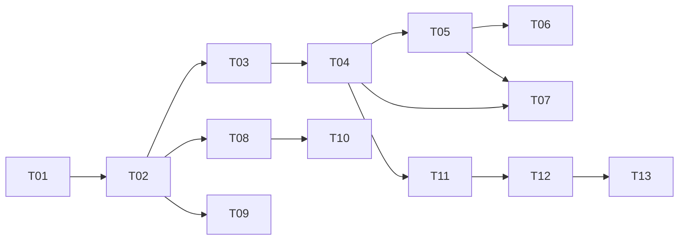
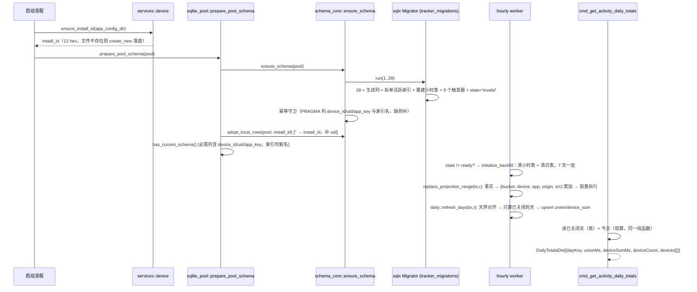

# 落地设计 · 数据结构与设备维度

## 1. 一句话结论

把 `device_id` 做成活动数据的一等维度，**在 P1 只用「一台设备」的退化形态上线**（数字逐位不变），
P2 才把它显形到界面，P3 让手机按「事件切段」写同一张 `activity.db`，
P4 用 **WebDAV 的「按天全量分片」**（不是 REST、不是增量日志）做多机同步——
因为 `uid` 里含属主 `device_id`，**一行永远只有它的属主写**，所以方案书 §7.2 里
「必须用服务端 seq 而不是 `updated_at_ms`」那个前提根本不成立，而**没有服务端**这件事因此也不再是缺陷。

三件裁决（详见 §4）：
- **A**（**已裁决**，施工协议见 `docs/design/PLAN-20261114-P4-同步协议.md`）：P4 传输层 = WebDAV 按天分片
  （`<install_id>/state.json` + `day-YYYY-MM-DD.jsonl` + 手动配对 12 位设备码），**不建 REST 服务端**；
  先落「bundle 导入导出」同内核形态。
- **B**：**不做**「把 `services/insight/data` 整块放开到两端编译」——它牵动 52 个文件 + 整个 `infra::insight`，且对 P3 的验收零贡献；改为抽 `schema_core` 最小可移植内核（4 个文件）。
- **C**：`normalize_app_key` 的 12 处内联拷贝收敛为 **3 列 SQLite 生成列**（`sessions.app_key` / `import_exact_sessions.app_key` / `import_time_buckets.app_key`），触发器只读 `NEW.app_key`。

---

## 2. 现状与图纸偏差表

方案书（`48-方案`）整体仍然有效，但**有 9 处必须按实际代码修正**，其中 4 处会直接让照抄的工程师踩空。

| # | 方案书写了什么 | 实际是什么（已核对） | 偏差影响 |
|---|---|---|---|
| D1 | 「0008 迁移（加列 + 拆唯一索引 + 小时表重建）」 | 业务库 `src-tauri/src/migrations/0008_v01300.sql` 已被安卓 `app_usage` 占号；活动库 `activity.db` 的迁移**根本不是 .sql 文件**，而是 `data/schema.rs` 里的 Rust 常量 `tracker_migrations()`（version 1–27）。两库两套机制 | 新迁移：业务库写 `0009_*.sql`；活动库追加 `version 28`。**两处都要动，且不能互相替代** |
| D2 | 「把 `HOURLY_SCHEMA_VERSION`（`hourly.rs:9`，现值 1）升到 2，`read_model_state` 会判 invalid 并全量回填」 | 机制**仍然成立**（`hourly.rs:80` 三条件不兼容 → `initialize_backfill` → `DELETE FROM activity_hourly_effective` + 重置 coverage）。但常量名是 `HOURLY_SCHEMA_VERSION = 1`，**另一个 `HOURLY_ALGORITHM_VERSION = 3` 也在同一处判定** | 两个常量改动后果相同（都触发全量回填）；本轮改 `SCHEMA_VERSION`（表结构变了），不动 `ALGORITHM_VERSION`（算法没变，便于区分「为什么重建」） |
| D3 | 「容量分摊循环在 `hourly.rs:440–477`」「跨设备求和写单行 80 分钟 → INSERT 直接失败（§6.3）」 | 循环**已经**按 `min(remaining, HOUR_MS)` 拆成 `native:0 / native:1 …` 多行（`hourly.rs:442–476`）。**INSERT 不会失败**——`CHECK` 恒满足 | §6.3 的「静默少一截」不会发生；真实风险变成**语义**：不按设备拆 key 时，两设备的 40 分钟会合成 `native:0` 40 分 + `native:1` 40 分，读侧求和 = 80 分 → 时间轴出现「同一小时同一应用 80 分钟」的荒谬读数。**风险性质从「写失败」变成「读荒谬」** |
| D4 | 「`web_links/totals.rs:8` 用 `LAG(end_time)` 算并集」 | 该文件已不存在（方案书 §10 索引自身也标错）。全仓 `LAG(` 只剩 `repositories/tools/read.rs:260–261`，用途是 **web 访问分段的 `visit_start` 归组**（按 domain 分组、单设备单调），**不是**日级并集 | 日级并集在 P1 **一行代码都没有**（现在是前端 `heatmapDays.ts` / `trendDays.ts` 按桶求和）。所以「改 LAG 为 running max」这条**无对象**；要写的是新的并集函数。`tools/read.rs` 的 LAG **本轮不动**（换成 running max 反而会改变 web 访问次数的口径） |
| D5 | 「`normalize_app_key` 有两份拷贝，触发器里另有一份」 | 实际是 **12 处**内联 `CASE … || '.exe'`（`schema.rs` 6 个触发器 × insert/delete 单发 + update 的 OLD∪NEW 双发） | 「两处必须同时改」的说法严重低估；见裁决 C |
| D6 | 「`src/app/components/DataHistoryFaces.tsx`」「`src/features/history/services/historyRangeTimeline.ts`」 | 实际在 `src/windows/patina/features/{dashboard,history}/**`；取数网关是 `src/windows/patina/platform/persistence/activityReadModelGateway.ts` | 任务书里的路径必须换；否则工程师找不到文件 |
| D7 | 「手机端：Kotlin `UsageWatcher` + 授权引导页 + 直写库」（§5，全新开发） | **采集与授权已经存在**：`gen/android/app/src/main/java/com/timing/app/native/UsageStats.kt`（142 行，已用 `queryEvents` 切 `ACTIVITY_RESUMED/PAUSED`、已判 `AppOpsManager`、已做息屏/锁屏关段）、`TimingNativePlugin.kt` 的 `usagePermission*`、`services/usage.rs` + `0008` 的 `app_usage` 表 | P3 的真实工作量 = 把「按包聚合」升级成「按事件切段返回区间」+ 一个 Kotlin 写库类 + 一个 60s 定时器。**不是从零建链**，工期约 1/3 |
| D8 | 「`services/insight/data` 那半边是纯 sqlx，不含 Win32；`mod.rs` 改一行就能放开」 | `data` 依赖 `crate::infra::insight::{clock, app_paths, storage_paths, storage_control, webdav, credentials, windows}`，而 `infra::insight` 整体是 `#[cfg(desktop)]`（`infra/mod.rs:72`）；`data` 下 136 个 rs 文件中 **52 个**直接引 `AppHandle`/`tauri::` | 「改一行」会得到 1000+ 编译错误；见裁决 B |
| D9 | （方案书未提）迁移与索引就绪判定的**隐藏墙** | ① 业务库 `infra/migrate.rs` 每次启动都重跑 `0002_v020.sql` → 它会**重建** `uq_records_open`；② 活动库 `sqlite_pool.rs:360/568` 每次启动按**旧索引名**做就绪判定，缺失就**重建旧索引**并「关掉除最新一条外的所有 open」；③ `normalize_current_baseline_migration_history_for_pool`（`sqlite_pool.rs:791`）会在「DB 布局与 `expected` 不匹配」时**整表重写 `_sqlx_migrations`** | 三处任何一处漏改，都会让「多设备」在**下一次启动**被静默还原成单设备，且其中 ② 会把另一台设备的进行中会话清零、③ 可能把新迁移标成「已应用」而不执行。**这是本轮最危险的一条**，见 §7 R2/R3 |

补充可核事实（本轮实测，未在方案书内）：

- `scripts/size-allowlist.json` 是**棘轮**：本方案要动的 7 个文件全部**正好压在冻结线上**——
  `schema.rs` 1887/1887、`hourly.rs` 852/852、`sqlite_pool.rs` 893/893、`sessions.rs` 684/684、
  `models/insight/activity_read_model.rs` 638/638、`activity_read_model/mod.rs` 371/371、`tools/read.rs` 515/515。
  **任何净增一行都会红。** 因此「先腾线位」不是一个可选优化，而是 P1 的第一个任务。
- `check:size` 只扫 `.ts/.tsx/.css/.rs`，**不扫 `.sql`**；`check:vendored` 扫 `services/insight/**` 下**全部**文件（无扩展名过滤）。
  ⇒ 新 DDL 写进 `.sql` 文件既躲开 300 行尺子，也只增加一条 `change:"added"` 的 vendored 登记。
- `check:contract` **不数 Patina 命令**（只数宿主 79 条），所以 P1 新增的
  `cmd_get_activity_daily_totals`（Patina 段）不会让门禁红；但 `docs/phase2/IPC-CONTRACT-v2.md`
  的「118」要改成 119（**文档那几处不会有人提醒你**）。
  P3 会新增 **1 条宿主命令** `activity_db_ensure`（手机端建库），宿主契约 **79 → 80**：
  这条要四处 + 文档四处同步，按 R2 规则**不单独升版，并入 0.12.2**。

---

## 3. 目标存储结构

### 3.0 两个库、两套迁移机制（先认清再动手）

| 库 | 文件 | 迁移机制 | 本轮动作 |
|---|---|---|---|
| 业务库 `timing.db`（`<exe>\data\timing.db`） | `time_records` 等 6 张 | `infra/migrate.rs`：每次启动按序重跑全部 `.sql` + `ensure_column` 幂等补列 | 新增 `migrations/0009_*.sql` + `migrate.rs` 加一组 `MIGRATE_COLUMNS_V9` |
| 活动库 `activity.db`（`%APPDATA%\com.timing.app\activity\data\activity.db`） | `sessions` 等 | `data/schema.rs::tracker_migrations()`（Rust 常量 + sqlx `Migrator`，只跑一次，有 checksum 账本） | 追加 `version 28`，SQL 正文放 `.sql` 文件用 `include_str!` 引入 |

> **不要**把活动库的 DDL 写成 `schema.rs` 里的字符串常量：那样既撞 300 行棘轮，又和宿主迁移的做法不一致。

### 3.1 业务库 `0009_v0140_device_dimension.sql`

加列由 `migrate.rs` 的 `ensure_column` 负责（K-13：SQLite 不支持 `ADD COLUMN IF NOT EXISTS`），**SQL 文件里不许出现裸 `ALTER`**。

```sql
-- =============================================================================
-- Timing 业务库迁移 0009（0.12.2 · 设备维度）
--
-- 只做三件事：
--   ① 拆掉「全库只能有一条进行中计时」的唯一索引，改成「每设备一条」；
--   ② 给 time_records 建 uid 唯一索引（同步身份）；
--   ③ 版本推进到 9。
-- 加列（device_id / uid / merged_into_uid）在 infra/migrate.rs 的
-- MIGRATE_COLUMNS_V9 里用 ensure_column 完成，必须早于本文件。
--
-- ⚠️ 本文件必须在 0002_v020.sql 之后执行，且**每次启动都要执行**：
--    migrate.rs 每次启动都会重跑 0002，而 0002 里有
--      CREATE UNIQUE INDEX IF NOT EXISTS uq_records_open ON time_records(status) WHERE status='active';
--    它会把这个「全库单活跃」索引建回来。本文件的 DROP 就是唯一的抵消点。
--    删掉这一行 = 下一次启动多设备计时立刻退化（第二台设备报 TIMER_ALREADY_RUNNING）。
-- =============================================================================

DROP INDEX IF EXISTS uq_records_open;

CREATE UNIQUE INDEX IF NOT EXISTS uq_records_open_per_device
  ON time_records(device_id) WHERE status = 'active';

CREATE UNIQUE INDEX IF NOT EXISTS uq_time_records_uid
  ON time_records(uid) WHERE uid IS NOT NULL;

CREATE INDEX IF NOT EXISTS idx_records_device_started
  ON time_records(device_id, started_at);

-- uid 由库自己发（理由同 activity.db 那边：写入口不止一个——计时落库 / 手改 / md 导入 / 恢复）
CREATE TRIGGER IF NOT EXISTS trg_time_records_uid AFTER INSERT ON time_records
WHEN NEW.uid IS NULL AND TRIM(NEW.device_id) <> ''
BEGIN
  UPDATE time_records SET uid = 't:' || NEW.device_id || ':' || NEW.id WHERE id = NEW.id;
END;

UPDATE settings SET value = '9', updated_at = CAST(strftime('%s','now') AS INTEGER) * 1000
WHERE key = 'schema.version';
```

`infra/migrate.rs` 增加（顺序：执行 `0008` 之后、`0009` 之前）：

```rust
/// V9 加列清单（设备维度）。定义里的 DEFAULT '' 是**迁移期哨兵**，
/// 由 `services::device::adopt_local_rows` 在启动时改写成真实 install_id。
/// 用 '' 而不是方案书的 'local'，是因为 'local' 会与"本机 id 就叫 local"混淆，
/// 而空串在 `CHECK` 里可被唯一索引之外的所有查询自然忽略。
const MIGRATE_COLUMNS_V9: &[(&str, &str, &str)] = &[
    ("time_records", "device_id", "TEXT NOT NULL DEFAULT ''"),
    ("time_records", "uid", "TEXT"),
    ("time_records", "merged_into_uid", "TEXT"),
];
```

顺序（`migrate.rs::migrate` 内追加两步）：

```
… ⑨ 补 v9 列（MIGRATE_COLUMNS_V9）
   ⑩ run_raw(include_str!("../migrations/0009_v0140_device_dimension.sql"))
   ⑪ device::adopt_local_rows(pool).await?      // '' → install_id；补 uid
```

### 3.2 活动库 `version 28 · device_dimension`

文件：`src-tauri/src/services/insight/data/sql/0028_device_dimension.sql`
注册：`data/schema_registry.rs`（新文件，见 T01）里追加一条 `Migration { version: 28, … }`。

```sql
-- =============================================================================
-- activity.db 迁移 28 · 设备维度（P1）
-- 由 data/schema_registry.rs 用 include_str! 引入（.sql 不受 check:size 约束）。
--
-- 为什么 ALTER 可以写在这里：sqlx 的 Migrator 对每个 version **只执行一次**，
-- 所以 ADD COLUMN 天然幂等。schema_core::ensure_schema 里另有一组 PRAGMA 守卫，
-- 只用于修复"被人手工删过列"的库，不是主路径。
--
-- 顺序是硬约束：加列 → 生成列 → 索引 → 触发器。反了会在建索引时报 no such column。
-- =============================================================================

-- ① 设备花名册 -------------------------------------------------------------
-- is_self 唯一：本机身份即使 install_id.txt 丢了也能定位「哪一行是我」。
-- color 为空 = 由 install_id 的哈希从 8 色调色板派生（见 §6.4），因此两台机器
-- 对同一台设备的取色天然一致，不需要同步颜色。
CREATE TABLE IF NOT EXISTS devices (
  install_id    TEXT    PRIMARY KEY CHECK(TRIM(install_id) <> ''),
  label         TEXT    NOT NULL DEFAULT '',
  platform      TEXT    NOT NULL CHECK (platform IN ('windows','android','macos','linux')),
  color         TEXT    NOT NULL DEFAULT '',
  is_self       INTEGER NOT NULL DEFAULT 0 CHECK (is_self IN (0,1)),
  first_seen_ms INTEGER NOT NULL,
  last_seen_ms  INTEGER NOT NULL
);
CREATE UNIQUE INDEX IF NOT EXISTS uq_devices_self ON devices(is_self) WHERE is_self = 1;

-- ② sessions 加列 ----------------------------------------------------------
-- DEFAULT '' 是**迁移期哨兵**，由 schema_core::adopt_local_rows 在同一个启动流程里
-- 改写成真实 install_id。用 '' 而不是方案书的 'local'：'local' 会与"本机 id 就叫 local"
-- 混淆，而且 '' 在 CHECK(TRIM(device_id)<>'') 之外的所有查询里都能被自然忽略。
ALTER TABLE sessions ADD COLUMN device_id TEXT NOT NULL DEFAULT '';
ALTER TABLE sessions ADD COLUMN uid       TEXT;

-- ③ app_key 生成列 ---------------------------------------------------------
-- 一份归一逻辑，替掉 12 处内联 CASE（裁决 C）。
-- 与 models/insight/activity_read_model.rs::normalize_app_key 逐字等价，
-- 由 `app_key_equivalence_tests` 双向断言。
-- 生成列表达式里不能引用别名，所以 TRIM(...) 那一段要写四遍 —— 这份重复是
-- **DDL 内部**的重复，且只存在一份 DDL，不会再漂。
ALTER TABLE sessions ADD COLUMN app_key TEXT GENERATED ALWAYS AS (
  CASE
    WHEN TRIM(TRIM(exe_name), ' "') = '' THEN ''
    WHEN INSTR(LOWER(TRIM(TRIM(exe_name), ' "')), ':') > 0
      THEN LOWER(TRIM(TRIM(exe_name), ' "'))
    WHEN LOWER(TRIM(TRIM(exe_name), ' "')) LIKE '%.exe'
      THEN LOWER(TRIM(TRIM(exe_name), ' "'))
    ELSE LOWER(TRIM(TRIM(exe_name), ' "')) || '.exe'
  END
) VIRTUAL;

ALTER TABLE import_exact_sessions ADD COLUMN app_key TEXT GENERATED ALWAYS AS (
  CASE
    WHEN TRIM(TRIM(exe_name), ' "') = '' THEN ''
    WHEN INSTR(LOWER(TRIM(TRIM(exe_name), ' "')), ':') > 0
      THEN LOWER(TRIM(TRIM(exe_name), ' "'))
    WHEN LOWER(TRIM(TRIM(exe_name), ' "')) LIKE '%.exe'
      THEN LOWER(TRIM(TRIM(exe_name), ' "'))
    ELSE LOWER(TRIM(TRIM(exe_name), ' "')) || '.exe'
  END
) VIRTUAL;

ALTER TABLE import_time_buckets ADD COLUMN app_key TEXT GENERATED ALWAYS AS (
  CASE
    WHEN TRIM(TRIM(exe_name), ' "') = '' THEN ''
    WHEN INSTR(LOWER(TRIM(TRIM(exe_name), ' "')), ':') > 0
      THEN LOWER(TRIM(TRIM(exe_name), ' "'))
    WHEN LOWER(TRIM(TRIM(exe_name), ' "')) LIKE '%.exe'
      THEN LOWER(TRIM(TRIM(exe_name), ' "'))
    ELSE LOWER(TRIM(TRIM(exe_name), ' "')) || '.exe'
  END
) VIRTUAL;

-- ④ uid 由库自己发，写入方不许自己拼 ----------------------------------------
-- 放在触发器里而不是调用点，是因为写入口有四个（Rust tracker / Kotlin / 导入 / 恢复），
-- 漏一个就会出现两种 uid 格式，P4 的分片合并直接失效。
-- 注意：这条 UPDATE 不会递归触发脏区间（trg_read_model_sessions_update 的
-- AFTER UPDATE OF 列表里没有 uid），也不会被 uq_sessions_uid 挡下（新值唯一）。
CREATE TRIGGER IF NOT EXISTS trg_sessions_uid AFTER INSERT ON sessions
WHEN NEW.uid IS NULL AND TRIM(NEW.device_id) <> ''
BEGIN
  UPDATE sessions SET uid = 's:' || NEW.device_id || ':' || NEW.id WHERE id = NEW.id;
END;

-- ⑤ 拆「全库单活跃」 --------------------------------------------------------
DROP INDEX IF EXISTS idx_sessions_single_active;
CREATE UNIQUE INDEX IF NOT EXISTS uq_sessions_open_per_device
  ON sessions(device_id) WHERE end_time IS NULL;
CREATE UNIQUE INDEX IF NOT EXISTS uq_sessions_uid
  ON sessions(uid) WHERE uid IS NOT NULL;
CREATE INDEX IF NOT EXISTS idx_sessions_device_start
  ON sessions(device_id, start_time);
-- 新的「取全部 open 的最小起点」探针（hourly.rs ACTIVE_SESSION_START_SQL）要能走
-- migration 15 建的 idx_sessions_end_start(end_time, start_time)：
--   SELECT MIN(start_time) FROM sessions WHERE end_time IS NULL
-- 契约用例断言 query plan 里出现 idx_sessions_end_start（替代原来钉的
-- idx_sessions_single_active，见 §6.1 / T03）。

-- ⑥ 小时投影按设备重建 ------------------------------------------------------
-- 缓存表，不迁数据；P1 只有一台设备，行数与总和逐位不变。
DROP TABLE IF EXISTS activity_hourly_effective;
CREATE TABLE activity_hourly_effective (
  bucket_start_ms  INTEGER NOT NULL,
  bucket_end_ms    INTEGER NOT NULL,
  device_id        TEXT    NOT NULL CHECK(TRIM(device_id) <> ''),
  app_key          TEXT    NOT NULL CHECK(TRIM(app_key) <> ''),
  raw_exe_name     TEXT    NOT NULL CHECK(TRIM(raw_exe_name) <> ''),
  display_app_name TEXT    NOT NULL DEFAULT '',
  origin           TEXT    NOT NULL CHECK(origin IN ('native','import_exact','import_bucket')),
  source_id        TEXT    NOT NULL,
  effective_duration_ms INTEGER NOT NULL CHECK(effective_duration_ms > 0),
  computed_revision INTEGER NOT NULL CHECK(computed_revision >= 0),
  updated_at_ms    INTEGER NOT NULL DEFAULT 0 CHECK(updated_at_ms >= 0),
  PRIMARY KEY(bucket_start_ms, device_id, app_key, origin, source_id),
  CHECK(bucket_end_ms > bucket_start_ms),
  CHECK(effective_duration_ms <= bucket_end_ms - bucket_start_ms)
);
CREATE INDEX IF NOT EXISTS idx_activity_hourly_range
  ON activity_hourly_effective(bucket_start_ms, bucket_end_ms);
CREATE INDEX IF NOT EXISTS idx_activity_hourly_device_range
  ON activity_hourly_effective(device_id, bucket_start_ms);
CREATE INDEX IF NOT EXISTS idx_activity_hourly_app_range
  ON activity_hourly_effective(app_key, bucket_start_ms, effective_duration_ms);

-- ⑦ 日级双口径 --------------------------------------------------------------
-- 不变式：**只存完整的天**（day_end <= now）。今天由读命令现算，
-- 因为今天的"现在"每 3 秒变一次，落表必然滞后且无法自证。
-- device_scope='*' → 全设备并集(union_ms, ≤24h) / 各设备之和(device_sum_ms, 可 >24h)
-- device_scope=<install_id> → 该设备自己的墙钟，两列恒相等（由 CHECK 钉住）
CREATE TABLE IF NOT EXISTS activity_daily_totals (
  day_key           TEXT    NOT NULL CHECK(length(day_key) = 10),
  device_scope      TEXT    NOT NULL CHECK(TRIM(device_scope) <> ''),
  union_ms          INTEGER NOT NULL CHECK(union_ms >= 0),
  device_sum_ms     INTEGER NOT NULL CHECK(device_sum_ms >= 0),
  device_count      INTEGER NOT NULL CHECK(device_count >= 0),
  computed_revision INTEGER NOT NULL CHECK(computed_revision >= 0),
  updated_at_ms     INTEGER NOT NULL DEFAULT 0 CHECK(updated_at_ms >= 0),
  PRIMARY KEY(day_key, device_scope),
  CHECK(device_scope = '*' OR union_ms = device_sum_ms)
);
CREATE INDEX IF NOT EXISTS idx_activity_daily_scope
  ON activity_daily_totals(device_scope, day_key);

-- ⑧ 九个脏区间触发器重定义（只改 app_key 来源，时间表达式逐字保留） -----------
-- 机械规则：把原来内联的 `CASE WHEN LOWER(TRIM(NEW.exe_name,' "') LIKE '%.exe' …`
-- 整段换成 `NEW.app_key`（DELETE 用 OLD.app_key，UPDATE 的 OLD∪NEW 子查询改成
-- `SELECT OLD.app_key UNION SELECT NEW.app_key`），并把 WHEN 子句里的
-- `TRIM(NEW.exe_name) <> ''` 换成 `TRIM(NEW.app_key) <> ''`。
-- 必须逐个 DROP + CREATE 的 9 个（名字逐字，写错就不会被替换、旧的继续用旧逻辑）：
--   trg_read_model_sessions_insert / _update / _delete
--   trg_read_model_exact_insert    / _update / _delete
--   trg_read_model_bucket_insert   / _update / _delete
-- 这 9 个里共有 12 处内联 CASE（三个 _update 各含 OLD 与 NEW 两处）。
-- ⚠️ 新建/删除会话的 `trg_native_session_web_boundary`（migration 14）不在改动范围：
--    它按 session_id 关联 web_activity_segments，天然是按行隔离的。

-- ⑨ 让小时投影与日表全量重建 ------------------------------------------------
UPDATE read_model_state
   SET state = 'invalid', coverage_start_ms = NULL, coverage_end_ms = NULL,
       backfill_cursor_ms = NULL, updated_at_ms = CAST(strftime('%s','now') AS INTEGER) * 1000
 WHERE model_name = 'activity_hourly';
```

> `schema.rs` 里 `ACTIVITY_READ_MODELS_SCHEMA_SQL` 的旧触发器文本**不动**（历史不可改）：
> 新库先按 version 8 建出旧触发器，再被 version 28 的 ⑧ 覆盖。这依赖 SQLite
> 「CREATE TRIGGER 时不解析 body 里的列名」，所以 T02 必须有一条
> 「空库走到 head 28 后，`sqlite_master` 里 9 个 `trg_read_model_*` 的 `sql` 文本都不含
> `|| '.exe'`」的用例来钉住这件事。

### 3.3 字段语义表

| 列 | 取值 | 谁写 | 语义 |
|---|---|---|---|
| `sessions.device_id` | 本机 = `install_id`（12 位小写 hex）；导入数据 = 导入方 `install_id` | 写入方 | 行归属。**永不为空**，迁移期哨兵 `''` 由启动修复改掉 |
| `sessions.uid` | `'s:' \|\| device_id \|\| ':' \|\| id` | 触发器（AFTER INSERT） | 同步身份。**带表前缀**，否则 `sessions.id=7` 与 `time_records.id=7` 会撞同一个 uid |
| `sessions.app_key` | 生成列，见 ② | SQLite | 唯一归一逻辑的落点 |
| `activity_hourly_effective.device_id` | 同 sessions；导入 origin 一律 = 本机 | 投影 | 主键成员 |
| `activity_daily_totals.day_key` | `YYYY-MM-DD`（**本地时区**） | 投影 | 与 md 同步 / `local_date` 同口径 |
| `devices.color` | `''` = 派生；否则 `#RRGGBB` | 用户 | 只影响展示 |

`uid` 的完整前缀表（P4 会用满）：`s:` sessions · `t:` time_records · `i:` items · `n:` notes · `d:` todos。

### 3.4 回填语句（幂等，每次启动跑，代价 ≈ 0 行命中）

```sql
-- activity.db：哨兵 '' → 本机 install_id（参数绑定，绝不拼字符串）
UPDATE sessions SET device_id = ?1 WHERE device_id = '';
UPDATE sessions SET uid = 's:' || device_id || ':' || id WHERE uid IS NULL;
-- 兜底：device_id 已被回填但 uid 落后的历史行
UPDATE import_exact_sessions SET device_id = ?1 WHERE device_id IS NULL;  -- 若该列存在

-- timing.db：同上
UPDATE time_records SET device_id = ?1 WHERE device_id = '';
UPDATE time_records SET uid = 't:' || device_id || ':' || id WHERE uid IS NULL;
```

`devices` 的本机行由 `services::device::ensure_self(pool, platform)` 做 upsert（`is_self=1`），
`last_seen_ms` 每次启动刷新。

### 3.5 读路径（一处一个出处）

| 用途 | 读哪张表 | 口径 |
|---|---|---|
| 日历热力 / 趋势卡 / 周月总览 | `activity_daily_totals`（今天现算） | 主指标 `union_ms`，副标 `device_sum_ms` |
| 时间轴 / 应用排行 / 每小时 | `activity_hourly_effective`（P2 起按 `device_id` 分组） | 求和 |
| 「同时在干什么」 | `sessions` 原始行 | 不聚合 |

P1 阶段这三条**读路径全部保持现状**（`hourly` 求和、前端按桶聚合），只有写路径加了设备维度。
这样「逐位相等」不是靠运气，而是"读路径一个字节都没动"的必然结果。

---

## 4. 三件裁决

### A. P4 的传输层：WebDAV 按天分片，不建 REST 服务端

> **状态：已裁决（2026-11-14，主人拍板采纳本方案）。**
> 施工协议已细化到可照着写：**`docs/design/PLAN-20261114-P4-同步协议.md`**
> （`state.json` 字段级 schema、`day-*.jsonl` 行格式与编码、撕裂读三分法、配对状态机、
> 与 md 同步的关系、首次同步代价、删除与保留期、T11–T13 可执行任务卡）。
> 下面保留**原始论证与被否决选项**——日后要翻案（例如真的有了服务端运维主体）时，
> 翻案成本要按这些理由逐条反驳，而不是重新讨论一遍。

**结论**
1. **不做** REST `POST /push` + `GET /pull?cursor=`。理由不是"懒得做"，是**没有服务端运维主体**：
   单人项目、无域名/证书/后端预算；而活动数据出机器需要明确收益对价（§7.1 已经把
   `session_title_samples` 22754 条排除在同步外，说明隐私口径是"最小出机"）。
2. **映射到 WebDAV 文件语义**，但**不是**方案书设想的 `<device>/<seq>.jsonl`：
   `infra/md_webdav/mod.rs` 的头注释写死了「坚果云单次列举上限 750 条、不支持 infinity PROPFIND，
   因此本客户端不发 PROPFIND」——**没有列目录能力**，就无法"发现分片"或"发现对端设备"。
3. 采用**手动配对 + 确定性路径 + 按天全量分片**：

```
<用户配置的 basePath>/timing-sync/
├─ <install_id>/
│  ├─ state.json                    设备自述：schema/installId/label/platform/days{rows,bytes,hash}
│  └─ day-2026-11-14.jsonl          该天"最终状态"的行（状态行 + 墓碑行，跨天后不再变）
└─ <peer_install_id>/
   └─ …
```

- **push** = 对本机「今天 + 所有 `updated_at_ms` 变更过的天」逐天重写该天文件（整文件 PUT，幂等），**最后**才重写 `state.json`（不变式：state 可解析 ⇒ 它列的分片都已上床）。
- **pull** = GET 对端 `state.json` → 用 `days[day].hash != sync_pull_state.applied_hash` 算出差集逐日 GET → 按 uid upsert。
- **配对** = 用户在对端设备的设置页读到 12 位设备码，在另一端填一次。**只有这一步需要人**。
- **冲突**：不需要。`uid` 里含属主 `device_id` ⇒ **一行永远只有它的属主写**。
  唯一的"同 uid 两次写"是属主自己重传，用 `updated_at_ms`（写入时 `max(now, prev+1)` 单调钳制）解 LWW。
  **方案书 §7.2「必须用服务端 seq，不能用设备时钟」的前提在这里不成立**——那句话防的是
  「两台机器改同一行」，而本设计里这不可能发生。这是 P4 最关键的一条，也是能砍掉整个服务端的原因。
- **删除**：**不**给 `sessions` 加 `deleted_at_ms`，改用独立表 `sync_tombstone(uid, kind, device_id, deleted_at_ms)`
  + `AFTER DELETE` 触发器写入。理由见 P4 文档 §8.1：软删除会让几十条 `FROM sessions` 查询
  与 9 个读模型触发器全部失效（漏一处即静默算错）。
- **前置依赖（明确）**：
  1. P1 的 `device_id` + `uid` 必须先落地并稳定（否则分片里的 uid 会变，重传会造重）；
  2. P4 自己的迁移：活动库 `version 29`（`sessions.updated_at_ms`、`sync_tombstone`、
     `sync_peer`、`sync_pull_state`、`sync_push_state`、`sync_channel`）+ 业务库 `0010`
     （`time_records.updated_at_ms` 与同名触发器）；
  3. **传输层不需要新增能力**（此处订正本文档 rev 1 的一处错误）：`infra/md_webdav/mod.rs::put()`
     的签名本来就是 `put(target, rel, bytes, if_match: Option<&str>)`，**条件写早就有了**；
     目录补建也已内建（`put` 遇 409 → `ensure_base_dir_err()` → 重试一次，`MAX_LEVELS = 8`）。
     撕裂读按"尾行截断 / 中间损坏 / 哈希不符"三分法处理，重试一次、**不标记已应用**，
     由摘要比对驱动下一轮自动重拉，不存在永久跳过（P4 文档 §4）；
  4. 代码落点 `services/insight/data/sync/`（不要放 `infra`：L4 规定 infra 不得依赖 services；
     且 `data/remote_backup.rs` 已有"data 调 infra::insight::webdav"的先例）。

  5. **凭据与地址复用 `remote_backup_settings`**（url / username / DPAPI 密码），
     远端子目录由 `sync_channel.remote_dir` 覆盖（空 = `<backup.remote_dir>/timing-sync`）。
     用户只配一次 WebDAV——配两套必然有一套填错。副作用（删掉备份配置会让同步不可用）
     必须在界面上说清。凭据层是 Windows DPAPI ⇒ **P4 只在 Windows 桌面可用**，与
     "手机只采集、PC 做聚合与同步"的分工一致。

**代价**：一天一次 GET/PUT，一年 365 个文件（≈32 MB/设备/年）；首次配对要逐日拉
（365 次 GET，4 路并发约 14 秒，一次性）；`state.json` 有撕裂读（三分法 + 摘要驱动重拉兜住）；
只能拉整天的文件、不能拉变化行（行数 200–900/天，可接受）。
「按周/月合片」**主动不做**（日常写放大 7–30 倍，而"今天一直在变"是每天必发生的事），
并写死日后重新评估的三个触发条件（P4 文档 §7.4）。

**被否决的选项**
- *新建 Rust/Node 服务端*：无运维主体；且要新增鉴权、限流、备份、隐私告知——成本远超 P4 的收益。
- *复用 `services::md_sync` 的 Markdown 通道*：md 是给人看的，往返解析会丢精度，
  且 md 已有「文件优先于库」（ADR-042），与 LWW 语义直接冲突。
- *`<seq>.jsonl` 自由增长分片*：无 PROPFIND 就无法枚举 seq；只能靠 `state.json` 记 lastSeq，
  而 state.json 撕裂读会丢一段（不可重造，违反 §7.3）。
- *只做导入导出、不做自动同步*：作为**先落地形态**保留（见下），但不是终态——
  方案的 §7.4 验收（"手机第一次同步完，历史页出现台式机泳道"）需要自动。
- *给 `sessions` 加 `deleted_at_ms` 做软删除*：会让几十条 `FROM sessions` 查询与 9 个读模型
  触发器全部失效（漏一处即静默算错）。改独立 `sync_tombstone` 表（P4 文档 §8.1）。
- *在 `state.json` 里维护"我认识哪些设备"*：没有 PROPFIND 无法验证、相互认识永远最终一致、
  且两台设备写同一份文件必然互相覆盖。对端列表只在本地 `sync_peer`，靠人配对一次引入。

**先落地形态（即使 P4 全量延后也能独立发货）**
`timing-bundle`：一个 zip，内含 `state.json`（设备自述）+ `day-*.jsonl`（与 WebDAV 分片
**同一格式、同一序列化器**）。手工放进网盘 / U 盘，另一端"导入 bundle"。
**合并内核与 WebDAV 版 100% 共用**——它就是 T12 的本体，T13 只是在它上面换了个传输。
验收可完全离线：A 库导出 → 导入 B 库 → 增量为 A 独有行数、uid 无重复、**重放第二次零变更**
（且两个 zip 的 SHA-256 相同）。

### B. P3 的编译门：不做"整块放开"，改抽 `schema_core`

**结论：方案书 §5.3 的「`services/mod.rs` 改一行 + `insight/mod.rs` 拆 data/engine」不可行。**
不是"难"，是"改完仍然对 P3 的验收零贡献"。

**逐项审计结果**（`services/insight/data/**`，136 个 rs 文件）

| 判定 | 文件 | 说明 |
|---|---|---|
| **可直接编** | `schema.rs`、`schema_contracts.rs`、`sqlite_error.rs`、`repositories/**`（除 icon_cache 的 Windows 图标路径）、`activity_read_model/{hourly,catalog}`、`models/insight/activity_read_model.rs` | 纯 sqlx + 纯函数 |
| **不用改（不是阻塞点）** | 52 个 `fn f<R: Runtime>(app: &AppHandle<R>)` | `AppHandle` 在 Android 上是真实存在的类型，签名已泛型 |
| **必须 cfg 掉** | `data/backup/**`、`data/remote_backup*`、`data/scheduled_backup|export`、`data/storage_migration*`、`data/storage_restart`、`data/storage_path_safety`、`data/export/**`（arrow/parquet）、`data/mini_window_store`、`data/icon_cache_service`、`data/user_data_maintenance`、`data/tracking_runtime/native_icon_acceptance`、`data/sqlite_pool/restore.rs`、`data/schema_contracts.rs` 的部分、`engine/**` 全部 | 桌面语义：备份/导出/自定义数据根/更新器/原生探针 |
| **真实阻塞点（cfg 一行解决不了）** | ① `data/**` → `crate::infra::insight::{clock, app_paths, storage_paths, storage_control, webdav, credentials, windows}`，而 `infra::insight` 整体 `#[cfg(desktop)]`（`infra/mod.rs:72`）<br>② `storage_paths::resolve_storage_paths` 依赖 `storage_control`（"切换数据根"在手机上是无意义概念）<br>③ `arrow`/`parquet` 在通用 `[dependencies]` 段 → 一旦 `export` 进包，Android 交叉编译真的会编 | 要放开必须先把 `infra::insight` 拆成「可移植内核 / 桌面外壳」两半，这是**另一轮重构**，不是 P3 的一个子项 |
| **门禁缺口** | `.github/workflows/ci.yml` 里**没有** `cargo check --target aarch64-linux-android` | 放开编译门 = 新增一片无门禁的编译面；写坏的 cfg 只有真机出包才发现（历史上已踩过 4 次同类） |

**推荐做法：抽 `services/insight/schema_core`（4 个文件，全部 ≤300 行）**

```
src-tauri/src/services/insight/schema_core/mod.rs       # 对外 3 个函数
src-tauri/src/services/insight/schema_core/ddl.rs       # include_str! 两个 .sql
src-tauri/src/services/insight/schema_core/ensure.rs    # 幂等建表/升级（&Pool<Sqlite> 入参，无 AppHandle）
src-tauri/src/services/insight/schema_core/device.rs    # install_id 读写（&Path 入参）
```

`mod.rs` 的对外面（**只有三个**，两端都编）：

```rust
/// 语义：把**任何**状态的库带到 head 28（等价于「跑一遍 Migrator + 幂等补列/补索引」）。
/// 顺序是硬约束：Migrator 先跑（空库要靠它建 sessions），补列守卫在后面（老库靠它兜底）。
pub async fn ensure_schema(pool: &sqlx::Pool<sqlx::Sqlite>) -> Result<(), String>;
pub async fn adopt_local_rows(pool: &sqlx::Pool<sqlx::Sqlite>, device_id: &str) -> Result<u64, String>;
pub fn ensure_install_id(config_dir: &std::path::Path) -> Result<String, String>;
```

> `ensure_schema` 内部的两步**不能换序**：空库上 `sessions` 还不存在，先补列会 `no such table`；
> 老库上 `_sqlx_migrations` 已到 28，Migrator 什么都不做，靠补列守卫修复"被人手工删过列"的库。
> 手机端没有 `prepare_pool_schema` 那套 legacy 修复，`ensure_schema` 就是它的全部。

桌面侧 `sqlite_pool::prepare_pool_schema` 改成调用 `schema_core::ensure_schema`；
手机侧在启动时由**一条宿主命令**建库。这条命令必须落在**宿主**命令段（不是 Patina 的 `$extra`），
否则移动端编不到：

```
src-tauri/src/commands/activity_db_cmd.rs          # 桌面：如实回 mobile_only(..) 桩
src-tauri/src/commands/activity_db_cmd_mobile.rs   # 手机：真实实现（#[path] 互换，照 data_root_cmd 的先例）
```

`activity_db_ensure` 用 `app_config_dir()` 拼出 `activity.db` 路径，调 `ensure_schema` +
`adopt_local_rows`。Kotlin 随后用 `SQLiteOpenHelper` + `busy_timeout=5000` 打开同一个文件。

> **契约记账**：这是**宿主**命令，79 → 80。按既有硬规矩，必须四处同步
> （`ipc_commands.rs` / `src/services/ipc.ts` / `src/types/domain/ipc.ts` / `src/mocks/browserMockPlugins.ts`）
> + 文档四处（`IPC-CONTRACT-v2.md` 的命令表 / 详解 / 变更记录 / 手机端行为表），
> 并按 R2 规则判断版号 —— 本轮**不单独升版，并入 0.12.2**。
> 若想避免这次契约变更，唯一替代是让 Kotlin 从构建期生成的 asset 里读 DDL，
> 那就多一条「asset 与 0028.sql 必须同源」的构建步骤，比一条命令更容易漂，**不推荐**。

**为什么这条路更对**
1. 只碰 4 个新文件 + 1 处 `prepare_pool_schema` 调用 + 1 条命令；上面那张「必须 cfg 掉」的表**一行都不用改**。
2. 手机端**根本不需要读模型**（读模型是 PC 的活：Kotlin 只写事实，聚合在 PC 上由现有 worker 做）。
   放开整个 `data` 是"为了拿到 DDL 而搬进整座仓库"。
3. `engine` 保持 `#[cfg(desktop)]` 不动 —— 方案书 §5.3 担心的"手机误开 engine 双写"在结构上不可能发生。

**代价**：DDL 有两个入口（桌面走 `prepare_pool_schema`，手机走命令），但**只有一份 SQL 文本**
（`include_str!`），且 `ensure_schema` 是幂等的，先跑谁都不会错。

### C. `normalize_app_key` 的 12 处拷贝：收敛成 3 个生成列

**结论：给三张源表各加一个 `app_key` **生成列**（`GENERATED ALWAYS AS … VIRTUAL`），
9 个触发器的正文全部改成只读 `NEW.app_key` / `OLD.app_key`。**

为什么这条路赢：
- **写入口不变**：Rust tracker、Kotlin、导入、SQL 手改、备份恢复——谁写 `exe_name` 都自动得到 `app_key`，
  没有一个"记得调函数"的点可以忘。
- **零运行时开销**：`VIRTUAL` 不落盘，读时按同一定义算；主键与索引都不用它。
- **12 → 1**：内联 CASE 从 12 处（分布在 **9** 个触发器里，update 的 `OLD ∪ NEW` 一处抵两处）
  变成 3 个 DDL 表达式（同一段文本，同一份文件）。
- **`:` 前缀规则一次到位**：`INSTR(…, ':') > 0` 原样返回，`com.tencent.mm` 不再被追 `.exe`；
  Windows 文件名禁用冒号 ⇒ 现有 98 条 `recorded_app_catalog` 键零影响。

**代价**
1. SQLite ≥ 3.31（生成列）。sqlx 内置版本够；**要加一条版本断言**，因为降级到系统 libsqlite3 时
   这条 DDL 会直接 `near "AS": syntax error`，而失败发生在建库阶段 = 用户装不上。
2. 仍是两份实现（Rust 函数 + DDL 表达式），只是**从 12 : 1 变成 1 : 1**。
   用 `app_key_equivalence_tests`（T03）双向钉住：对同一批夹具（引号、大小写、空白、`.EXE`、裸名、
   `com.tencent.mm`、`a:b`、纯空白），函数结果与 `SELECT app_key FROM …` 必须逐字相等；
   再对现有 98 条 `recorded_app_catalog` 键做一次全量回归。
3. 生成列不能改表达式，日后改规则 = 重建列（表重建或"加新列 + 切读点"）。这条要在
   `normalize_app_key` 的注释里写死："改这里必须同时改 0028 的生成列，并做等价用例"。

**被否决的选项**
- *(a) 写入方传 `app_key`*：写入口有 5 个以上（Rust tracker / Kotlin / CSV 导入 / sqlite 导入 / 恢复），
  漏一个 = 该批数据在热力图上**永久隐形**且无报错。这是最坏的一类失败。
- *(b) `app_key_alias` 映射表*：触发器要"先查表"，但表里没有这条 raw 值时怎么办？
  只能回落到内联 CASE —— 等于既没收敛又多了张表。
- *(c) 12 处同时改一遍 + 加一条"两处必须同时改"的用例*：把**结构性重复**换成**纪律**。
  本仓已经因为"两份拷贝迟早漂移"付过一次代价（`md_file.rs` 的围栏状态机）。

---

## 5. 任务列表

> 分组原则：按**阶段 × 模块**分组，不按单文件拆。
> 每条任务的文件改动量都控制在「被改文件腾出 ≥ 新增行数」的范围内（P1 的冻结点见 §2 补充事实）。
> `check:size` 的棘轮要求：**动任何一个冻结文件之前，先把它的某一段搬走**。

### P1 · 后端（可单独发版，`cargo test --lib` 是主判据）

---

**T01｜腾线位：把 3 段代码搬出 3 个冻结文件**
- 依赖：无
- 涉及文件：
  - `src-tauri/src/services/insight/data/schema.rs`（删 `tracker_migrations()` 140 行，加 1 行 `pub use`）
  - `src-tauri/src/services/insight/data/schema_registry.rs`（**新建**，~155 行：迁入 `tracker_migrations` + `use super::schema::*`）
  - `src-tauri/src/services/insight/data/activity_read_model/hourly.rs`（删 `replace_projection_range` ~108 行）
  - `src-tauri/src/services/insight/data/activity_read_model/hourly_write.rs`（**新建**，~130 行）
  - `src-tauri/src/services/insight/data/sqlite_pool.rs`（删 `ensure_current_indexes` + `has_current_schema` ~240 行）
  - `src-tauri/src/services/insight/data/sqlite_pool/current_schema.rs`（**新建**，~260 行）
  - `src-tauri/src/services/insight/data/activity_read_model/mod.rs`（删 `aggregate_records_into_boundaries` + `validate_aggregate_boundaries` ~62 行，加 `mod buckets;`）
  - `src-tauri/src/services/insight/data/activity_read_model/buckets.rs`（**新建**，~70 行）
  - `scripts/vendored-allowlist.json`（4 条 `change:"modified"` + 4 条 `change:"added"`，共 8 条，≤10 档）
- 验收：
  1. `node scripts/check-size.mjs` 绿，且**逐条打印**这 7 个文件的「当前/冻结」值
     （下面的数按搬迁量估算，**以实跑为准**；任何一项超了就是搬得不够，不许改基线）：
     `schema.rs 1887 → ≈1749`、`hourly.rs 852 → ≈745`、`sqlite_pool.rs 893 → ≈655`、
     `activity_read_model/mod.rs 371 → ≈310`；
  2. `node scripts/check-vendored-diff.mjs` 绿（8 条登记）；
  3. `cargo +1.100.0 test --lib` 的 passed 数**必须等于基线数**（先记录基线，别被"绿"骗——见 §7 R8）；
  4. 这三个搬迁都是**纯移动**：`git diff -M` 里新增文件内容必须能在旧文件里找到对应块（`--color-moved` 人工看一眼）。

---

**T02｜迁移 0028（patina）+ 0009（timing）+ install_id**
- 依赖：T01
- 涉及文件：
  - `src-tauri/src/services/insight/data/sql/0028_device_dimension.sql`（**新建**，§3.2 全文）
  - `src-tauri/src/services/insight/data/schema_registry.rs`（追加 `Migration{version:28,…}` + `include_str!`）
  - `src-tauri/src/services/insight/data/sqlite_pool/current_schema.rs`（`ensure_current_indexes` 改判 `uq_sessions_open_per_device`；`has_current_schema` 的必需列加 `device_id/uid/app_key`、索引名换新；新增 `ensure_device_columns`，走 `PRAGMA table_info` 守卫）
  - `src-tauri/src/services/insight/schema_core/{mod,ddl,ensure,device}.rs`（**新建 4 个**，见裁决 B）
  - `src-tauri/src/services/insight/mod.rs`（加 `pub mod schema_core;`）
  - `src-tauri/src/services/mod.rs`（`pub mod device;`）
  - `src-tauri/src/services/device.rs`（**新建**，~120 行：`ensure_install_id` + `adopt_local_rows` + `ensure_self`）
  - `src-tauri/src/migrations/0009_v0140_device_dimension.sql`（**新建**，§3.1 全文）
  - `src-tauri/src/infra/migrate.rs`（`MIGRATE_COLUMNS_V9` + 两步调用）
  - `src-tauri/src/services/insight/data/sqlite_pool.rs`（`VALIDATED_SCHEMA_MIGRATION_HEAD` → `schema::DEVICE_DIMENSION_MIGRATION_VERSION`）
  - `src-tauri/src/services/insight/data/schema_registry.rs`（同上，定义 `DEVICE_DIMENSION_MIGRATION_VERSION = 28`）
  - `src-tauri/src/commands/activity_db_cmd.rs` + `activity_db_cmd_mobile.rs`（**新建 2 个**：
    宿主命令 `activity_db_ensure`，`#[path]` 互换，桌面如实回 `mobile_only(..)`）
  - `src-tauri/src/ipc_commands.rs`（**宿主段**加一行 —— 不是 `$extra`，否则手机端不存在）
  - `src/services/ipc.ts` + `src/types/domain/ipc.ts` + `src/mocks/browserMockPlugins.ts` + `docs/phase2/IPC-CONTRACT-v2.md`（宿主契约 79 → 80 的四处 + 文档四处）
  - `scripts/vendored-allowlist.json`：**6 条 `added`**（`data/sql/0028_device_dimension.sql`、
    `schema_core/` 4 个）+ **2 条 `modified`**
    （`sqlite_pool.rs`、`services/insight/mod.rs`）。
    注意 `src-tauri/src/{migrations,services/device.rs,infra/migrate.rs,ipc_commands.rs,commands/activity_db_cmd*.rs}`
    **不在 vendored 根内，不需要登记**；`current_schema.rs` / `schema_registry.rs` 已在 T01 登记为
    `added`，后续改动**不产生新差异**（基线里从来没有它们的哈希），**不要重复登记**。
- 验收（**这条任务的验收全是"跑什么、看什么数字"**）：
  1. **升级路径**（最容易被 `_sqlx_migrations` 账本骗，必须真测）：
     把生产库 `VACUUM INTO 'D:/tmp/p1-v27.db'` 复制一份 → 用 `TIMING_PARITY_DB` 指过去跑
     `cargo +1.100.0 test --lib device_schema_upgrade -- --ignored --nocapture`，断言
     `SELECT COUNT(*) FROM sessions WHERE device_id = ''` **= 0**、`COUNT(*) FROM sessions` **= 13375**、
     `PRAGMA table_info(sessions)` 含 `device_id/uid/app_key`、
     `SELECT COUNT(*) FROM _sqlx_migrations WHERE version = 28` **= 1**；
  2. **空库路径**：删库重建后 `sqlite_master` 里 9 个 `trg_read_model_*` 触发器的 `sql` 文本
     **不含** `|| '.exe'`（旧版特征）；
  3. **业务库**：`PRAGMA index_list(time_records)` 有 `uq_records_open_per_device`、**没有** `uq_records_open`；
     **重启两次**后再断言一次（0002 会重建旧索引，0009 是唯一抵消点）；
  4. **变异自证**（必须做，写进报告）：把 `adopt_local_rows` 里那条
     `UPDATE sessions SET device_id = ? WHERE device_id = ''` 注释掉 → 上面第 1 条断言必须红 → 还原 →
     `git status --short` 与 `git diff --cached --stat` 双双为空（§7 R9）；
  5. `cargo +1.100.0 test --lib` 全绿、passed 数 ≥ T01 记录值 + 新增用例数。

---

**T03｜投影与读路径接入设备维度（一台设备时数字不动）**
- 依赖：T02
- 涉及文件：
  - `hourly.rs`：`HOURLY_SCHEMA_VERSION` 1→2；`ACTIVE_SESSION_START_SQL` 改成
    `SELECT MIN(start_time) FROM sessions INDEXED BY idx_sessions_end_start WHERE end_time IS NULL`；
    `initialize_backfill` 加一行 `DELETE FROM activity_daily_totals`；`FACT_CANDIDATES_SQL` 三支各自带出
    `device_id`（`sessions` 用行上的；`anonymous_activity` 用**本机 install_id**；import 两支同样用**本机
    install_id** —— 见 §6.1「导入数据」那一行，不要引入 `'import'` 这种伪设备）
  - `hourly_write.rs`：`BTreeMap` key 加 `device_id`；INSERT 加列
  - `hourly_contract_tests.rs`（865/865 冻结 → 需同步把旧的「schema 强制单活跃」用例改成「每设备单活跃」，
    **净行数不得超过原值**：把原来断 `idx_sessions_single_active` 的两条合并成一条断 `uq_sessions_open_per_device`）
  - `hourly_benchmark.rs`（154/164 行的 query-plan 断言改判 `idx_sessions_end_start`）
  - `models/insight/activity_read_model.rs`（`normalize_app_key` 加 `|| normalized.contains(':')`；
    文件 638/638 → 必须同时把 `LIFECYCLE_*` 三个常量表（~85 行）搬到新文件
    `models/insight/activity_lifecycle.rs`，并在原文件 `pub use`）
  - `models/insight/activity_lifecycle.rs`（**新建**）
  - `activity_read_model/app_key_equivalence_tests.rs`（**新建**，~90 行，见裁决 C 代价 2）
  - `sqlite_pool/current_schema.rs`（索引就绪判定换新名，见 T02）
- 验收：
  1. 契约用例：`EXPLAIN QUERY PLAN` 的 detail 里出现 `idx_sessions_end_start`、
     **不出现** `idx_sessions_date`（旧用例的反向断言保留）；
  2. 两设备同时 open 的插入**成功**（旧用例断言必须失败 → 此处反转），
     第三台同设备第二条 open **失败**且错误信息含 `uq_sessions_open_per_device`；
  3. `app_key_equivalence`：12 个夹具 × （Rust 函数 / `SELECT app_key`）逐字相等；
     **且**对现有 98 条 `recorded_app_catalog.app_key` 跑一遍「重算 == 现值」（全等）；
  4. `cargo +1.100.0 test --lib` 全绿。

---

**T04｜日级双口径表 + 读命令 + 逐位相等基线（P1 的唯一硬验收）**
- 依赖：T03
- 涉及文件：
  - `activity_read_model/daily.rs`（**新建**，~260 行）：纯函数 `compute_day(intervals: &[(device,start,end)]) -> DayTotals`
    （排序 + running max 求并集、按 device 求和）+ `refresh_days(tx, from, to, revision)` + `load_range(pool, day_keys, now)`
  - `activity_read_model/mod.rs`（加 `mod daily;` + `DailyTotalsDto` + `load_activity_daily_totals`）
  - `activity_read_model/buckets.rs`（T01 建的空壳，此处补 `DailyTotalsDto` 的桶裁剪复用）
  - `hourly_write.rs`（写完小时投影后调 `daily::refresh_days(tx, start, end, revision)`）
  - `commands/insight/activity_read_model_cmd.rs`（`cmd_get_activity_daily_totals`）
  - `ipc_commands.rs`（`$extra` 加一行）、`src/windows/patina/platform/persistence/activityReadModelGateway.ts`（`loadActivityDailyTotals`）
  - `daily_parity_tests.rs`（**新建**，~200 行，`#[ignore]`，两个用例：`capture`/`verify`）
  - `src-tauri/src/services/insight/data/mod.rs`（注册 `#[cfg(test)] mod daily_parity_tests;` + `device_schema_upgrade_tests`）
  - `scripts/vendored-allowlist.json`（3 条 modified + 3 条 added）
- 验收（**逐位相等，具体到看什么数字**）：
  1. **改动前**（T01–T03 完成后、T04 编码前）先采集基线：
     `TIMING_PARITY_DB=D:/tmp/p1.db TIMING_PARITY_OUT=D:/tmp/baseline.json cargo +1.100.0 test --lib daily_parity -- --ignored --nocapture capture`
     产出「每个本地日：`hourlySumMs` / `hourlyRowCount` / `sessionCount`」；
  2. **改动后**：`… verify` 断言
     - 每日 `hourlySumMs` 与 `hourlyRowCount` **与基线逐位相等**（整数比较，不是浮点）；
     - 每个**已关闭**日的 `activity_daily_totals`（`device_scope='*'`）
       `union_ms == device_sum_ms == baseline.hourlySumMs`；
     - `SELECT COUNT(*) FROM activity_hourly_effective` 与基线相等（现网 1924）；
     - `SELECT COUNT(*) FROM activity_daily_totals WHERE device_scope='*'` = 已关闭天数；
  3. `activity_daily_totals` 里**没有** `day_key = 今天`（今天不落表，由读命令现算）；
  4. 变异自证：把并集的 running max 改成 `LAG`（即 `prev_max_end` 取上一条的 end 而不是历史最大）
     → 「两设备完全嵌套」的纯函数用例必须红 → 还原；
  5. `npm run check` 八步 + `cargo +1.100.0 test --lib` 全绿。

---

### P2 · 展示层（桌面，单设备时界面与现在一致）

**T05｜聚合 DTO 带 deviceId + 设备读接口**
- 依赖：T04｜涉及：`activity_read_model/mod.rs`（`ActivityAggregateRecordDto` 加 `device_id` 并在 `buckets.rs` 的聚合 key 里带上）、`repositories/sessions/read.rs`、`activityReadModelGateway.ts`、`features/history/hooks/useHistoryRangeData.ts`、`features/dashboard/hooks/useTrendDays.ts`
- 验收：单设备库上 `cmd_get_activity_aggregate_range` 的 `records` 数量与逐条 `start/end` 与改动前相等（只多一个字段）；`npm test` 里 history/dashboard 的既有快照与用例零改动通过。

**T06｜时间轴按设备分行 + 设备 chip / 图例**
- 依赖：T05｜涉及：`features/history/components/HistoryRangeTimeline.tsx`、`HistoryTimelineLaneList.tsx`、`features/history/services/historyRange.ts`、新增 `features/history/components/DeviceChip.tsx` + `DeviceLegend.tsx`、`styles/*.css`（走 `var(--*)` 令牌）
- 验收：**单设备时 DOM 里不出现设备行、不出现图例**（用例断言 `queryAllByTestId('device-lane').length === 0`）；两设备夹具下 `device-lane` 数 = 设备数且本机在第一行；`check:size` 绿（新组件各自 ≤300）。

**T07｜日历热力 / 趋势切到日级双口径**
- 依赖：T04 + T05｜涉及：`features/dashboard/hooks/useHeatmapModel.ts`、`features/dashboard/services/heatmapDays.ts`、`features/dashboard/hooks/useTrendDays.ts`、`activityReadModelGateway.ts`
- 验收：同一份单设备库上，热力图 672 格数值与改动前**逐格相等**（用例把旧实现留在测试里当 oracle）；`device_sum_ms` 只在历史页出现（主界面不显示 >24h 读数）。

---

### P3 · 手机端

**T08｜Kotlin：事件切段 + 直写 `activity.db`**
- 依赖：T02（schema_core + `activity_db_ensure`）｜涉及：`gen/android/…/native/UsageStats.kt`（新增 `querySessions()`，与 `queryDay()` 共用同一个事件遍历，抽 `walkEvents`）、`gen/android/…/native/ActivityDb.kt`（**新建**：`SQLiteOpenHelper` + `busy_timeout=5000` + 事务内 close 旧 active / insert 新行）、`gen/android/…/overlay/PillService.kt`（60s 定时器 + `Prefs.lastEventMs` 增量）
- 验收：真机刷 10 分钟 → `adb shell` 拉库 `SELECT device_id, COUNT(*) FROM sessions GROUP BY device_id` 出现手机 install_id、行数 ≈ 切换次数、`end_time IS NULL` **恰好 1 条**；**PC 进程不在同一台机器上**（单写者不变式）；`end_time - start_time` 单位 = **毫秒**。

**T09｜`schema_core` 落地 + 手机端建库命令**
- 依赖：T02｜涉及：`services/insight/schema_core/**`（4 文件）、`services/insight/mod.rs`、`commands/activity_db_cmd{, _mobile}.rs`、`ipc_commands.rs`（宿主段）、`src/services/ipc.ts` + `src/types/domain/ipc.ts` + `src/mocks/browserMockPlugins.ts` + `docs/phase2/IPC-CONTRACT-v2.md`（**宿主命令，四处 + 文档四处必须同步，漏一处 `check:contract` 会点名；文档那四处不会有人提醒**）
- 验收：桌面 `cargo +1.100.0 build` 绿；`cargo +1.100.0 check --target aarch64-linux-android` 绿（**这条命令当前不在 CI，本轮至少本地跑一次**）；安卓包启动后 `activity.db` 由 `ensure_schema` 建出、`devices` 里 `is_self=1` 一行。

**T10｜采集开关 / 授权引导 / 耗电口径**
- 依赖：T08｜涉及：`src/windows/timing/components/mobile/**`（设置页开关 + 授权引导）、`services/settings.rs`（`activity.capture_enabled` KV）、`gen/android/…/native/UsageStats.kt`（`hasPermission` 已存在，复用）、`services/insight/schema_core/device.rs`
- 验收：**默认关**（首次进设置页引导）；关着时 `PillService` 的定时器**不注册**（判据钉在调度上，不是钉在界面渲染上——见坑速查 v0.11.22）；拒授权时状态分 `enabled`（偏好）与 `permitted`（系统）两栏，不显示"已生效"。

---

### P4 · 同步

> **P4 的三张任务卡已细化到可照着写，正文在 `docs/design/PLAN-20261114-P4-同步协议.md` §10**
> （含确切文件路径、逐条验收判据、棘轮腾线位与 vendored 登记清单）。
> 这里是摘要，**与那份文档冲突时以 P4 文档为准**，改一处必须同步改另一处。

**T11｜簿记层：`updated_at_ms` + `sync_tombstone` + 同步表（两库）**
- 依赖：T04｜涉及：`data/sql/0029_sync_bookkeeping.sql`（**新建**；`sessions.updated_at_ms` + touch 触发器 + `sync_tombstone` + `sync_peer`/`sync_pull_state`/`sync_push_state`/`sync_channel`）、`schema_registry.rs`（version 29）、`schema_core/ensure.rs`、`sqlite_pool/current_schema.rs`、`migrations/0010_v0141_sync_bookkeeping.sql`（**新建**；业务库 `time_records`）、`infra/migrate.rs`、`data/sync/mod.rs`（**新建**）、`data/mod.rs`
- 验收：head 29 后 `updated_at_ms=0` 计数 = 0 且 sessions 仍 **13375**；时钟回拨后 `updated_at_ms` 仍严格递增；`PRAGMA trigger_list` 无自指；硬删一行 → `sync_tombstone` +1 且 `kind='s'`；删后读模型脏区间仍标 + T04 逐位相等仍通过

**T12｜合并内核 + bundle 导入导出（无网络端到端）**
- 依赖：T11｜涉及：`data/sync/{jsonl,dayfile,merge,plan,state,bundle}.rs`（6 个**新建**）、`data/repositories/sync_peer.rs`（**新建**）、`commands/insight/sync_cmd.rs`（**新建**，先只读三件）、`ipc_commands.rs`、`src/windows/patina/platform/persistence/syncGateway.ts`（**新建**）
- 验收：A(500 行含 5 条删除) 导出 → 导入 B(200 行) ⇒ B 的 sessions = **700**、`COUNT(DISTINCT uid)=COUNT(*)`、墓碑 **5**；**重放第二次 `changes()` 合计 = 0**；两次导出的 zip **SHA-256 相同**、单个 day 文件逐字节相同；`grep -c windowTitle` = **0** 且不覆盖本地 title；行 `v=9` → 跳过并计数不 panic；尾行截断判 `TornTail`、中间损坏判 `Corrupt`，两者都不写 `sync_pull_state`；**墓碑继承不改写**（B 的 `deleted_at_ms`/`device_id` 与 A 完全相同、B 的该天分片与 A 逐字节相同，链式传播只多一轮）

**T13｜WebDAV push / pull + 配对**
- 依赖：T12｜涉及：`data/sync/{push,pull,channel,peer}.rs`（4 个**新建**）、`commands/insight/sync_cmd.rs`（+4 条命令，共 7 条）、`ipc_commands.rs`、`syncGateway.ts`、`src/windows/patina/features/settings/**`（设备与同步面板）、`docs/phase2/IPC-CONTRACT-v2.md`（Patina 119 → 126，**不新增错误码**）
- 验收：两设备各记 30 分钟**完全重叠** → `union_ms=**1800000**`、`device_sum_ms=**3600000**`、`device_count=2` 且两条 sessions 都在（不合并记录）；把 day/state 写序交换（变异）→ 用例红；截断响应一次 → 本轮跳过不写 watermark、下一轮成功；连续坏 5 次 → `failed_attempts=5` + 可点提示，恢复后归零；连跑 3 轮 → 第 2/3 轮 `applied=0/pushed=0`；解绑后远端文件仍在；整轮 **`DELETE` 请求计数 = 0**

---

### 依赖图



---

## 6. 共享知识 / 跨文件约定

写在文档里，**不要各文件各写一套**。

### 6.1 `device_id` 的取值（唯一权威表）

| 场景 | 值 | 出处 |
|---|---|---|
| 本机（桌面 + 安卓） | 12 位小写 hex，例 `a1b2c3d4e5f6` | `schema_core::device::ensure_install_id(app_config_dir)` |
| 落盘位置（**唯一**） | `<app_config_dir>/install_id.txt`（桌面上 = `%APPDATA%\com.timing.app\`；安卓 = `/data/user/0/com.timing.app/`） | 与 `data-root.json` / `portable-optout.json` 同目录，理由是同一个：**它必须在"数据根被决定之前"可读** |
| 迁移期哨兵 | `''`（空串） | 只在 `ensure_column` 的 DEFAULT 与启动修复之间存活；**任何读路径见到 `''` 都是 bug** |
| 导入数据（CSV / sqlite / 备份恢复） | **导入方本机 id** | 导入的是"别人的历史"，但在这台机器上它是本机产生的投影；origin 列（`import_exact`/`import_bucket`）已足够区分，不需要伪设备 |
| 匿名活动（`anonymous_activity`） | 本机 id | 由本机采集 |
| 手机 | 同上，读同一个文件 | Kotlin 侧 `context.getDataDir()` |

**禁止**：`'local'`（会与"本机 id 就叫 local"混淆）、`'unknown'`、`NULL`、主机名、`Build.MODEL`。
**禁止**：把 `install_id` 写进 activity.db 的 `settings` 或读回来当权威（副本必然漂）。

**拷贝整包到另一台机器 = 新设备身份**（历史行保留原 `device_id`，这是对的：那些行确实产生在旧的
"这台机器"上）。要合并两段身份，走 `devices` 表的手动合并（`label` 改名 + 颜色一致），**不做自动迁移**。

### 6.2 `uid` 规则

```
uid = <表前缀> || ':' || device_id || ':' || 本地自增 id
表前缀：s=sessions  t=time_records  i=items  n=notes  d=todos
```
- 用本地自增 id 而不是 UUID：省字节；同一设备重传天然同名，幂等不需要映射表。
- **不带表前缀会撞**（`sessions.id=7` 与 `time_records.id=7` 会得到同一个 uid，同步时互相覆盖）。
- `uid` 由**触发器 / 插入后 UPDATE** 生成，不允许写入方自己拼（否则 P4 的分片 jsonl 里会出现两种格式）。

### 6.3 时间口径

| 量 | 口径 |
|---|---|
| 存储时刻 | 毫秒 Unix epoch（`INTEGER`）。**不要混秒**（坑速查 §9.8） |
| 小时桶 | UTC epoch 对齐的整小时（`floor_to_hour`），与 `HOURLY_FINGERPRINT = "epoch-hour-v1"` 一致 |
| 日界 | **本地 00:00**，用 `infra::insight::clock::local_day_range_at`（已存在，`mini_window_store` 在用）；**不要**用 UTC 切（会整档偏一天） |
| `day_key` | `YYYY-MM-DD`（本地），与 md 同步的 `{date}.md`、`app_usage.local_date` 同口径 |
| 时长 | 毫秒；显示层才转分钟 |

### 6.4 设备色（不落库也能一致）

`devices.color` 为空时，由 `install_id` 的 FNV-1a 32 位哈希取 `hash % 8` 索引 8 色调色板——
**确定性派生**，两台机器对同一台设备取到同一个颜色，因此不需要同步颜色。
用户显式选色则写 `#RRGGBB`，覆盖派生值。调色板取 `src/styles/tokens/*.css` 里已有的 8 个 accent 令牌名，
在 `src/windows/patina/shared/lib/deviceColor.ts` 一处实现（前端），Rust 侧只在导出/同步时透传。

### 6.5 双口径的展示口径（P2 硬约束）

- 主指标 = `union_ms`（≤24h，可画进度条、可跨天比）
- 副标 = `device_sum_ms`（可 >24h，**绝不许画进度条**，也**不许**出现在主界面的分析窗里，
  只出现在历史页；否则会出现"今天用了 26 小时"这种读数）
- 只有一台设备时，两者恒等，**界面不许出现任何设备相关元素**（无泳道、无 chip、无图例）

### 6.6 失败必须是显式错误分支（`panic = "abort"`）

`release` 是 `panic = "abort"`，可达路径上任何一个 `expect`/`unwrap` 都是"用户点一下、App 没了"。
本方案里新增的每一处 DB 访问都返回 `Result<_, String>`，**包括**：
- `ensure_install_id` 的写文件失败（→ 回落到"本次运行用临时 id 并记 WARN"？**不行**，会产生脏行。
  **决定**：失败即返回 `Err`，由启动流程按 `IO_ERROR` 处理，不允许静默）。
- `daily::refresh_days` 里的天界计算（夏令时"本地 00:00 不存在"时**不许** `unwrap_or(0)` 兜底——
  那是"当天日记被灌进全部历史"那个坑的同一个形状）。

### 6.7 门禁与工具链

- clippy 必须 `cargo +1.100.0 clippy --all-targets`，**不看 exit code**；
  按四件套报结论（`cargo clean -p timing` → 确认 `Compiling timing v0.12.2` → 数两种诊断形态的计数 + JSON `file_name` 用 `(^|/)src/` → 塞一条正对照确认会红）。见坑速查 V0.11.19 那条。
- 不新增 `-A clippy::unwrap_used` 豁免；新代码零裸 `unwrap`。
- `check:vendored`：新文件登记 `change:"added"`，改文件登记 `change:"modified"`，每条带 `reason` + `owner`；
  一批 ≤10 个文件走逐条登记，>10 才 `--refresh` 重锚。
- `check:size`：动冻结文件前先搬走；`--freeze` 只在**收口时向下收紧**。

---

## 7. 风险清单

### 方案书 §9 八条（逐条给处置与判据）

| # | 坑 | 本方案处置 | 没处置好会怎样（判据） |
|---|---|---|---|
| 1 | `INDEXED BY idx_sessions_single_active` 改名后语句**直接报错** | 改成 `INDEXED BY idx_sessions_end_start`（migration 15 已建），并把契约用例的 query-plan 断言换到新索引名 | 报 `no query solution`；用例 `active_probe_uses_…` 会红 |
| 2 | 启动修复"关掉除最新一条外所有 open"把另一台设备清零 | `ensure_current_indexes` 的 sealing UPDATE 改 `ROW_NUMBER() OVER (PARTITION BY device_id …)`；迁移 SQL 不写 sealing（旧索引保证 ≤1 条 open） | 手机正在记录的会话被清成 0 秒且无日志。判据：两台设备各 open 一条 → 重启 → 两条都还在且 `end_time IS NULL` |
| 3 | 并集用 `LAG` 而非 running `MAX` → 完全嵌套算成 0 | `daily::compute_day` 是**纯函数**（排序 + 前缀最大），不写在 SQL 里，单测可直接钉 | 两台设备 9:30–10:00 完全重合 → `union_ms` 少 30 分钟。判据：T04 验收 4（变异自证） |
| 4 | `normalize_app_key` 与触发器内联 CASE 两份拷贝 | 裁决 C：生成列，12 → 1 | `recorded_app_catalog` 键裂成两套（`code.exe` 与 `code`）。判据：T03 验收 3（98 键全量重算） |
| 5 | 小时表容量 CHECK 在跨设备求和时 INSERT 失败 | 实际不会失败（D3：已有 capacity 拆分），真实风险是**读侧求和荒谬** | 同一小时同一应用显示 80 分钟。判据：`device_id` 进主键 + P2 的读路径按设备分组 |
| 6 | 重建 `activity_hourly_effective` 必须同时清 `read_model_state.coverage_*` | 迁移 ⑦ 显式置 `state='invalid'` + coverage=NULL；`initialize_backfill` 额外 `DELETE FROM activity_daily_totals` | 增量重算以为覆盖还在 → 日级表算出空洞。判据：T04 验收 2 的 `COUNT(*)` 对比 |
| 7 | Kotlin 写库要 `busy_timeout`，事务要短 | `ActivityDb` 固定 `busy_timeout=5000`；每 60s 一批、每批一个事务、只写「切走 + 新开」两条 | 与 PC 快照导出撞 `SQLITE_BUSY`。判据：真机连续 24h 后 `adb logcat` 零 `SQLITE_BUSY` |
| 8 | 手机端 `duration` 单位混秒 | 写入方按毫秒；`ActivityDb` 的列名与类型逐字对齐 `sessions`，不另起一套 | 手机上 10 分钟显示成 10 秒。判据：T08 验收里的 `end_time - start_time` |

### 本轮新发现（R1–R10，其中 R1–R3 会**静默**毁掉整个改造）

| # | 风险 | 为什么危险 | 处置 |
|---|---|---|---|
| **R1** | 业务库 `infra/migrate.rs` **每次启动重跑 `0002_v020.sql`**，它会重建 `uq_records_open` | 我们在 `0009` 里 `DROP` 掉，下一次启动又被建回来 → 多设备计时在**第二次启动**退化（不是第一次，所以第一次自测永远绿） | `0009` 的 `DROP` 是唯一抵消点；T02 验收 3 要求**重启两次后再断言** |
| **R2** | `sqlite_pool.rs:360` 按**旧索引名**判定就绪，缺失就「seal 其余 open + 重建旧索引」 | 迁移 28 drop 了旧索引 → 每次启动都走这条修复 → ① 另一台设备的 open 被清零（方案书坑 2 的真实入口）；② 旧索引被**建回来** → 第三台设备插入时报「已有 open」，但报的是旧索引名，排查会指向错误的方向 | T02：改判 `uq_sessions_open_per_device` + 改成按设备 seal；`has_current_schema` 的必需项同步换 |
| **R3** | `normalize_current_baseline_migration_history_for_pool`（`sqlite_pool.rs:791`）会**整表重写 `_sqlx_migrations`**，而 `expected` 来自 `tracker_migrations()` | 若 `schema_contracts::schema_revision_limit()` 的探测跟着涨到 28，则升级库会被**直接标成"28 已应用"而从不执行** → 列不存在 → `has_current_schema` 失败 → **每个老用户启动即报 schema validation failed**。（当前探测合计 27，恰好安全；一旦有人"顺手补一条探测"，立刻变灾难） | ① T02 **不要**给 `schema_revision_limit` 加 28 的探测（写注释说明为什么），靠「布局探测 = 27」把 `expected` 截断在 27，让 Migrator 真的跑 28；② T02 验收 1 的升级用例就是这条的哨兵；③ 在 `sqlite_pool.rs` 的那段加一行注释：*"新迁移一律不要在这里加探测，除非同时让迁移变成幂等可重跑"* |
| **R4** | 迁移在 13375 条 `sessions` 上跑多久 | `ADD COLUMN` 是元数据级（常量默认值）；`CREATE UNIQUE INDEX` 要全表扫；`UPDATE … SET uid` 要写 13375 行 + 重建 `uq_sessions_uid` | 预估 < 1s（13k 行 / SSD）；**但迁移在 `Mutex` 之外的 sqlx 事务里，会持写锁**：WAL 下读者不受影响，第二写者（Kotlin，仅安卓）会 `SQLITE_BUSY`。桌面上没有第二写者 ⇒ 可接受。判据：T02 打印迁移耗时（`_sqlx_migrations.execution_time`） |
| **R5** | 回填语句的**幂等性** | `UPDATE sessions SET uid = … WHERE uid IS NULL` 在 `uq_sessions_uid` 存在时，若两条行算出同一个 uid（例如历史脏数据的 `device_id` 被手工改过），整个 UPDATE 会因唯一约束失败 → **启动直接失败** | 回填前先跑一次 `SELECT uid, COUNT(*) … GROUP BY uid HAVING COUNT(*)>1`，有冲突则**不写**、记 WARN、留给人工（不许静默跳过）；判据：一条用例造两条同 uid 行，断言启动不失败且日志有 WARN |
| **R6** | `check:size` 棘轮：7 个必改文件全部贴线 | 净增一行即红，且红的信息是"grown"，容易被误读成"超 300 行" | T01 先腾线位；每个后续任务在验收里写"当前/冻结"的实际数字 |
| **R7** | 空库从 version 1 走到 28：旧触发器 body 引用 `NEW.exe_name`（合法），新 body 引用 `NEW.app_key`（列在 ② 才加上） | 若 SQLite 在 `CREATE TRIGGER` 时就解析列名，version 8 的旧触发器会因……不会（它引用的列都存在）。但 **version 28 的 ⑥ 若把顺序写成"先建触发器后加列"就会失败** | 迁移 SQL 里 ② 必须在 ⑥ 之前（本设计已如此）；T02 验收 2 用空库钉住 |
| **R8** | 「绿得没有信息量」：`cargo test --lib` 的 passed 数没涨 = 新用例没注册 | 本仓已三次踩（`mark_tray_quitting` 接线、`md_section_fence` 未注册、`remove.rs` 恒真断言） | 每个任务的验收都写"passed 数 ≥ 上次记录值 + 新增用例数"；且注入 `tests/mod.rs` / `data/mod.rs` 这类**共享注册点**时用 `git add <明确路径>`，不许 `git add -A` |
| **R9** | 变异自证期间别人提交 → 变异态入库 | V0.11.19 真的发生过（`484c946` 入库了变异） | 变异前先查进程；变异期间只允许变异者碰树；还原后 `git status --short` 与 `git diff --cached --stat` **双双为空**才许 commit |
| **R10** | 方案书 §11 的三个产品口径未定（设备色 / >24h 要不要上主界面 / 手机采集默认开关） | 实现时若自拍板，会在 P2/P3 返工 | 本设计已按"可撤销的默认值"实现（色=派生、>24h 只上历史页、采集默认关），**并在 §8 列为待裁决** |

---

## 8. 待明确事项（需要主人裁决，不许自己拍）

1. **设备色**：自动派生（默认，8 色调色板，跨机一致）还是设置页手动选色（默认自动）？
   ——本设计按「派生为默认 + 可手动覆盖」实现，因为手动选色需要同步颜色本身，多一层状态。
2. **`device_sum_ms`（可 >24h）要不要出现在主界面分析窗**？建议只在历史页（否则主界面会出现
   "今天 26 小时"）。若主界面也要，需要定一条"超出 24h 时怎么显示"的文案口径。
3. **手机端采集默认开还是关**？建议默认关 + 首次进设置页引导（耗电与隐私）。
4. **拷贝数据目录到新机器**：新机器拿到新 `install_id`，历史行保留旧 id ⇒ 时间轴会出现"两台设备"。
   要不要提供一个「合并设备身份」的动作（把 A 的历史全部改写成 B）？这是**不可逆**的写操作，
   我的建议是**不提供**（宁可显示两行，也不要一次误操作改写 13375 行的归属）。
5. **`session_title_samples`（22754 条）**：方案书结论是不传。P3 手机端 `window_title` 恒 NULL，
   于是「手机上的会话在 PC 端详情里没有标题」是**预期行为**——要不要在 UI 上明确说明一句？
6. ~~**P4 是否整体批准**~~ —— **已裁决（2026-11-14）**：按 §4-A 方案 A 做，
   传输层 = WebDAV 按天分片 + 手动配对 12 位设备码，**不建 REST 服务端**。
   施工协议见 `docs/design/PLAN-20261114-P4-同步协议.md`。
   该文档 §11 另留了 5 个**更细的**待裁决点（自动同步节律、首次配对进度 UI、
   `time_records` 是否本轮就同步、墓碑永久保留能否接受、单轮最大天数闸），
   其中「`time_records` 是否本轮同步」**建议本轮先只同步 `sessions`**（避免 `item_id` 悬空），需你点头。
7. **`.sql` 文件进 `services/insight/data/sql/`** 会新增一条 `check:vendored` 的 `added` 登记。
   仓库现行规矩是「新文件不该靠 allowlist 入职」——需要一次性裁定：**DDL 用 `.sql`（推荐，避开 300 行尺子）
   还是继续写成 Rust 常量（会持续撞棘轮）**。

---

## 附：P1 的关键调用序列（迁移 + 日级读）


