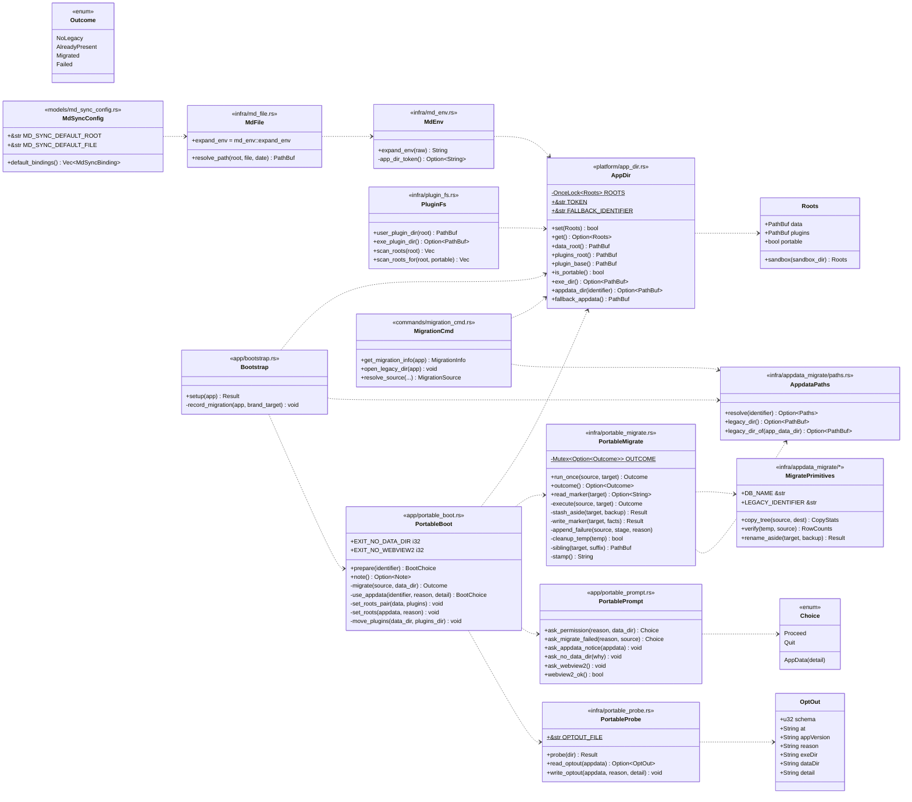
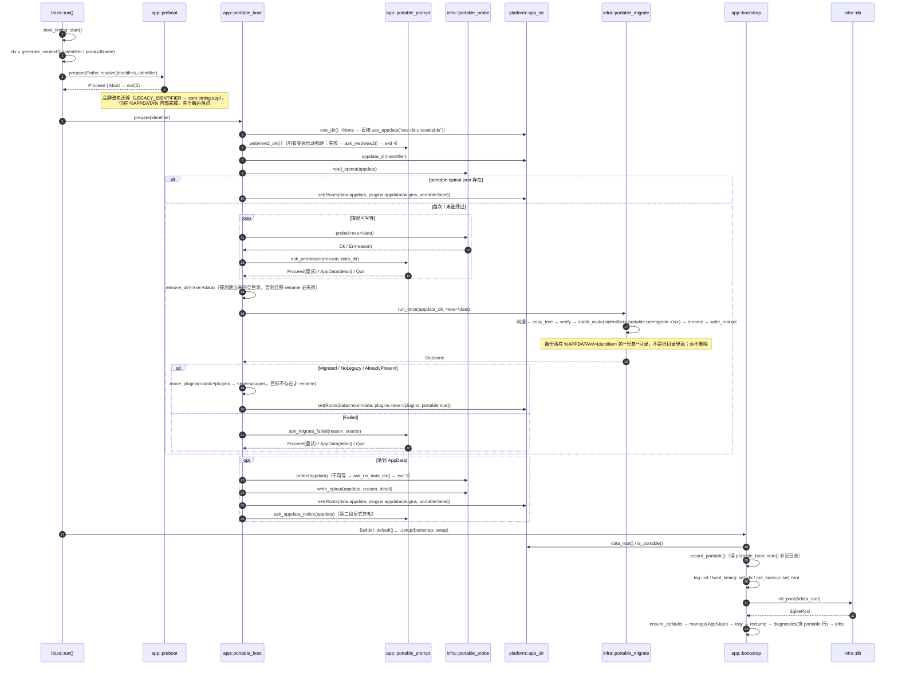
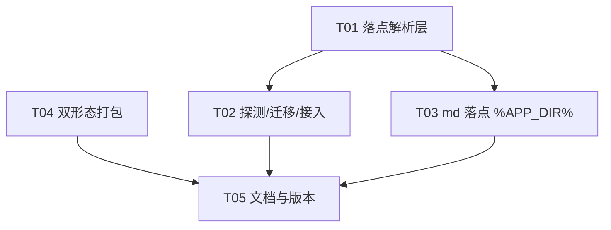

# V0.11.6 设计：便携落点 + 双形态打包

> 结论口径见 `docs/decisions/ADR-050.md`（落点）与 `docs/decisions/ADR-051.md`（打包）。
> 本文是给工程师的实现规格：文件级改动、调用顺序、坑。标注 `[已核]` 的条目都带文件:行号依据。

## 1. 关键判断一览

| 问题 | 结论 | 依据 |
|---|---|---|
| 落点入口 | `<exe 目录>`（`std::env::current_exe()?.parent()`） | `infra/plugin_fs.rs:56` 已有同款实现 |
| 数据根 | `<exe>\data`；不可写时 `%APPDATA%\com.timing.app` | ADR-050 §1 |
| 插件根 | `<exe>\plugins`；回退时 `%APPDATA%\com.timing.app\plugins` | ADR-050 §1 |
| 插件扫描拓扑 | 便携+release：只有 `User`；回退：`Exe` + `User`；debug：恒多一条 `Dev` | ADR-050 §1「插件扫描拓扑」 |
| md 出厂落点 | `%APP_DIR%\md`（新保留占位符） | ADR-050 §5 |
| 解析缓存 | `platform/app_dir.rs` + `OnceLock<Roots>` | ADR-050 §2 |
| 探测时机 | 每次启动（`portable-optout.json` 存在则跳过） | ADR-050 §3 |
| 探测手段 | 建目录 + 写 16B + **回读比对** + 删 | ADR-050 §3（`readonly()` 判据无效） |
| 提示手段 | Rust 侧 `rfd::MessageDialog`（**不是** `tauri-plugin-dialog`） | `app/preboot.rs` 顶部注释同款理由 |
| 回退状态 | `%APPDATA%\<identifier>\portable-optout.json` | ADR-050 §3 |
| 迁移框架 | 复用 `appdata_migrate` 的 `copy` / `verify` 原语（备份换名走自己的 `stash_aside`，落点不同），**共用原语不共用状态** | ADR-050 §4 |
| 迁移标记 | `<data>\migrated-to-portable.json`（随数据走） | ADR-050 §4 |
| 命令/事件/错误码 | 67 / 11 / 16 **全部不变** | ADR-050 §7 |
| 安装包 | 只留 NSIS，`installMode: currentUser` | ADR-051 §2 |
| 产物 | 便携目录 + zip + setup.exe（**不产** SHA256SUMS，见 ADR-051 §1） | ADR-051 §1 |

## 2. 类图



## 3. 启动时序



## 4. 任务分解（5 个，按依赖排序）

| ID | 任务 | 主要文件 | 依赖 | 优先级 |
|---|---|---|---|---|
| T01 | 落点解析层（叶子模块 + 旧目录口径） | `platform/app_dir.rs`(新)、`platform/mod.rs`、`infra/appdata_migrate/paths.rs` | — | P0 |
| T02 | 探测/迁移/接入（数据与插件真正搬过去） | `infra/portable_migrate.rs`(新)、`app/portable_boot.rs`(新)、`lib.rs`、`app/bootstrap.rs`、`app/diagnostics.rs`、`infra/plugin_fs.rs`、`commands/plugin_cmd.rs`、`commands/migration_cmd.rs` | T01 | P0 |
| T03 | md 出厂落点 `%APP_DIR%\md` | `infra/md_env.rs`(新)、`infra/md_file.rs`、`models/md_sync_config.rs`、`components/settings/MdSyncTab.tsx`、`mocks/browserMockPlugins.ts`、`infra/md_file_test.rs` | T01 | P0 |
| T04 | 双形态打包 | `src-tauri/tauri.conf.json`、`scripts/build-release.cmd`、`scripts/build-desktop.mjs`(新)、`.gitignore` | — | P0 |
| T05 | 文档与版本 0.11.6 | 六处版本、`CHANGELOG.md`、`docs/plugin-spec.md`、`ADR-050/051`（已落盘） | T01-T04 | P1 |



## 5. 交接清单（按文件，Rust 先）

> 本节现为**落地核对表**（as-built，0.11.6 实现完成后的实际形状）。与首版设计的差异已在对应小节
> 就地标注「实测/落地」，六处主要差异见 §9。

### 5.1 `src-tauri/src/platform/app_dir.rs`（落地 173 行，P0）

- `pub struct Roots { pub data: PathBuf, pub plugins: PathBuf, pub portable: bool }` + `Roots::sandbox(dir)`
- `static ROOTS: OnceLock<Roots>`
- `pub const TOKEN: &str = "%APP_DIR%";`
- `pub const FALLBACK_IDENTIFIER: &str = "com.timing.app";`（注释必须写明：**只**在 `ROOTS` 未注入时使用，
  生产路径由 `ctx.config().identifier` 注入）
- `set`（返回 `bool`：`false` = 已被写过，忽略并记 WARN，**不 panic**）/ `get` / `data_root` /
  `plugins_root` / **`plugin_base`** / `is_portable` / `exe_dir` / `appdata_dir(&str)` / `fallback_appdata`
- **`plugin_base()` 为什么必须存在**：`infra::plugin_fs::user_plugin_dir(root)` 内部会 `join("plugins")`，
  命令层若直接传 `plugins_root()` 就得到 `<exe>\plugins\plugins`。改名换口径（改 `user_plugin_dir`
  签名）会连带改 8 个测试夹具，所以两个口径分开命名。
- **坑 1**：`platform` 是叶子层，只能 `use std` + `dirs`，**不得** `use crate::infra`（`check:layers` L4 只
  管 infra→services，但 `platform` 加依赖会被分层评审打回）。
- **坑 2**：`data_root()` / `plugins_root()` 必须返回 `PathBuf`（不是 `Result`），未注入时走
  `fallback_appdata()`。若改成 `Result`，`plugin_cmd` 两处会各自编一条错误消息，口径会漂。
- **坑 3**：`set()` 的失败语义是**返回值**而不是 panic（落地实现返回 `bool`）；
  `log` 未初始化时 `log_warn!` 自带降级，见 `platform/log.rs`。

### 5.2 改 `src-tauri/src/platform/mod.rs`（+1 行）

`pub mod app_dir;`（按现有字母序插入）。

### 5.3 改 `src-tauri/src/infra/appdata_migrate/paths.rs`（+约 14 行）

新增：

```rust
/// 旧品牌数据目录（**与当前数据根无关**：品牌改名迁移的目标恒在 `%APPDATA%` 下）。
#[cfg(desktop)]
pub fn legacy_dir() -> Option<PathBuf> {
    data_dir().map(|base| base.join(LEGACY_IDENTIFIER))
}
```

- **坑**：`legacy_dir_of(app_data_dir)` **保留不动**（`app/preboot.rs` 的迁移路径仍靠它反推，那时数据根
  还没决定）。两函数共存必须在 doc 注释里写清「谁用哪个」：`legacy_dir()` = 展示/命令层；
  `legacy_dir_of()` = 迁移执行期。

### 5.4 新增 `src-tauri/src/infra/portable_migrate.rs`（目标 ≈190 行，P0）

- `pub enum Outcome { NoLegacy, AlreadyPresent(PathBuf), Migrated(Facts), Failed { stage: &'static str, reason: String } }`
  （落地砍掉 `Occupied`：判据表 ① ② 两行都是「什么都不做」，一个 `AlreadyPresent` 就够）
- `pub fn run_once(source: &Path, target: &Path) -> Outcome`（**路径全部注入**，测试可直接跑两个临时目录）
- 内部顺序：`cleanup_temp(target.migrating)` → 判据 → `copy::copy_tree` → `verify::verify` →
  `stash_aside`（目标已存在）→ `std::fs::rename(temp, target)` → `write_marker`
  （as-built 没有独立的 `decide` 函数，判据内联在 `execute()` 里；`stash_aside` 是 `portable_migrate`
  自己的私有函数，不是 `appdata_migrate::copy::rename_aside` 的直接调用）
- **备份落点**：`sibling(source, ".portable-premigrate-<ts>")` =
  `%APPDATA%\<identifier>.portable-premigrate-<ts>\`——`source` 的**兄弟**目录，
  **不是**它的子目录、也**不在** exe 旁边。**永不删除**（里面是用户原有文件，谁都不能删）。
  语义是「**挪走**」不是「复制留底」：跨盘时 `fs::rename` 报 `EXDEV`，退成「`copy_tree` → 删原件」，
  删原件失败会留两份并判 `Failed{swap}`（`portable_migrate.rs:207-212`），对话框带出备份路径——不丢数据。
  首版设计（和 ADR-050 首版）把它写成 `source.join("portable-premigrate-<ts>")`，QA `a1d` / `a1e`
  两条反例推翻了这个位置：放进 `source` 里一违背「旧目录零新增」，二让下一次迁移把备份当用户数据
  一起复制进新 `data\`。
- **「旧目录不改」的准确口径**：已有内容不删、不改、不覆盖；新增只有两处——上面的备份目录（`source`
  的兄弟），和「标记写失败」时的 `%APPDATA%\<identifier>\portable-migrate-failed.txt`（`append` 追加）
- 标记文件名 `migrated-to-portable.json`、`schema: 1`；写入目标目录
- 失败明细：**只有「标记写不进去」这一种**才把 `portable-migrate-failed.txt` 追加到 **source**
  （appdata）目录（`append_failure(source, "marker", …)` 是唯一调用点；此时结局**仍是 `Migrated`**，
  弹框一个都不弹）；`cleanup` / `copy` / `verify` / `swap` 的失败**只进 `logs/`**（`bootstrap` 补记
  ERROR），不写该文件
- **坑 1**：`copy::copy_tree` / `verify::verify` 都是 `pub`，直接 `use crate::infra::appdata_migrate::{copy, verify}`；
  但「判据」不要复用 `decide`——它判的是「两个 identifier 目录」，判据不同（本次只看 `timing.db`）。
- **坑 2**：临时目录名必须是 `<target>.migrating`（同盘才能 `rename`）。若 target 在 U 盘、temp 落到
  系统临时目录，`rename` 会跨卷失败（`os error 17`）。
- **坑 3**：**不要**碰 `appdata_migrate::{outcome, paths_used}` 这两个全局缓存（`mod.rs:275-277`），
  否则 `diagnostics::migration_label` 与 `migration_cmd::resolve_source` 会显示成品牌改名迁移的结果。
- **坑 4**：`run_once` 里任何一步失败都要先 `cleanup_temp` 再返回，杜绝半成品目录（`appdata_migrate`
  `mod.rs:196` 的注释解释了为什么：`verify` 只校验「源里有的、新目录里也有」，查不出「多」）。

### 5.5 `app/portable_boot.rs`（落地 221 行）+ `app/portable_prompt.rs`（新增，193 行）+ `infra/portable_probe.rs`（新增，154 行）

**落地时拆成三个文件**（首版设计只有两个）：`portable_boot` 一度写到 310 行撞门禁；更要紧的是
「弹框文案」与「决策流程」分开后，改文案不用碰逻辑，而「碰磁盘」单独一层才能被单测
（`prepare()` 会写进程级 `OnceLock`，同进程内不可清除，测试一跑就污染并行用例）。

| 文件 | 内容 | 为什么在这层 |
|---|---|---|
| `app/portable_boot.rs` | `prepare(identifier) -> BootChoice`、`note()`、`migrate()`、`use_appdata()`、`set_roots_pair()` / `set_roots()`、`move_plugins()`；`EXIT_NO_DATA_DIR=3`、`EXIT_NO_WEBVIEW2=4`、`BootChoice::{Proceed, Abort, NoDataDir, NoWebView2}` | `app` 层可同时用 `platform::app_dir` 与 `infra::portable_*`；放在 `infra` 会反向依赖 `app` 的对话框 |
| `app/portable_prompt.rs` | `ask_permission` / `ask_migrate_failed` / `ask_appdata_notice` / `ask_no_data_dir` / `ask_webview2` / `webview2_ok`；`enum Choice { Proceed, AppData(String), Quit }` | 纯 UI、无状态机。`Choice` 语义化，不绑定按钮文案 |
| `infra/portable_probe.rs` | `probe(dir)`、`OPTOUT_FILE`（`"portable-optout.json"`）、`OptOut` 结构 + `read_optout` / `write_optout` | 只碰磁盘。`infra → platform` 是允许方向（用 `exe_dir()` 把「程序当时在哪」写进标记） |

- **坑 1**：`rfd::MessageButtons::YesNoCancelCustom(a,b,c)` 在部分 Windows 语言下走
  `MessageDialogResult::Custom(文案)`，两个分支都要认（落地实现里的 `tri()` 就是这么做的）。
- **坑 2**：这一层在 `platform::log::init` **之前**跑，**不能**用 `log_info!` 指望有文件；
  事实缓存进 `portable_boot::NOTE`（`Mutex<Option<Note>>`），由 `bootstrap::record_portable()` 补记。
- **坑 3**：`probe` 会**创建** `<exe>\data`，之后迁移的 `rename` 目标已存在 → Windows 上必失败并白留
  一份空备份。**落地做法**：探测循环结束后立刻 `fs::remove_dir(&data_dir)`（只删得掉空目录；用户
  自己放过东西时它失败，正好什么都不做）。
- **坑 4**：迁移成功后 `plugins` 的处置（`move_plugins`：`<data>\plugins` → `<exe>\plugins` 只在目标
  不存在时 rename）；已存在则只 `log_warn!`，不要合并（ADR-050 Consequences 已登记为已知限制）。
- **坑 5（首版设计写错了，落地已纠正）**：`webview2_ok()` **不是**「只在便携分支跑」——它跑在
  `prepare()` 最前面、所有桌面启动都过一遍。理由：① 运行时缺失时连安装版都起不来；②「是否便携」
  要等探测与迁移之后才知道，顺序上做不到「只在便携分支检查」；③ 安装版恒为 true，代价只是两次
  `fs::metadata`。为安装版单独写一套检查才是把安装器的职责搬到运行时。

### 5.6 改 `src-tauri/src/lib.rs`（+约 20 行）

在 `preboot::prepare` **之后**、`Builder::default()` **之前**插入：

```rust
#[cfg(desktop)]
{
    let identifier = ctx.config().identifier.clone();   // 复用上面已克隆的变量
    match app::portable_boot::prepare(&identifier) {
        app::portable_boot::BootChoice::Proceed => {}
        app::portable_boot::BootChoice::Abort => {
            std::process::exit(app::preboot::EXIT_MIGRATION_ABORTED)
        }
        app::portable_boot::BootChoice::NoDataDir => {
            std::process::exit(app::portable_boot::EXIT_NO_DATA_DIR)
        }
        app::portable_boot::BootChoice::NoWebView2 => {
            std::process::exit(app::portable_boot::EXIT_NO_WEBVIEW2)
        }
    }
    platform::boot_timing::mark("portable_boot");
}
```

- **坑**：`generate_context!()` 已经提到 `run()` 开头（`lib.rs:52`），不要再调一次（会 panic：
  context 只能生成一次）。
- **坑**：`identifier` 变量已在 `lib.rs:55` 克隆，新增代码放在同一个 `#[cfg(desktop)]` 块里即可，
  不要重复 `.clone()` 到两个 block（顺序依赖：品牌迁移在前，落点搬运在后）。

### 5.7 改 `src-tauri/src/app/bootstrap.rs`（约 ±15 行）

| 位置 | 改法 |
|---|---|
| `:32` | `let data_root = platform::app_dir::data_root();`；移动端先 `app_dir::set(Roots::sandbox(app.path().app_data_dir()?))` |
| `:35` `:36` `:47` `:49` `:49` `:60` `:85` | 全部 `&app_data_dir` → `&data_root`（日志 / boot_timing / md_backup / init_pool / diagnostics） |
| `:32` 附近的 `log_info!` | 追加一行 `portable` 标记：`crate::log_info!("data root: {} (portable={})", data_root.display(), app_dir::is_portable());` |
| `:133` `record_migration` 签名第二个参数 | 由「权威数据根」改成「品牌改名迁移的目标」= `platform::app_dir::appdata_dir(identifier)`（`dirs::data_dir()+identifier`），**不是** `data_root` |
| `:137` 的 ERROR 比对 | `if used.target != brand_target`，否则便携模式下每次启动一条假 ERROR |

- **坑**：`record_migration` 里 `mig::legacy_dir_of(app_data_dir)`（失败分支打印旧目录）要换成
  `mig::legacy_dir()`，否则打印 `<exe>\<LEGACY_IDENTIFIER>`（永不存在的路径），报障时误导用户。
- **坑**：`bootstrap.rs` 现在 207 行，本任务加约 15 行仍在 300 内；但**不要**顺手把探测逻辑写进来
  （那是 `portable_boot` 的职责，顺序也不对）。

### 5.8 改 `src-tauri/src/app/diagnostics.rs`（+约 4 行）

- `legacy` 行（`:52`、`:58`）改用 `mig::legacy_dir()`；
- 新增两行：`portable     : true|false`（`platform::app_dir::is_portable()`）、
  `plugins_dir  : <path>`（`platform::app_dir::plugins_root()`）；
- 若 `portable_migrate::outcome()` 是 `Failed`，`migration` 行追加 `; portable=failed(<stage>)`。
- **坑**：文件 138 行，别把 `migration_label` 重构成两个函数；只在末尾加一个
  `fn portable_label() -> String`（约 8 行）。

### 5.9 改 `src-tauri/src/infra/plugin_fs.rs`（+约 12 行，as-built）

**机制变了，不是措辞变了**：便携模式下 `<exe>\plugins` **就是**用户目录，所以不再 push 一条 `Exe`
（否则用户自己放进去的插件会被标成「随包」，而设置页「打开目录」给他的正是这个目录——文案在骗人）。
「三种组合分别扫什么」的权威表在 **ADR-050 §1「插件扫描拓扑」**，此处不重复；落地形状：

```rust
// 薄壳：生产签名不变，便携与否由 app_dir 决定
pub fn scan_roots(app_data_dir: &Path) -> Vec<(PluginSource, PathBuf)> {
    scan_roots_for(app_data_dir, crate::platform::app_dir::is_portable())
}

// 实际实现（pub(crate)，只为测试开缝，见坑 6）
pub(crate) fn scan_roots_for(app_data_dir: &Path, portable: bool) -> Vec<(PluginSource, PathBuf)> {
    if let Some(dir) = dev_plugin_dir() {
        roots.push((PluginSource::Dev, dir));      // debug 构建恒多一条
    }
    if !portable {                                  // 便携模式下不 push Exe：<exe>\plugins 就是 User 目录
        if let Some(dir) = exe_plugin_dir() {
            roots.push((PluginSource::Exe, dir));
        }
    }
    roots.push((PluginSource::User, user_plugin_dir(app_data_dir)));
    // 防御性去重（正常配置一次都不会命中，见坑 1）
    let mut seen = std::collections::HashSet::new();
    roots.retain(|(_, dir)| seen.insert(dir.to_string_lossy().to_ascii_lowercase()));
    roots
}
```

- **坑 1（去重是防御，不是主路径）**：便携模式「不重复」靠的是**不 push `Exe`**，不是靠去重。去重只在
  「用户把整个便携目录拷进 `%APPDATA%`」「手动建同名目录」这类异常下命中；命中本身就是「扫描根配置
  异常」的信号 → 保留它，但**别**在文档里写成「已去重所以没事」，也别让它承担便携模式的正确性。
- **坑 2**：去重必须按**小写字符串**比，`PathBuf` 的 `==` 在 Windows 上对 `C://X` / `c://x` 判不等。
- **坑 3**：`user_plugin_dir(root)` 的语义**不变**（`root.join("plugins")`），`plugin_fs_test.rs` 与
  `tests/plugin_v3_matrix.rs` 依赖它；改语义会连带改 8 个测试文件的夹具。
- **坑 4（枚举一个变体都不删）**：`PluginSource::{Dev, Exe, User}` 是 DTO 面的一部分
  （`PluginInfo.source` 字符串 + 前端 `SOURCE_LABEL`），删变体要连带改 TS 类型 + mock + 组件测试，
  违反本轮「契约面不动」。只在文档里说明产出条件：`Exe` **只在回退 AppData 时**产出；`Dev` **只在
  debug 构建**产出（`dev_plugin_dir()` 只看 `cfg!(debug_assertions)`，与落点无关）。所以「便携模式下
  恒为 user」的准确表述是**「便携 + release」**。**三处文案分支同理一个都没删**
  （`PluginsTab.tsx:26`、`services/plugin_merge.rs:50`、`services/plugin.rs:50`）：回退 AppData 与 debug
  组合下它们仍会命中，删掉等于让回退模式的用户看到空标签 + 一条没有下文的日志。
- **坑 5（as-built：注释已随代码重写）**：`plugin_fs.rs` 文件头目录表第 2 行已改成「`exe`（随包分发，
  **仅回退 AppData 时**）」，`scan_roots` 上方 doc 与 `models/plugin.rs` 的 `Exe` / `User` 变体注释也已同口径。
  评审新代码时只认这三处口径，别再按「便携下 exe 与 user 同目录所以去重」理解。
- **坑 6（测试缝，as-built 新增）**：`scan_roots` 现在是 `scan_roots_for(dir, crate::platform::app_dir::is_portable())`
  的**薄壳**，实际实现在 `pub(crate) fn scan_roots_for(dir, portable: bool)`。原因：`app_dir` 的 `OnceLock`
  写入后不可清除，测试里禁止 `set()`（会污染同进程并行用例），于是「便携 / 回退」两条分支在端到端里
  只有一条跑得到。这个缝让两条都能单测；**生产签名与行为不变**，`check:layers` 仍绿（`infra → platform`
  是允许方向）。别把薄壳删掉「简化一下」——删了回退分支就没法测。


### 5.10 改 `src-tauri/src/commands/plugin_cmd.rs`（2 行）

`:22`、`:32`：`app.path().app_data_dir()` → `platform::app_dir::plugins_root()`，删掉 `use tauri::Manager`
里不再需要的 import（`AppHandle` 仍要，供…其实两个命令都不再需要 `app` 参数里的 path 能力，
**保留 `AppHandle` 参数不动**：删参数会改 IPC 签名）。

- **坑**：改名参数会让 Tauri 的命令入参变化；`AppHandle` 不是 JSON 入参，但保守起见原样保留。

### 5.11 改 `src-tauri/src/commands/migration_cmd.rs`（约 ±8 行）

| 位置 | 改法 |
|---|---|
| `:25` | `let data_root = platform::app_dir::data_root();`（marker / pending / db 判定用它） |
| `:27` | `mig::legacy_dir_of(&app_data_dir)` → `mig::legacy_dir()` |
| `:66`（`open_legacy_dir`） | 同样改成 `mig::legacy_dir()`；错误文案「无法推断旧数据目录（app_data_dir 没有父目录）」要改成「无法推断旧数据目录（拿不到系统数据根）」 |

- **坑**：`legacy_dir` 现在恒为 `%APPDATA%\<LEGACY_IDENTIFIER>`（旧品牌目录，字面量见
  `infra/appdata_migrate/paths.rs` 的 `LEGACY_IDENTIFIER`，本文件不重复它——`check:brand` 只允许旧名
  出现在 `docs/decisions/ADR-*.md` 与白名单登记的迁移类源码里），与当前数据根无关；**不要**再接受任何
  前端传入路径（现有实现已经这样，保持），否则便携目录搬家后会出现路径注入面。

### 5.12 新增 `src-tauri/src/infra/md_env.rs`（目标 ≈90 行）

- 把 `infra/md_file.rs:55-95` 的 `expand_env` 整段搬过来（含 `~` 展开与未知变量原样保留）；
- 开头加 `%APP_DIR%` 替换：

```rust
pub const APP_DIR_TOKEN: &str = "%APP_DIR%";

pub fn expand_env(raw: &str) -> String {
    let text = raw.replace(APP_DIR_TOKEN, &app_dir_value());
    expand_vars(&text)          // 原逻辑
}

fn app_dir_value() -> String {
    crate::platform::app_dir::data_root().to_string_lossy().to_string()
}
```

- **坑 1**：`%APP_DIR%` 是**保留名**，先于 `%VAR%` 展开；`app_dir_value()` 永远返回具体路径
  （`data_root()` 自带 `fallback_appdata()` 兜底），**绝不**返回未替换的占位符——否则
  `resolve_path` 会在 CWD 下造出 `%APP_DIR%\md\` 这种目录，比直接报错更难查。
- **坑 2**：`md_file.rs` 必须留 `pub use crate::infra::md_env::expand_env;`，否则
  `infra/md_file_test.rs:59` 编译失败。
- **坑 3**：不要在这里 `use crate::platform::app_dir::TOKEN` 又自己定义一份常量；`TOKEN` 只在
  `app_dir` 定义一次（口径唯一）。

### 5.13 改 `src-tauri/src/infra/md_file.rs`（-约 45 行）

- 删除 `expand_env` 函数体，留 re-export（见 5.12）；
- `resolve_path` 改调 `md_env::expand_env`；
- `expand_tokens`（日期令牌）保持不动。
- **坑**：该文件现在 **298/300 行**，删完约 250 行；**先删后加**，顺序反了会先红一次 `check:size`。

### 5.14 改 `src-tauri/src/models/md_sync_config.rs`（1 行 + 注释）

```rust
/// 出厂落点根目录。`%APP_DIR%` = 数据根（便携 `<exe>\data` / 回退 `%APPDATA%\com.timing.app`），
/// 解析在 `infra::md_env::expand_env`（换用户 / 换机器 / 换盘符后仍然跟着应用走）。
pub const MD_SYNC_DEFAULT_ROOT: &str = r"%APP_DIR%\md";
```

- **坑**：`MD_SYNC_DEFAULT_FILE` 与 `default_bindings()` 不要动；`enabled` 出厂仍 `false`。

### 5.15 前端（TS，2 个文件）

| 文件 | 改法 | 坑 |
|---|---|---|
| `src/components/settings/MdSyncTab.tsx:289` | `根目录支持 {'%USERPROFILE%'} 与开头的 ~。` → `根目录支持 {'%APP_DIR%'}、{'%USERPROFILE%'} 与开头的 ~。` | 该文件 **295/300 行**，必须**行数中性**（同一行内替换），否则 `check:size` 红 |
| `src/mocks/browserMockPlugins.ts:25` | `MOCK_ROOT = '%APP_DIR%\\md'` | 浏览器预览走 `resolve_path` 时 `app_dir` 未注入 → 落到 appdata 口径；mock 只用于展示，可接受 |

### 5.16 打包（4 个文件，落地形状）

| 文件 | 改成（as-built） |
|---|---|
| `src-tauri/tauri.conf.json` | `"version": "0.11.6"`；`bundle.targets: ["nsis"]`；`bundle.windows.nsis.installMode = "currentUser"`；`webviewInstallMode` 保持 `embedBootstrapper` |
| `scripts/build-release.cmd` | **只做**「载入 `vcvars64.bat` + 参数转发」：`portable` → `--portable`、`installer` → `--installer`、`all`/空 → 无参数；未知参数 `exit /b 2`。ASCII + CRLF 不能破 |
| `scripts/build-desktop.mjs`（新） | 全部实际步骤：前端 → dist 内容指纹（变了才 `touch src-tauri/build.rs`）→ **一次** `tauri build`（`--bundles nsis` 或 `--no-bundle`）→ 组装 `release/Timing-<ver>-portable/` → `tar -a -cf` 打 zip → 收 `bundle/nsis/*-setup.exe` → 打印报告。细节见 ADR-051 §3/§4 |
| `.gitignore` | 加 `release/*.zip` 与 `release/Timing-*/` |

- **坑 1**：`.cmd` 里含 `Program Files (x86)` 的变量**不能**放进括号块内展开（现有文件注释已警告），
  所以实际步骤全在 `.mjs` 里，`.cmd` 只负责 vcvars 与转发。
- **坑 2**：**不要**为了「先出裸 exe 再出安装包」跑两次 `tauri build`：`--no-bundle` 会改变内嵌 config
  指纹，两次产物不可复用，等于整 crate 重编两遍（实测白花 2m06s）。要安装包就只跑 `--bundles nsis`，
  便携版复用它的 `timing.exe`。
- **坑 3**：zip 必须用 `C:\Windows\System32\tar.exe`（bsdtar）的**绝对路径**；PATH 上的 GNU tar 1.35
  不能写 zip，还会把 `D:\...` 当远程主机报 `Cannot connect to D:`。传给它的路径一律转仓库相对路径。
- **坑 4**：空目录不进 zip → `data\` / `plugins\` 里各放一份 `README.txt` 占位兼说明。
- **坑 5**：`dist\` 不是 cargo 输入，必须处理「前端变了但 exe 没重编」。落地用内容指纹 + `touch
  src-tauri/build.rs`，**不要**退回 `cargo clean --release -p timing`（等效但整 crate 重编）。

### 5.17 版本与文档（T05）

| 文件 | 改成 |
|---|---|
| `package.json` | `"version": "0.11.6"` |
| `package-lock.json` | 顶层 `version` + `packages[""].version` 两处 |
| `src-tauri/Cargo.toml` | `[package] version = "0.11.6"` |
| `src-tauri/Cargo.lock` | `name = "timing"` 那条的 `version` |
| `src-tauri/tauri.conf.json` | `version: "0.11.6"` |
| `CHANGELOG.md` | 顶部新增 `## 0.11.6 — 落点搬到应用旁边 / 双形态打包` |
| `docs/plugin-spec.md:382` 的「三档默认值」行 | `root = %APP_DIR%\md`，并注明 `%APP_DIR%` 语义 |
| `docs/decisions/ADR-050.md` / `ADR-051.md` | 已落盘（本设计产出） |
| `scripts/archived-versions.json` | **不动**（冻结断言） |

## 6. 测试影响面（数字都核过）

| 项 | 结论 |
|---|---|
| `grep -rn "app_data_dir" src-tauri/src/tests/` | **0 命中** → 没有任何测试夹具依赖 `app.path().app_data_dir()`，落点改造**不红一条测试** |
| `unique_dir(` 使用 | 8 个文件 13 处，传的是纯临时目录（`support.rs::unique_dir` → `db::init_pool(&dir)`），不需要改 |
| `tests/md_sync_disabled_gate.rs:70` / `tests/md_sync_legacy_config.rs:112` | 常量对常量断言，换字面量后照过 |
| `tests/md_sync_disabled_gate.rs:154-162` | **语义变化但断言仍过**（它比的是「目录存在性前后一致」）：解析结果从 `%USERPROFILE%\Documents\Timing` 变成 `%APPDATA%\com.timing.app\md`。**注释必须改**，否则下一个人会以为守的是文档目录 |
| `infra/md_file_test.rs:59` | 靠 re-export 保持编译；**新增**一条 `expand_env("%APP_DIR%\\md")` 用例（保留名优先级 + 永不留占位符） |
| 需要新增的 Rust 测试（落地在 `tests/portable_dir.rs`） | ①`portable_probe::probe` 对不可写路径的判定（用「父路径是一个文件」构造必然失败；`set_readonly` 对目录在 Windows 上无效）；②迁移判据四行表（`AlreadyPresent` / `NoLegacy` / `Migrated` / `Failed`）；③标记幂等（跑两次 `run_once`，第二次必须 `AlreadyPresent` 且源目录字节不变）；④`plugin_fs::scan_roots`：便携模式下不产 `Exe`（只有 `User` 一条）、回退模式两条都产；去重只在人为构造同路径时命中 |
| **禁止** | 任何测试都不得调 `app_dir::set()`：`OnceLock` 不可清除，会污染同进程并行用例。所有可测逻辑必须接受**注入路径**（与 `appdata_migrate::run_at(&Paths)` 同款设计） |

## 7. 共享知识（给工程师）

- 错误一律 `AppError::io(...)`（`IO_ERROR`），不新增错误码；用户可见文案写中文、带绝对路径。
- 启动期（`log::init` 之前）不打日志：结果缓存 + `bootstrap` 补记（`appdata_migrate` 的既有手法）。
- 时间戳一律本地时区 RFC3339 带偏移（`chrono::Local::now().to_rfc3339()`）。
- 所有「一次决策」的结果必须落盘可查（`*.json` 标记 + 日志一行 + `diagnostics.txt` 一行），
  不许只存在内存里。
- 单文件 ≤300 行是硬门禁：`md_file.rs`(298)、`MdSyncTab.tsx`(295) 两个文件只能**先删后加 / 行内替换**。

## 8. 待明确事项

| # | 事项 | 现状处理 |
|---|---|---|
| 1 | 便携模式下 `.window-state.json` 仍在 `%APPDATA%` | 插件 2.5.0 只提供 `with_filename`（`src/lib.rs:366`），目录由 `app_config_dir()` 决定（`:138`）。本轮接受为已知限制；要彻底解决需 fork 插件，已登记 ADR-050 Consequences |
| 2 | 迁移后 `<exe>\plugins` 已存在时旧插件不合并 | 只在目标不存在时 rename；否则留 `data\plugins` + WARN。已在 ADR-050 登记 |
| 3 | 设置页是否要显示「数据目录 / 是否便携」 | 需要新 IPC 命令或扩 `get_migration_info` DTO，两者都会碰契约面 → 本轮**不做**，可见性靠「对话框 + 操作日志 + diagnostics.txt」。列为 P2 |
| 4 | 便携目录搬家后自启项失效 | 需要重新开关一次自启，`docs` 无入口；P2 |

## 9. 落地差异（as-built vs 首版设计）

实现完成、门禁全绿后回填。共八处差异：七处是**实现更优 / 首版设计写错**，第 7 处是 **QA 反例推翻首版落点**。

| # | 首版设计（已作废） | 落地（准） | 为什么改 |
|---|---|---|---|
| 1 | 打包分两次构建：先 `--no-bundle` 出裸 exe，再 `--bundles nsis` 出安装包 | **一次** `tauri build --bundles nsis` 同时拿 exe + 安装包，便携版复用该 exe；只有「只要便携版」时才用 `--no-bundle` | `--no-bundle` 会改变内嵌的 config 指纹（两次调用传给 `tauri-build` 的配置不同 → 生成代码变化），两次产物不可复用 → 整 crate 重编两遍，实测白花 **2m06s** |
| 2 | zip 用 `Compress-Archive`，后又写「bsdtar 或等价」 | 钉死 **`C://Windows//System32//tar.exe`** 绝对路径，`tar -a -cf` | PATH 上第一个 `tar` 是 Git 的 GNU tar 1.35：`-a` 不能写 zip，且把 `D://...` 当远程主机报 `tar: Cannot connect to D: resolve failed` |
| 3 | 两个文件：`app/portable_boot.rs`（含探测与弹框）+ `infra/portable_migrate.rs` | **三个文件**：`app/portable_boot.rs`(221) 编排 / `app/portable_prompt.rs`(193) 文案与按钮 / `infra/portable_probe.rs`(154) 探测与标记读写 | `portable_boot` 一度 310 行撞门禁；「文案」与「决策」分开后改文案不碰逻辑，「碰磁盘」单独一层才能单测（`prepare()` 写进程级 `OnceLock`，一跑就污染并行用例）。没复用 `app::preboot::ask`：那是 private 且文案绑死品牌改名迁移 |
| 4 | `app_dir` 只有 `plugins_root()` | 追加 **`plugin_base()`**（`plugins_root()` 的父目录） | `plugin_fs::user_plugin_dir(root)` 内部还会 `join("plugins")`，命令层直接传 `plugins_root()` 会得到 `<exe>\plugins\plugins`；改 `user_plugin_dir` 签名会连带改 8 个测试夹具，所以两个口径分开命名 |
| 5 | `webview2_ok()` 只在便携分支跑 | 跑在 `prepare()` 最前面，**所有桌面启动**都过 | 「是否便携」要等探测/迁移之后才知道（顺序上做不到）；运行时缺失时安装版也起不来；安装版恒 true，代价只是两次 `fs::metadata` |
| 6 | `build-release.cmd` 自己跑完全部步骤；用 `cargo clean -p timing` 强制重嵌前端 | `.cmd` 只载入 vcvars + 转发参数，步骤全在 `scripts/build-desktop.mjs`；重嵌改成 **dist 内容指纹 + `touch src-tauri/build.rs`** | `.cmd` 里跟引号/括号搏斗不值；`cargo clean` 等效但整 crate 重编，指纹法重编量小得多 |
| 7 | 覆盖前的目标备份放**旧目录里面**：`source.join("portable-premigrate-<ts>")`（首版原文） | 改到 `source` 的**兄弟目录**：`%APPDATA%\<identifier>.portable-premigrate-<ts>\`，**永不删除** | **首版这个位置被 QA 的 `a1d` / `a1e` 直接推翻**：`a1d` —— 往旧目录里写任何东西（哪怕只是新增一个子目录）都直接打脸「旧目录零新增」的承诺，断言是「迁移前后源目录的文件集合必须完全相同」；`a1e` —— 备份落在被复制的源树里，用户「删掉 `data\` 重来」时会把它当成用户数据一起拷进新数据目录。放 exe 旁边也不行——便携目录只该有 `Timing.exe` / `data` / `plugins`。所以最终落在 `source` **兄弟**位置，与 `appdata_migrate` 既有的 `<target>.premigrate-<ts>` 同父同级 |
| 8 | 只在 `scan_roots` 里加一个 `if !is_portable()` | `scan_roots` 变薄壳，实际实现拆成 `pub(crate) fn scan_roots_for(dir, portable: bool)` | `app_dir` 的 `OnceLock` 写入后不可清除，测试禁止 `set()`（会污染同进程并行用例）→「便携 / 回退」两条分支在端到端里只有一条跑得到。开个参数缝两条都能单测，生产签名与行为不变，`infra → platform` 仍是允许方向 |

**旧品牌标识的写法（`check:brand`）**：`scripts/brand-gate.mjs` 用 `git grep --untracked` + 大小写不敏感的品牌旧名
（判据字面量只写在那个脚本里，本文件不复制）扫全仓，
白名单支持整文件与「行级子串」两种豁免。`docs/decisions/ADR-*.md` 是**整文件豁免**（历史决策记录不改），
所以旧 identifier 的字面量只写在 ADR-050/051 里；`docs/design/**` 不在白名单内，本文件与
`v0.11.6-sequence.mermaid` 一律写成 `LEGACY_IDENTIFIER`（Rust 常量名，见
`infra/appdata_migrate/paths.rs`）。**没有为此改白名单**——旧名该出现的地方是 ADR 与迁移模块，
设计文档引用常量名反而更不容易与代码漂移。
