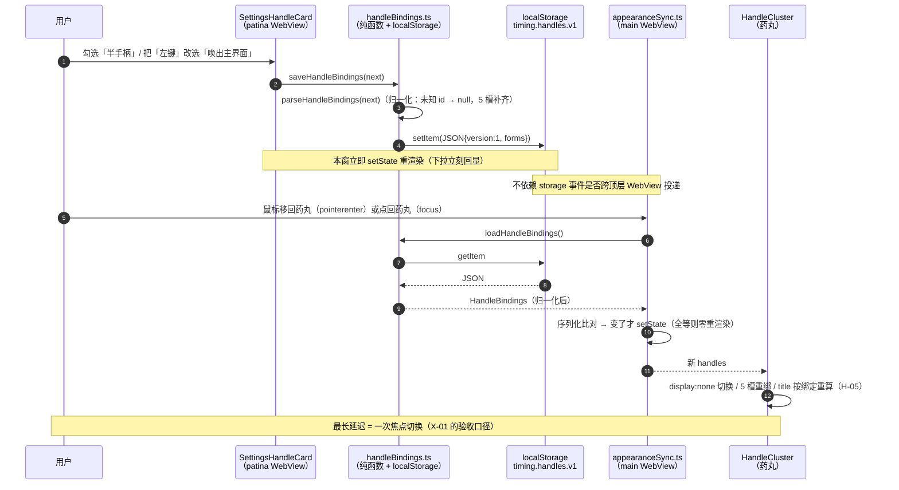
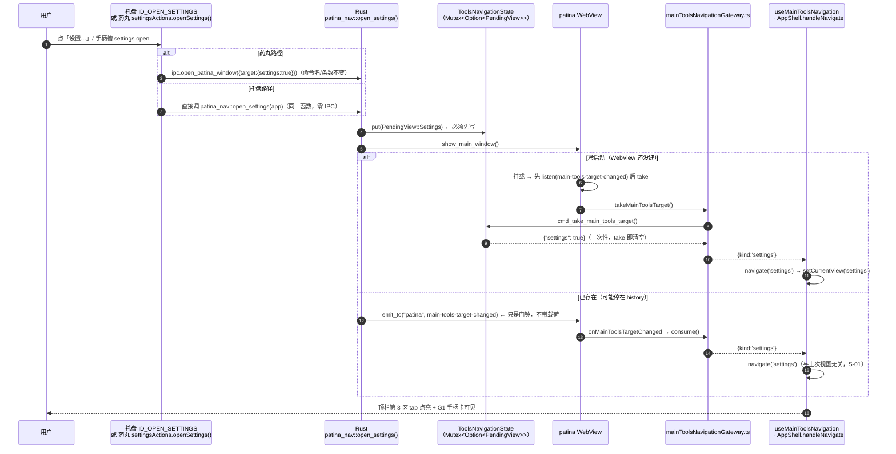
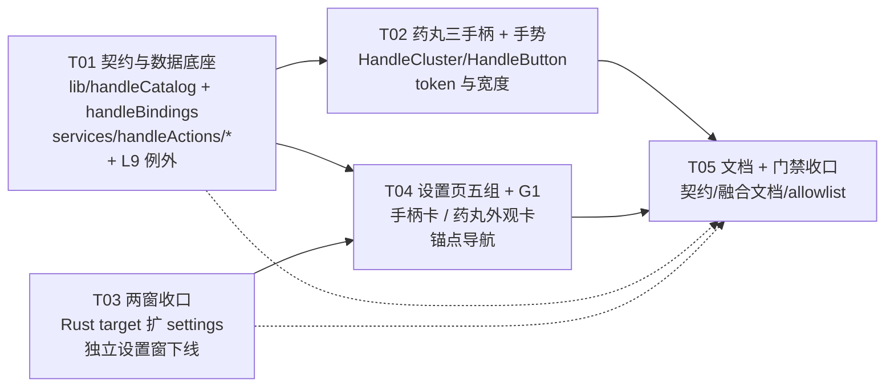

# 设计 · 0.12.1 手柄三形态 + 两窗收口（增量）

> 工作区：`D:\101-Workshop\261111-Timing`（HEAD `0e99029`，工作树含 0.12.1 未提交改动）
> 上游：`docs/fusion/BRIEF-20261111-手柄与两窗融合.md`（任务书 / A1-A2-A3）+ `docs/fusion/PRD-20261111-手柄与两窗融合.md`（59 条：P0 38 / P1 15 / P2 6）
> 版号：**不动**（`desktop: 0.12.1`）。本轮**只做桌面**。
> 本文只写设计，不含任何代码改动。所有结论给文件路径 + 行号锚点。

---

## 0. 事实校正（先读，避免按任务书的旧数字设计）

| 任务书写的 | **实跑实测** | 来源 |
|---|---|---|
| 命令表 `#[cfg(desktop)]` **80**+117 / 手机 80 | **宿主 81** + Patina 117（`create_record` 已把 80→81） | `node scripts/check-contract.mjs` 实跑输出 |
| 事件 **17** / emit 点 **11** | 事件**声明 11/11**（后 11 / 前 11），emit 点 **18**（脚本 `EXPECTED_EMIT_SITES = 18`） | `scripts/check-contract.mjs:260` |
| L9 主窗 310 / 分析窗 411 | 主窗 **324** / 分析窗 **450**（快照：`src/platform/desktop/mainTool` 等新增文件） | `node scripts/check-layers.mjs` 实跑输出 |
| `src-tauri/src/app/insight/bootstrap.rs` 正好 300 行 | allowlist 冻结值 **305**（实际 305） | `scripts/size-allowlist.json` |

**含义**：契约门禁那三个数字本轮**一个都不用动**（我们不加命令、不加事件），但任何"顺手补一条命令/事件"都会撞红。下面所有设计以此为准。

---

## 1. 裁决摘要

### 1.1 三条被点名的技术判据

| # | 问题 | **裁决** | 一句话理由 |
|---|---|---|---|
| **T1** | 「打开设置」跨窗落点 | **扩 `settings?: bool`**（与 `overview` 同构），**不加** `view?: string`；判序 **`history` > `settings` > `overview`**；Rust 侧只加 `PendingView::Settings` + `patina_nav::open_settings()` + DTO 一个 `Option<bool>` 字段 | 通用 `view: string` 会让 `overview` 出现两种写法（`{overview:true}` 与 `{view:"overview"}`），并把前端 `View` 枚举泄漏进 Rust 契约；`deny_unknown_fields` 已经能挡住拼错，布尔三键是**唯一无解析器、无非法值**的形状 |
| **T2** | 手柄配置跨 WebView 生效 | **不依赖 `storage` 事件**：药丸窗口在 `focus` / `pointerenter` / `visibilitychange` 三个信号上**从 localStorage 重读**（幂等、只在内容变化时 setState）；`storage` 监听保留为快路径 | 三个信号都指向"人回到药丸窗口了"，而用户改完设置**必然**要回到药丸才能看见效果——所以**最长延迟 = 一次焦点切换**是可证的，不依赖任何跨顶层 WebView 的投递行为；零新增 Tauri 事件 |
| **T3** | 动作注册表分层与扩展性 | **两份文件、两个方向**：目录=纯数据 `src/lib/handleCatalog.ts`（两窗共享）／实现=`src/services/handleActions/{runners,guards,dispatch}.ts`（只主窗）。新增一个动作 = **改 2 个文件、0 个 UI 文件**；A-02 的反证型判据在**两侧各自的单测**里都能实现（目录数组与 runner 表都是可注入的普通数组/对象） | 目录必须被设置页（分析窗）读到，而 `src/components/**` 与 `src/features/**` 分属 L9 的两个互斥集合；唯一能共享的载体是 `src/lib/`（与既有 `windowApi.ts` 同族）——所以目录与实现必须**物理分离**，这不是洁癖而是门禁的硬约束 |

### 1.2 设计过程中发现的三条**与 PRD 冲突**的裁决（必须由主人确认，见 §11）

| # | PRD 原条 | 冲突事实 | **我的裁决** |
|---|---|---|---|
| **B1** | §5.1「插件（md-sync）→ 并入 G5」、S-04「删 `panel==='settings'`」、A2「独立设置窗下线、设置全在主界面」 | ① `src/features/settings/settingsConvergence.source.test.ts:251-260` **明文断言**"分析窗这套不碰 md_sync（那是宿主的计时数据备份）"；② 同一测试的 `p006_only_one_accent_editor_in_the_whole_app`（:144-155）把"可改主色的控件全仓只有 `src/components/settings/ThemePicker.tsx`"钉死，且 `capabilities/patina.json` 已摘 `host-theme-write`（P0-06 裁决）；③ md-sync 的 6 张卡与数据管理都 import 宿主 `services/api`，搬进 `src/features` 直接撞 L9 | **本轮 md-sync / 数据管理 / 主题与主色 不迁**。药丸**内联设置面板保留**（`panel==='settings'` 不删），收窄为「主题与主色 / 计时记录同步与备份 / 药丸高亮颜色」三块；patina 设置页 G3、G5 各加一行指引 + 既有 `open_host_settings` 意图跳过去。**反转 S-04、部分反转 S-07**（详见 §11-① ） |
| **B2** | V-01「5 个分组 + 页内锚点」 vs 既有 P0-06 判据②「分区 5 → 4」 | `settingsConvergence.source.test.ts:189-194` 逐字断言 Settings.tsx 里顶层 `<Settings*Panel` 恰为 4 个（追踪/显示/常驻/数据安全） | **V-01 优先**（5 组是用户可见 IA，判据②只是当时"外观页签消失"的表述方式）。该用例改为断言 **5 组 + 「外观」字样仍不在 `Settings.tsx`/`SettingsAppearancePanel.tsx` 源码里**——实质判据（不许再有独立"外观"分区）不变，只改计数口径 |
| **B3** | §6.2「`handles` 嵌进 `timing.appearance.v1`」 | 若嵌进去，`appearanceStore.commit()`（:97-108）是**逐字段重建对象**再整串写回——任何一次拖不透明度滑杆都会把 `handles` 抹成默认。这是本轮最难查的一类回归 | **另立键 `timing.handles.v1`**：`appearanceStore.ts` **零改动**（139 行 + 其测试零改动），手柄读写由 `src/lib/handleBindings.ts` 独占，两个写入方物理上不可能互相覆盖。代价是多一个 localStorage 键，如实记入 CHANGELOG |

### 1.3 其余关键裁决（不冲突，直接执行）

| # | 事项 | 裁决 | 依据 |
|---|---|---|---|
| D1 | 三手柄的 DOM 与开关 | 三个都**始终渲染**，关掉的加 `hidden`（`display:none`）+ `data-enabled="false"`；不采用"不渲染" | H-02 判据写的是"该节点 `offsetWidth === 0`"，节点不存在会让选择器返回 `null`、把断言变成"测不到" |
| D2 | 三形态 SVG | 三个 `viewBox="0 0 12 22"`、都带 `strokeWidth="2.5"`、`color: var(--pill-grip-ink)`；圆点用 `<circle r="3" fill="currentColor" stroke="none">` | H-03 的三条断言（stroke 2.5 / viewBox 高 22 / 同色）逐字可测；dot 用 fill 而保留 svg 上的 `strokeWidth` 属性，是唯一能同时满足"三者同视觉语言"与"圆点是实心"的写法 |
| D3 | hover 显形 | **保留**（只动 `svg { opacity }`），并补 `.pill[data-reveal="true"] .pill__handle svg { opacity: 1 }` | G-08 "hover 只改 opacity 不改宽度"；补 `data-reveal` 是把 PRD §4.2 显影矩阵里"有浮层时 opacity 1"那一格落到 CSS（现状漏了这一格） |
| D4 | 双击判定窗常量 | `DBLCLICK_MS = 250` 落 `src/lib/constants.ts`（与 `DRAG_THRESHOLD_PX`、`DRAG_CLICK_SWALLOW_MS` 同族） | G-01 要求常量在 `lib/constants.ts`；该文件 71 行，+3 行余量充裕 |
| D5 | 双击的识别 | **手工配对，不绑 `onDoubleClick`**：同槽两次 tap 间隔 ≤ `DBLCLICK_MS` → 双击 | 原生 `dblclick` **只对主键触发**，右键双击拿不到；两套机制必有一套是死的。手工配对同时天然满足 G-02"双击不触发两次单击"（第一次的定时器被第二次取消） |
| D6 | 拖动互斥 | 手柄自己镜像 `DRAG_THRESHOLD_PX`：`pointermove` 位移 ≥ 4px → 清空待定单击 | 与 `usePillDrag`（:18-19）**同一个常量、同一组坐标**，所以"药丸判定为拖动"与"手柄撤销待定"由构造保证等价，不靠时序巧合 |
| D7 | 药丸外观卡的归属 | `#s-pill-look`（文字/背景不透明度 + 常驻形态）**迁到主界面**；`高亮颜色` 留在药丸面板 | 前两项只写 localStorage（走 B3 的豁免模块即可），后一项写 Rust `reference settings`（要新增 HostIntent 变体 + 一个 gateway），本轮不值当，记债 |
| D8 | i18n | **本轮不新增任何 i18n key**；G1 手柄卡与 5 个组标题走中文常量（`src/lib/handleCatalog.ts` / `src/features/settings/settingsGroups.ts`） | `src/shared/i18n/generated/contract.ts` 恰好 1131 行且冻结值=1131（**零余量**），加任何 key 必红 `check:size`；且 i18n 是"位置数组 + 4 份 locale"，加 20 个 key 会把 A-02 的"1-2 文件"撑成 6 文件。宿主侧 `src/components/settings/**` 本来就是硬编码中文，本轮只是让 G1 与之一致 |

---

## 2. 组件树（现状 → 目标）

### 2.1 药丸手柄区

```
现状                                    目标
PillBar.tsx (291)                       PillBar.tsx (≤300, 本批 ≈291±8)
├─ MainButton (环)                      ├─ MainButton                     0 改
├─ TimerDisplay                        ├─ TimerDisplay                   0 改
├─ ItemName | NewItemEntry             ├─ ItemName | NewItemEntry        0 改
├─ TodayEntry          ← 删            ├─ ~~TodayEntry~~                −41 行文件删除
│   ├─ 左键 openTodayPanel             │   └→ 动作 today.panel（full 的左双击）
│   └─ 右键 openDigestPanel            │   └→ 动作 today.digest（full 的右双击）
└─ NoteHandle (79)     ← 改            └─ HandleCluster (新, ~70)
    ├─ 左键 便利贴                        ├─ HandleButton "dot"  (新, ~110) ×3
    ├─ 右键 清单                          │   ├─ useHandleGesture（新, ~140）
    └─ 左键拖窗口                         │   ├─ 5 槽 → dispatch.ts
                                          │   └─ svg: 圆点 / 短括号 / 长括号
                                          └─ 5 槽 = { left, right, middle, leftDouble, rightDouble }
                                             每槽 = 动作 id | null（默认表见 §3.3）
```

**不变的契约（逐条照抄，别"顺手优化"）**
- 手柄 `onPointerDown`（左键）**必须继续冒泡**给 `.pill` 的 `usePillDrag.onDown`（`usePillDrag.ts:11-14` 只认 `button===0 && isTrusted`）。手柄内部**禁止**对 `button===0` 调 `stopPropagation`。
- 拖起来后 `onClickCapture`（`usePillDrag.ts:26-31`）**只吞 `click`**，不吞 `dblclick` / `auxclick` → 所以手柄的单击/双击/中键必须**只挂在 `click` / `auxclick` / `pointerup(2)`** 上，不能挂在 `pointerdown` 派发。
- `note.list` 的锚点计算与今天**逐字一致**：`{ x: r.left - 6, y: r.bottom + 4 }`（`NoteHandle.tsx:36` / :50）。

### 2.2 动作注册表（分层）

```
src/components/pill/           src/services/handleActions/            src/lib/
────────────────────────       ───────────────────────────────        ────────────────────────
HandleButton.tsx ──dispatch──▶ dispatch.ts  ──canRun──▶ guards.ts      handleCatalog.ts  (纯数据)
  (L1: 无 ipc.)                  │                                  │   ▲ id/label/group/flags
                                 └──run──▶ runners.ts ────▶ services/ │   ▲ 默认绑定
                                             todayActions / noteActions   ▲ DEFAULT
                                             todosActions / settingsActions│
                                             uiStore / timer(经 ctx)      │
                                                                          handleBindings.ts (纯IO)
                                                                          parse / normalize / load / save
                                                                              ▲              ▲
                                        src/stores 不动 ────────────────────┘              │
                                        src/features/settings/**（分析窗）─────────────────┘
                                        （经 §9-R3 的 L9 例外路径）
```

### 2.3 设置页（分析窗）

```
现状 Settings.tsx (348, 冻结 348 → 零余量)         目标
┌ QuietPageHeader（rightSlot 45 行内联）  ┐        ┌ SettingsHeaderActions（新，抽出 45 行）┐
├ 平铺 grid：4 张卡                        ┤        ├ SettingsGroupNav（新，5 组锚点）        ┤
│  1 SettingsTrackingPanel                │        ├ G1 悬浮条与手柄  #s-pill-handles        │
│  2 SettingsAppearancePanel              │        │   ├ SettingsHandleCard ×3（新）          │
│    └ SettingsInterfacePanel(embedded)   │        │   └ SettingsPillLookPanel（新）          │
│  3 SettingsResidentPanel                │        ├ G2 记录与追踪    #s-tracking            │
│  4 SettingsDataSafetyPanel              │        ├ G3 外观与语言    #s-theme / #s-language │
└ 2 个 lazy 对话框                          ┘        ├ G4 常驻与启动    #s-tray / #s-startup   │
                                                    └ G5 数据、同步与接口 #s-backup/#s-storage  │
                                                        /#s-interface /#s-timing-sync（指引）  │
```

**共存关系**：`src/components/settings/SettingsPanel.tsx`（药丸内联面板，PillBar 之外的 `panel==='settings'`）**保留**，收窄为「主题与主色 / 计时记录的同步与备份 / 高亮颜色」；删 `variant='window'` 分支与 `SettingsWindow.tsx`（唯一消费者消失）。

---

## 3. 数据契约

### 3.1 localStorage

| 键 | 归属模块 | 写入方 | 读取方 |
|---|---|---|---|
| `timing.appearance.v1`（既有） | `src/stores/appearanceStore.ts` | 药丸（滑杆）/ 主界面 `#s-pill-look` | 全部宿主窗 |
| **`timing.handles.v1`（新）** | `src/lib/handleBindings.ts` | 主界面 G1 卡（独占） | 药丸（`focus`/`pointerenter`/`visibilitychange` 重读） |

`timing.appearance.v1` **结构不变**（`textOpacity` / `bgOpacity` / `floatForm`）。

> **为什么键名不写进 `src/lib/storageKeys.ts`**：那张表的语义是"v0.5.0 改名双读（新键/老键/回写）"，`timing.handles.v1` 是全新键、**没有老键**，塞进去必须为 `LEGACY_STORAGE_KEYS` 编一个假老键（类型是 `Record<StorageKeyName, string>`，不可省），反而制造"两个键名都合法"的错觉。所以键字面量**只出现一次**，在 `src/lib/handleBindings.ts` 顶部的 `const HANDLE_BINDINGS_KEY = 'timing.handles.v1'`，并附注释说明为何不进那张表。校验：`grep -rn "timing.handles.v1" src/ --include=*.ts --include=*.tsx | grep -v test` = **1 命中**。

### 3.2 TypeScript 类型（`src/lib/handleCatalog.ts` 定义，零 import）

```ts
export type HandleForm = 'dot' | 'half' | 'full';           // H-04：只这三个值，永不含 floatForm 的 'bar'
export type HandleSlot = 'left' | 'right' | 'middle' | 'leftDouble' | 'rightDouble';

export interface HandleFormBinding {
  enabled: boolean;
  slots: Record<HandleSlot, string | null>;   // 5 个 key 必须全在（A-01）；值为动作 id 或 null
}
export type HandleBindings = Record<HandleForm, HandleFormBinding>;

export interface StoredHandleBindings {
  version: 1;                 // 迁移位。版本不认识 → 整体回落默认，不写盘
  forms: HandleBindings;
}

export interface HandleActionDescriptor {
  id: string;                 // 持久化键，永不变（A-03）
  label: string;              // 中文文案，可改（改了不影响已存配置）
  group: 'ui' | 'timer';      // 选择器分组（A-06）
  irreversible?: boolean;     // 角标（A-09 / §7-4）
  lowFrequency?: boolean;     // 低频标记（§6.1 理由 2）
  blockedHint?: string;       // canRun 为 false 时的 notice 文案（A-07「不静默」）
}

export const HANDLE_FORMS: readonly HandleForm[] = ['dot', 'half', 'full'];   // 顺序 = 渲染顺序（H-01）
export const HANDLE_SLOTS: readonly HandleSlot[] = ['left','right','middle','leftDouble','rightDouble'];
export const HANDLE_FORM_LABELS: Record<HandleForm, string>;                  // 圆点 / 半手柄 / 手柄
export const HANDLE_SLOT_LABELS: Record<HandleSlot, string>;                  // 左键 / 右键 / 中键 / 左双击 / 右双击
export const HANDLE_ACTIONS: HandleActionDescriptor[];                        // 目录（13 条，见 §4.2）
export const DEFAULT_HANDLE_BINDINGS: HandleBindings;                         // §3.3
export function findHandleAction(id: string): HandleActionDescriptor | undefined;
```

### 3.3 默认绑定（逐字照 PRD §6.1）

| 形态 | 默认开 | left | right | middle | leftDouble | rightDouble |
|---|---|---|---|---|---|---|
| `dot` | 关 | `today.panel` | `today.digest` | null | null | null |
| `half` | 关 | `patina.open` | `todos.open` | null | null | null |
| `full` | **开** | `note.current` | `note.list` | null | `today.panel` | `today.digest` |

### 3.4 归一化 / 非法值回落（`src/lib/handleBindings.ts`）

`parseHandleBindings(raw: unknown): HandleBindings`，纯函数，规则按序：

| # | 输入 | 输出 | 对应用例 |
|---|---|---|---|
| 1 | 非对象 / `null` / JSON 解析失败 | 全默认（**不写盘**） | X-03、§6.3 行 3 |
| 2 | `version !== 1` | 全默认（不写盘），并 `console.warn` 一次 | 未来版本降级 |
| 3 | `forms` 缺某形态（如 `full` 缺） | 该形态取默认（`full` = **开** + 默认绑定），其余保留 | §6.3 行 4 |
| 4 | `enabled` 非布尔 | 取该形态默认值 | 手改坏 |
| 5 | `slots` 缺 key / 值非字符串 | 该槽 = `null`（渲染"无"） | A-01、A-04 |
| 6 | 值是字符串但不在 `HANDLE_ACTIONS` 里 | 该槽 = `null`（渲染"无"，**不抛、不 console.error**） | **A-04** |
| 7 | 三个形态被手加成 `bubble` 之类 | 忽略未知形态（不报错） | 前向兼容 |

- `loadHandleBindings()` = `parse(JSON.parse(localStorage.getItem(KEY)))`，**永不 throw**。
- `saveHandleBindings(b)` = 先 `parse` 再写 = 落盘的永远是归一化后的形状（`version:1`）。
- **读坏不写盘**：`load` 路径**没有**任何 `setItem`（X-03 的"不覆盖用户原键"靠这一点）。写入只发生在用户真的动了控件时。

### 3.5 跨窗同步（T2 的落地形状）

`src/lib/appearanceSync.ts`（新，宿主窗，`main.tsx` 装一次）：

```
installAppearanceSync()
├─ window.addEventListener('storage', …)            // 既有快路径（appearanceStore 已装，不动）
├─ window.addEventListener('focus', reread)          // ① 用户点回药丸
├─ window.addEventListener('pointerenter', reread)   // ② 鼠标进入药丸（含 alwaysOnTop 未获焦）
└─ document.addEventListener('visibilitychange', …)  // ③ 最小化还原
   reread(): 序列化比对 → 变了才 setState + applyAppearance + (floatForm 变了才 applyFloatForm)
```

- `reread` 的比对口径 = 把 `{textOpacity,bgOpacity,floatForm}` 与 `handles` 各序列化成字符串比一次；全等则**不 setState**（避免药丸每次 hover 都重渲染）。
- `handles` 的宿主侧读取：`useHandleBindings()`（`src/hooks/useHandleBindings.ts`，新，~35 行）＝`useState(loadHandleBindings())` + 订阅上面同一个信号。**不放进 zustand**（避免出现第二个写入方）。
- **验收口径（X-01）**：主界面改完 → 鼠标移入药丸 → 一个事件循环内生效。最长延迟 = **一次焦点切换**；不做轮询、不加事件。

---

## 4. 动作注册表规格

### 4.1 类型签名

```ts
// src/services/handleActions/types.ts 的等价物（并入 dispatch.ts 也可，见 §8-T01 行数预算）
export type TimerStatus = 'idle' | 'running' | 'paused';

export interface TimerCtx {                 // 护栏看得到的全部状态
  status: TimerStatus;
  itemId: number | null;
}

export interface HandleActionCtx extends TimerCtx {
  /** 面板 / 菜单锚点：由**手柄自己**在派发瞬间取 rect，与 NoteHandle.tsx:36 逐字一致 */
  anchor: () => { x: number; y: number };
  /** 计时动作（PillBar 的 `useTimerActions()` 原样传入，禁止在注册表里重建编排） */
  timer: TimerActions;
  /** uiStore 的 4 个打开动作（组件不碰 store，只拿这一层） */
  ui: {
    openPanel: (panel: 'records' | 'digest') => void;
    openNotesList: (pos: { x: number; y: number }) => void;
    openCountdownMenu: (arg: { pos: { x: number; y: number }; itemId: number | null }) => void;
    openMoyuMenu: (arg: { pos: { x: number; y: number }; itemId: number | null }) => void;
  };
  /** 护栏不通过时的提示通道（A-07：不静默） */
  notice: (text: string) => void;
}

export type HandleActionRunner = (ctx: HandleActionCtx) => void | Promise<void>;
export type HandleActionGuard  = (ctx: TimerCtx) => boolean;
```

- `dict` 与实现分离：`HANDLE_ACTIONS`（目录，可被分析窗 import）+ `RUNNERS: Record<string, HandleActionRunner>` 与 `GUARDS: Record<string, HandleActionGuard>`（仅主窗）。
- `dispatch.ts`：

```ts
export function dispatchHandleAction(id: string | null, ctx: HandleActionCtx): void {
  if (id == null) return;                          // 空槽：不派发、不提示
  const action = findHandleAction(id);
  if (!action) return;                             // A-04：未知 id → 不崩、不派发、不提示
  const guard = GUARDS[id];
  if (guard && !guard({ status: ctx.status, itemId: ctx.itemId })) {
    ctx.notice(action.blockedHint ?? `${action.label} 现在不可用`);   // A-07
    return;
  }
  void RUNNERS[id]?.(ctx);                         // 无 runner = 未实装（目录与实现由单测对齐）
}
```

### 4.2 动作清单（13 条，≥10 达标）

| id | label | group | irreversible | lowFrequency | canRun | run 落点（文件:行） |
|---|---|---|---|---|---|---|
| `patina.open` | 唤出主界面 | ui | — | — | 恒真 | `settingsActions.openPatina()`（`services/settingsActions.ts:41`） |
| `today.panel` | 记录面板 | ui | — | ✔ | 恒真 | `openTodayPanel()`（`services/todayActions.ts:22`）**同一引用** |
| `today.digest` | 今日摘要 | ui | — | ✔ | 恒真 | `openDigestPanel()`（`services/todayActions.ts:27`）**同一引用** |
| `note.current` | 当前事项便利贴 | ui | — | — | 恒真 | `openOrCreateNoteForItem(ctx.itemId)`（`services/noteActions.ts:137`） |
| `note.list` | 便利贴清单 | ui | — | — | 恒真 | `ctx.ui.openNotesList(ctx.anchor())` |
| `todos.open` | 事项窗 | ui | — | — | 恒真 | `openTodosWindow()`（`services/todosActions.ts:28`） |
| `settings.open` | 设置 | ui | — | — | 恒真 | `ipc.openPatinaWindow({target:{settings:true}})` → **T1 的落点** |
| `timer.start` | 开始 / 继续 | timer | — | — | `status !== 'running'`（否则"已在计时中"） | `ctx.timer.start(ctx.itemId ?? undefined)` |
| `timer.pause` | 暂停 | timer | — | — | `status === 'running'` | `ctx.timer.togglePause()` |
| `timer.stop` | 结束并保存 | timer | **✔** | — | `status !== 'idle'` | `ctx.timer.stop()` |
| `md.sync` | Markdown 同步 | timer | — | ✔ | 恒真 | `mdSyncApi.run()`（`services/api.ts:149`）→ 失败 `ctx.notice(errorText(err))` |
| `menu.countdown` | 倒计时菜单 | timer | — | — | `status === 'idle'` | `ctx.ui.openCountdownMenu({pos: ctx.anchor(), itemId: ctx.itemId})` |
| `menu.moyu` | 摸鱼菜单 | timer | — | ✔ | `status === 'paused'` | `ctx.ui.openMoyuMenu({pos: ctx.anchor(), itemId: ctx.itemId})` |

### 4.3 扩展点如何被选择器消费（A-02 的可测形状）

| 环节 | 代码 | 断言 |
|---|---|---|
| 选择器渲染 | `SettingsHandleCard.tsx` 里 `HANDLE_ACTIONS.map(a => <option value={a.id}>{a.label}</option>)`，前置一个 `<option value="">无</option>` | `option.length === HANDLE_ACTIONS.length + 1` |
| **反证型判据** | 单测里 `HANDLE_ACTIONS.push({id:'test.fake', label:'假动作', group:'ui'})` → 重新渲染 → 断言 `option` 里出现 `test.fake`；把 push 删掉 → 断言红 | `a02_selector_lists_every_action_in_the_registry`（**不改任何 UI 代码**） |
| 派发侧反证 | 主窗单测里 `RUNNERS['test.fake'] = spy` → `dispatchHandleAction('test.fake', ctx)` → `spy` 被调 1 次 | `a02_injected_action_is_dispatchable` |
| 目录/实现一致性 | `RUNNERS` 的 key 集合 ≡ `HANDLE_ACTIONS` 的 id 集合（**双向**） | `a02_registry_and_runners_cover_each_other` |
| 新增动作的成本 | 目录 +1 条（`src/lib/handleCatalog.ts`）+ `RUNNERS`/`GUARDS` 各 +1 条（`src/services/handleActions/runners.ts` / `guards.ts`）= **2 个文件、0 个 UI 文件** | `git diff --name-only` 人工核对 |

> **与 PRD A-02 字面的偏差**：PRD 写"只加 1 条"。物理上做不到 1 个文件——目录要能被分析窗 import（`src/lib`），runner 要用宿主 `services`（`src/services`），两者**不可能同文件**。PRD §8.1 自己的判据是"改动文件数 ≤2"，本设计正好卡在 2，且第 2 个文件只在"需要新底层能力"时出现（纯转发型动作如 `today.digest` 也仍需在 `RUNNERS` 加一行，所以严格是 2 个文件）。**接受的是 ≤2 而不是 1。**

---

## 5. 手势判定

### 5.1 状态（每个手柄一份，`useHandleGesture.ts` 内部）

```
singleTimer: number | null          // 待定的单击（250ms）
pendingTap:  { slot: 'left'|'right'; at: number } | null   // 可能成为双击的第一击
rightUpAt:   number                 // contextmenu 去重（沿用 NoteHandle.tsx:22 的 400ms）
pressOrigin: {x,y} | null           // 镜像 usePillDrag 的拖动判定
dragging:    boolean                // 本次按下已越过 4px → 本次手势作废
```

### 5.2 判定表（按下-抬起序列 → 派发哪个槽）

| # | 序列 | 派发 | 必须覆盖的竞态 / 变异点 |
|---|---|---|---|
| 1 | `pointerdown(0)` → `pointerup(0)` → `click`（`detail===1`），该手柄**双击槽全空** | **当帧** `left`（0 延迟） | G-03 前半。变异：把 0 延迟改成永远 250ms → 该用例红 |
| 2 | 同上，双击槽**至少一个非空** | `setTimeout(→left, 250)`，并记 `pendingTap` | G-03 后半（250±50ms 派发、<200ms 不派发） |
| 3 | `click`(t0) → `click`(t1≤250ms) | 取消 t0 定时器 → 派发 `leftDouble` | **G-02**：`left` 计数必须 0。变异：把 `leftDouble` 派成 `left` → 红 |
| 4 | `pointerdown(0)` → `pointermove` Δ≥4px（`DRAG_THRESHOLD_PX`） | `dragging=true` + 清空 `singleTimer`；随后的 `click` 被 `.pill` 的 `onClickCapture` 吞掉 | **G-04 + G-06**：拖 20px 松手 → 手柄动作 0 次、`startCurrentWindowDrag` 1 次 |
| 5 | `pointerdown(2)` → `pointerup(2)`(t0)，右双击槽有值 | 250ms 后 `right` | 右键的双击配对**只能手工做**（原生 `dblclick` 不给右键），见 D5 |
| 6 | `pointerup(2)`(t0) → `pointerup(2)`(t1≤250) | 取消 t0 → `rightDouble` | 前置条件：`click` 与 `contextmenu` 都不得抢先派发右单击 |
| 7 | 紧接 #5/#6 的 `contextmenu` | **不派发**（`now - rightUpAt < 400` 直接 return） | **G-07**：一次物理右键 = 恰好 1 次 |
| 8 | `pointerdown(1)` / `mousedown(1)` | 只 `preventDefault()`，**0 动作** | **G-05**：抑制 WebView2 自动滚动与中键粘贴；`scrollTop` 变化 = 0 |
| 9 | `auxclick(1)` | 立即 `middle`（不参与双击配对）+ `preventDefault()` | **G-05**：唯一派发点 |
| 10 | 键盘 `Enter` / `Space`（`click` 且 `detail === 0`） | 立即 `left`（**不走 250ms**） | **H-06**：`left` 恰好 1 次；`detail===0` 是键盘激活与鼠标点击的唯一可靠判据 |
| 11 | 组件卸载 / `window blur` / `pointercancel` | 清空 `singleTimer` + `pendingTap` | **G-04** 后半 |
| 12 | 槽 = `null` | 0 动作、0 提示 | A-01；与"护栏不通过"必须可区分 |
| 13 | 槽有值但 `canRun` false | 0 动作 + **1 条 notice** | **A-07**；变异：删掉 notice → 红 |
| 14 | `wheel` 在手柄上 | 不 `stopPropagation`、不 `preventDefault` → 冒泡给 `.pill` 的 `onWheel` | **G-10**（不绑 `onWheel` 即天然满足） |
| 15 | 拖动中 hover 显形变化 | `opacity` 变，`offsetWidth` 不变 | G-08 / W-07 |

### 5.3 事件挂载清单（手柄 `<button>` 上，逐条不许省）

| 事件 | 处理 | 备注 |
|---|---|---|
| `onPointerDown` | `button===2`→`stopPropagation`（沿用 `NoteHandle.tsx:26-28`）；`button===1`→`preventDefault`+`stopPropagation`；**`button===0` 什么都不做**（必须冒泡） | G-06 的源码级判据：手柄 `onPointerDown` 里**不得**出现针对 button 0 的 `stopPropagation` |
| `onPointerMove` | `button===0 && 按下中` → 位移比对 → `dragging` | 与 `usePillDrag` 同常量同坐标 |
| `onPointerUp` | `button===2` → 记 `rightUpAt` + 配对 | 现有 :31-37 的等价物 |
| `onClick` | `detail===0` → 键盘分支；`detail>=2` → 忽略（配对已在 `pendingTap` 里做完） | 见判定表 #3/#10 |
| `onAuxClick` | `button===1` → middle | **必须绑在 `onAuxClick`**，React 19 支持 |
| `onMouseDown` | `button===1` → `preventDefault` | 与 `pointerdown` 双保险 |
| `onContextMenu` | `preventDefault` + `stopPropagation` + 400ms 去重 | 沿用 :44-51 |
| ~~`onDoubleClick`~~ | **不绑** | D5 |

---

## 6. 几何与宽度

### 6.1 宽度算式（实测口径：`.pill` 是 `display:flex; gap: var(--space-2)=8px`，各段 `margin-left: -4px`）

```
pill 宽 = 15 (pad 8+7) + 2 (border) + 16 (ring) + 8 (gap 环↔数字) + 53 (timer)
        + 4 + name                                  ← 名净间距 4（gap 8 − margin 4）
        + Σ_每手柄 (8 − 4 + 命中宽)                  ← 命中宽 12 → 每手柄净 16
```

| 配置 | 固定部分（不含 name） | name 可用 | 实际最大宽 | 判据 |
|---|---|---|---|---|
| **现状**（1 手柄@10 + 今天≈24） | `15+2+16+8+53+4+24+14` = **136** | `288−136` = **152** | **288** | 与 PRD §3.7 表现状行**逐字相符**（136/152/288） |
| 本轮仅「手柄」开（默认） | `15+2+16+8+53+4+16` = **114** | `320−114` = 206 → 截到 `--task-w-max` **164** | **278** | W-02/W-04：−10 于现状（删掉今天图标换来的） |
| 三手柄全开 | `114 + 2×16` = **146** | `320−146` = 174 → 截到 **164** | **310** | W-04：≤320 ✓ |
| **反证**（`--pill-w-max` 回落 288） | 146 | `288−146` = **142** | 288 | W-04 反证：142 < 154 → **该用例必须红** |

- **W-03 的 +48**：手柄 0→3 个，`name` 钉在 164（因 320 ≥ 310），宽度差 = `3×16 = 48` ✓。
- **W-05 的 352**：`384 − 2×16 = 352`，320 ≤ 352 ✓。测试写成"把 320 改 360 → 红"。
- **R-03 的 4px**：`.pill__today` 删除后，`name → 第一个手柄` 的净间距仍 = 4 —— 因为 `.pill__handle` 已经在 `surfaces.css:66-71` 这条规则里带 `margin-left: calc(-1*var(--space-1))`。**禁止**再给 `.pill__handle` 加一次 `-4px`（会变成 0）。

### 6.2 Token 改动（`src/styles/tokens/01-primitives.css`）

| 行 | 现值 | 新值 | 理由 |
|---|---|---|---|
| :88 | `--pill-w-max: 288px` | **`320px`** | W-02 |
| （新增 :89 后） | — | **`--undo-w-max: 288px`** | W-02 / PRD §7-3：撤销条**必须**停在 288 |
| :113 | `--grip-w: 10px` | **`12px`** | W-01 |
| :114 | `--grip-hit-w: 10px` | **`12px`** | 与上一行同步（当前无消费方，纯口径一致） |

`src/styles/overlays.css:150` 的 `.undo { max-width: var(--pill-w-max) }` → **`var(--undo-w-max)`**。这是**唯一**必须改的撤销条消费点（全仓再 grep 一遍 `--pill-w-max` 确认只剩 `.pill`，见 §8-T02 验收）。

### 6.3 三形态并排的 flex 权重与截断顺序

| 元素 | flex | 是否可被压缩 | 说明 |
|---|---|---|---|
| `.ring` / `.timer-digits` | `0 0 auto`（既有） | 否 | 环 16、数字 53 定宽 |
| `.pill__name` | `0 1 auto` + `min-width:0` + `max-width:164`（既有） | **是（唯一）** | W-03"优先保事项名"的机制：只有它会让，且让到 `ellipsis` |
| `.pill__handle` ×3 | `0 0 auto`（既有 :171） | 否 | H-01"固定项"，三连排不因宽度互相挤压 |
| 关掉的手柄 | `display:none`（新 `.pill__handle[data-enabled="false"]`） | — | 不占位、不吞点击（H-02） |

**截断顺序**：`name` 先截（`text-overflow: ellipsis`）→ 三手柄永不缩 → 药丸宽度封顶 320。**不换行、不堆叠**（W-06：`.pill` `offsetHeight === 32` 锁死）。

### 6.4 三形态 SVG 规格（`src/styles/pill-handles.css` + `HandleButton.tsx`）

| 形态 | path / 元素 | 视觉 |
|---|---|---|
| `full` | `M5.6 3.6 C9 6.6, 9 15.4, 5.6 18.4` | 现行长括号（`NoteHandle.tsx:75` 逐字） |
| `half` | `M5.6 8.6 C7.8 10.4, 7.8 11.6, 5.6 13.4` | 短括号（高 4.8 弧，居中） |
| `dot` | `<circle cx="6" cy="11" r="3" fill="currentColor" stroke="none"/>` | 实心点 ⌀6 |

三者共同：`width="12" height="22" viewBox="0 0 12 22" strokeWidth="2.5" strokeLinecap="round"`，颜色继承 `var(--pill-grip-ink)`。

### 6.5 hover 显形

```
.pill__handle svg { opacity: 0; transition: opacity var(--dur-exit) … }        /* 既有 :182-185 */
.pill:hover .pill__handle svg,
.pill:focus-within .pill__handle svg,                                          /* 既有 :187-190 */
.pill[data-reveal="true"] .pill__handle svg,                                   /* 新增（§4.2 矩阵漏的那格） */
.pill__handle:focus-visible svg { opacity: 1 }
```

**只动 `opacity`，绝不动 `width`**（G-08 / W-07：hover 前后 `offsetWidth` 必须相等）。

---

## 7. 时序图

### 7.1 主界面设置页改手柄 → 药丸生效（T2）



### 7.2 托盘 / 设置入口 → 主界面 settings 视图（T1，冷启动 + 已存在）



---

## 8. 任务列表（文件级、有序、带依赖）

> 硬上限：5 条任务（本项目架构纪律）。每条都给出**逐文件的动作 + 行数预算 + 可跑验收**。
> 依赖图见 §8.6。**T01 / T03 可并行**；T02 依赖 T01；T04 依赖 T01 + T03；T05 收尾。

### T01 · 契约与数据底座（无 UI，可独立回滚）｜P0｜依赖：—

| # | 文件 | 动作 | 行数预算 |
|---|---|---|---|
| 1 | `src/lib/handleCatalog.ts` | **新建**：§3.2 的全部类型/常量/默认绑定/13 条目录。**零 import**（L9 例外文件，见 §9-R3） | ≤180 |
| 2 | `src/lib/handleBindings.ts` | **新建**：`HANDLE_BINDINGS_KEY` + `parseHandleBindings` + `loadHandleBindings` + `saveHandleBindings` + `isKnownActionId`。**只 import `./handleCatalog`** | ≤160 |
| 3 | `src/lib/constants.ts` | 改：`export const DBLCLICK_MS = 250;`（G-01），紧随 `DRAG_CLICK_SWALLOW_MS`（:60） | +4 |
| 4 | `src/services/handleActions/guards.ts` | **新建**：`GUARDS: Record<string, HandleActionGuard>`（4 条不恒真：`timer.start/pause/stop`、`menu.countdown`、`menu.moyu`） | ≤70 |
| 5 | `src/services/handleActions/runners.ts` | **新建**：`RUNNERS` 13 条 + `HandleActionCtx` / `TimerCtx` 类型。**只调 services 与 ctx**，不碰 `ipc.` 字符串（L1 不适用但保持同族风格） | ≤190 |
| 6 | `src/services/handleActions/dispatch.ts` | **新建**：`dispatchHandleAction`（§4.1） | ≤70 |
| 7 | `scripts/check-layers.mjs` | 改：`L9_ALLOWED_TARGETS` 加 `'src/lib/handleCatalog'`、`'src/lib/handleBindings'`；同批改文件头注释与 `:93-96` 的说明（"唯一例外"→"两个纯数据/纯 IO 例外"） | +6 |
| 8 | `src/lib/handleBindings.test.ts` | **新建**：§3.4 的 7 条归一化规则各 1 例 + 迁移（无键→默认、坏 JSON→默认且**键未被改写**） | ≤200 |
| 9 | `src/services/handleActions/dispatch.test.ts` | **新建**：`a02_injected_action_is_dispatchable`、`a04_unknown_id_is_silent`、`a07_guard_blocks_with_notice`、`a01_empty_slot_is_silent` | ≤180 |
| 10 | `src/services/handleActions/runners.test.ts` | **新建**：`r02_today_panel_is_the_same_reference_as_openTodayPanel`（`vi.mock` + `toHaveBeenCalled`）；`a02_registry_and_runners_cover_each_other` | ≤180 |

**验收（可跑）**
```
node scripts/check-layers.mjs          # OK，且日志里 L9 主窗/分析窗计数非空
npx vitest run src/lib/handleBindings.test.ts src/services/handleActions
node scripts/check-size.mjs            # 6 个新文件都 ≤300
```
**变异自证**：把 `parseHandleBindings` 的"未知 id → null"改成"原样保留"→ `a04` 必红。

---

### T02 · 药丸三手柄 + 手势 + 宽度（宿主侧）｜P0｜依赖：T01

| # | 文件 | 动作 | 行数预算 |
|---|---|---|---|
| 1 | `src/hooks/useHandleGesture.ts` | **新建**：§5 的 15 条判定表全部落在这里（纯 hook，只依赖 `DBLCLICK_MS` / `DRAG_THRESHOLD_PX`） | ≤160 |
| 2 | `src/components/pill/HandleButton.tsx` | **新建**：单手柄 `<button data-handle data-enabled>` + 三种 SVG + `title` 由绑定生成（H-05）+ `aria-label` + 键盘 `detail===0` 分支。**`ctx.anchor` 在派发瞬间取 `getBoundingClientRect()`** | ≤130 |
| 3 | `src/components/pill/HandleCluster.tsx` | **新建**：按 `HANDLE_FORMS` 渲染 3 个，拼 `baseCtx`（`anchor` 由子件注入） | ≤80 |
| 4 | `src/components/pill/NoteHandle.tsx` | **删除**（逻辑迁入 1+2） | −79 |
| 5 | `src/components/pill/TodayEntry.tsx` + `TodayEntry.test.tsx` | **删除**（R-01；两条断言迁到 T01 的 `runners.test.ts`） | −99 |
| 6 | `src/components/pill/PillBar.tsx` | 改：`import {HandleCluster}` 替 `NoteHandle`+`TodayEntry`；构造 `baseCtx`（`timer: actions` + 4 个 ui 打开函数 + `notice`）；`useHandleBindings()` 取绑定 | 291 → ≤300 |
| 7 | `src/hooks/useHandleBindings.ts` | **新建**：`useState(loadHandleBindings())` + 订阅 `appearanceSync` 的重读信号 | ≤45 |
| 8 | `src/lib/appearanceSync.ts` | **新建**：§3.5（focus / pointerenter / visibilitychange → 幂等重读，含 `handles`） | ≤70 |
| 9 | `src/main.tsx` | 改：`import { installAppearanceSync }`；在 `initAppearance()` 之后 `installAppearanceSync()` | 108 → 110 |
| 10 | `src/styles/tokens/01-primitives.css` | 改：§6.2 的 4 个 token | +2 |
| 11 | `src/styles/overlays.css` | 改：`.undo` 的 `max-width` → `var(--undo-w-max)` | 0 |
| 12 | `src/styles/surfaces.css` | 改：删 `.pill__today`（:192-216）整块；`.pill__handle` 的 `margin-left` **保持不动**（R-03 靠它） | 288 → ≤266 |
| 13 | `src/styles/pill-handles.css` | **新建**：三形态几何 + `[data-enabled="false"]{display:none}` + §6.5 的显影规则 | ≤110 |
| 14 | `src/main.tsx` 同文件第 2 处 | 加 `import './styles/pill-handles.css'`（与既有 15 条 style import 同列） | 已计入 #9 |
| 15 | `src/hooks/useHandleGesture.test.ts` | **新建**：§5.2 判定表 15 条 → 至少覆盖 #1–#10、#12、#13；用例名含 `h10_` / `h11_` 前缀供变异自证定位 | ≤280 |
| 16 | `src/components/pill/HandleCluster.test.tsx` | **新建**：H-01（顺序 + 同 top）/ H-02（关掉后 `offsetWidth===0` + `elementFromPoint` 不命中）/ H-03（三个 `viewBox`/`stroke-width`）/ H-05（title 随绑定变、旧文案消失）/ H-06（`Enter` → `left` 1 次） | ≤280 |

**验收（可跑）**
```
npx vitest run src/hooks/useHandleGesture.test.ts src/components/pill/HandleCluster.test.tsx
grep -rn "pill__today\|TodayEntry" src/ | grep -v "\.md"      # 0 命中（R-01）
grep -rn "pill-w-max" src/styles/                              # 只剩 tokens 定义 + .pill 一处
node scripts/check-size.mjs                                    # PillBar ≤300 / surfaces.css 只减不增
npx tsc --noEmit && npx eslint src --max-warnings=0
```
**变异自证（PRD §8.2 ①）**：把 `useHandleGesture` 里 `leftDouble` 与 `left` 两个实参对调 → `h10_*` 必红；把 `auxclick` 与 `pointerup` 的处理对调 → `h11_*` 必红。

---

### T03 · 两窗收口（settings 落点 + 独立设置窗下线）｜P0｜依赖：**—**（可与 T01 并行）

| # | 文件 | 动作 | 行数预算 |
|---|---|---|---|
| 1 | `src-tauri/src/commands/window_cmd.rs` | 改：`PatinaOpenTarget` + `#[serde(default)] settings: bool`（:94-99）；`OpenTarget` + `Settings` 变体（:104-107）；`into_view` 判序 **history > settings > overview**（:112-117）；`open_patina_window` 的 `match` + 一支（:160-163）；`mod tests` 加 2 条（settings 单独 / settings 压 overview / history 压 settings） | 229 → ≤260 |
| 2 | `src-tauri/src/app/insight/main_window/tools_navigation.rs` | 改：`PendingView` + `Settings`（:47-51）；`pub(crate) fn open_settings()` 走同一个 `deliver`（照 :106-108 的 `open_overview` 抄）；单测 +1 条"settings 只能取一次 + 让位给后来的 history" | 161 → ≤180 |
| 3 | `src-tauri/src/commands/insight/window_cmd.rs` | 改：`MainWindowTargetDto` + `settings: Option<bool>`（`skip_serializing_if`）；`from_pending` + 一支；单测 +1（`{"settings":true}` 单键） | 184 → ≤200 |
| 4 | `src-tauri/src/app/tray.rs` | 改：`ID_OPEN_SETTINGS`（:145-150）→ `crate::app::insight::main_window::tools_navigation::open_settings(app)`；**不再调 `window::open_settings_window`** | 0（替换） |
| 5 | `src-tauri/capabilities/default.json` | 改：`windows` 数组移除 `"settings"`（:6）→ `["main","todos","timer","note-*"]` | 0 |
| 6 | `src/types/domain/ipc.ts` | 改：`PatinaOpenTarget` + `settings?: boolean`（:113-116，注释写明三键互斥 + 判序） | +2 |
| 7 | `src/platform/desktop/mainToolsNavigationGateway.ts` | 改：`MainWindowTarget` + `{kind:"settings"}`（:15-18）；解析顺序 **tools → history → settings → overview**（:53-58） | 64 → ≤76 |
| 8 | `src/platform/desktop/mainToolsNavigationGateway.test.ts` | 改：既有 5 份载荷断言**一字不动**；新增 `{"settings":true}` 与两条判序（history 压 settings、settings 压 overview） | 只增 |
| 9 | `src/app/hooks/useMainToolsNavigation.ts` | 改：`navigate` 类型 + `"settings"`（:15）；新增 `openSettings`（照 :81 的 `openOverview`）；`consume()` 加分支（:91-93） | 107 → ≤120 |
| 10 | `src/services/settingsActions.ts` | 改：`openSettings()`（:66-76）→ `ipc.openPatinaWindow({target:{settings:true}})`，失败 `setNotice`；删 `useUiStore.openPanel('settings')` 兜底 | 0（替换） |
| 11 | `src/services/hostIntentBridge.ts` | 改：**行为不变**（`open_host_settings` 仍 `openPanel('settings')`，语义已从"宿主设置窗"变成"悬浮条设置面板"）；只改 :123-126 的注释 | 0 |
| 12 | `src/App.tsx` | 改：删 `if (kind === 'settings') return <SettingsWindow />`（:48）与 `import SettingsWindow`（:24）；**`panel==='settings'` 分支（:119）保留**（B1） | 130 → 128 |
| 13 | `src/lib/window.ts` | 改：`WindowKind` 去 `'settings'`（:28）；`currentWindowKind()` 去 :49 分支 | 0 |
| 14 | `src/components/settings/SettingsWindow.tsx` | **删除**（唯一消费者已删） | −48 |
| 15 | `src/components/settings/SettingsPanel.tsx` | 改：删 `variant`/`isWindow`（:32-41,52,57）；`TABS` 收窄为 `look` / `sync` 两页（B1：`plugins` 并入 `sync`、`gen` 已由 patina G4 覆盖） | 87 → ≤80 |

**验收（可跑）**
```
cd src-tauri && cargo test --lib commands::window_cmd        # 含新增 3 条
cd src-tauri && cargo test --lib tools_navigation            # 含新增 1 条
cd src-tauri && cargo test --lib overview_pending_serializes
npx vitest run src/platform/desktop/mainToolsNavigationGateway.test.ts
node scripts/check-contract.mjs                              # 81(+117) / 17 / 11-11-18 一字不变
grep -rn "openSettingsWindow" src/ --include=*.ts --include=*.tsx | grep -v "\.test\." | grep -v "services/ipc.ts" | grep -v "services/api.ts" | grep -v "types/domain/ipc.ts"   # 0 消费方
grep -n '"settings"' src-tauri/capabilities/default.json      # 0 命中
```
**手测（S-01 三种情形）**：① 杀光 `timing.exe` 后点托盘「设置…」→ 落 settings；② patina 已在前台停在 history → 药丸手柄 `settings.open` → 落 settings；③ 冷启动 + 托盘。

---

### T04 · 设置页五组 + G1 手柄卡（分析窗）｜P0｜依赖：T01、T03

| # | 文件 | 动作 | 行数预算 |
|---|---|---|---|
| 1 | `src/features/settings/settingsGroups.ts` | **新建**：5 组的 `{id, title, anchors:[{id,title}]}`（中文常量，D8）；`#s-pill-handles`/`#s-pill-look`/`#s-tracking`/`#s-theme`/`#s-language`/`#s-tray`/`#s-startup`/`#s-backup`/`#s-storage`/`#s-interface`/`#s-timing-sync` | ≤80 |
| 2 | `src/features/settings/components/SettingsGroupNav.tsx` | **新建**：5 组横排锚点，点击 `document.getElementById(a).scrollIntoView({block:'start'})`；`aria-current` 由 `IntersectionObserver` 或滚动位置派生（用 `useEffect` + `scroll` 节流，**不引入第三方**） | ≤110 |
| 3 | `src/features/settings/components/SettingsHandleCard.tsx` | **新建**：卡头 = 形态名 + 开关；卡内 5 行下拉（`HANDLE_SLOTS.mapi`），选项 = `HANDLE_ACTIONS`（A-02 唯一数据源）；卡脚「恢复默认」；关闭态整卡降墨（`secondary`）；双击绑定存在时给一行黄字提示（§6.4 的代价说明） | ≤200 |
| 4 | `src/features/settings/components/SettingsHandlesPanel.tsx` | **新建**：`HANDLE_FORMS.map(f => <SettingsHandleCard/>)` + 顶部说明（"单击会延迟 250ms"的条件说明）；读写走 `handleBindings`（`loadHandleBindings` / `saveHandleBindings`） | ≤120 |
| 5 | `src/features/settings/components/SettingsPillLookPanel.tsx` | **新建**：文字不透明度 / 背景不透明度两个 `input[type=range]` + 常驻形态 2 选 1（口径照 `src/components/settings/AppearanceCard.tsx:1-82`），写 `timing.appearance.v1`（D7）。**必须复用 `TEXT_OPACITY_MIN` / `FLOAT_FORM_OPTIONS`**（从 `handleCatalog.ts` 或本文件常量，**不许** import `src/stores/appearanceStore`） | ≤170 |
| 6 | `src/features/settings/components/SettingsHeaderActions.tsx` | **新建**：把 `Settings.tsx:164-209` 的 `rightSlot`（保存状态 + 取消 + 保存）整段搬出，并加「返回概览」按钮（S-06：只切视图不关窗） | ≤90 |
| 7 | `src/features/settings/components/Settings.tsx` | 改：import 3 个新面板；`<SettingsHeaderActions/>` 替掉内联 rightSlot；插 `<SettingsGroupNav/>`；grid 里加 `<SettingsHandlesPanel/>`（G1）与 `<SettingsPillLookPanel/>`；每张卡外包 `id={锚点}`；接受 `onNavigate` prop（返回概览用）。**净行数必须 ≤348** | 348 → **≤348**（靠 #6 抽走的 45 行换空间） |
| 8 | `src/features/settings/components/SettingsAppearancePanel.tsx` | 改：G3 顶部加一行"主题与主色在悬浮条设置里"+ 按钮 → `emitHostIntent({action:'open_host_settings'})`（P0-06 不反转，B1） | 240 → ≤258 |
| 9 | `src/features/settings/types.ts` | 改：`SettingsPageProps` + `onNavigate?: (view: 'dashboard') => void` | +1 |
| 10 | `src/app/AppShell.tsx` | 改：给 `<Settings>` 传 `onNavigate={(v)=>void handleSidebarNavigate(v)}` | 374 → 376（冻结 381，余量 7） |
| 11 | `src/app/styles/features/settings-handles.css` | **新建**：G1 卡的卡头/5 行/角标/降墨/锚点滚动偏移（`scroll-margin-top`）+ 三处焦点环 2px（V-05） | ≤220 |
| 12 | `src/app/App.css` | 改：`@import "./styles/features/settings-handles.css";` | 29 → 30 |
| 13 | `src/features/settings/settingsConvergence.source.test.ts` | 改：`p006_four_sections_and_no_appearance_title` → `p006_five_groups_and_no_standalone_appearance`（断言 5 组 + 「外观」字样仍不在 SETTINGS/APPEARANCE）；**其余 5 条用例一字不动** | 只改 1 条 |
| 14 | `src/features/settings/components/SettingsHandleCard.test.tsx` | **新建**：`a01_each_form_has_exactly_five_slots`、`a02_option_count_equals_registry_size_plus_none`、**`a02_injected_fake_action_appears_in_the_selector`**（push 后重渲，删掉即红）、`a03_renaming_a_label_keeps_the_stored_id`、`a07_disabled_handles_are_dimmed_not_disabled` | ≤260 |
| 15 | `src/stores/appearanceStore.ts` | 改：`commit` 里 `writeKey('appearance', …)` 抽成导出 `patchAppearance(patch)` 供 `#s-pill-look` 复用（**两次写同一键必须只有一条写路径**）；`setHandleXxx` **不加**（B3：handles 不在这张键里） | 139 → ≤155 |

**验收（可跑）**
```
npx vitest run src/features/settings
node scripts/check-size.mjs        # Settings.tsx ≤348（棘轮）；3 个新面板 ≤300
npx tsc --noEmit && npx eslint src --max-warnings=0
node scripts/check-layers.mjs      # features 侧不得出现 src/stores|src/services 的 import
```
**突变自证（PRD §8.2 ②）**：把 `HANDLE_SLOTS` 的 `leftDouble` 与 `rightDouble` 对调 → `a01` 必红；把 `#s-pill-look` 的滑杆写到 `appearance.handles` → `a01` 必红。

---

### T05 · 文档 + 门禁收口 + 全局自检｜P1｜依赖：T01–T04

| # | 文件 | 动作 |
|---|---|---|
| 1 | `docs/phase2/IPC-CONTRACT-v2.md` | **新增 §12.13「V0.12.1：`open_patina_window` 的 `target` 扩 `settings`」**：三键互斥 + 判序 history>settings>overview + 命令 81(+117)/错误码 17/事件 11-11/emit 18 **不变**。**§3.7 命令表、§4.7 详解、§12.8.2 手机端行为表三处都不改**（理由：命令集合与数量不变；`open_patina_window` 是 `#[cfg(desktop)]`，手机端编不进来，现有"多窗口 无"已覆盖） |
| 2 | `docs/fusion/FUSION-ARCH-P1-v1.md` | 改 §5.3 与 §8 的判序表：`tools → history → overview` → `tools → history → settings → overview`；§7 的落点表 +1 行 `settings` |
| 3 | `docs/fusion/FUSION-ARCH-v1.md` | 改 §6.6：`PatinaOpenTarget` 形状 + `settings?: bool` |
| 4 | `CHANGELOG.md` | 新增 0.12.1 条目（手柄三形态 / 设置窗下线 / 已知限制：①手柄命中 12px < WCAG 24（32px 条内三连排物理做不到，见 PRD §7-5）②G1 文案未多语化 ③主题主色与 md-sync 仍在悬浮条设置） |
| 5 | `更新日志.md` | 顶部追加一条（按既有"最新在最上面"口径，插在 `# 更新日志` 之后） |
| 6 | `README.md` | 改 4 行：「小条」行补三手柄；「悬浮形态」「主题」「Markdown 同步」三行的入口路径（"设置 → 外观/同步" → 新的两窗口径） |
| 7 | `scripts/size-allowlist.json` | `node scripts/check-size.mjs --freeze`（**只收紧**：surfaces.css / Settings.tsx / PillBar 等条目下调或移除） |
| 8 | `scripts/vendored-allowlist.json` | 逐条登记本轮新增的、落在 `src/{app,features}/**` 的文件（8 个：`settingsGroups.ts`、`SettingsGroupNav/HandleCard/HandlesPanel/PillLookPanel/HeaderActions.tsx`、`settings-handles.css`，+ 若 T01 采用双文件则无 —— 那两个在 `src/lib`，不在 vendored 范围） |

**验收（可跑，缺一不算完）**
```
npm run check      # 八步全绿
npm test
cd src-tauri && cargo test --lib
node scripts/check-vendored-diff.mjs      # 未登记漂移 = 0
npx tsc --noEmit && npx eslint src --max-warnings=0   # 抓未还原的变异残留
```

### 8.6 依赖图



> **批次建议（不是 5 条任务的替代，是执行节奏）**：T04 是唯一有可能超出单次交付预算的任务（6 个新组件 + 一份 1736 行 CSS 的旁挂）。若工程师一次做不完，可沿这条线切两刀而不改依赖：**T04a** = #1/#2/#6/#7/#9/#10/#12（组骨架 + 锚点 + 净行数搬家，**不改任何视觉**）→ **T04b** = #3/#4/#5/#11/#14（G1 两张卡 + 样式 + 用例）。切完两条各自仍 ≥3 文件。

---

## 9. 风险与回滚

### 9.1 五个最可能撞红的地方（按概率排序）与"撞了怎么改"

| # | 门禁 | 最可能撞的文件 | 症状 | **撞了怎么改** |
|---|---|---|---|---|
| **R1** | `check:size` | `src/features/settings/components/Settings.tsx`（**冻结 348 = 当前 348，零余量**）、`src/shared/i18n/generated/contract.ts`（1131 = 1131）、`src/components/pill/PillBar.tsx`（291）、`src/styles/surfaces.css`（288） | `✗ Settings.tsx — 355 行，超过冻结值 348` | ① **先抽后加**：把 `Settings.tsx:164-209` 的 rightSlot 搬到 `SettingsHeaderActions.tsx`（T04-#6），拿到 45 行空间再插新节点；② 手柄/外观的样式一律落**新文件** `settings-handles.css`（`App.css` 只加 1 行 `@import`）；③ **禁止**为 i18n 加 key（contract.ts 零余量）——文案走中文常量（D8）；④ 若 `surfaces.css` 还是超，把三形态几何全部搬进 `pill-handles.css`，`surfaces.css` 只留 `.pill__handle` 的既有 5 条声明 |
| **R2** | `check:layers` **L9** | `src/features/settings/**` 里 import `src/stores/appearanceStore` 或 `src/services/*` | `✗ L9 … src/features/settings/components/SettingsPillLookPanel.tsx → src/stores/appearanceStore.ts` | 唯一合法通道是 §3 的两个 `src/lib/handle*.ts`（已在 `L9_ALLOWED_TARGETS`）。**绝不允许**把 `appearanceStore` 加进例外清单——它是带副作用与 zustand 的模块，一加就等于双窗隔离作废。若确实需要 store 语义，改成"读 localStorage + 本窗 useState" |
| **R3** | `check:contract` | 误以为"要加命令" | `✗ Rust 注册了、前端没调用：open_patina_settings` | **不要加命令**。落点复用 `open_patina_window` 的可选参数；命令数必须仍是 **81(+117)**，事件声明 **11/11**，emit 点 **18**（注意：不是任务书写的 17/11） |
| **R4** | `check:vendored` | 8 个新文件落在 `src/{app,features}/**` | `✗ 未登记漂移：src/features/settings/components/SettingsHandleCard.tsx` | 往 `scripts/vendored-allowlist.json` 的 `entries` 追加 `{path, change:"added", reason, owner}`；**`owner` 必填**（脚本 :492 会单独报 `missingOwner`）。理由写"0.12.1 手柄三形态：G1 分组卡，上游无对应面" |
| **R5** | `check:brand` / `eslint` | 新注释里写旧品牌名；新键名写成旧前缀 + `.handles.v1`；未用变量 | `✗ brand: 1 处` | 新键名 = `timing.handles.v1`；旧名一律不写进代码。eslint 注意 `react-hooks/exhaustive-deps`（`useHandleGesture` 的回调用 `useCallback` + 完整依赖）与未使用的 `TimerCtx` 导入 |

### 9.2 回滚

| 场景 | 动作 | 影响 |
|---|---|---|
| T01 单独回滚 | 删 3 个 services 文件 + 2 个 lib 文件 + 还原 `check-layers.mjs` | **零行为变化**（无消费者），可安全回滚 |
| T02 回滚 | 恢复 `NoteHandle.tsx` / `TodayEntry.tsx` / `surfaces.css` / tokens | 手柄回到单形态；`timing.handles.v1` 残留键无害（旧代码不读） |
| T03 回滚 | 恢复 `SettingsWindow.tsx` + `App.tsx` 分支 + capability + Rust | 设置窗回来；`open_patina_window` 的 `settings` 字段被忽略（`deny_unknown_fields` 下**会报错**！回滚 Rust 但前端还在发 `settings:true` → invoke 报错。**必须前后端同批回滚**） |
| T04 回滚 | 删 5 个新组件 + 还原 `Settings.tsx` | G1 消失，其余 4 组照旧 |
| 整批回滚 | `git restore` 上述路径（**不要** `git checkout .`，工作树有 178 个未提交改动） | — |

---

## 10. 不做清单

| # | 不做 | 理由 |
|---|---|---|
| N1 | Android / Kotlin overlay / `android-apk.mjs` | 裁决 A3 |
| N2 | 重排 dashboard / history / data / mapping / tools / about 六页 | 本轮只动 settings 与其壳层必要处 |
| N3 | 新增 IPC 命令或事件 | 契约 81(+117)/17/11-11-18 不动；落点复用 `open_patina_window` |
| N4 | 手柄配置进 Rust `settings` 表 / 走 `update_settings` | 纯显示偏好；localStorage 已足够且跨窗天然共享 |
| N5 | 三手柄的自定义图标 / 用户脚本 / 改 `--pill-h` / 换行堆叠 | PRD N5；三层形态是**形状**差异不是布局差异 |
| N6 | 把命中宽做到 WCAG 24px | PRD §7-5：32px 条内三连排不重叠在物理上做不到，如实记债（12px） |
| N7 | **md-sync / 计时记录数据管理 / 主题与主色 迁入主界面** | B1：撞 `settingsConvergence.source.test.ts` 的两条既有判据 + P0-06 裁决 + L9；需要 4 个新 gateway 与一次 capability 重授权，另立一批 |
| N8 | **新增 i18n key**（手柄卡 / 5 组标题多语化） | D8：`contract.ts` 零行余量；多语化需先拆 contract.ts 或恢复 i18n 生成脚本（`scripts/i18n/generate.ts` 当前不存在） |
| N9 | `storage` 事件跨顶层 WebView 的投递行为做实验性依赖 | T2：设计上**不依赖**它，只当快路径 |
| N10 | 双击判定窗做成用户可配 | G-01 要的是常量 250；可配会让"单击延迟"变成一个谜 |
| N11 | 手柄动作做二次确认弹窗 | PRD §7-4：护栏 + 角标已够，确认会毁掉"快" |
| N12 | 动 `cargo clippy` / `cargo fmt` 既有脏账（26 条 / 253 文件） | 已裁决不清 |

---

## 11. PRD 修订清单（我与 PRD 的偏离，逐条写明改哪条、为什么）

| # | 原条 | 改成 | 为什么 | 影响面 |
|---|---|---|---|---|
| 1 | **S-04**「删 `App.tsx:119` 的 `panel==='settings'` 与 `uiStore.panel` 的 `'settings'` 取值」 | **不删**。`panel==='settings'` 保留，`SettingsPanel` 收窄为「主题与主色 / 计时记录同步与备份 / 高亮颜色」 | 删了这三块**没有一个可达入口**：`ThemePicker` 是全仓唯一的主色控件（`settingsConvergence.source.test.ts:144-155` 钉死），且分析窗 capability 无 `host-theme-write`（P0-06）；md-sync 的 6 张卡与数据管理写的是**计时记录**，p006⑤ 明文要求两套备份不许合并。删 = 用户丢功能，不是"融合" | T03-#12/#15；`uiStore.ts` 零改动 |
| 2 | **S-02** 四入口之一：`hostIntentBridge` 的 `open_host_settings` | **保持 `openPanel('settings')`**，只改注释 | 它的语义本来就是"打开**宿主**设置面板"；它不调 `open_settings_window`，所以 S-02 的判据"`open_settings_window` 被调 0 次"**仍然成立**。改指反而会变成"patina 让药丸把自己叫到前台"的回环 | T03-#11 |
| 3 | **S-07**「`SettingsPanel` 若整体无消费方则一并下线」 | `SettingsPanel` **保留**（有消费方 = 药丸面板），只删 `variant='window'` 与 `settings--window` 壳 | 同 #1 | T03-#15 |
| 4 | **§5.1**「插件（md-sync）→ 并入 G5」、「数据管理 → G5」 | G5 只收**主界面自有**面（活动库备份 / 数据安全 / 接口）+ 一行指引「计时记录的同步与备份在悬浮条设置里」 | 同 #1；两条数据域不同（`timing.db` vs `patina.db`），UI 合并会让用户以为"备份一次两边都有"——那是数据正确性风险，不只是美观问题 | T04-#8、G5 锚点由 `#s-md-sync` 改名 `#s-timing-sync` |
| 5 | **V-01**「5 个分组」 vs **P0-06 判据②「分区 5→4」** | 5 组优先；把 `p006_four_sections_and_no_appearance_title` 改名为 5 组断言，**保留**"「外观」字样不在 `Settings.tsx`/`SettingsAppearancePanel.tsx` 源码里"这条实质判据 | 判据②的原始意图是"取消独立的外观分区"，而 V-01 的 G3 是"外观与语言"（含语言），组数变了、意图没变 | T04-#13 |
| 6 | **§6.2**「`handles` 嵌进 `timing.appearance.v1`」 | 另立 `timing.handles.v1` | `appearanceStore.commit()`（:97-108）逐字段重建对象再写回 → 嵌进去必然被滑杆抹掉（最隐蔽的一类回归）。分开后 `appearanceStore` 与其测试**零改动** | T01-#2、T02-#8、T04-#5 |
| 7 | **A-02**「新增动作 = 只在注册表加 1 条」 | **≤2 个文件、0 个 UI 文件**（目录 + runners） | 目录要能被分析窗 import（`src/lib`），runner 要用宿主 `services`（`src/services`）——L9 让它们不可能同文件。PRD §8.1 自己的判据就是 ≤2 | T01-#1/#5 |
| 8 | **§5.2** G1 的「高亮颜色」 | 留在悬浮条设置面板（G1 里给指引） | 它写 Rust `reference settings`（参与业务判定），要迁就得加一个 `HostIntent` 变体 + 一个 gateway，本轮收益 < 成本 | T04-#5、T04-#8 |
| 9 | **V-02/V-03/V-09** 的字重/字号审计范围 | 只强制 **G1 新增面**（三张手柄卡 + 药丸外观卡）达标；其余 4 组沿用现状，不重排 | 重排 4 个既有面板 = 1736 行 `settings.css` 的全面翻修，与"本轮只做手柄与两窗收口"冲突。**如实记债**：全页 V-02..V-09 达标列为 0.13 前置 | T04-#11 |

> 以上 9 条**都需要主人确认**（尤其 #1、#4、#6、#7：它们改的是"能不能达成 PRD P0 判据"本身，不是实现细节）。

---

## 12. 附：类图（契约全景，供实现时对照）

```mermaid
classDiagram
  class HandleActionDescriptor {
    +string id
    +string label
    +'ui'|'timer' group
    +boolean irreversible
    +boolean lowFrequency
    +string blockedHint
  }
  class HandleFormBinding {
    +boolean enabled
    +Record~HandleSlot,string|null~ slots
  }
  class HandleBindings {
    <<type>> Record~HandleForm, HandleFormBinding~
  }
  class StoredHandleBindings {
    +1 version
    +HandleBindings forms
  }
  class handleCatalog {
    <<module, pure, L9-exempt>>
    +HandleForm[] HANDLE_FORMS
    +HandleSlot[] HANDLE_SLOTS
    +HandleFormBinding LABELS
    +HandleActionDescriptor[] HANDLE_ACTIONS
    +HandleBindings DEFAULT_HANDLE_BINDINGS
    +findHandleAction(id) HandleActionDescriptor
  }
  class handleBindings {
    <<module, pure IO, L9-exempt>>
    +parseHandleBindings(raw) HandleBindings
    +loadHandleBindings() HandleBindings
    +saveHandleBindings(b) void
  }
  class HandleActionCtx {
    +TimerStatus status
    +number|null itemId
    +anchor() MenuPos
    +TimerActions timer
    +ui UiOpeners
    +notice(text) void
  }
  class dispatch {
    <<service, main only>>
    +dispatchHandleAction(id, ctx) void
  }
  class guards {
    <<service, main only>>
    +Record~string,Guard~ GUARDS
  }
  class runners {
    <<service, main only>>
    +Record~string,Runner~ RUNNERS
  }
  class useHandleGesture {
    <<hook>>
    +bindings() event handlers
    -number|null singleTimer
    -{slot,at}|null pendingTap
    -boolean dragging
  }
  class HandleButton {
    <<component, main>>
    +HandleForm form
    +string|null[5] slots
    +number|null itemId
    +TimerActions timer
  }
  class SettingsHandleCard {
    <<component, patina>>
    +HandleForm form
    +switches 5 selects
  }
  class PendingView {
    <<rust enum>>
    Tools
    History
    Overview
    Settings
  }
  class PatinaOpenTarget {
    <<rust struct, deny_unknown_fields>>
    +Option~PatinaHistoryTarget~ history
    +bool overview
    +bool settings
    +into_view() Option~OpenTarget~
  }

  handleCatalog <.. handleBindings : imports (only)
  handleCatalog <.. SettingsHandleCard : imports (L9 例外)
  handleBindings <.. SettingsHandleCard : imports (L9 例外)
  handleBindings <.. useHandleGesture : imports
  HandleActionDescriptor <-- handleCatalog
  HandleFormBinding <-- HandleBindings
  HandleBindings <-- StoredHandleBindings
  HandleButton --> useHandleGesture
  HandleButton --> dispatch : 槽 → id
  dispatch --> guards
  dispatch --> runners
  runners ..> HandleActionCtx
  SettingsHandleCard --> handleBindings : save
  PatinaOpenTarget --> PendingView : into_view
```

---

## 13. 交付给 QA 的最小自检集（与 S4 对齐）

| 类别 | 命令 / 用例 |
|---|---|
| 门禁八步 | `npm run check` |
| 单测 | `npm test`（本轮新增 6 个测试文件，禁止降低既有通过数） |
| Rust | `cd src-tauri && cargo test --lib`（`commands::window_cmd` / `tools_navigation` / `overview_pending_serializes`） |
| 变异 ①（双击/中键分派对调） | `useHandleGesture.test.ts` 的 `h10_*` / `h11_*` 必须红 |
| 变异 ②（槽位错位） | `SettingsHandleCard.test.tsx` 的 `a01_each_form_has_exactly_five_slots` 必须红 |
| 反证 ③（`--pill-w-max` 回落 288） | `HandleCluster.test.tsx` 的 `w04_name_width_never_below_154` 必须红 |
| 反证 ④（A-02 假动作注入） | 删掉 `HANDLE_ACTIONS.push(...)` 行 → `a02_injected_fake_action_appears_in_the_selector` 必须红 |
| 残留 | `npx tsc --noEmit`、`npx eslint src --max-warnings=0` |
