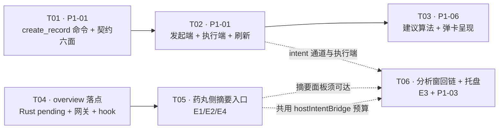

# FUSION-ARCH-P1-v1 · P1 批次增量设计与任务分解

> 上游：`docs/fusion/FUSION-PRD-v1.md` §2.2（P1 需求池）· `docs/fusion/FUSION-ARCH-v1.md`（P0 全量设计，本文只写**增量**）
> 基线：P0-01…P0-07 七项已落地，工作树 57 改 + 12 新增；门禁八步全绿。
> **本文所有行号 / 计数 / 行数均为 2026-11-10 工作树实测**（`wc -l` + `node scripts/check-*.mjs`），不引用 P0 文档里的旧数字。
> 本文不重复 P0 已定的约定（§6 共享知识里已归档的命名、坐标系、intent 协议继续有效），只写「P1 新增/改变的那部分」。

---

## 0. 读前必读：四条与直觉相反的事实

| # | 事实 | 证据（实测） | 对设计的影响 |
| --- | --- | --- | --- |
| **F1** | **`ipc.ts` 已经用满 300 行的硬上限，而且它不是「冻结」而是「顶格」** | `wc -l src/services/ipc.ts` = **300**；`scripts/check-size.mjs:23` `const LIMIT = 300`；`node -e "require('./scripts/size-allowlist.json').files['src/services/ipc.ts']"` = **undefined**（不在基线里，所以没有「棘轮余量」这回事，只有硬上限 300） | 新增一条宿主命令必须往这个文件加 1 行 → 301 → 立刻红。**只能在同一文件内等量挤出**（§6 R1 给了具体手法）。更狠的是：`scripts/check-contract.mjs:86-87` 的 `ipcCalls()` **只读 `src/services/ipc.ts` 这一个文件**，所以「把 `call('create_record')` 挪到新文件」这一招会让 Rust 81 vs ipc.ts 80 直接对不上——**挪不出去**。 |
| **F2** | **有三个文件是「零余量」**，其中包含 P1-02 最想去动的那个页面 | `src/app/AppShell.tsx` = 381 / 冻结 **381**；`src/features/history/components/History.tsx` = 1147 / 冻结 **1147**；`src/features/dashboard/components/Dashboard.tsx` = 513 / 冻结 **513**（三个文件的 `measured == frozen`，余量 0） | P1-02 不能把入口放进「总览页」（`Dashboard.tsx` 加一行就红），也不能动 `AppShell.tsx`（标题栏槽位若有变化必须**行数不变**）。本方案把「分析窗 → 摘要」的入口挂在 `TimingCapsule` 内部（复用既有 `timingStatusEntry` 那**一行**），`AppShell` 涨 0 行。 |
| **F3** | **「两份 capability」是 0 处改动，不是 2 处** | `scripts/check-contract.mjs:315-337`：`aclCommands()` 只解析 `src-tauri/permissions/host-commands.toml`；`capRefs` 只断言 `capabilities/default.json` 与 `capabilities/mobile.json` 里**引用了 `"host-commands"` 这个 permission 标识符**（`default.json:8` / `mobile.json:8` 各一行，都已存在） | 加命令 = 往 `host-commands.toml` 的 `commands.allow` 集合里加一条，两份 capability **自动**生效（permission 是集合，不是逐命令清单）。工程师不用去改那两个 json——改了也对，但那不是门禁要求，别浪费一次 commit。 |
| **F4** | **最像「写库范式」的那个文件离上限只差 1 行** | `src-tauri/src/repositories/record_session.rs` = **299**（`finalize` / `finalize_split` / `end_and_start` 三份 INSERT 范式的家）；`src-tauri/src/repositories/record.rs` = 172（余量 128） | 补记的 INSERT **不许**抄进 `record_session.rs`（+1 就红，+12 更不用说）。落点是 `repositories/record.rs`（它的模块文档第一行就写着「查询 / 汇总 / 编辑 / 软删除」，补记属「写入记录」的正位）。同理 `src/app/tray.rs` 221 行是托盘派发的唯一去处，`tests/tray_menu.rs` 已 270/300 不能再塞测试（§5-③）。 |

### 0.1 门禁实测基线（本文所有论证的前提）

```
[size]     OK — 扫描 1466 个文件，上限 300 行；冻结基线 152 条（棘轮：只许减不许增）
[contract] OK — 命令：Rust 80（+Patina 117）/ IpcApi 80 / ipc.ts 80 / mock 80；
                错误码：Rust 17 / 前端 17；事件：后端 11 / 前端 11 / emit 点 18
[layers]   OK — 9 条分层规则全部通过（扫描 1391 个文件；L9 主窗 319 / 分析窗 431 个文件）
```

| 门禁 | 本轮影响 |
| --- | --- |
| `check:contract` | 命令 **80 → 81**（唯一一次变动，P1-01）；Patina 117 不变；错误码 **17 不变**；事件 **11/11/18 全部不变**。 |
| `check:size` | 8 个文件**必须净减或持平**（`ipc.ts` / `AppShell` / `History` / `Dashboard` / `history.css` / `contract.ts` / `PillBar` / `History.tsx` 等价物），其余全部有余量（§6 逐文件给了上限数字）。 |
| `check:layers` L9 | 新增 `.ts` 只有 1 个（`features/history/services/itemNameMatch.ts`，分析窗树）；主窗新增 0 个。P1-02/P1-03 的跨窗全部走 IPC 命令 / 事件 / pending 通道，**零跨树 import**。 |
| `check:vendored` | 新增登记 2 条（`itemNameMatch.ts` / `itemNameMatch.test.ts`，`change: added`）。已登记的 6 个 vendored 文件改造**不需**新增条目（已登记条目只验 kind 不验哈希）。第 40 条（`mainToolsNavigationGateway.test.ts`）**不许删**，T04 要扩它。 |
| `check:version` / `check:brand` | 无影响（不新增含旧品牌名的文案）。 |
| 运行时 | release `panic = "abort"`：本轮新增 Rust 代码零 `unwrap` / 零 `expect`，时间戳解析一律 `Result` 或 saturating 运算（§3 边界）。 |

---

## 1. 四项需求的落点

> 图例：**H** = 宿主自有（主窗树 / 非 vendored）；**V** = vendored（`src/{app,features,platform,shared}/**` 或 `src-tauri/src/**/insight/**`）。
> 「上限」= 本任务结束时该文件的**绝对行数上限**（`check-size` 的判定口径，等于 `wc -l` 去掉末尾换行）。

### 1.1 P1-01 · 把一段活动补记为一条已完成的计时记录

**一句话**：分析窗点活动段 → 弹卡 → 「补记为计时记录」→ 这段活动变成一条 `status='saved'` 的 `time_records` 行，起止 = 活动段起止。

| 项 | 内容 |
| --- | --- |
| **涉及文件（Rust）** | **H(改)** `src-tauri/src/repositories/record.rs` 172 → **≤225**：新增 `insert_saved_backfill()`（照 `record_session.rs:151-167` 的 INSERT 形状）+ `find_backfill_duplicate()`（幂等键）+ 三条纯函数单测<br/>**H(改)** `src-tauri/src/services/record.rs` 116 → **≤175**：新增 `backfill()`（校验 → `split_by_day` → 逐段落库 → 回读）<br/>**H(改)** `src-tauri/src/commands/record_cmd.rs` 106 → **≤150**：新增 `create_record` 命令（调 service + `dirty::mark("record")` + `emit_timer_state`）<br/>**H(改)** `src-tauri/src/ipc_commands.rs` 247 → **≤249**（`generate_handler!` 里加 1 行）<br/>**H(改)** `src-tauri/permissions/host-commands.toml` 97 → **≤99**（`commands.allow` 加 `"create_record"`，description 里的「80 条」改「81 条」） |
| **涉及文件（前端）** | **H(改)** `src/services/ipc.ts` 300 → **≤300（净 −5）**：加 `createRecord` 一行，折叠 `listRecords`（8 行 → 2 行，−6）<br/>**H(改)** `src/types/domain/ipc.ts` 273 → **≤275**（`IpcApi` 加一行签名，参数用**内联对象类型**，不新建 `domain-params.ts` 条目——该文件已有 `mdSyncSave(params: { config; secret })` 的内联先例）<br/>**H(改)** `src/mocks/browserMock.ts` 256 → **≤278**（`create_record` handler，4 空格缩进，见 §7 约定）<br/>**V(改)** `src/features/history/components/HistoryActivityActionDialog.tsx` 155 → **≤210**（「补记为计时记录」按钮 + handler；与 P1-06 共用，T02+T03 合计 ≤225）<br/>**H(改)** `src/services/hostIntentBridge.ts` 107 → **≤145**（`backfill_record` 分支：按名找/建事项 → `ipc.createRecord`；与 P1-02 共用，T02+T06 合计 ≤160）<br/>**V(改)** `src/platform/runtime/hostIntentGateway.ts` 54 → **≤58**（`HostIntent` 联合加一支；T02+T06 合计 ≤66）<br/>**V(改)** `src/features/history/hooks/useTimingSegments.ts` 72 → **≤88**（订阅 `timer:state-changed` → 重取当天记录：补记后泳道**立即**出现新段）<br/>**V(改)** `src/app/hooks/useHostTimerState.ts` 129 → **≤134**（广播到达时重读「今日已封存秒」，否则胶囊的今日累计要等下一次状态迁移才更新）<br/>**H(改)** `docs/phase2/IPC-CONTRACT-v2.md`（命令表 + 详解 + 变更记录 + 手机端行为表，四处） |
| **Rust 侧改动** | 1 条新命令 `create_record`（`#[tauri::command]`，桌面 + 手机都注册——它不含任何 `#[cfg]`，手机端编同一份）；1 个新 service 函数；2 个新 repo 函数。**不新增表、不新增迁移、不改 schema（仍 v7）**，形状与 `record_session::finalize` 完全一致：`status='saved'`、`running_since=NULL`、`mode='countup'`、`target_sec=NULL`。 |
| **前端侧改动** | 分析窗：弹卡加一个按钮 + 发 1 条 intent；宿主：`hostIntentBridge` 多一个 `case`，用**既有** typed IPC；泳道与胶囊各加一次「广播即重取」。**分析窗零写命令**——`patina-host-bridge.toml:21` 的 `commands.allow` 仍是 3 条只读，**不许**把 `create_record` 加进去。 |
| **IPC 契约影响** | 命令 **80 → 81**（`IpcApi` 81 / `ipc.ts` 81 / mock 81）；Patina 命令 117 不变；错误码 **17 不变**（复用 `ITEM_NOT_FOUND` / `INVALID_DURATION` / `DB_ERROR`，见 §2.3）；事件 **11/11/18 不变**（复用 `timer:state-changed` 作「计时域数据变了」的门铃，新增事件要改 `check-contract.mjs:260` 的 `EXPECTED_EMIT_SITES`，属改门禁，本轮不动）。 |
| **权限 ACL 影响** | `host-commands.toml` +1 行（自动覆盖桌面 + 手机两份 capability，见 F3）。`patina-host-bridge.toml` **零改动**（这是 P1-01 的核心边界，不是可选项）。 |
| **行数预算** | 见上表每个文件后的「上限」。最紧的三个：`ipc.ts` 净 −5、`ipc_commands.rs` +2、`host-commands.toml` +2。 |
| **验收判据** | ① `node scripts/check-contract.mjs` 打印 `命令：Rust 81（+Patina 117）/ IpcApi 81 / ipc.ts 81 / mock 81`，错误码 `17 / 17`，事件 `11 / 11 / 18`；② `node scripts/check-size.mjs` 绿且 `src/services/ipc.ts` ≤300；③ 见 §6 T01 的 8 条可变异判据。 |
| **依赖前序** | 无（可在 Wave A 第一波开工） |

### 1.2 P1-06 · 同名事项建议（活动名 → 已有事项的模糊匹配）

| 项 | 内容 |
| --- | --- |
| **涉及文件** | **V(新)** `src/features/history/services/itemNameMatch.ts`（纯函数，≤130 行）<br/>**V(新)** `src/features/history/services/itemNameMatch.test.ts`（表驱动，15 组含 7 组负例，≤150 行）<br/>**V(改)** `src/features/history/components/HistoryActivityActionDialog.tsx`（把 P0-05 的「精确同名」判据换成 `suggestItemName()`，并把「将复用『X』/ 将新建」写成建议而不是结论）<br/>**H(改)** `scripts/vendored-allowlist.json`（+2 条 `added`） |
| **Rust 侧改动** | **零**。建议算法完全在前端；最后的「复用还是新建」仍由宿主按**精确名**判定（`hostIntentBridge.findItemByName`，P0-05 既有），分析窗只负责「建议同名」。 |
| **IPC 契约影响** | **零**（不新增命令/事件/错误码）。 |
| **权限 ACL 影响** | 零。 |
| **行数预算** | `itemNameMatch.ts` ≤130（新）；`itemNameMatch.test.ts` ≤150（新）；`HistoryActivityActionDialog.tsx` **≤225**（与 P1-01 共用同一份预算：155 + P1-01 的 ~35 + P1-06 的 ~35）。 |
| **验收判据** | ① §4.4 的 **15 组**表格逐行（测试文件即判据本体，表是它的镜像）；② 弹卡的 `data-history-activity-match` 属性三态：`reuse`（exact）/ `suggest`（contained）/ `create`（null）——变异「把 contained 也标成 reuse」→ 断言红；③ 命中建议时点「在 Timing 计这件事」，宿主**复用**该事项（`items` 总数不变）而不是新建——变异「intent 里传活动名而不是建议名」→ 事项表多一条 → 红。 |
| **依赖前序** | P1-01 的发起端（T02）——同一个文件（弹卡），必须串行 |

### 1.3 P1-02 · 今日摘要入口 + 与分析窗「总览」互链

| 项 | 内容 |
| --- | --- |
| **涉及文件** | **H(改)** `src/components/records/RecordsPanel.tsx` 138 → **≤152**（面板头「在分析窗看这一天 ↗」旁边加「今日摘要」按钮）<br/>**H(改)** `src/components/pill/TodayEntry.tsx` 31 → **≤44**（右键 → 直接开摘要；左键行为不变）<br/>**H(改)** `src/services/todayActions.ts` 42 → **≤60**（`openDigestPanel()` + `openDigestInAnalysis()`）<br/>**H(改)** `src/components/todos/TodayDigest.tsx` 137 → **≤158**（面板头加「在分析窗看总览 ↗」）<br/>**V(改)** `src/app/components/TimingCapsule.tsx` 132 → **≤152**（胶囊里加「今日摘要」次级动作 → 发 intent `open_digest`）<br/>**H(改)** `src/services/hostIntentBridge.ts` → **≤160**（`open_digest` 分支；与 P1-01 共用同一份预算）<br/>**V(改)** `src/platform/runtime/hostIntentGateway.ts` → **≤66**（联合加 `open_digest`） |
| **Rust 侧改动** | 落点通道扩一支（`overview`），四个文件见 §1.3.1。**不新增命令**（复用 `open_patina_window`；只把它的可选参数结构从「只有 history」扩成「history 或 overview」）。 |
| **IPC 契约影响** | 命令 **81 不变**（P1-01 之后）；Patina 命令 **117 不变**（`cmd_take_main_tools_target` 只改返回 DTO 的一个可选字段）；错误码不变；事件不变（复用 `main-tools-target-changed` 作门铃）。 |
| **权限 ACL 影响** | 零（`open_patina_window` 已在 `host-commands.toml:58`）。 |
| **行数预算** | `AppShell.tsx` **0 行**（冻结 381）、`Dashboard.tsx` **0 行**（冻结 513）、`PillBar.tsx` **0 行**（291，右侧只剩 9 行，本轮不为它花）。 |
| **验收判据** | ① 药丸：左键「今天」→ 记录面板 →「今日摘要」→ 摘要面板（2 次点击）；右键「今天」→ 摘要面板（1 次点击，`aria-label` 含「今日摘要」）；② 摘要面板「在分析窗看总览 ↗」→ 分析窗停在**总览页**（`currentView === "dashboard"`，且**冷启动**也成立——先杀光 `timing.exe` 再点）；③ 分析窗任意视图 → 标题栏胶囊的「今日摘要」→ 药丸展开并停在摘要面板；④ 变异：把 `overview` 的 pending 写入放到 `show_main_window` **之后** → 冷启动时落不到总览（停在默认视图）→ 红（**该顺序已由 `tools_navigation.rs::deliver` 的源码级哨兵钉住**：`AppHandle` 不可构造，运行时测试测不到它，顺序反了 = 冷启动丢落点、**无声**）；⑤ 变异：删掉 `useMainToolsNavigation` 里的 `case 'overview'` → 点「看总览」停在原视图 → 红。 |
| **依赖前序** | §1.3.1 的落点通道（T04）必须先落地 |

#### 1.3.1 `overview` 落点通道（P1-02 的 Rust 部分）

| 文件 | 改动 | 上限 |
| --- | --- | --- |
| **V(改)** `src-tauri/src/app/insight/main_window/tools_navigation.rs` | `PendingView` 加 `Overview` 变体；`open_overview()`（走同一个 `deliver`：**先写 state 再 show**）；单测加一条「overview 覆盖 tools / 只能取一次」 | 140 → **≤160** |
| **H(改)** `src-tauri/src/commands/window_cmd.rs` | `PatinaOpenTarget` 从「`history` 必填」改成「`history` 与 `overview` 二选一」；`into_history_target()` → `into_view()`；`open_patina_window` 按分支派发 | 205 → **≤228** |
| **V(改)** `src-tauri/src/commands/insight/window_cmd.rs` | `MainWindowTargetDto` 加 `overview: Option<bool>`（`skip_serializing_if = "Option::is_none"`）；`from_pending` 加一支 | 165 → **≤185** |
| **V(改)** `src/platform/desktop/mainToolsNavigationGateway.ts` | `MainWindowTarget` 加 `{ kind: "overview" }`；解析 `target.overview === true` | 56 → **≤70** |
| **V(改)** `src/app/hooks/useMainToolsNavigation.ts` | `navigate` 的类型从 `"tools" \| "history"` 扩到含 `"dashboard"`（`AppShell` 传进来的 `handleNavigate` 本来就收 `View`，**0 行改动**）；`consume()` 加 `else if target.kind === 'overview'` 分支 | 94 → **≤106** |
| **V(改)** `src/platform/desktop/mainToolsNavigationGateway.test.ts` | 既有的 4 份载荷**不许改断言**，新增 1 份 `{"overview":true}` → `{kind:'overview'}` + 1 条「overview 与 history 同时存在时 history 先判」（与 B-2 的判序判据同构） | 只增不改 |

> 为什么值得动 5 个文件换一个落点：`main-tools-target-changed` 这条通道从 P0-03 起就是「宿主 → 分析窗」的**唯一**通用落点机制，缺了 `overview` 它就是个只能用一半的通道；而「摘要 ↔ 总览」这条互链正是 PRD P1-02 的原文要求，用「只开窗不导航」代替等于没做（分析窗停在上次的 History 页时，用户看到的是「历史」，不是「总览」）。

### 1.4 P1-03 · 托盘菜单「分析窗 · 今天」

| 项 | 内容 |
| --- | --- |
| **涉及文件** | **H(改)** `src-tauri/src/infra/tray_menu.rs` 183 → **≤196**（`ID_OPEN_ANALYSIS_TODAY = "open_analysis_today"` + 一个节点，紧跟 `ID_OPEN_STATS`）<br/>**H(改)** `src-tauri/src/app/tray.rs` 221 → **≤258**（`on_menu_event` 加一支；`today_history_target()` + 纯函数 `local_date_key_of(now_ms)` + 同文件 `#[cfg(test)] mod tests`） |
| **Rust 侧改动** | 2 个文件。派发 = `tools_navigation::open_history(app, HistoryTarget { date_key, focus_app: None })`——**复用 P0-03 已建好的 pending 通道**，不新增命令、不新增事件、不新增 DTO。`app/tray.rs:164` 已有「宿主 app 层调 insight app 层」的先例（`show_main_window`）。 |
| **前端改动** | 零（全在 Rust）。 |
| **IPC 契约影响** | **全部不变**：命令 81（P1-01 后的数）/ Patina 117 / 错误码 17 / 事件 11+11 / emit 点 18。 |
| **权限 ACL 影响** | 零。 |
| **行数预算** | `tray_menu.rs` ≤196；`app/tray.rs` ≤258（**不新建** `tests/tray_analysis_today.rs`：`tests/tray_menu.rs` 已 270/300，`tests/mod.rs` 108 行虽有余量，但本轮把判据写进 `app/tray.rs` 自己的 `#[cfg(test)]` 更省——`cargo test --lib` 一样收）。 |
| **验收判据** | ① 单测 `local_date_key_of(0)` 的**形状**判据用固定时区/固定输入断言不成立（`chrono::Local` 依赖宿主时区）→ 改为：`local_date_key_of(x)` 必须 `parse` 回来等于 `Local.timestamp_millis_opt(x).date_naive()`，且**长度必须是 10、第 5/8 位是 `-`**（变异：把 `%m` 写成 `%e`/不补零 → 长度 9 或含空格 → 红）；② `build_nodes` 快照：新项在 `ID_OPEN_STATS` **之后**、`ID_MD_SYNC` **之前**，label 逐字 `分析窗 · 今天`（变异：位置挪到「打开事项」前 → 快照红）；③ 手测：点托盘「分析窗 · 今天」→ 分析窗起来并停在**历史页 + 今天**；再点一次 → 只消费一次（`take()` 语义，同 P0-03）；④ 变异：把 `focus_app` 传成 `Some("")` → 网关解析成 `null` 应仍可用（既有 B-2 已钉空串降级，本轮不重复测）。 |
| **依赖前序** | 无（`open_history` 是 P0-03 的既有函数；可与 T04 并行） |

---

## 2. P1-01 接口契约

### 2.1 命令签名

```rust
// src-tauri/src/commands/record_cmd.rs
#[tauri::command]
pub async fn create_record(
    app: AppHandle,
    state: State<'_, AppState>,
    item_id: i64,          // → JS: itemId（必填；事项不存在/已软删 → ITEM_NOT_FOUND）
    started_at: i64,       // → JS: startedAt（epoch ms，本地墙钟）
    ended_at: i64,         // → JS: endedAt（epoch ms；> startedAt）
    note: Option<String>,  // → JS: note（可空；本轮前端恒传 null）
) -> AppResult<Vec<TimeRecord>>
```

**注册名与前端 camelCase 一一对应**（`check-contract` 用 `toCamel` 对齐）：`create_record` ↔ `createRecord`。

```ts
// src/types/domain/ipc.ts（IpcApi，内联参数类型，不新建 domain-params 条目）
createRecord(params: { itemId: number; startedAt: number; endedAt: number; note?: string | null }): Promise<TimeRecord[]>;

// src/services/ipc.ts（实现对象，净 +1 行 —— 必须先折叠 listRecords 腾出 6 行）
createRecord: (params) => call<TimeRecord[]>('create_record', { itemId: params.itemId, startedAt: params.startedAt, endedAt: params.endedAt, note: params.note ?? null }),
```

### 2.2 返回 JSON schema

```jsonc
// Ok 载荷：**数组**，因为跨本地零点会被拆成多条（§3.3）
[
  {
    "id": 1287,
    "itemId": 42,
    "status": "saved",          // 恒为 "saved"（绝不产生 active）
    "startedAt": 1762744800000,
    "endedAt": 1762746600000,   // 跨天时第二段的 endedAt
    "accumulatedSec": 1800,     // = (endedAt - startedAt) / 1000，整数秒向下取整
    "runningSince": null,       // 恒为 null（与 record_session::finalize 同形状）
    "note": null,
    "mode": "countup",          // 恒为 countup（补记不产生倒计时）
    "targetSec": null           // 恒为 null
  }
]
```

**为什么返回 `Vec` 而不是单条**：跨零点拆段是既有口径（`services/timer_split.rs`，V0.11.3），一个补记动作可能落 2~3 行；返回数组让「实际写了几行」对调用方透明，也让单测能直接断言拆段结果。不跨天时长度恒为 1。

### 2.3 错误码（**17 个不新增**）

| 场景 | 错误码 | 为什么复用而不是新增 |
| --- | --- | --- |
| `item_id` 不存在或 `deleted_at IS NOT NULL` | `ITEM_NOT_FOUND` | 与 `services/record.rs:54-63`（`update` 的记录/事项不存在）逐字同口径；新增一个 `ITEM_DELETED` 只会让前端多一条文案而语义无差别 |
| `ended_at <= started_at`（含相等） | `INVALID_DURATION` | 既有码（`error.rs`），`update_record` 用同一码拒绝 `ended_at < started_at`；补记多拒一个「相等」是因为 0 长度记录没有意义（§8 R3 可回退） |
| `started_at >= now` 或 `ended_at > now` | `INVALID_DURATION` | 同上。**未来时间必拒**：补记是「补过去的账」，时间在未来的记录会让「今天总计」超过 24h，且用户无法自证 |
| 落库失败 / 事务失败 | `DB_ERROR` | 既有码 |
| 事项名超长 / 备注超长 | — | 事项名由 `create_item` 侧管（既有校验）；`note` 走 `NOTE_MAX_LEN` 截断（复用 `services/record.rs:114` 的 `clamp_note`），**不报错** |

> 三个码都是既有 17 个里的，`src/services/ipc.ts::errorText()` **零改动** → `check-contract` 的「每个错误码必须有 case」那条不会动。

### 2.4 幂等与边界

| 边界 | 规则 | 判据（可变异） |
| --- | --- | --- |
| **重复提交** | **幂等**：写库前用 `(item_id, started_at)` 查一条 `status='saved' AND deleted_at IS NULL` 的记录，命中则**直接返回它**（不新增、不报错）。 | 同一组参数调两次 → `list_records` 只多 1 条；变异「删掉 `find_backfill_duplicate` 调用」→ 多 2 条 → 红 |
| **幂等键为什么是二元组** | 跨天拆段后，「第一行的 `(started_at, ended_at)`」与「最后一行的」都不等于原始区间，三元组匹配不上；而 `(item_id, started_at)` 在 ms 精度下不可能与真实计时撞车。代价：同一事项同一毫秒起点的两次不同长度补记会被判成重复——**这就是想要的取向**（宁可少记，不可重复记）。 | 跨天补记同一段两次 → 仍只 2 行（1+1 段）；变异改回三元组 → 跨天用例多出 2 行 → 红 |
| **跨本地零点** | **拆成多条**（`services::timer_split::split_by_day`，与「结束一条计时」同一条路径），累计秒按墙钟占比分配、末段吃余数（和恒定守恒）。 | 23:40→00:20 → 2 行（23:40–24:00 / 00:00–00:20），两行 `accumulatedSec` 之和 == 2400；变异「不拆」→ 1 行 → 红 |
| **与正在进行中的计时冲突** | **不冲突、不干扰**：补记只写 `status='saved'` 行，`uq_records_open` 是 `WHERE status='active'` 的部分唯一索引，插入 saved 不会撞；也**不**暂停/切换当前会话。 | 先开始计时（事项 A）再补记（事项 B）→ `get_timer_state` 前后逐字段相等（`session.id` / `accumulatedSec` 不变），且 B 的记录已落库；变异「补记里顺手 `startOrSwitch`」→ 状态变化 → 红 |
| **低于「最短记录时长」(30s)** | **不过阈值**（ADR-023：只有非显式路径才过闸；补记是用户显式声明「这段要留下」）。10 秒的活动段也能补。 | 补记 10s 段 → 落 1 行；变异「套用 `should_ignore`」→ 0 行 → 红 |
| **联动待办** | **不联动**（不调 `todo::soft_delete_for_saved_record`）。理由见 §3.2。 | 库里存在同名未完成 todo → 补记后该 todo 仍 `deleted_at IS NULL`；变异「补记时调 `soft_delete_for_saved_record`」→ todo 被软删 → 红 |
| **与「从现在开始计时」的区别** | 补记 **不碰** `clock::anchor` / `running_since` / `timer:state-changed` 的**状态部分**；P0-05 的 `start_timer_for_activity` 完全不走这条新命令。 | 两条 intent 的 `action` 不同、宿主分支不同（§3.4）；变异「两个 action 共用一段处理」→ 判据②（P0-05 计时从「现在」开始）会红 |
| **活动段还没结束（进行中）** | 允许补记，右端 = `min(段.endTimeMs, Date.now())`（弹卡在点击那一刻定值）；`endTimeMs` 来自时间线编译器的 `visibleEndMs`，本来就不是活值。 | 对「进行中」的活动段补记 → 落库的 `endedAt <= Date.now()`；变异「直接用 `endTimeMs` 不 clamp」→ 时钟倒退 1 分钟内会命中 INVALID_DURATION → 单测钉住 clamp |

---

## 3. P1-01 数据一致性：补记该走哪几条副作用

> 本节是 P1-01 最容易漏的地方。下面是「结束一条计时」的**完整**副作用链（实地读 `services/timer_stop.rs` / `timer_flush.rs` / `services/timer_split.rs` / `commands/timer_cmd.rs` 得到），然后逐条裁决补记要不要走。

### 3.1 既有链路（`stop_timer`，作为参照系）

| # | 副作用 | 出处 | 补记要不要走 | 为什么 |
| --- | --- | --- | --- | --- |
| S1 | 阈值判定 `should_ignore`（<30s → `discard` 软删） | `services/timer_stop.rs:54` | **不走** | ADR-023 只对「手动结束 / 切换分段」这两条**非显式保存**路径设闸；补记是显式保存（与「倒计时到点」「崩溃恢复的结束并保存」同类） |
| S2 | 跨零点拆段落库 | `services/timer_split.rs::finalize` → `record_session::finalize_split` | **走**（但要自己调 `split_by_day` + `insert_saved_backfill`，不能调 `finalize_split`——后者要求一条 `status='active'` 的源行） | 若不分段：一条 23:40→00:20 的记录整条挂在**前一天**，次日的活动泳道有段而 Timing 泳道无段 → 直接违反 D1「同轴可见」；统计按 `started_at` 过滤（`repositories/record.rs::push_filters`），不分段还会让「次日 00:00–00:20」既不在次日统计里、也不在次日时间线上 |
| S3 | `todo::soft_delete_for_saved_record`（同名未完成待办 → 软删，视为办完） | `record_session.rs:126/185/283` | **不走** | 该联动的前提是「用户**刚刚亲手结束**这一段」；补记是给**过去**补账，用户很可能还有一个同名待办**今天还要做**（例：待办「周报」是今晚要写的，他补的是昨天写周报的那半小时）。静默删掉待办**没有撤销入口**（撤销条只对 active→saved 出现）→ 属于不可逆的数据丢失。 |
| S4 | `clock::clear_anchor(running_since)` | `timer_stop.rs:57/83` | **不走** | 补记不结束任何进行中的会话，锚点表不该被动 |
| S5 | `todo_start::after_stop`（结束后自动开始下一个待办） | `timer_stop.rs:92` | **绝对不走** | 走了 = 用户点「补记」却凭空开始一个新计时。这是本条链里**最危险**的一条 |
| S6 | `md_sync::dirty::mark("timer")` | `commands/timer_cmd.rs:60` 等 | **走，但用 `"record"` 而不是 `"timer"`** | `dirty.rs:29` 的 `REASONS` 白名单里 `record` 就是「记录域写入」（`update_record` / `delete_record` 用的就是这个键）。补记是一次记录写入，该让 md 同步在 1.5s 内重导一轮；漏标最坏由 60s 兜底吸收，但没理由漏 |
| S7 | `events::emit_timer_state(&app, &pool)`（`app.emit("timer:state-changed")` 全窗广播） | `commands/timer_cmd.rs:22` 等 8 处 | **走** | 载荷是 `TimerState`（当前会话快照），补记不改状态，但这是**既有的、唯一的「计时域数据变了」广播**，两窗的「今日已封存秒」与泳道都拿它当门铃。不新增事件（新增要改 `EXPECTED_EMIT_SITES`，属改门禁）。代价：胶囊会收到一帧「状态没变」的广播——幂等，无害 |
| S8 | `daily_status` 缓存 | `services/daily_status.rs`（独立表） | **不走** | 每日状态是 `(date, item, status)` 的独立表，与 `time_records` 无触发器、无缓存层，补记不影响它 |
| S9 | `timer_flush` 的 15s 折账 | `services/timer_flush.rs` | **无关** | 它只处理 `status='active'` 行；补记写 saved 行，`find_active` 看不见 |
| S10 | 药丸自身的 store 刷新 | `stores/timerStore` | **不需要** | 补记不改计时状态；`RecordsPanel` 每次都 `list_records` 重取，打开即最新 |

### 3.2 「补记不联动待办」的判据化

`soft_delete_for_saved_record` 的 SQL（`repositories/todo.rs:161-179`）按 `title = items.name` 匹配未完成待办并软删。补记若不跳过它，用户在弹卡里点一下「补记为计时记录」，隔天会发现某个还没做的待办**消失了**，且没有任何地方能查回来。判据写成一条反向断言（§1.1 的验收判据⑤），**变异即红**。

### 3.3 落库形状（逐字对齐 `record_session.rs:151-167`）

```sql
INSERT INTO time_records
  (item_id, status, started_at, ended_at, accumulated_sec, running_since,
   mode, target_sec, created_at, updated_at)
VALUES (?, 'saved', ?, ?, ?, NULL, 'countup', NULL, ?, ?)
```
`note` 单独在 INSERT 里带 `?`（可空）。**不新造表、不新造 status 值、不加列**——schema 仍是 v7，`migrations/` 零改动。

### 3.4 两条 intent 的边界（防串味）

| intent | 语义 | 宿主执行 | 是否改计时状态 |
| --- | --- | --- | --- |
| `start_timer_for_activity`（P0-05，已有） | 「这件事我从**现在**开始计」 | `create_item`(可选) → `startOrSwitch` | **改**（进入 running，必要时切换） |
| `backfill_record`（P1-01，新） | 「这段**过去**的活动补成一条记录」 | `create_item`(可选) → `ipc.createRecord` | **不改** |

判别式只有一句：**payload 里带不带 `startedAt`/`endedAt`**。带 = 补记；不带 = 从现在开始。P0-05 的判据「计时从『现在』开始、不回填历史区间」因此在协议层面继续成立（P0 的 payload 结构没被污染）。

---

## 4. P1-06 匹配算法

### 4.1 纯函数签名与落点

```ts
// src/features/history/services/itemNameMatch.ts  —— 纯函数：无 DOM、无 IPC、无 i18n、无 React
export interface ItemNameCandidate { id: number; name: string }
export type ItemNameMatchKind = "exact" | "contained";
export interface ItemNameSuggestion { kind: ItemNameMatchKind; score: number; item: ItemNameCandidate }

/** 给一段活动的名字，在已有事项里找「最该复用的那一个」。找不到 → null。 */
export function suggestItemName(
  activityName: string,
  items: readonly ItemNameCandidate[],
): ItemNameSuggestion | null;

/** 归一化（导出只为测试；生产代码只经 suggestItemName 用）。
 *  返回 `string`：**空串表示「不参与匹配」**，不是 `null`。
 *  `null` 只出现在 suggestItemName 的返回值上（= 没有建议）。 */
export function normalizeItemName(raw: string): string;
```

> **返回类型别写混**：`normalizeItemName` 恒返回 `string`（空串是它的「空值」），`suggestItemName` 返回 `ItemNameSuggestion | null`。两者用不同的空值表示法，是因为前者要参与 `===` 比较（空串天然不相等）、后者要表达「没有」。测试里断言 `normalizeItemName("  ") === ""`，断言 `suggestItemName("  ", …) === null`。

**为什么放 `src/features/history/services/`**：① 唯一消费方是历史页弹卡（`features/history/components/HistoryActivityActionDialog.tsx`）；② 同目录已有同类纯函数先例（`timingLaneSegments.ts`、`historyFormatting.ts`）；③ 落在分析窗树（L9 合法），不需要跨窗共享；④ 纯函数 → 表驱动单测不需要渲染环境。

**为什么不放宿主侧**：宿主只做「按精确名找/建」（`hostIntentBridge.findItemByName`），那是**判定**；**建议**是分析窗的呈现层职责。两边分开，判定仍然只有一处。

### 4.2 归一化规则（顺序不可换）

| 步 | 规则 | 代码 | 例子 |
| --- | --- | --- | --- |
| N1 | **NFKC 归一** | `raw.normalize("NFKC")` | `ＶＳ　ＣＯＤＥ` → `VS CODE`；`（重构）` → `(重构)`；`２５` → `25` |
| N2 | **小写** | `.toLowerCase()` | `VSCode` → `vscode` |
| N3 | **只留字母/数字/汉字，其余（空格、标点、连字符、下划线、括号、点、斜杠）全删** | `.replace(/[^\p{L}\p{N}]+/gu, "")` | `VS Code` → `vscode`；`写代码（重构）` → `写代码重构`；`a.b-c_d` → `abcd` |
| N4 | 归一化结果为空串 → **不参与匹配**（`normalizeItemName` 仍返回 `""`；只有 `suggestItemName` 返回 `null`） | — | `"  "` → `""`（→ 建议 `null`） |

> 用 `NFKC` 一次搞定全角，不手写 `0xFEE0` 映射表（手写的那套在中文标点上必漏）。用 `\p{L}\p{N}` 而不是 `[a-z0-9]` 是因为汉字属于 `\p{L}`，用 ASCII 白名单会把中文全删掉——这是最容易写错的一行。

### 4.3 相似度与阈值

```
exact      : normalized(a) === normalized(b)                        → score 1.0
contained  : short ∈ long 且 short.length >= 3 且 short/long >= 0.6 → score = short/long
其它        : 不参与（score 0，等价于不存在）
多命中      : 取 score 最高；同分取 name 字典序最小（确定性，便于钉测试）
```

**为什么不用编辑距离（Levenshtein）**：中文里 2 个字的差别往往是**完全不同的事**——「写方案」vs「写代码」距离 2、相似度 0.67，任何 0.6 一档的阈值都会把它们判成同一件事。编辑距离在拉丁词上工作、在汉字上撒谎，所以整条算法**不引入距离度量**。

**为什么 `contained` 要求短串 ≥3 且比值 ≥0.6**：短串太短会把「会」匹配进「会议纪要」；比值太低会把 `Chrome` 匹配进 `Google Chrome`（6/12 = 0.500）——后者看起来像漏配，但它恰恰是**该让用户确认**的情形（同名跨语言的正确做法是改个名，不是猜）。宁可少建议一次，不可建议错。

### 4.4 判据表（测试文件即本表的镜像，15 组含 7 组负例）

| # | 活动名（段） | 事项库 | 期望 | 钉住什么 |
| --- | --- | --- | --- | --- |
| 1 | `VS Code` | `["写代码", "VSCode"]` | `{kind:"exact", score:1, item:"VSCode"}` | N3 删空格 + N2 小写后全等 |
| 2 | `ＶＳ　ＣＯＤＥ` | `["vs code"]` | `{kind:"exact", score:1, item:"vs code"}` | N1 全角 + 全角空格 |
| 3 | `vscode` | `["写代码"]` | `null` | **负例**：跨语言不做词典（§9-4） |
| 4 | `Chrome` | `["Google Chrome"]` | `null` | **负例**：`chrome`(6) / `googlechrome`(12) = **0.500** < 0.6（N3 删空格后是 12 字，不是 13） |
| 5 | `Chrome` | `["Chrome 浏览器"]` | `{kind:"contained", score:0.667, item:"Chrome 浏览器"}` | contained 正例；断言用 `toBeCloseTo(6/9, 5)` |
| 6 | `微信` | `["微信电脑版"]` | `null` | **负例**：2/5 = **0.400**，比值闸与长度闸**双挡**。注意：它**观测不到**任何单一闸的变异（把阈值降到 0.4 也仍被长度闸挡住）——能观测长度闸的是 #15 |
| 7 | `会` | `["会议纪要", "开会"]` | `null` | **负例**：`会`(1)/`开会`(2) = 0.500、/`会议纪要`(4) = 0.250，**比值闸已先拒**——长度闸在这一行**不可观测**（单字名不误配，但靠的是比值不是长度） |
| 8 | `记事本` | `["记事本-长期"]` | `{kind:"contained", score:0.6}` | **边界**：3/5 = 0.6 **恰好达标**（钉住判据是 `>=` 不是 `>`） |
| 9 | `""` / `"   "` | `["任一"]` | `null` | **负例**：归一后空串 |
| 10 | `VS Code` | `[]`（空库） | `null` | **负例**：空库不崩、不新建建议 |
| 11 | `VS Code` | `["VS Code 调试", "VS Code 写代码"]` | `{kind:"contained", score:0.75, item:"VS Code 调试"}` | `vscode`(6)/`vscode调试`(8) = **0.750** > `vscode`(6)/`vscode写代码`(9) = 0.667，取高分；**两个都像时不并列** |
| 12 | `VS Code` | `["VS Code 写代码", "VS Code 调试"]` | 同上（`{kind:"contained", score:0.75, item:"VS Code 调试"}`） | 同上但**输入顺序反转**——钉住「结果与库顺序无关」（#11 与 #12 是**同一组数据、两种排列**，两条都过才算真的顺序无关） |
| 13 | `写代码` | `["写代码", "写代码（重构）"]` | `{kind:"exact", item:"写代码"}` | exact(1.0) 压过**达标**的 contained：`写代码`(3)/`写代码重构`(5) = **0.600 ≥ 0.6 是合格的**，所以这一行钉的不是「contained 不达标」，而是「exact 不被一个合格的 contained 挤掉」 |
| 14 | `WeChat` | `["wechat", "WeChat 工作号"]` | `{kind:"exact", item:"wechat"}` | exact 唯一命中（注意 `WeChat 工作号` 归一后是 `wechat工作号`，与 `wechat` 不是全等） |
| 15 | `微信` | `["微信版"]` | `null` | **补闸负例**：`微信`(2)/`微信版`(3) = **0.667 ≥ 0.6 比值是合格的**，只被「短串 ≥3」挡住 → 这是本表里**唯一**能把长度闸变异成红的一组（#6 / #7 都做不到，见下方变异表） |

**变异对照**（任一改坏即红）：

| 变异动作 | 变红的用例 | 为什么 |
| --- | --- | --- |
| MH1 去掉 N1（不 NFKC） | **#2** | 全角字母属 `\p{L}`，不会被 N3 删掉，归一后是 `ｖｓｃｏｄｅ` ≠ `vscode` |
| MH2 N3 用 `[a-z0-9]` 而非 `\p{L}\p{N}` | **#5 #8 #11 #12 #13 #14** | 中文被整段删空：候选变成空串/同串 → 变成 exact 或 null。**#1 不会红**（`VS Code`/`VSCode` 全是 ASCII，删汉字不改变它）；**#12 会红**（中文被删后两个候选都归一成 `vscode`，并列后字典序取到了 `VS Code 写代码`） |
| MH3 阈值 0.6 → 0.4 | **#4** | 0.500 ≥ 0.4 就成建议了。**#6 不会红**：它 0.400 虽达标，但先被「短串 ≥3」挡住 → 比值闸在 #6 身上**不可观测** |
| MH4 阈值 0.6 → 0.7 | **#5 #8** | 0.667 与 0.600 都掉到阈值下 → 都变 `null` |
| MH5 去掉「短串 ≥3」 | **#15** | `微信`(2)/`微信版`(3) = 0.667 放行 → 误建议。**#7 不会红**：`会`(1)/`开会`(2) = 0.500、/`会议纪要`(4) = 0.250，比值闸本身就拒了，长度闸在 #7 上不可观测 |
| MH6 contained 允许反向（long ∈ short） | 不会红 | 判据对称（`short = 较短的那一个`），但会引入 #6 的近亲（长串被短串包含的情形归入匹配）。故**明确不允许**反向写法 |
| MH7 多命中取「第一个」而非最高分 | **#12** | #11 的候选顺序恰好让第一个就是正确答案（所以 #11 不红）；#12 把顺序反过来，取第一个得到 `VS Code 写代码` → 红。**这就是 #11/#12 必须成对存在的原因** |
| MH8 候选取「最后一个」 | **#11** | 与 MH7 镜像；#11 红、#12 不红 |

> **变异覆盖率自检**：三道硬规则每条都至少被一组判据观测到——N1→#2、N3 的 Unicode 类→#5/#8/#11/#12/#13/#14、比值闸→#4/#5/#8、长度闸→#15、最高分选择→#11/#12 成对。**没有「写了但从不会被变异成红」的判据行**（#6/#7 是纯负例，作用是防回归，不承担变异覆盖——这一点在原表里被写错成「#6/#7 观测阈值/长度闸」，现更正）。

#### v1.1 修正记录（2026-11-10 · T03 实现方发现 + 架构师独立复算确认）

> 性质：**按 §4.2/§4.3 的硬规则实算后的数字修正**。**决策一条都没变**（原有 14 条全部保留，另加补闸行 #15），错的只是表里的比值与「哪条会红」。复算方式：对本表逐行跑 `normalize("NFKC").toLowerCase().replace(/[^\p{L}\p{N}]+/gu,"")` + 四种变异实现，比对「决策三元组」（kind|score|item）。

| # | 原表写的 | 实算后 | 影响 |
| --- | --- | --- | --- |
| 1 | #4 `6/13 = 0.46` | **`6/12 = 0.500`** | 决策仍 `null`（< 0.6）；但**阈值一降到 0.4 就会红**——写 0.46 会让人误以为到 0.4 还安全 |
| 2 | #11/#12 `7/9 = 0.78` vs `7/10` | **`6/8 = 0.750`** vs **`6/9 = 0.667`** | 决策不变（前者仍更高）；但分子把空格算进了长度，两个比值都错 |
| 3 | #13 备注「后者 3/6 = 0.5 不达标」 | **`3/5 = 0.600` 达标** | 决策不变，但这一行钉的东西从「contained 不达标」变成「exact 压过**达标**的 contained」——**含义更重要，已改写** |
| 4 | MH2 红：「#1 #5 #8 #11 #13 #14」 | **`#5 #8 #11 #12 #13 #14`** | **#1 不会红**（全 ASCII，删汉字不影响）；**#12 被漏列**（原表低估了自己的覆盖） |
| 5 | MH3 红：「#4 #6」／MH5 红：「#7」 | **MH3 = #4**；**MH5 = #15** | #6 被长度闸先挡、#7 被比值闸先挡 → 两闸在它们身上**不可观测**。**原表里「短串 ≥3」这道闸没有任何一组能把它变异成红** |
| 6 | （实现方补的 #15） | **`微信`/`微信版` = 0.667，只被长度闸挡** | **补闸，不是替换 #6/#7**：这是全表**唯一**能观测长度闸的一组；#6/#7 继续作为纯负例在跑 |
| 7 | （复算额外发现）MH4 红：「#8」／MH7 红：「#11 #12」 | **MH4 = #5 #8**；**MH7 = #12** | 0.667 也会被 0.7 砍掉；「取第一个」在 #11 里恰好对、只在 #12（顺序反转）里错——**这正是 #11/#12 必须成对的原因**。另补 MH8（取最后一个）→ 红 = #11 |
| 8 | §4.1/§4.2 N4「空串 → `null`」 | **`normalizeItemName` 恒返 `string`（空串 = 不参与匹配）；`null` 只是 `suggestItemName` 的返回值** | 签名与表述对齐。（工程师按签名实现是对的，是派活方的表述写混了） |

**给后续改算法的人的硬提醒**：改 §4.3 的任何一个常量，先重算「变异对照」表——**「变红的用例」列是这份文档里唯一可被机械验证的部分**，数字写错不会让任何门禁变红（`check:*` 不看文档），只会让下一个人以为判据覆盖到了。复算成本 < 1 分钟。

---

## 5. P1-02 / P1-03 的入口、落点与降级

### 5.1 三条路径（从哪进 → 进到哪）

| # | 起点 | 动作 | 落点 | 跨窗手段 | 冷启动（分析窗未创建） |
| --- | --- | --- | --- | --- | --- |
| **E1** | 药丸 · 记录面板头部「今日摘要」 | 1 次点击（面板已开时） | 药丸摘要面板（`openPanel('digest')`，`src/App.tsx:118` 的渲染分支**本来就存在**） | 无（同窗） | 不适用 |
| **E2** | 药丸 · 「今天」图标**右键** | 1 次点击 | 同上（跳过记录面板） | 无（同窗） | 不适用 |
| **E3** | 分析窗 · 标题栏 `TimingCapsule` 的「今日摘要」 | 1 次点击 | 药丸展开 + 摘要面板 | intent `open_digest` → `emitTo("main")` → 宿主 `openDigestPanel()` | 不适用（药丸恒在） |
| **E4** | 摘要面板头部「在分析窗看总览 ↗」 | 1 次点击 | 分析窗 + `currentView='dashboard'` | `open_patina_window({target:{overview:true}})` → pending → `take` | **能**：先写 pending 再 show（与 P0-03 同一顺序要求） |

**入口位置的三条硬约束**（沿用 P0 口径）：
- 药丸 7 个既有点击区一个不动；本轮**不新增第 6 个图标位**（`PillBar.tsx` 291 行只剩 9 行余量，不值得为一个次级入口花掉）。
- 入口必须有可读文案：E1 是文本按钮，E2 的 `aria-label`/`title` 明写「今天 · 今日摘要」（右键语义）。
- 分析窗侧入口常驻标题栏（`TimingCapsule` 随任意视图可见，`AppTitleBar.tsx:91` 的槽位是既有的）。

### 5.2 落点为什么不能靠「只开窗」

`open_patina_window()` 不带 target 时**只 show**，分析窗停在**上次的视图**（`currentView` 由 `updateRelaunchViewStorage` 恢复）。用户从摘要点「看总览」，如果分析窗上次停在「历史」，他会落在历史页——这不是「互链」，是「开一下窗」。所以必须走 pending：

```
摘要面板 → openDigestInAnalysis()
        → ipc.openPatinaWindow({ target: { overview: true } })
        → Rust: PatinaOpenTarget::into_view() → PendingView::Overview
        → tools_navigation::open_overview()：**先** state.put(Overview) **再** show_main_window
        → emit_to("patina", main-tools-target-changed)   ← 只是门铃
        → 分析窗 useMainToolsNavigation.consume() → take → {kind:'overview'}
        → navigate("dashboard")
```

### 5.3 失败降级（逐条，且都「不报错」）

| 失败点 | 表现 | 处理 | 依据 |
| --- | --- | --- | --- |
| `overview` 与 `history` 同时给（前端不该发，但协议允许） | 落 history | **`history > overview`（已裁决）**：网关判序是 `tools` → `history` → `overview`，`tools` 那条来自 P0 既有断言 p003，本轮不动 | `mainToolsNavigationGateway.test.ts:96`（p003）+ Rust `overview_parses_and_history_wins_when_both_are_sent` |

> **[V0.12.1 追加 · 第四种落点 `settings`]** 两窗收口把独立设置窗下线后，「打开设置」不再是一条新命令，
> 而是本命令的第四个落点：`PatinaOpenTarget` + `settings?: bool`（`#[serde(default)]`），判序变为
> **`history > settings > overview`**（前端网关整体顺序 `tools > history > settings > overview`）。
> 命令数 81 / 错误码 17 / 事件 11 / emit 18 **四个数一个没变**；`MainWindowTargetDto` 的 `settings`
> 用 `skip_serializing_if`，不发时载荷逐字节不变。详见 `docs/phase2/IPC-CONTRACT-v2.md` §12.14。
| `show_main_window` 返回 false（重建中 / 未就绪） | 窗没起来 | `deliver` **回滚** pending 并 Err；命令层 `log_warn` 后**仍返回 Ok**（用户再点一次） | `window_cmd.rs:78-82` / `tools_navigation.rs::deliver` 既有口径 |
| 冷启动 | 门铃丢失 | **先写 state 再 show**；分析窗挂载时先订阅后 `take` | `useMainToolsNavigation.ts:84-90` 既有写法 |
| `navigate("dashboard")` 被未保存确认拦住 | 停在原视图 | 与工具/历史落点同一处理：`navigated === false` → 放弃（不重试、不提示）；摘要面板已关，用户再点一次 | `useMainToolsNavigation.ts:44/62` |
| 药丸侧 `open_digest` 收到时 `collapsed === true` | 药丸没展开 | `setCollapsed(false)` + `openPanel('digest')`（与 `open_host_settings` 分支逐字同构） | `hostIntentBridge.ts:87-90` |
| 托盘点击时分析窗在重建 | 落不到今天 | `open_history` 返回 Err → `log_warn`（**不弹错误**）；pending 已回滚，下次点就好 | P1-03 判据③ |

---

## 6. 任务列表（6 个任务 · 2 波）

> 硬约束核对：任务数 **6 ≤ 6** ✓；单任务源文件数 **≤5**，唯一例外是 **T01 = 8**（理由见下）；每个任务 ≥3 个文件 ✓。
> **算术事实（先讲清，别让工程师以为可以更细）**：本轮共 **30 处**文件改动（8+5+3+5+4+5），6 个任务的平均是 5.0，T01 因为 `check:contract` 的「集合双向 diff」必须**原子**落地（Rust 命令 + `ipc_commands.rs` + `host-commands.toml` + `IpcApi` + `ipc.ts` + mock 六面缺一面即红）而无法再拆，故为 8。若强行压到 5，只能把契约面拆成两个 commit——那是「红着交」。

### Wave A（核心价值：补记 + 建议）

| 任务 | 目标 | 文件（新/改） | 依赖 | 完成判据 | 行数上限 |
| --- | --- | --- | --- | --- | --- |
| **T01** | **P1-01 写库命令 + 契约六面**（原子） | 改：`src-tauri/src/repositories/record.rs`、`src-tauri/src/services/record.rs`、`src-tauri/src/commands/record_cmd.rs`、`src-tauri/src/ipc_commands.rs`、`src-tauri/permissions/host-commands.toml`、`src/services/ipc.ts`、`src/types/domain/ipc.ts`、`src/mocks/browserMock.ts`；文档：`docs/phase2/IPC-CONTRACT-v2.md` | — | ① `check:contract` = `Rust 81（+Patina 117）/ IpcApi 81 / ipc.ts 81 / mock 81`，错误码 17/17，事件 11/11/18；② `check:size` 绿且 `ipc.ts ≤300`；③ §6.1 的 8 条 Rust 判据全绿；④ 手机端也能编（无 `#[cfg]`，`cargo check --target` 桌面/手机各一次） | `repositories/record.rs ≤225`；`services/record.rs ≤175`；`record_cmd.rs ≤150`；`ipc_commands.rs ≤249`；`host-commands.toml ≤99`；**`ipc.ts ≤300（净 −5）**`；`types/domain/ipc.ts ≤275`；`browserMock.ts ≤278` |
| **T02** | **P1-01 分析窗发起端 + 宿主执行端 + 立即刷新** | 改：`src/features/history/components/HistoryActivityActionDialog.tsx`、`src/services/hostIntentBridge.ts`、`src/platform/runtime/hostIntentGateway.ts`、`src/features/history/hooks/useTimingSegments.ts`、`src/app/hooks/useHostTimerState.ts` | T01 | ① 弹卡出现「补记为计时记录」，点后药丸 ≤2s 无错误提示；② 分析窗泳道 ≤2s 出现新段（不切日期）；③ 胶囊「今日累计」同步 +N；④ 计时中补记不打断当前会话（`get_timer_state` 逐字段相等）；⑤ 取消/关闭不发 intent、不写库 | `HistoryActivityActionDialog ≤210`（与 T03 共用）；`hostIntentBridge ≤145`（与 T06 共用）；`hostIntentGateway ≤58`（与 T06 共用）；`useTimingSegments ≤88`；`useHostTimerState ≤134` |
| **T03** | **P1-06 同名事项建议** | 新：`src/features/history/services/itemNameMatch.ts`、`itemNameMatch.test.ts`；改：`src/features/history/components/HistoryActivityActionDialog.tsx`；登记：`scripts/vendored-allowlist.json`（+2 `added`） | T02 | §4.4 的 **15 组**逐行通过（含补闸行 #15）；弹卡三态 `data-history-activity-match` ∈ {`reuse`,`suggest`,`create`}；点确认后宿主**复用**（事项表条数不变） | `itemNameMatch.ts ≤130`；`itemNameMatch.test.ts ≤150`；`HistoryActivityActionDialog ≤225`（T02+T03 合计 +70） |

### Wave B（可达性：摘要入口 + 托盘）

| 任务 | 目标 | 文件（新/改） | 依赖 | 完成判据 | 行数上限 |
| --- | --- | --- | --- | --- | --- |
| **T04** | **`overview` 落点通道**（摘要 ↔ 总览的 Rust 底座） | 改：`src-tauri/src/app/insight/main_window/tools_navigation.rs`、`src-tauri/src/commands/window_cmd.rs`、`src-tauri/src/commands/insight/window_cmd.rs`、`src/platform/desktop/mainToolsNavigationGateway.ts`、`src/app/hooks/useMainToolsNavigation.ts`；测试：`mainToolsNavigationGateway.test.ts`（扩，不许删） | — | ① `PendingView::Overview` 单测：覆盖写 + 只能取一次 + `history` 优先；② 网关载荷（tools×2 / history×2 / overview×1）+ 判序 `tools→history→overview`；③ 手测：`open_patina_window({target:{overview:true}})` → 分析窗停在总览（含冷启动）；④ `check:contract` 仍 `81/117/17/11/11/18`；⑤ **Rust 三条过滤命令逐条跑**（见下方「⚠️ 过滤词」）；⑥ **`deliver()` 的行序哨兵**：`state.put(` 必须出现在 `show_main_window(` **之前**——这是**唯一**能发现该顺序被改反的东西（`AppHandle` 无法构造，没有任何运行时测试覆盖它），已由实现方加源码级哨兵钉住 | `tools_navigation.rs ≤160`；`commands/window_cmd.rs ≤228`；`insight/window_cmd.rs ≤185`；`mainToolsNavigationGateway.ts ≤70`；`useMainToolsNavigation.ts ≤106` |

> **⚠️ `cargo test` 过滤词踩过的坑（本轮真实踩到）**：`cargo test --lib patina_open` **匹配 0 条用例**，而**过滤词匹配 0 条时 `cargo test` 静默 exit 0**（不会报「没找到用例」）。本仓历史上已因同类问题被骗过一次（`--exact` 移层后匹配 0 个用例、静默成功）。T04 的正确三条（实测条数）：
>
> ```
> cargo test --lib commands::window_cmd        # 5 条：4 条既有解析 + 1 条 overview 新增
> cargo test --lib overview_pending_serializes # 1 条：DTO 序列化形状（单键 {overview:true}）
> cargo test --lib tools_navigation            # 4 条：含 overview 只能取一次 / 让位给后来的 history
> ```
>
> **通用纪律**：任何按名过滤的 `cargo test`，先确认它**打印了 `running N tests` 且 N > 0**；只看到 `test result: ok. 0 passed` 一律视为**未验证**。
| **T05** | **药丸侧摘要入口**（E1 / E2 / E4） | 改：`src/components/records/RecordsPanel.tsx`、`src/components/pill/TodayEntry.tsx`、`src/components/todos/TodayDigest.tsx`、`src/services/todayActions.ts` | T04 | ① 左键「今天」→ 面板 →「今日摘要」→ 摘要面板；② 右键「今天」→ 摘要面板（1 次点击，`aria-label` 含「今日摘要」）；③ 摘要头「在分析窗看总览 ↗」→ 分析窗**总览页**（冷启动同样）；④ 药丸 7 个既有点击区零回归；⑤ `PillBar.tsx` **0 行变化** | `RecordsPanel ≤152`；`TodayEntry ≤44`；`TodayDigest ≤158`；`todayActions ≤60`；**`PillBar 291 不动`**；**`AppShell 381 不动`**；**`Dashboard 513 不动`** |
| **T06** | **分析窗侧回链（E3）+ 托盘「分析窗 · 今天」** | 改：`src/app/components/TimingCapsule.tsx`、`src/services/hostIntentBridge.ts`、`src/platform/runtime/hostIntentGateway.ts`、`src-tauri/src/infra/tray_menu.rs`、`src-tauri/src/app/tray.rs` | T02（intent 通道）、T05（摘要面板须可达） | ① 胶囊「今日摘要」→ 药丸展开 + 摘要面板；② 托盘新项位置在「时间统计…」之后、「Markdown 同步」之前，label 逐字 `分析窗 · 今天`；③ 托盘点击 → 历史页今天（含冷启动、连点只生效一次）；④ `local_date_key_of` 形状判据；⑤ `check:contract` 全不变 | `TimingCapsule ≤152`；`hostIntentBridge ≤160`；`hostIntentGateway ≤66`；`tray_menu.rs ≤196`；`app/tray.rs ≤258` |

**任务依赖图**



> 可并行组合：`{T01, T04}` → `{T02, T05}` → `{T03, T06}`（T02↔T05 文件不相交；T03↔T06 文件不相交）。
> 单人顺序：T01 → T02 → T03 → T04 → T05 → T06（每个任务收口跑一次 `npm run check`）。
> **单写者文件**：`HistoryActivityActionDialog.tsx`（T02→T03）、`hostIntentBridge.ts`（T02→T06）、`hostIntentGateway.ts`（T02→T06）——同一时刻只有一个工程师改。

### 6.1 T01 的 8 条可变异判据（Rust 侧，逐条给「改坏哪一行 → 哪条转红」）

| # | 判据 | 变异动作 → 红灯 |
| --- | --- | --- |
| 1 | `backfill_writes_one_saved_row`：新行 `status=='saved'`、`runningSince IS NULL`、`accumulatedSec == (ended-started)/1000`、`mode=='countup'`、`targetSec IS NULL` | 把 `accumulatedSec` 写成 0 或写成 `ended-started`（毫秒）→ 断言值不等 → 红 |
| 2 | `backfill_rejects_zero_or_negative_span`：`ended == started` 与 `ended < started` 都返回 `INVALID_DURATION` | 去掉 `>` 校验（改成 `>=` 放行相等）→ 期望 Err 却 Ok → 红 |
| 3 | `backfill_rejects_future`：`started_at` 在未来 / `ended_at` 在未来 → `INVALID_DURATION` | 删掉未来校验 → Ok → 红 |
| 4 | `backfill_is_idempotent`：同参调两次 → 1 行 | 删掉 `find_backfill_duplicate` → 2 行 → 红 |
| 5 | `backfill_splits_across_local_midnight`：23:40→00:20 → 2 行，`sum(accumulatedSec)==2400`，第一行 `ended_at == 次日 00:00` | 改成不拆（单段 INSERT）→ 1 行 → 红 |
| 6 | `backfill_ignores_min_record_threshold`：10s 段 → 仍落 1 行 | 加 `should_ignore` 判断 → 0 行 → 红 |
| 7 | `backfill_does_not_touch_todos`：存在同名未完成 todo → 补记后 `deleted_at IS NULL` | 调 `soft_delete_for_saved_record` → todo 被软删 → 红 |
| 8 | `backfill_does_not_disturb_active_session`：有 active 会话时补记 → `find_active()` 返回同一 id、`accumulated_sec` 不变 | 补记里顺手 `end_and_start` → 会话 id 变 → 红 |

> 命令层另有一条轻量判据：`create_record` 的 `dirty::mark("record")` 与 `emit_timer_state` 各被调用一次（用 `dirty::seq()` 前后差 1 断言 → 变异删掉 mark → 差 0 → 红）。

---

## 7. 共享知识（本轮新增/需要重申的跨文件约定）

| 项 | 唯一写法 | 说明 |
| --- | --- | --- |
| **命令命名** | Rust `create_record` ↔ TS `createRecord`；`call<'create_record'>` | `check-contract` 用 `toCamel` 机械对齐，不许手工起别名 |
| **intent action** | `backfill_record` / `open_digest` | 与既有 `start_timer_for_activity` / `toggle_timer` / `open_host_settings` / `show_pill` 同一命名风格（动词_名词或动词）；两侧（`hostIntentGateway.ts` / `hostIntentBridge.ts`）各声明一份，**字段名逐字一致**（L9） |
| **pending 落点** | `overview` | 与 `tools` / `history` 并列；DTO 字段 `skip_serializing_if = "Option::is_none"` 保证三键互斥。<br/>**判序（已裁决，不再讨论）**：网关按 **`tools` → `history` → `overview`** 解析。其中 `tools` 先于 `history` 是 **P0 既有断言**（`mainToolsNavigationGateway.test.ts:96` 的 `p003_tools_wins_when_both_keys_are_present`），本轮不许改；真正有语义、也是本轮新增的只有 **`overview` 排在 `history` 之后**（即 `history > overview`）——因为后端 `skip_serializing_if` 保证真实载荷永远只有一个键，`tools` 与 `history` 的相对先后只在**畸形载荷**下才可观测，而那套畸形口径已被 p003 钉死。<br/>判据落点：TS 侧 `mainToolsNavigationGateway.test.ts`；Rust 侧 `commands/window_cmd.rs` 的 `overview_parses_and_history_wins_when_both_are_sent` 与 `tools_navigation.rs` 的 `overview_is_consumed_once_and_yields_to_a_later_history_target`。 |
| **时间单位** | Rust `i64` epoch **毫秒**；前端字段名一律 `*At` / `*Ms`；`accumulatedSec` 是**秒** | 与 `TimeRecord` 既有字段一致。补记的 `accumulatedSec` 由 Rust 算（`/1000` 向下取整），**前端不算** |
| **「今天」** | 宿主 `src/lib/dateKey.ts::todayDateKey()`（本地日）；分析窗 `shared/lib/localDate.ts::formatLocalDateKey()`；Rust 新增私有 `local_date_key_of(now_ms)`（只给托盘用） | 三处同一口径，禁用 `toISOString().slice(0,10)`。Rust 那份必须有单测（§1.4 判据①） |
| **错误文案** | 补记失败 → 药丸 `setNotice({tone:'danger', text: errorText(err)})`；分析窗**不承担责任**（intent 无回执，靠泳道/胶囊自然收敛） | 与 `§6.5`（FUSION-ARCH-v1）一致 |
| **`ipc.ts` 的行数纪律** | 唯一手法：把 `listRecords`（8 行）折叠成 2 行（−6），再 +1 行 `createRecord`；**禁止**调 `size-allowlist.json`；**禁止**把 `call()` 挪到新文件（`check-contract.mjs:86-87` 只读 ipc.ts） | 见 F1 |
| **mock handler 缩进** | `src/mocks/browserMock.ts` 里 handler 必须是**恰好 4 个空格**缩进的 `snake_case: (` | `check-contract.mjs:189-198` 用 `/^ {4}([a-z][a-z0-9_]*):\s*\(/gm` 正则抓键，缩进错了这条命令就「mock 没实现」→ 红 |
| **i18n 零改动** | 所有新文案走组件内 `COPY = { zh, en }` + `useLocale()` | `src/shared/i18n/generated/locales/*.ts` 是**位置数组**（每语 2 行、千级元素，由 `resources.ts` 的 `FRONTEND_MESSAGE_KEYS` 按下标对齐），`contract.ts` 冻结 1131 行；增删一项会让其后全部文案错位 |
| **CSS** | 新样式只能进 `src/app/styles/features/timing-lane.css`（P0 已建）或组件内 Tailwind 任意值 | `history.css` 冻结 **817**；`App.css` 新增 `@import` 只许追加在既有块内 |
| **`timer:state-changed` 的语义扩展** | 它是「计时域数据变了」的**唯一**门铃（状态迁移 + 补记） | 不许新增第 12 个事件（要改 `EXPECTED_EMIT_SITES`）；两窗消费方必须容忍「状态没变」的帧 |
| **已知刷新边界（写进代码注释，避免被当 bug）** | 若记录面板**正开着**，用户在分析窗补记 → 面板列表不实时刷新（重开即最新） | 不为它加订阅：面板是短生命周期浮层，`records` 侧已有 3 个刷新点，加第 4 个的收益不抵风险 |

---

## 8. 风险与待明确（6 条，每条给默认答案——工程师不要再回来问）

| # | 风险 / 待明确 | 影响 | **默认答案（照这个做）** |
| --- | --- | --- | --- |
| **R1** | `src/services/ipc.ts` 顶格 300 行，而新增命令必须写在**这个文件里**（`check-contract.mjs:86-87` 只读它） | 工程师会本能地想「新建一个 `recordActions.ts` 把调用挪出去」，然后契约红半天查不出原因 | **A（默认）**：折叠 `listRecords`（`:171-178`，8 行 → 2 行）腾出 6 行，再 +1 行 `createRecord`，落地 **295** 行。**B（禁止）**：调大 `size-allowlist.json`（脚本注释明令禁止，且 `--freeze` 是唯一入口）。**C（禁止）**：把 `call()` 挪到新文件（契约集合对不上）。 |
| **R2** | 跨语言同名（`VS Code` ↔ `写代码`）用字符串相似度**做不出来** | 用户可能觉得「建议不准」 | **A（默认）**：不做词典/拼音/别名表，`suggestItemName` 只做 N1-N3 归一化 + 包含判定（§4）；`VS Code` vs `写代码` 判 `null` → 弹卡显示「将新建『VS Code』」，用户仍可在药丸上改名。**B（不采纳）**：内置「vscode→写代码」映射表——它要维护、要 i18n、且对多数用户是错的猜测。 |
| **R3** | 补记的幂等键取 `(item_id, started_at)` 二元组（不是三元组） | 理论上「同事项、同毫秒起点、不同长度」的两次补记会被判成重复 | **A（默认）**：接受。ms 精度下与真实计时撞车不可能发生，而「宁可少记一条，不可重复记两条」是补账场景的正确取向。**B（后续）**：若真需要精确幂等，加唯一索引需要新迁移 `0008`（改表必须新增迁移，不吃重跑）——**本轮不做**。 |
| **R4** | 补记跨本地零点会落成 2 条记录 | 用户可能在记录列表里看到"同一次补记两条" | **A（默认）**：拆（与 `services/timer_split.rs` 的既有口径一致）。不拆会让次日时间线「有活动无声计时」（违反 D1），且统计按 `started_at` 过滤会把它整条算进前一天。**B（不采纳）**：不拆——省 9 行代码，换来 D1 破口。 |
| **R5** | 复用 `timer:state-changed` 作为「补记也广播」的门铃，等于给一个既有事件加了一层语义 | 后来人可能把它当纯状态事件删掉 | **A（默认）**：复用并在两侧注释里写清「补记也发它，作为计时域数据变更的唯一门铃」。**B（不采纳）**：新增 `record:created` 事件——要改 `check-contract.mjs:260` 的 `EXPECTED_EMIT_SITES`（18→19）+ `IPC_EVENTS`（11→12），属改门禁，本轮不动。 |
| **R6** | **`useTimingSegments.ts` 88 行、`useHostTimerState.ts` 134 行——本轮分配给它们的预算已 100% 用尽**（实测正好 88 / 134，一行未超）。注意：这**不是** `ipc.ts` 300 那种「门禁顶格」，两者性质不同（详见下） | 下一轮只要往这两个 hook 里加任何一个字段/订阅，就会顶破本设计给它们的额度；而它们是两个**高频复用**的 hook（泳道 + 胶囊 + 工具页状态行 + P1 新增的两处刷新），改它们的概率很高 | **A（默认）**：往这两个文件加逻辑前**先做净减抽取**（`useTimingSegments` 的取数/投影两段可以按 P0 的 `useHistoryDistributionItems` 手法拆出去；`useHostTimerState` 的「事项名与今日累计」那一段 effect 可独立成 `useHostTimerLabels`），再接线。**B（禁止）**：调 `size-allowlist.json`。**C（禁止）**：靠「还离 300 很远」说服自己直接加——预算的意义是「本轮之后这两个 hook 不再增长」，破了它，下一轮就没人知道该在哪里停。<br/>**⚠️ 别误读成「改不了」**：它们距硬上限 300 都还有 200+ 行，**门禁不会拦你**。R6 约束的是**设计预算**，不是编译/门禁可行性——「门禁不红」≠「设计允许」。 |

---

## 9. 不做的事（附理由，不接受讨论）

| # | 项 | 为什么本轮不做 |
| --- | --- | --- |
| 1 | **P1-05 快捷键一键呼出分析窗** | `src-tauri/Cargo.toml:31` 记录：`tauri-plugin-global-shortcut` 已随**全局快捷键功能整体移除（ADR-022）**；`EVENT_ALLOWLIST` 里唯一的历史例外 `shortcut:triggered` 也已随之删除（`scripts/check-contract.mjs:255-258` 注释明写）。恢复 = **反 ADR**：要重加依赖（`Cargo.toml` / `Cargo.lock` / capability / 事件常量 / `IPC_EVENTS` / emit 点计数）+ 改 ADR-022 + 过契约评审。属用户特批范围，不属于本批次。 |
| 2 | **P1-04 空态/加载/错误文案同源** | 文案源是 `src/shared/i18n/generated/locales/{zh-CN,en-US,es,ru-RU}.ts` 四份**位置数组**（每份 2 行的巨型数组，与 `resources.ts` 的 `FRONTEND_MESSAGE_KEYS` **按下标逐位对齐**），而 `contract.ts` 冻结在 **1131** 行。任何「新增一条文案」= 四份数组同步插一项 + `contract.ts` +1 行（直接红）+ vendored 基线漂移 + `--freeze` 时机，四件事必须同批处理。这与 P1 的主体（补记/入口）零交集，混进来只会让「一个任务六个失败模式」。**单独一批做**。 |
| 3 | **在「总览」页面内放入口** | `src/features/dashboard/components/Dashboard.tsx` 实测 **513 行 / 冻结 513**，余量 0。要放就必须先做净减抽取（在一个 513 行的 vendored 交互密集文件上做，风险与收益完全不成比例）。标题栏胶囊（常驻、任意视图可见）是更好的发现路径。若产品坚持页面内入口，单开一批「Dashboard 净减抽取」。 |
| 4 | **跨语言别名/拼音建议** | 见 R2。 |
| 5 | **分析窗直接调 `create_record`** | `src-tauri/permissions/patina-host-bridge.toml:16` 明文「边界：**不给任何写命令**」，PRD §4.9 把它列为既定边界而非可选项。补记必须走 intent → 药丸执行。**任何在实现里就地给分析窗开口子的做法都算未达标**。 |
| 6 | **补记的批量/多选** | PRD 未要求；多选会引出「部分成功怎么办」的事务语义，而 intent 通道**没有回执**。单段补记已经覆盖 PRD 场景。 |
| 7 | **为补记新增错误码** | 三个场景（事项不存在 / 时长非法 / 落库失败）都能被既有 `ITEM_NOT_FOUND` / `INVALID_DURATION` / `DB_ERROR` 精确表达。AGENTS.md 要求「加码必须走契约评审 + ADR 说明现有码为什么表达不了」——本轮没有这个必要。 |

---

## 10. 附：本轮额外发现的问题（不在需求池里，供主理人决定是否立项）

| # | 发现 | 证据 | 建议 |
| --- | --- | --- | --- |
| A1 | **主理人批次说明里「新增命令要同时出现在 ③capabilities 两份」不成立** | `check-contract.mjs:315-337`：ACL 只读 `host-commands.toml`；capability 只断言**引用了 `"host-commands"` 这一个 permission 标识**（`default.json:8` / `mobile.json:8` 都已存在） | 改说明，避免工程师白改两个 json（改了不红，但会浪费一次 diff/评审） |
| A2 | **`ipc.ts` 的「200 行棘轮」在 P0 文档里写的是 `src/services/ipc.ts:300`「顶格，余 0」，但实际状态是「不在 allowlist 里、正好 300」** | `size-allowlist.json` 无该键；`LIMIT=300` | 语义差别很重要：顶格=硬上限不可商量；allowlist 里的超限文件=有棘轮余量。文档表述要分清，否则工程师会以为「有冻结值可以借」 |
| A3 | **`src-tauri/src/repositories/record_session.rs` 299/300** | `wc -l` | 这是一个「随时会红」的文件：任何人在里面加一行（哪怕一行注释）都会红。建议在本轮收口后做一次净减抽取（把那 4 个 `INSERT` 语句的模式抽成 `insert_row(tx, RowShape)`），否则下一位工程师一定会踩 |
| A4 | **`tests/tray_menu.rs` 270/300 + 每个托盘特性一个测试文件** | `wc -l`；`tests/qa_tray_stats_entry.rs` 59 行专测 `ID_OPEN_STATS` | 托盘功能再多两个，`tests/` 就该改成子目录（注意 MEMORY.md 的「搬 `.rs` 文件必扫三样」：`include_str!` 路径、`pub(super)` 语义、`super::` 指向——只有 `cargo test` 能抓到） |
| A5 | **`src/features/history/hooks/useTimingSegments.ts` 只按 `[dayStartMs, dayEndMs]` 取数**（P0 的刻意设计，防「每跳一秒打一次 IPC」） | `:37-60` 的依赖数组 | 它同时意味着**任何**记录变更（不止补记）都不会刷新泳道——本轮用 `timer:state-changed` 补上这一个门铃，是这类问题的最小解；若将来记录变更路径变多（如批量导入），需要一个统一的 `records-revision` 门铃 |
| A6 | **`open_patina_window` 的 `PatinaOpenTarget` 用了 `deny_unknown_fields`** | `commands/window_cmd.rs:71-90` | 这是好事（拼错字段立刻报错而不是静默丢落点），但它意味着**任何**未来加落点都必须动 Rust；文档里要写明「落点只有 tools / history / overview / **settings** 四种（settings 为 V0.12.1 追加，见 §5.3 的追加条），加第五种要走同一个 §1.3.1 流程」 |

---

*本文只写设计与任务分解，未改动任何源码。所有行数/计数均可用 `node scripts/check-size.mjs`、`node scripts/check-contract.mjs`、`node scripts/check-layers.mjs` 复现。*
