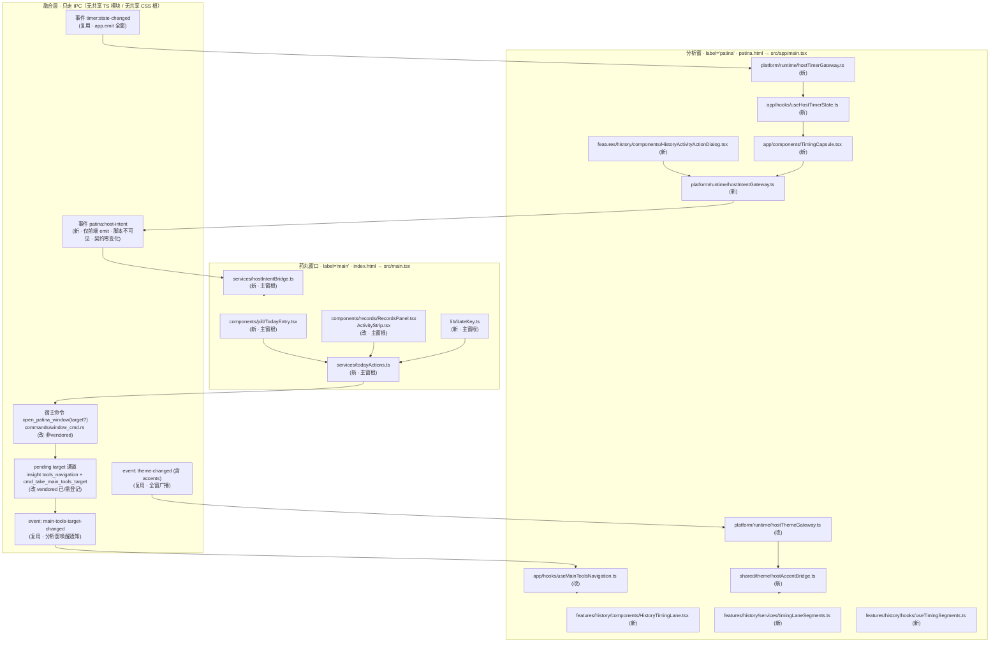
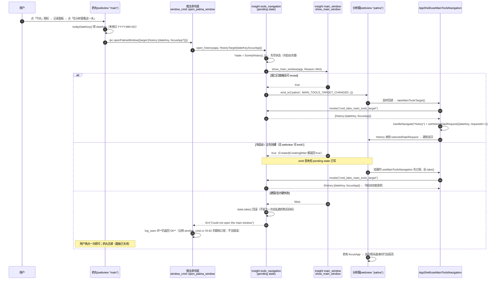
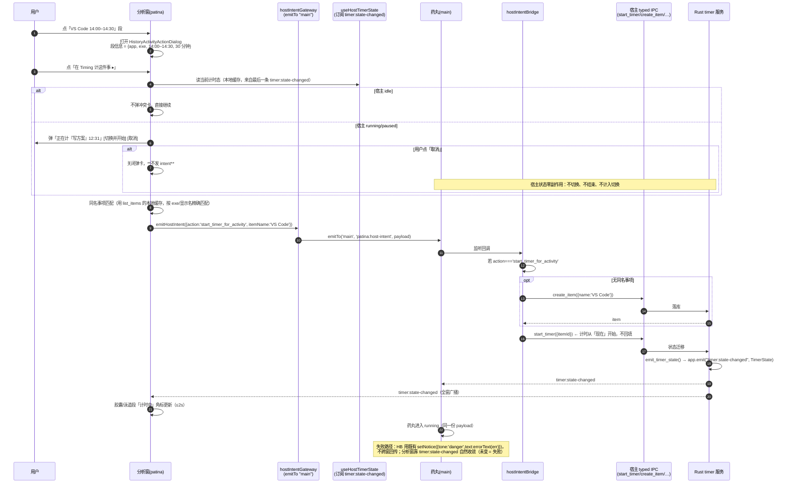
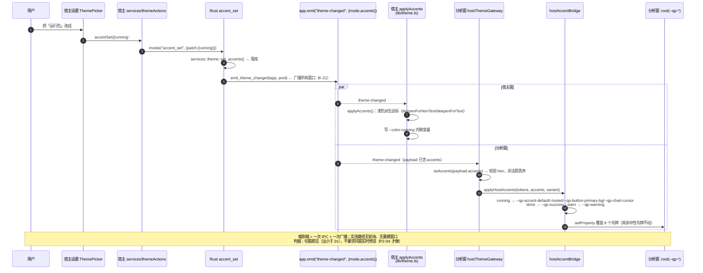
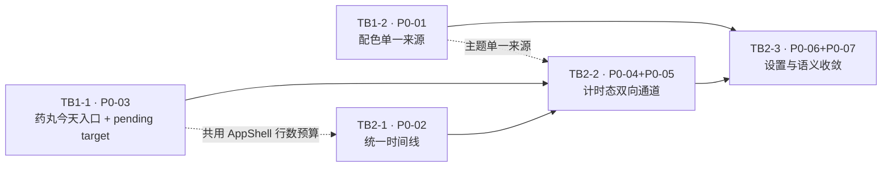

# FUSION-ARCH-v1 · Timing × Patina 双窗统一 · 系统设计与任务分解

> 上游：`docs/fusion/FUSION-PRD-v1.md`（P0 七项 / D1–D4 / 5 条待确认）
> 本文只写「怎么落地 + 怎么验收 + 谁先做」，不写代码。所有行号取自工作树当前状态（实测，非推测）。
> 已由主理人拍板的两条前置决策见 §0.2，本文按此设计，不再讨论选项。

---

## 0. 读前必读：三条与直觉相反的事实

| # | 事实 | 证据（实测） | 对设计的影响 |
| --- | --- | --- | --- |
| F1 | **窗口 label 语义是反的**：`"patina"` = 分析窗，`"main"` = 药丸（384×360 透明置顶） | `src-tauri/src/app/insight/main_window.rs:17` `MAIN_WINDOW_LABEL = "patina"`；`src-tauri/capabilities/default.json` 的 `windows: ["main", …]` 才是药丸 | insight 侧所有 `require_main_window*` 守卫、`show_main_window` 说的都是**分析窗**。写注释一律用 `pill(label "main")` / `analysis(label "patina")`，禁止裸写 `main`。 |
| F2 | **`check:size` 是逐文件棘轮，且 `History.tsx` / `AppShell.tsx` 已被钉死** | `scripts/check-size.mjs:23` `LIMIT=300`；`scripts/size-allowlist.json` 里 `src/features/history/components/History.tsx: 1206`、`src/app/AppShell.tsx: 385`、`src/features/settings/components/SettingsInterfacePanel.tsx: 598`、`src/shared/lib/activityTimelineCompiler.ts: 917` | **这三个文件一行都不能涨**（涨 = CI 红）。P0-02/P0-03 的接线必须先做「等量抽取」腾出预算（见 §5 TB2-1 前置任务）。 |
| F3 | **「事件 11」≠ emit 点**；契约脚本只认 Rust emit 与 `IPC_EVENTS` | 实测 `[contract] OK — 命令：Rust 80（+Patina 117）/ IpcApi 80 / ipc.ts 80 / mock 80；错误码：Rust 17 / 前端 17；事件：后端 11 / 前端 11 / emit 点 18`；`scripts/check-contract.mjs:260` `EXPECTED_EMIT_SITES = 18` | 只从**前端**发出的跨窗事件脚本完全看不见（既不加 11 也不加 18）。这是本方案「+0 命令 / +0 事件计数」的关键杠杆。 |

### 0.1 门禁实测基线（本文所有论证的前提）

```
[contract] OK — 命令：Rust 80（+Patina 117）/ IpcApi 80 / ipc.ts 80 / mock 80；
             错误码：Rust 17 / 前端 17；事件：后端 11 / 前端 11 / emit 点 18
[layers]   OK — 9 条分层规则全部通过（扫描 1362 个文件；L9 主窗 310 / 分析窗 411 个文件）
```

| 门禁 | 数字/棘轮 | 本方案的影响 |
| --- | --- | --- |
| `check:contract` | 宿主命令 80 / Patina 命令 117 / 错误码 17 / 事件 11+11 / emit 点 18 | **全部不变**（§1.3 逐条论证） |
| `check:size` | 单文件 ≤300；152 条冻结基线只许减 | 净**减少**（§5 每个任务都标了行数预算） |
| `check:vendored` | `scripts/vendored-allowlist.json` 现 31 条；**已登记条目只验 kind 不验哈希**（`scripts/check-vendored-diff.mjs:476-488`） | 需新增 ~12 条登记（§3 落点表逐项标出） |
| `check:layers` L9 | 主窗根 = `components/hooks/lib/mocks/services/stores/styles/types`；分析窗根 = `app/features/platform/shared` | 新增 .ts/.tsx **全部落在两端之一**，不新建共享根（§0.2） |
| `check:version` / `check:brand` | 六处版本一致 / 禁旧品牌名 | 无影响（不新增文案含旧名） |
| 运行时 | release `panic = "abort"` | 新增 Rust 代码零 `unwrap`/`expect`，`Mutex` 一律 `unwrap_or_else(|e| e.into_inner())` |

### 0.2 主理人已拍板的决策（不再讨论）

| 决策 | 内容 | 本文的落实方式 |
| --- | --- | --- |
| **Q5 = 否** | 本轮不新增前端共享根（L9 的 `L9_MAIN_ROOTS`/`L9_ANALYSIS_ROOTS` 是显式前缀集合 + 双向哨兵，扩集合爆炸半径过大） | 两窗共用的**行为**走 IPC 命令/事件；两窗共用的**视觉**只有「四色令牌」一件事，靠 `accent_get` 读 + `theme-changed` 播（不是 CSS 共享）。**新增 .ts 全部在各窗自己的根内**（§1.4 逐文件过 L9）。 |
| **Q2 = 不给分析窗写命令** | `permissions/patina-host-bridge.toml` 的「不给任何写命令」是既定边界 | 「分析窗 → 药丸」一律：分析窗 `emitTo('main', 'patina:host-intent', …)` → **药丸前端**监听到后用**自己的** typed IPC 执行。Rust 侧不新增任何写命令。 |

> 补充发现（比 PRD 更省）：PRD §5.3 建议「新开一条只读 `accent_get`」，实测**不需要新开**——`accent_get` 早就在宿主命令表里（`src-tauri/src/commands/theme_cmd.rs:34`，已注册于 `src-tauri/src/ipc_commands.rs:62`），只是没授权给分析窗。把它加进 `patina-host-theme.toml` 的 `host-theme-read` 即可，**契约计数零变化**。

---

## 1. 实现方案总览

### 1.1 结构图（两窗 + 融合层）



**每个新增文件落在哪个门禁域、为什么合法**：

| 新文件 | 根 | L9 归类 | 为什么合法 |
| --- | --- | --- | --- |
| `src/components/pill/TodayEntry.tsx` | `src/components/` | 主窗 | L9 主窗根；`check-layers` L1 只禁 `ipc.`/`invoke(`，本组件只调 `services/todayActions` ✓ |
| `src/services/todayActions.ts` | `src/services/` | 主窗 | L2 禁 `ipc.`/`invoke(` 于 `src/stores`、`*Store.ts`、`features/**/stores` —— `src/services` 不在其中，且它通过 `services/ipc` 的 typed 方法调用（现成写法，见 `src/services/settingsActions.ts:37`）✓ |
| `src/services/hostIntentBridge.ts` | `src/services/` | 主窗 | 同上；`@tauri-apps/api/event` 不受 L3 约束（L3 只禁 `api/window`、`api/webviewWindow`）✓ |
| `src/lib/dateKey.ts` | `src/lib/` | 主窗 | L3 例外文件是 `src/lib/windowApi.ts`，本文件不碰窗口 API ✓ |
| `src/features/history/**`（5 个新文件） | `src/features/` | 分析窗 | 分析窗根；组件内不出现 `ipc.`/`invoke(`（L1 管 `features/**/components/`），取数一律经 `platform/runtime/*Gateway` ✓ |
| `src/platform/runtime/hostTimerGateway.ts`<br/>`hostIntentGateway.ts` | `src/platform/` | 分析窗 | 网关层，`invoke`/`emitTo` 只允许出现在这里（与既有 `timingOverlapGateway.ts`、`hostThemeGateway.ts` 同构）✓ |
| `src/app/components/TimingCapsule.tsx`<br/>`src/app/hooks/useHostTimerState.ts` | `src/app/` | 分析窗 | 分析窗根；胶囊只读 hook 结果 ✓ |
| `src/shared/theme/hostAccentBridge.ts` | `src/shared/` | 分析窗 | 纯函数（无 DOM、无 IPC），被 `shared/theme` 与 `app/hooks/useAppThemeMode` 引用，同根内 ✓ |

> **L9 哨兵自证**：`scanWindowCross` 只看**相对 import 的解析目标**（`scripts/check-layers.mjs:205-219`）。上表所有新增文件的相对 import 目标都在**同一侧**；唯一跨窗引用是 `src/lib/windowApi.ts`（既有例外，本方案不新增用例）。L9 的两组文件数与哨兵（`L9_MAIN_FILES.length > 0` 等，`:267-287`）均不受影响。

#### 1.1.1 L9 红线清单（这 5 个「顺手 import」一定红，必须自己写一份）

| 想 import 的东西 | 会被谁 import | 为什么不行 | 正确做法 |
| --- | --- | --- | --- |
| `src/shared/lib/localDate.ts` 的 `formatLocalDateKey` | `src/lib/dateKey.ts`（主窗） | 主窗 → 分析窗，L9 直接红 | `src/lib/dateKey.ts` **自己实现** `pad2` + `todayDateKey()`（6 行） |
| `src/platform/runtime/insightEvents.ts` 的事件常量 | `src/services/hostIntentBridge.ts`（主窗） | 主窗 → 分析窗 | 宿主侧在该文件**头部**自己声明 `const HOST_INTENT = 'patina:host-intent'`，注释指回 `insightEvents.ts` |
| `HostIntent` 联合类型 | 两侧都要用 | 类型也不能跨窗（L9 不区分 `import type`） | 两侧各声明一份（分析窗 `insightEvents.ts`，宿主 `hostIntentBridge.ts`），字段名逐字一致 |
| `src/hooks/useTimerTick.ts` 的 `computeLiveSec` | `src/platform/runtime/hostTimerGateway.ts`（分析窗） | 分析窗 → 主窗 | 分析窗内复制同一公式（§6.2），注释指回 `useTimerTick.ts:11-21` 与 IPC-CONTRACT-v2 §4.2 |
| `src/lib/theme.ts` 的 `deepenForNonText/deepenForText` | `src/shared/theme/hostAccentBridge.ts`（分析窗） | 分析窗 → 主窗 | `hostAccentBridge.ts` 内逐字复制（§4 注 2） |


### 1.2 为什么不共享 CSS

主理人给的替代手段是「两个 HTML 入口各自 `@import` 同一份 CSS 产物」。实测后**判定本轮不需要**：

- 两窗唯一的视觉统一诉求是「强调色/语义色一套」，而这是**运行时的值**，不是样式规则。值经 `accent_get` + `theme-changed` 从宿主 IPC 拿到，在分析窗内合成 `--qp-*`（§4）。CSS 文件本身不会被复制。
- 唯一可能共享的是药丸的新图标样式，而分析窗不渲染药丸 → 天然不需要共享。
- 结论：**本轮 0 个共享 CSS 文件、0 处 `@import` 改动**，规避「样式图分裂」带来的首帧与产物差异风险。（若 B2 之后真出现共享组件，再回到 CSS 令牌层方案，届时只需两入口各加一行 `@import`。）

### 1.3 契约计数为什么是零（逐条）

| 计数 | 现值 | 本方案 | 论证 |
| --- | --- | --- | --- |
| 宿主命令（Rust 80 / IpcApi / ipc.ts / mock / ACL） | 80 | **80** | `open_patina_window` 只加**可选参数**，命令名不变（`scripts/check-contract.mjs:88` 的 `call<'…'>('open_patina_window'` 仍命中）。mock 键集合不变（`browserMockV020.ts:156` 忽略多余实参）。`permissions/host-commands.toml` 不变。 |
| Patina 命令 | 117 | **117** | `cmd_take_main_tools_target` 只改**返回 DTO 形状**，不改名字/不新增命令（`:70-73` 按 `commands::insight::<模块>::<函数>` 解析，集合不变）。 |
| 错误码 | 17 | **17** | 不新增 `ErrorCode`；失败一律复用 `INTERNAL`/既有码或返回结构化 Ok。 |
| 宿主事件（Rust 常量 / `IPC_EVENTS`） | 11 / 11 | **11 / 11** | `patina:host-intent` **不进** `IPC_EVENTS`（进了就会被 `:282-287` 「前端声明的事件后端没有来源」判红——它只有前端 emit）。它声明在分析窗自己的 `src/platform/runtime/insightEvents.ts`（该文件不参与 host 契约比对）。 |
| emit 点 | 18 | **18** | 宿主侧新写入点复用既有常量 `MAIN_TOOLS_TARGET_CHANGED`（`src-tauri/src/models/insight/events.rs`），`emitSites()` 收进的是**事件值集合**（`:166-177`，`values` 是 `Set`），同一值不会 +1；且必须用常量，禁止字面量（`:288-295` 会红）。 |
| `errorText()` 分支 | 17 | **17** | 无新码。 |

> 若工程师中途想「顺手加个命令」，代价是：`ipc_commands.rs` + `IpcApi` + `ipc.ts`（**已卡在 300/300 行**，加一行必须同时删一行）+ mock + `host-commands.toml` + `IPC-CONTRACT-v2.md` 四处。**本轮一律不许。**

### 1.4 vendored 登记（新增 ~12 条，逐条写理由 + owner）

规则实测：`check-vendored` 对**已登记**条目只校验 `change` 的类型是否与实际一致，**不再校验哈希**（`scripts/check-vendored-diff.mjs:476-488`）。所以：

- **新文件**（`added`）必须登记（否则 `unlisted` 红）；
- **已登记**的文件（如 `History.tsx`、`App.tsx`、`AppTitleBar.tsx`）后续怎么改都不会再红；
- **首次修改**的 vendored 老文件必须补一条 `modified`。

登记处：`scripts/vendored-allowlist.json`，字段 `{path, change, reason, owner}`，`owner` 必填。

---

## 2. P0 七项落点表

> 图例：**V** = vendored（`src/app|features|platform|shared` 或 `src-tauri/src/{layer}/insight`），需在 `scripts/vendored-allowlist.json` 登记；**H** = 宿主自有（非 vendored）。
> 行号格式 `path:line`，均相对仓库根。

### P0-01 · 颜色单一来源（分析窗强调/语义色从宿主四色派生）

| 项 | 内容 |
| --- | --- |
| **涉及文件** | **H** `src-tauri/permissions/patina-host-theme.toml:12-14`（`host-theme-read` 的 `commands.allow` 加 `"accent_get"`）<br/>**V(改)** `src/platform/runtime/hostThemeGateway.ts:26-28,72-85`（新增 `readHostAccents()`；`subscribeHostThemeMode` 扩成同时回调 accents，`theme-changed` 载荷本就带 `accents`，见 `src-tauri/src/app/events.rs:139-148` + `services/theme.rs:24-30`）<br/>**V(改)** `src/app/hooks/useHostThemeMode.ts:18-28`（升级为 `useHostTheme()` → `{mode, accents}`；文件名保持不变，避免动 L9 之外的引用面）<br/>**V(改)** `src/app/hooks/useAppThemeMode.ts:18-30`（`applyDocumentTheme` 里 `deriveTheme(...)` 之后串一层 `applyHostAccents`）<br/>**V(新)** `src/shared/theme/hostAccentBridge.ts`（纯函数，令牌映射表见 §4）<br/>**V(改)** `src/shared/theme/deriveTheme.ts:21`（仅加 `export` 关键字，导出 `primaryButtonBackground`，**不改算法**） |
| **vendored** | 是，5 处。`hostThemeGateway.ts` / `useHostThemeMode.ts` / `useAppThemeMode.ts` 已登记（`added`/`modified`），只需补 `hostAccentBridge.ts`(added)、`deriveTheme.ts`(modified)、`patina-host-theme.toml` 是非 vendored 权限文件不用登记。 |
| **IPC 命令/事件** | **不新增命令**：`accent_get` 已存在（`src-tauri/src/commands/theme_cmd.rs:34`，注册于 `ipc_commands.rs:62`，ACL 已在 `permissions/host-commands.toml`），本次只把它加进 Patina 的 `host-theme-read`。<br/>**不新增事件**：复用 `theme-changed`，载荷 `{ mode, accents }`（`ThemeChanged`，`src-tauri/src/services/theme.rs:24-30`）。<br/>错误码：无（`accent_get` 失败 → `AppResult`，分析窗侧 catch 后回落预设）。 |
| **依赖前序** | 无（可与 P0-03 并行） |
| **验收判据（对齐 PRD）** | ① 宿主设置把「运行色」改成 `#C81E1E` → **≤2s** 分析窗按钮主色/选中态/图表游标变红（切窗即可见）；② 分析窗内**不存在任何**主色/四色选择器（全仓枚举 `accent_set` 的调用点只有宿主 `services/themeActions.ts`）；③ 28 套配色预设仍只影响 `--qp-bg-* / --qp-text-* / --qp-border-*` 等中性令牌，`--qp-accent-default` 等 8 个令牌不再随预设变（可写单测钉住 §4 的映射表）；④ 深/浅仍单源（不改 `useHostThemeMode` 的既有语义）。 |

### P0-02 · 统一时间线（历史页「Timing 计时」泳道）

| 项 | 内容 |
| --- | --- |
| **涉及文件** | **V(改·已登记)** `src/features/history/components/History.tsx:622-625,1059,1096-1105`（接线；**必须先做净减抽取**，见下）<br/>**V(改·需登记)** `src/features/history/components/HistoryHorizontalTimeline.tsx:17-29`（Props 加 `onSegmentActivate?`，`:210-244` 的 `QuietTimelineSegment` 外包一层可点容器）<br/>**V(改·已登记)** `src/platform/runtime/timingOverlapGateway.ts:24-27,55-68`（`RawRecord` 补 `startedAt` / `endedAt` / `runningSince` / `mode`；`TimingRecordSlice` 补同名可选字段）<br/>**V(新)** `src/features/history/services/timingLaneSegments.ts`（纯函数：记录 + 视口 → 带 `startRatio/widthRatio` 的段）<br/>**V(新)** `src/features/history/hooks/useTimingSegments.ts`（取数 + 「进行中」合成段）<br/>**V(新)** `src/features/history/components/HistoryTimingLane.tsx`（第二条 `QuietTimelineTrack`，`showAxis={false}`）<br/>**V(新·前置抽取)** `src/features/history/hooks/useHistoryDistributionItems.ts`（把 `History.tsx:648-725` 的三个 `useMemo` 搬走，**净减 ~74 行**） |
| **vendored** | 是。`History.tsx`/`timingOverlapGateway.ts` 已登记；`HistoryHorizontalTimeline.tsx` 需补 `modified`；3 个新文件需 `added`。 |
| **IPC 命令/事件** | **零**。数据源是既有 `list_records` + `list_items`（`permissions/patina-host-bridge.toml` 已放行）。<br/>**无错误码变化**：读失败 → 泳道整条不渲染（沿用 `useTimingOverlap` 的「失败即空」口径，`hooks/useTimingOverlap.ts:42-47`）。 |
| **依赖前序** | 无（但 `History.tsx` 净减抽取必须在本任务内先做，否则 `check:size` 直接红） |
| **验收判据** | ① 任选一天：活动泳道在上、Timing 泳道在下，**共用同一 `viewportStartMs/viewportEndMs`**；② 14:00–14:30 的计时段与同区间活动段首尾对齐 **±1 分钟**（本方案用**同一比例公式、不取整**，理论误差 0）；③ 当天无记录 → `HistoryTimingLane` 返回 `null`，不留空壳；④ 进行中记录右端 = `viewModel.visibleEndMs`（今日 = now）并带「进行中」角标；⑤ 每段可点（触发 P0-05 弹卡）；⑥ `node scripts/check-size.mjs` 后 `History.tsx` 行数 **≤1206**。 |

### P0-03 · 药丸「今天」入口 + 跳分析窗今天

| 项 | 内容 |
| --- | --- |
| **涉及文件** | **H(新)** `src/components/pill/TodayEntry.tsx`（16px 图标，`aria-label="今天 · 在分析窗看今天"`）<br/>**H(改)** `src/components/pill/PillBar.tsx:280-285`（在 `<NoteHandle>` 前插一个子节点；`:288` 行目前 288 行 → **预算 ≤+5**，必须 ≤293）<br/>**H(新)** `src/services/todayActions.ts`（`openTodayPanel()` = `openPanel('records')`；`openTodayInAnalysis(focusApp?)` = `ipc.openPatinaWindow({target:{history:{dateKey, focusApp}}})`）<br/>**H(新)** `src/lib/dateKey.ts`（`todayDateKey()`：本地日 `YYYY-MM-DD`）<br/>**H(改)** `src/components/records/RecordsPanel.tsx:69-79`（面板头加「在分析窗看这一天 ↗」；`ActivityStrip` chip 传 `onFocusApp`）<br/>**H(改)** `src/components/records/ActivityStrip.tsx:16-37`（chip 由 `span` 改 `button`，`aria-label`；**注释②「不可点击」必须同批改写**，否则注释与行为相反）<br/>**H(改)** `src/services/ipc.ts:247`（`openPatinaWindow: (target?) => call<void>('open_patina_window', { target })`，**净 +0 行**：该文件 300/300）<br/>**H(改)** `src/types/domain/ipc.ts:181`（签名加可选参 + 新 `PatinaOpenTarget` 类型，净 +6）<br/>**H(改)** `src-tauri/src/commands/window_cmd.rs:71-83`（`open_patina_window(app, target: Option<PatinaOpenTarget>)`：有 target → 写 pending + 显示；无 → 走原路径，**净 +14**）<br/>**V(改·需登记)** `src-tauri/src/app/insight/main_window/tools_navigation.rs:10-35`（`ToolsNavigationState` 扩成 `Mutex<Option<MainWindowTarget>>`，新增 `open_history(app, target)`；`:38-48` 的单测同步改）<br/>**V(改·需登记)** `src-tauri/src/commands/insight/window_cmd.rs:109-119`（`cmd_take_main_tools_target` 返回 `Option<MainWindowTargetDto>`）<br/>**V(改·需登记)** `src/platform/desktop/mainToolsNavigationGateway.ts:5-9`（返回联合类型）<br/>**V(改·需登记)** `src/app/hooks/useMainToolsNavigation.ts:1-24`（消费 `history` 目标）<br/>**V(改·已登记)** `src/app/AppShell.tsx:110,165-170,294`（把 `handleToolsStatusChipOpen` 搬进 hook，**净 ≤0**；新增 `focusApp` 状态与 `selectedDateRequest` 透传） |
| **vendored** | 是，6 处（4 处新增登记 + 2 处已在册）。`PillBar.tsx` / `RecordsPanel.tsx` / `ActivityStrip.tsx` / `window_cmd.rs` / `ipc.ts` / `types/domain/ipc.ts` 是宿主自有，不登记。 |
| **IPC 命令/事件** | **不新增命令**：复用 `open_patina_window`（加可选参数）+ `cmd_take_main_tools_target`（改返回 DTO）。<br/>**不新增事件**：复用 `main-tools-target-changed` 作为唤醒（`tools_navigation.rs:33` 已有 emit_to）。<br/>**DTO**：<br/>`PatinaOpenTarget = { history: { dateKey: string; focusApp?: string \| null } }`（camelCase，Rust 侧 `#[serde(rename_all="camelCase")]`）<br/>`MainWindowTargetDto = { tools?: "pomodoro" \| "reminders"; history?: { dateKey: string; focusApp: string \| null } }`（两字段均 `skip_serializing_if = "Option::is_none"`）<br/>错误码：**无**。窗未就绪不报错（`show_main_window` 返回 false 只 `log_warn`，`window_cmd.rs:78-82`），pending 目标保留给冷启动消费。 |
| **依赖前序** | 无（B1 第一批） |
| **验收判据** | ① 药丸 ≤1 次点击打开记录面板；② 面板头「在分析窗看这一天」→ 分析窗停在**历史页 + 今天**；③ 点「同时在用」chip → 同上且该应用泳道高亮/展开；④ 既有 **7 个点击区**行为零变化（圆环 1 / 数字左右 2 / 事项名左右 2 / 便利贴手柄左右 2，逐项回归）；⑤ 冷启动（分析窗未创建）也能拿到目标：先写 state 再 show（`open_history` 与 `open()` 同序），分析窗 `useMainToolsNavigation` 先订阅后 take（`:17-22` 既有写法）；⑥ 连点两次「今天」只消费一次（`take()` 清空，单测 `latest_target_survives_until_consumed_once` 扩一条 history 用例）。 |

> **[V0.12.1 追加 · 落点扩到四种]** 本节写的 `PatinaOpenTarget` 只有 `history`；P1-02 加了 `overview`，
> 0.12.1 两窗收口又加了 `settings`（判序 `history > settings > overview`，命令数与事件数不变）。
> 现行形状与判据以 `docs/phase2/IPC-CONTRACT-v2.md` §12.13 / §12.14 与
> `FUSION-ARCH-P1-v1.md` §5.3 的追加条为准；本节保留为当时的设计事实，不回写。

### P0-04 · 分析窗标题栏「Timing 计时胶囊」

| 项 | 内容 |
| --- | --- |
| **涉及文件** | **V(新)** `src/app/components/TimingCapsule.tsx`（事项名 + 已计时长 + 今日累计 + 暂停/继续 + 回药丸）<br/>**V(新)** `src/app/hooks/useHostTimerState.ts`<br/>**V(新)** `src/platform/runtime/hostTimerGateway.ts`（`listen('timer:state-changed')` + `invoke('list_items')` + `computeHostLiveSec`）<br/>**V(改·已登记)** `src/app/components/AppTitleBar.tsx:12-17,91`（`toolsStatusEntry` 旁新增 `timingStatusEntry?: ReactNode`，插在 `:91` 之前）<br/>**V(改·已登记)** `src/app/AppShell.tsx:294` 附近（传 `timingStatusEntry={<TimingCapsule/>}`，**靠 P0-03 的净减预算吸收**） |
| **vendored** | 是，2 处已在册（AppTitleBar / AppShell），3 个新文件需 `added`。 |
| **IPC 命令/事件** | **不新增命令/事件**：<br/>· 状态：复用宿主广播 `timer:state-changed`（`src-tauri/src/app/events.rs:43-56`，`app.emit` = 全窗；载荷 = `TimerState{status, session:TimeRecord\|null, last_item_id, live_duration_sec, mode, remaining_sec}`，`src-tauri/src/models/timer.rs:15-28`）。分析窗能力已含 `core:event:allow-listen`（`capabilities/patina.json:10`）。<br/>· 事项名：复用已授权的 `list_items`（`patina-host-bridge.toml`）。<br/>· 暂停/继续：**意图事件**（见 P0-05 的 `patina:host-intent`，`action:'toggle_timer'`），宿主执行。 |
| **依赖前序** | P0-03（共用 `AppShell` 的行数预算与 intent 通道骨架） |
| **验收判据** | ① 药丸开始计时后切到分析窗：胶囊 **≤2s** 显示同一事项名与同一时长；② 两处数字**每秒完全一致**——两侧都用 `accumulatedSec + floor((Date.now() - runningSince)/1000)`（宿主 `src/hooks/useTimerTick.ts:11-21` 的 `computeLiveSec`，分析窗副本见 §6.2）；③ 点胶囊「暂停」→ 药丸 ≤2s 变暂停态；④ 胶囊可见性不受侧栏视图影响（标题栏常驻）；⑤ `status==='idle'` 时胶囊不渲染（不留空壳）。 |

### P0-05 · 分析窗对一段活动「在 Timing 计这件事」

| 项 | 内容 |
| --- | --- |
| **涉及文件** | **V(新)** `src/features/history/components/HistoryActivityActionDialog.tsx`（段信息 + 「在 Timing 计这件事」+「关闭」；已计时时先出「切换并开始 / 取消」）<br/>**V(新)** `src/platform/runtime/hostIntentGateway.ts`（`emitHostIntent(intent)` → `emitTo('main', HOST_INTENT, intent)`）<br/>**V(改·已登记)** `src/platform/runtime/insightEvents.ts:1-25`（加 `HOST_INTENT` / `HOST_TIMER_STATE` 两个常量）<br/>**V(改·已登记)** `src/features/history/components/History.tsx`（`actionTarget` 状态 + 弹卡挂载，**靠 P0-02 的净减预算吸收**）<br/>**V(改·需登记)** `src/features/history/components/HistoryHorizontalTimeline.tsx`（`onSegmentActivate`，与 P0-02 同一处改动）<br/>**H(新)** `src/services/hostIntentBridge.ts`（宿主侧监听 `patina:host-intent`，分派到 `useTimerActions` / `itemStore` / 打开设置 / 唤起药丸）<br/>**H(改)** `src/App.tsx:1-126`（挂一次 `useHostIntentBridge()`，**+2**） |
| **vendored** | 是，5 处（2 已登记 + 1 需登记 + 2 新文件）。 |
| **IPC 命令/事件** | **不新增命令**（动作全部由药丸用**既有** typed IPC 执行：`start_timer` / `create_item` / `pause_timer` / `resume_timer`）。<br/>**+1 前端事件**（契约计数不变，理由见 §1.3）：<br/>· 名：`patina:host-intent`<br/>· 方向：分析窗 `emitTo('main')` → 药丸 `listen`<br/>· 载荷：`{ action: 'start_timer_for_activity'; itemName: string } \| { action: 'toggle_timer' } \| { action: 'open_host_settings' } \| { action: 'show_pill' }`<br/>· 错误处理：药丸执行失败 → 既有 `setNotice({tone:'danger', text: errorText(err)})`，**不跨窗回传**（分析窗只表达意图，不承诺结果；胶囊/角标自然随 `timer:state-changed` 收敛）。 |
| **依赖前序** | P0-02（泳道段可点）、P0-03（`AppShell` 预算 + 标题栏槽位） |
| **验收判据** | ① 点 14:00–14:30 的 VS Code 段 → 「在 Timing 计这件事」→ 药丸 **≤2s** 进入 running 且事项名 = 应用名；② 无同名事项 → 自动新建（`itemStore` 走既有 `create_item`，名称 = `slice.app`）；③ **宿主已在计时** → 先弹「正在计『写方案』12:31 / [切换并开始] [取消]」，点「取消」→ 宿主状态**完全不变**（不切换、不结束、不计入切换；判据：`get_timer_state` 前后逐字段相等）；④ 计时**从「现在」开始，不回填**历史区间；⑤ 弹卡内不出现分类/标签等分析窗概念；⑥ 该段/新泳道段出现「计时中」角标。 |

### P0-06 · 设置与备份职责收敛

| 项 | 内容 |
| --- | --- |
| **涉及文件** | **V(改·已登记)** `src/features/settings/components/Settings.tsx:9,255-303`（删掉独立的 `SettingsAppearancePanel` 与 `SettingsInterfacePanel` 两块，改成一个 `SettingsDisplayPanel` 块 → **净减 ≥10 行**，分区 5→4）<br/>**V(改·需登记)** `src/features/settings/components/SettingsAppearancePanel.tsx`（**原地改造**为本节的「显示」分区：删「主题模式」段、迁入并保留 语言/动效/配色预设（标题标注「仅影响中性底色」）、顶部一行「主题与主色在 Timing 设置里统一配置 →」走 intent `open_host_settings`、内部嵌入 `SettingsInterfacePanel`）<br/>**V(改·需登记)** `src/shared/i18n/**`（分区标题文案：外观→显示；新增那一行提示）<br/>**H(改)** `src/components/settings/ThemePicker.tsx`（唯一主色入口的标题/说明措辞收敛：「主题与主色 · 全应用唯一入口」，**仅文案**）<br/>**V(改·需登记)** 备份两处的标题/说明（分析窗 `features/settings/components/SettingsDataSafetyPanel.tsx` 与宿主 `src/components/settings/MdSyncBackupCard.tsx`） |
| **vendored** | 是，4 处（1 已登记 + 3 需登记）。`ThemePicker.tsx` / `MdSyncBackupCard.tsx` 宿主自有。 |
| **IPC 命令/事件** | 无新增。跳转宿主设置复用 P0-05 的 `patina:host-intent`（`action:'open_host_settings'`）。 |
| **依赖前序** | P0-05（intent 通道）、P0-01（主题模式单一来源已成立，删掉分析窗的主题开关才不会「少了一个入口」） |
| **验收判据** | ① 全应用可改「主题/主色」的控件数 = **1**（枚举：`theme_set`/`accent_set` 的调用点只剩宿主 `services/themeActions.ts` 一处；UI 上只剩 `ThemePicker`）；② 分析窗设置分区 5→4 且不含「外观」（列表可由测试快照断言）；③ 「最短会话时长 / 合并间隔 / 刷新间隔」各只剩 **1 个可编辑处**，另一侧只读且同值；④ 两处备份的按钮标题、说明、作用对象互不相同（活动库 vs 计时数据）；⑤ 28 套配色预设仍可切换，且只改中性底色。 |

### P0-07 · 计时语义统一（专注会话 vs 计时）

| 项 | 内容 |
| --- | --- |
| **涉及文件** | **V(改·需登记)** `src/features/tools/components/PomodoroToolPanel.tsx:1-78`（一句话「专注会话 · 不计入时间账」）<br/>**V(改·需登记)** `src/features/tools/components/FreeFocusContent.tsx`（同义）<br/>**V(新)** `src/features/tools/components/HostTimingStatusRow.tsx`（复用 `useHostTimerState`：「Timing 计时中：<事项名> <时长> →」，点击发 intent `show_pill`）<br/>**H(改)** `src/components/menu/CountdownCard.tsx`（倒计时卡片顶部一句话「计时 · 计入时间账」；入口在 `src/components/Batch2Overlays.tsx`，挂载点由 `PillBar.tsx:180` 的 `openCountdownCard` 决定）<br/>**H(改)** `src/mocks` 之外的纯文案：`src/lib/constants.ts` 若已有文案常量则复用，否则就地写 |
| **vendored** | 是，3 处（均需登记）+ 1 处宿主文案。 |
| **IPC 命令/事件** | 无新增（状态读 `timer:state-changed` + `list_items`，跳转走 intent `show_pill`）。 |
| **依赖前序** | P0-04（`useHostTimerState` 复用） |
| **验收判据** | ① 番茄钟面板与分析窗工具页各有一句「是否计入时间账」的说明；② 宿主正在计时时，分析窗工具页显示「Timing 计时中：<事项名> <时长>」并可点击回到药丸；③ 同一功能两处**同一名词**（同义异名清单为空：检查「番茄钟/Pomodoro」「自由专注/FreeFocus」「倒计时/CountDown」在两侧文案中各自只用一种写法）。 |

---

## 3. 三张时序图

### ① 药丸 → 分析窗「历史 · 今天」（含冷启动未就绪回滚路径）



**落地要点**
- 「先写 state 再 show」是冷启动可用的**唯一**保证；顺序不能反。
- 回滚只在**硬失败**时发生（`ensure_main_window_once`/`reveal` 失败），`MainWindowShowDecision::Wait|Created|Creating` 都返回 `true`（`src-tauri/src/app/insight/main_window.rs:146-158`），因此「还没就绪」不会清掉目标。
- 命令层不把「未就绪」当错误（`src-tauri/src/commands/window_cmd.rs:78-82` 既有注释：点第二次就好）。

### ② 分析窗对一段活动「在 Timing 计这件事」（事件 handoff + 已有计时先问）



**落地要点**
- 「先问再切」的判断在**分析窗**（它有 `timer:state-changed` 缓存），不在药丸——这样「取消」是纯前端零副作用，连一次 intent 都不发。
- 动作只由药丸执行（Q2 边界）：分析窗**没有任何**写命令权限。
- 计时起点是「现在」：payload 不含 `startedAt`，从协议上杜绝回填（P1-01 才做回填）。

### ③ 四色变更后两侧 ≤2s 同步



**落地要点**
- 分析窗**不**订阅 `theme_set` 的返回值，只认广播 → 宿主设置页、托盘、其它入口改色都能同步到。
- 首帧/冷启动：`accent_get` 读一次（新增授权见 P0-01）；失败 → 保持预设值（不回退成白屏）。
- 分析窗的浅色派生成**对分析窗自己的 `--qp-bg-panel` 亮度**计算，不是照抄宿主派生后的 hex —— 见 §4 注 2。

---

## 4. 令牌桥接映射表（宿主四色 → 分析窗 `--qp-*`）

### 4.1 宿主侧真实变量（实测）

| 用户可配键 | 写入的 CSS 变量 | 默认值（深） | 默认值（浅） | 定义处 |
| --- | --- | --- | --- | --- |
| `running` | `--color-running` | `#4DA3E8` | `#1669AD` | `src/lib/theme.ts:28-33`（`ACCENT_VAR`）、`:36-41`（`DEFAULT_ACCENTS`）→ 运行时写 `documentElement.style`（`applyAccents`，`:153-181`） |
| `warn` | `--color-warn` | `#E8A33D` | `#A05E00` | 同上；`:11-15` 的别名链 `--color-warn: var(--warn)`（`src/styles/tokens/04-aliases.css`） |
| `done` | `--color-done` | `#4CC38A` | `#0C7E47` | 同上 |
| `bar` | `--color-bar` | `null`=跟随 | `null`=跟随 | 同上（`null` → 移除内联，回落 `--bg-plate`） |
| （不可配，仅令牌） | `--danger` / `--ok` / `--accent` | `#E5484D` / `#4CC38A` / `#4DA3E8` | 见文件 | `src/styles/tokens/02-theme-dark.css:43-51`、`03-theme-light.css:34-40` |

> **重要**：`ACCENT_KEYS` 只有 4 个且**不含 danger**（`src/lib/theme.ts:25`）。所以「四色派生」的可用来源只有 `running/warn/done/bar`。这是 PRD §P0-01「语义色一律从宿主四色派生」的天然上界。

### 4.2 分析窗侧真实令牌清单（`deriveTheme` 实际产出的全部键）

来自 `src/shared/theme/deriveTheme.ts:42-91`（`DEFAULT_CONTROLS`）+ `:93-135`（`controlColors`）+ `:147-159`（`deriveTheme` 返回体）：

```
--qp-bg-app --qp-bg-canvas --qp-bg-panel --qp-bg-elevated
--qp-border-subtle --qp-border-strong
--qp-text-primary --qp-text-secondary --qp-text-tertiary --qp-text-on-accent --qp-text-disabled
--qp-accent-default --qp-accent-muted
--qp-success --qp-participation --qp-warning --qp-danger
--qp-control-off --qp-control-thumb
--qp-track-muted --qp-badge-subtle
--qp-scrollbar-default --qp-scrollbar-hover
--qp-chart-cursor --qp-chart-grid --qp-chart-track
--qp-button-primary-bg
```

### 4.3 逐项映射（`hostAccentBridge.ts` 的唯一职责）

| 宿主来源 | → 分析窗目标 | 派生关系（逐字，`dark = variant==="dark"`） | 依据 |
| --- | --- | --- | --- |
| `accents.running` | `--qp-accent-default` | `= running` | 强调色本体 |
| `accents.running` | `--qp-accent-muted` | `color-mix(in srgb, running {dark?20%:14%}, {surface})` | 现有 `controlColors` 的强调弱化档（`deriveTheme.ts:101,120`） |
| `accents.running` | `--qp-button-primary-bg` | `primaryButtonBackground(running)`（保色相向黑混到与白字 ≥4.5:1） | `deriveTheme.ts:21-33` + `:157`（本轮仅加 `export`） |
| `accents.running` | `--qp-chart-cursor` | `color-mix(in srgb, running {dark?14%:12%}, transparent)` | `deriveTheme.ts:113,132` |
| `accents.done` | `--qp-success` | `= done` | 语义「成功/完成」 |
| `accents.warn` | `--qp-warning` | `= warn` | 语义「提醒」 |
| **无来源** | `--qp-danger` | **保持 `deriveTheme` 原值**（预设决定） | 宿主四色无 danger 键（`ACCENT_KEYS`） |
| **无来源** | `--qp-participation` | **保持原值** | 同上 |
| **不映射** | `accents.bar` | 不参与 | `bar` 是药丸底板色（`--pill-hover-plate` 消费），分析窗无对应语义 |
| （保持预设） | `--qp-bg-app/-canvas/-panel/-elevated`、`--qp-border-*`、`--qp-text-primary/-secondary/-tertiary/-disabled`、`--qp-text-on-accent`、`--qp-control-off/-thumb`、`--qp-track-muted`、`--qp-badge-subtle`、`--qp-scrollbar-*`、`--qp-chart-grid`、`--qp-chart-track` | 全部不动 | **这就是「中性底色仍由 28 套预设决定」的边界线**：上表 8 个键由宿主覆盖，其余 20 个键仍归 `colorScheme` 预设 |

**注 1（覆盖顺序）**：`applyDocumentTheme`（`src/app/hooks/useAppThemeMode.ts:23-29`）里顺序必须是 `deriveTheme() → applyHostAccents() → setProperty 循环 → applyActivityDisplayTheme()`。`applyActivityDisplayTheme` 会从 tokens 读 `--qp-bg-panel/-elevated/-canvas/--qp-chart-track` 算活动色的混色底，**必须在覆盖之后调用**，否则浅色反差算错。

**注 2（浅色达标派生）**：宿主在浅色下写入 `--color-running` 的是**派生后**的 hex（`applyAccents`，`src/lib/theme.ts:168-177`），但 `accent_get` 返回的是**用户原始值**（`services::theme::accents` 读设置）。分析窗因此必须**自己派生**（对 `--qp-bg-panel` 亮度）：`running/done` → `deepenForNonText(hex, panelLum, 3)`，`warn` → `deepenForText(hex, plateLum, 4.5)`。这两个函数在 `src/lib/theme.ts:103-122`（宿主根，分析窗 import 不了，L9），因此 `hostAccentBridge.ts` 内**逐字复制**同一算法（30 行），并注明「与 `src/lib/theme.ts` 的 `deepenForNonText/deepenForText` 必须逐字同构；如改一处必须两处同改」。

**注 3（非法值）**：沿用宿主口径——非 `#RGB`/`#RRGGBB` 一律忽略（`isValidHex`，`src/lib/theme.ts:59-64`），保留预设值。分析窗不写日志噪音，只在 dev 下 `console.warn` 一次。

---

## 5. 任务列表（有序 · 带依赖 · 分 B1/B2）

> 每任务 ≥3 个文件；任务数 5（B1 两个 + B2 三个）——把 P0-04 与 P0-05 合并（共用 intent 通道与 `useHostTimerState`）、把 P0-06 与 P0-07 合并（同属「设置与文案收敛」），因此满足「单批 ≤5 任务」的硬上限，且没有把不相关的模块硬凑在一起。
> 「行数预算」= 该任务结束后的**净变化**（负数 = 必须减下来）。

### B1（零风险批：不新增命令、不碰时序复杂性、体感立竿见影）

| 任务号 | 目标 | 文件 | 前置 | 完成判据 | 行数预算 |
| --- | --- | --- | --- | --- | --- |
| **TB1-1** | **P0-03 药丸「今天」入口 + 宿主→分析窗 pending target 通道** | 新：`src/components/pill/TodayEntry.tsx`、`src/services/todayActions.ts`、`src/lib/dateKey.ts`<br/>改(H)：`src/components/pill/PillBar.tsx`、`src/components/records/RecordsPanel.tsx`、`src/components/records/ActivityStrip.tsx`、`src/services/ipc.ts`(净0)、`src/types/domain/ipc.ts`、`src-tauri/src/commands/window_cmd.rs`<br/>改(V)：`.../main_window/tools_navigation.rs`、`src-tauri/src/commands/insight/window_cmd.rs`、`src/platform/desktop/mainToolsNavigationGateway.ts`、`src/app/hooks/useMainToolsNavigation.ts`、`src/app/AppShell.tsx` | — | `npm run check` 全绿；`cargo test --lib` 绿（含改后的 `tools_navigation` 单测）；手测：药丸→记录面板→分析窗今天 ≤1 次点击；冷启动（先杀分析窗）再点仍落到今天；7 个既有点击区逐项回归 | `PillBar.tsx` ≤+5（288→≤293）；`AppShell.tsx` **≤0**（385，靠把 `:165-169` 搬进 hook）；`ipc.ts` =0（300 上限）；其余新文件 ≤120/个 |
| **TB1-2** | **P0-01 配色单一来源** | 改(H)：`src-tauri/permissions/patina-host-theme.toml`<br/>新(V)：`src/shared/theme/hostAccentBridge.ts`<br/>改(V)：`src/platform/runtime/hostThemeGateway.ts`、`src/app/hooks/useHostThemeMode.ts`、`src/app/hooks/useAppThemeMode.ts`、`src/shared/theme/deriveTheme.ts`（仅 `export`） | — | 手测：宿主改运行色 → 切到分析窗按钮/选中态/图表游标已变；分析窗无任何主色控件；`hostAccentBridge` 单测覆盖 §4.3 全 8 键 + 非法 hex 回落 + 深/浅两档 | `deriveTheme.ts` +0（1 行改前缀）；`hostAccentBridge.ts` ≤180；其余 ≤+20 |

> **B1 为什么可以并行**：TB1-1 碰「窗口/导航」，TB1-2 碰「主题」，文件集合不相交；唯一的公共文件是 `src/app/AppShell.tsx`（只有 TB1-1 动）。若单人顺序做，建议先 TB1-1（体感最大）。

### B2（其余五项）

| 任务号 | 目标 | 文件 | 前置 | 完成判据 | 行数预算 |
| --- | --- | --- | --- | --- | --- |
| **TB2-1** | **P0-02 统一时间线**（含 `History.tsx` 净减抽取前置） | 新：`src/features/history/hooks/useHistoryDistributionItems.ts`、`src/features/history/services/timingLaneSegments.ts`、`src/features/history/hooks/useTimingSegments.ts`、`src/features/history/components/HistoryTimingLane.tsx`<br/>改(V)：`src/features/history/components/History.tsx`、`src/features/history/components/HistoryHorizontalTimeline.tsx`、`src/platform/runtime/timingOverlapGateway.ts` | — | 两泳道同轴同视口；14:00–14:30 对齐 ≤1 分钟（`timingLaneSegments` 单测用同视口断言 `startRatio` 与 `buildSegment` 一致）；无记录不留空壳；进行中到 `visibleEndMs` | `History.tsx` **≤1206**（抽取 −74，接线 +5）；`HistoryHorizontalTimeline` ≤+25；新文件 ≤150/个 |
| **TB2-2** | **P0-04 + P0-05 计时态双向通道**（标题栏胶囊 + 活动转计时） | 新：`src/app/components/TimingCapsule.tsx`、`src/app/hooks/useHostTimerState.ts`、`src/platform/runtime/hostTimerGateway.ts`、`src/platform/runtime/hostIntentGateway.ts`、`src/features/history/components/HistoryActivityActionDialog.tsx`、`src/services/hostIntentBridge.ts`<br/>改(V)：`src/app/components/AppTitleBar.tsx`、`src/app/AppShell.tsx`、`src/platform/runtime/insightEvents.ts`、`src/features/history/components/History.tsx`<br/>改(H)：`src/App.tsx` | TB2-1 | 胶囊与药丸每秒同数字；点暂停药丸 ≤2s 同步；点活动段 → 计这件事 → 药丸 ≤2s running；已计时先问且「取消」零副作用（`get_timer_state` 逐字段不变） | `AppTitleBar` ≤+12；`AppShell` ≤+4（用 TB1-1 腾出的余量）；`History.tsx` 仍 ≤1206（用 TB2-1 余量）；新文件 ≤150/个 |
| **TB2-3** | **P0-06 + P0-07 设置与语义收敛** | 改(V)：`src/features/settings/components/Settings.tsx`（净减）、`SettingsAppearancePanel.tsx`（原地改造为「显示」分区）、`src/shared/i18n/**`、`SettingsDataSafetyPanel.tsx`、`src/features/tools/components/PomodoroToolPanel.tsx`、`FreeFocusContent.tsx`<br/>新(V)：`src/features/tools/components/HostTimingStatusRow.tsx`<br/>改(H)：`src/components/settings/ThemePicker.tsx`、`src/components/settings/MdSyncBackupCard.tsx`、药丸倒计时入口文案 | TB2-2（intent 通道）、TB1-2（主题单一来源） | 可改主色控件 =1（枚举）；分析窗分区 5→4 且无「外观」；三个同名参数各 1 个可编辑处；两处备份文案互不相同；两处「是否计入时间账」说明齐备；同义异名清单为空 | `Settings.tsx` **≤364**（净减 ≥10）；`SettingsAppearancePanel` ≤240（原地改造）；`PomodoroToolPanel` ≤+6 |

**任务依赖图**



> 可并行组合：`{TB1-1, TB1-2}` → `{TB2-1}` → `{TB2-2}` → `{TB2-3}`。
> 若只有一个工程师：TB1-1 → TB1-2 → TB2-1 → TB2-2 → TB2-3（每个任务结束跑一次 `npm run check`）。

---

## 6. 共享知识（跨文件约定，工程师必须照此写）

### 6.1 「今天」的日期口径（唯一）

- **定义**：本地日。`dateKey = \`${y}-\${MM}-\${dd}\``（补零），来自 `new Date()` 的 `getFullYear/getMonth/getDate`。
- **宿主机实现**：`src/lib/dateKey.ts` 的 `todayDateKey()`（新）。
- **分析窗实现**：`src/shared/lib/localDate.ts:27` `formatLocalDateKey(date)`（现成，**不要另写一份**）。
- **两窗一致性**：都基于**本地时区**的日历日，禁用 `toISOString().slice(0,10)`（UTC 会跨日错位）。
- **区间 ↔ dateKey 换算**：`[startOfLocalDay(d), addLocalDays(startOfLocalDay(d), 1))`；宿主侧对应 `src/lib/time.ts:64-73` 的 `rangeBounds('day')`；分析窗侧对应 `History.tsx:613-619` 的 `selectedDayRange`。**同一天在两窗必须得到相同的 `[fromMs,toMs)`**，这是 D4「同一天总时长相等」的底层前提。

### 6.2 时间线段的坐标系与取整规则

- **唯一坐标系**：`HistoryTimelineViewModel`（`src/shared/lib/activityTimelineCompiler.ts:105-118`）的 `viewportStartMs / viewportEndMs / viewportDurationMs / dayStartMs / dayEndMs / visibleEndMs`。
- **唯一比例公式**（照抄 `buildSegment`，`:437-482`）：
  ```
  clippedStart = max(segStart, dayStartMs, viewportStartMs)
  clippedEnd   = min(segEnd,   dayEndMs, visibleEndMs, viewportEndMs)
  if (clippedEnd <= clippedStart) 丢弃该段
  startRatio = (clippedStart - viewportStartMs) / viewportDurationMs
  widthRatio = (clippedEnd - clippedStart) / viewportDurationMs
  ```
- **取整规则：不取整。** 一律用毫秒比例交给 CSS 百分比。任何 `Math.round` 到分钟都会引入 ≥30s 偏差，直接威胁「±1 分钟」判据。
- **Timing 段的墙钟口径**：`segStart = session.startedAt`，`segEnd = session.endedAt ?? viewModel.visibleEndMs`（`endedAt === null` ⇒ 进行中）。**宽度用墙钟跨度**（不是 `accumulatedSec`），否则与活动泳道对不齐；**显示数字用 `accumulatedSec`**（与「同期计时」行同口径，D4）。
- **「现在」的唯一来源**：`viewModel.visibleEndMs`（今日 = `min(dayEnd, now)`，历史日 = `dayEnd`）。泳道**不要**自己起一个 `Date.now()` 定时器。

### 6.3 pending 目标的类型与生命周期

```ts
// host → analysis（Rust 侧镜像，serde camelCase）
type MainWindowTargetDto =
  | { tools: 'pomodoro' | 'reminders' }
  | { history: { dateKey: string; focusApp: string | null } };
```

- **写入方**：宿主命令 `open_patina_window(target?)`（唯一的宿主侧写入口）。
- **消费方**：仅分析窗（`cmd_take_main_tools_target` 带 `require_main_window_string` 守卫，label 必须是 `"patina"`；`src-tauri/src/commands/insight/window_guard.rs:13-19`）。
- **生命周期**：`take` 即清空（`Mutex<Option<_>>::take`），**一次性**；重复 `take` 返回 `None`。
- **覆盖语义**：后写覆盖先写（`Some(x)` 直接赋值，不做队列）。用户连点两次「今天」只落地最后一次——这是正确的（目标幂等）。
- **唤醒事件**：`main-tools-target-changed`（`src/platform/runtime/insightEvents.ts:21` ← `src-tauri/src/models/insight/events.rs`）。**它只是「该来取一次」的门铃，不带载荷**；载荷永远从 `take` 取。冷启动靠「挂载时也 take 一次」兜底。
- **回滚**：只在 `show_main_window` 硬失败时 `state.take()`；「未就绪」不回滚。

### 6.4 分析窗 → 药丸的意图协议（`patina:host-intent`）

```ts
type HostIntent =
  | { action: 'start_timer_for_activity'; itemName: string }
  | { action: 'toggle_timer' }          // 暂停 ⇄ 继续，由药丸读自身状态决定方向
  | { action: 'open_host_settings' }
  | { action: 'show_pill' };            // 唤起并高亮药丸（复用 tray:highlight 的处理函数）
```

- **一个方向、一个事件名**：所有「分析窗想让宿主做事」都走这条，禁止每功能一个事件名。
- **无返回值**：分析窗不 await 结果；成败由 `timer:state-changed` / 宿主自身 UI 收敛。
- **归属**：执行方是药丸前端（`src/services/hostIntentBridge.ts`），用**既有** typed IPC；Rust 侧完全不知情。
- **幂等**：`toggle_timer` 由药丸按当前 `status` 决定方向，重复投递 = 来回切（与用户连点等价，可接受）。

### 6.5 错误文案口径

| 场景 | 文案 | 位置 |
| --- | --- | --- |
| 分析窗打不开 / 未就绪 | **不提示**，只 `log_warn`（`window_cmd.rs:78-82` 既有口径），用户再点一次 | Rust |
| intent 执行失败（建事项/开始计时） | 既有 `errorText(err)` + `setNotice({tone:'danger'})`，在**药丸**上出现 | `hostIntentBridge` |
| 泳道读不到数据 | **静默**，整条不渲染（`useTimingOverlap.ts:42-47` 同口径） | `useTimingSegments` |
| 主题/四色读不到 | **静默**，回落预设值 | `hostAccentBridge` / gateway |
| 弹卡「取消」 | 无提示（用户明确表达「什么都不做」） | dialog |

> 通例：**分析窗不承担宿主错误文案**；跨窗只传意图，不传错误。

### 6.6 命名规范（防易错点，硬约定）

| 概念 | 唯一写法 | 禁止 |
| --- | --- | --- |
| 药丸窗口 | `pill`（注释里写 `药丸(label "main")`），类型/变量用 `Pill*`、`pill*` | 在 Rust insight 侧写「main window」表示药丸（那里的 `MAIN_WINDOW_LABEL` = `"patina"` 是分析窗） |
| 分析窗 | `analysis`，或沿用既有 `insight` 命名空间；类型用 `Analysis*` / 既有 `App*` | 新造 `main`/`sub`/`stat` 三个词 |
| 宿主（Timing 数据与命令） | `host`（如 `hostAccentBridge`、`hostTimerGateway`、`hostIntentBridge`、`useHostTheme`） | `timing` 作前缀（会与产品名混淆） |
| 跨窗事件常量 | 分析窗侧集中在 `src/platform/runtime/insightEvents.ts`；宿主侧集中在 `src/services/hostIntentBridge.ts` 顶部 | 散落在组件里写字面量 |
| 「计时」vs「专注会话」 | 计入时间账 = **计时**；不计入 = **专注会话**（P0-07） | 混用「番茄钟/Pomodoro」当动词 |
| 段（时间线） | `segment`（数据）/ `lane`（一行的容器）/ `track`（绘制区域） | 把 lane 叫 row |

---

## 7. 风险与待明确事项（最多 5 条，均给默认答案）

| # | 风险/待明确 | 影响 | **若不确定就按 A 方案做** |
| --- | --- | --- | --- |
| **R1** | **改 vendored Rust 的 `tools_navigation` + `cmd_take_main_tools_target` 返回形状**，与 PRD「+0 命令」不冲突（计数不变），但它确实是 vendored 语义改动 | 若评审不接受动 vendored Rust，P0-03 的冷启动保证就没有干净解法 | **A（默认采纳）**：按 §3-① 镜像既有 pending-target 模式改这两处 vendored 文件 + 登记。**B（备选，不推荐）**：新增 insight 命令 `cmd_take_host_window_target`（Patina 117→118，`window-commands.toml` +1 行，`ipc_commands.rs` +1 行）。**C（明确禁止）**：用 localStorage 跨窗传目标——无门禁可见、与「行为统一走 IPC」原则冲突。 |
| **R2** | `History.tsx` / `AppShell.tsx` / `SettingsInterfacePanel.tsx` 是**冻结行数**文件，任何「顺手加两行」都会让 `check:size` 红 | 工程师最容易在这里卡住半天 | **A**：先做净减抽取（TB2-1 的 `useHistoryDistributionItems.ts`、TB1-1 把 `handleToolsStatusChipOpen` 搬进 hook），再接线；每个任务结束跑 `node scripts/check-size.mjs` 复核。**禁止**手工调大 `size-allowlist.json`（脚本注释明令禁止）。 |
| **R3** | `list_records` 的 `limit: 200`（`timingOverlapGateway.ts:20`）可能截断一天 >200 条的记录，导致 Timing 泳道缺段 | 极端用户可能会漏看到记录（不会显示错误数字，只是少几段） | **A**：保持 200，但在 `timingLaneSegments` 里当 `records.length === 200` 时**不显示**任何「全天合计」，避免出现「合计偏小」的假数字；若真需要，P1 再翻页。 |
| **R4** | 28 套配色预设的编辑器位置：P0-06 要「分析窗下线外观分区」而 P0-01 要「中性底色仍由预设决定」 | 两条要求若按字面同时执行，预设就没地方改了 | **A（默认采纳）**：把「主题模式」行删除（单一来源 = 宿主），把 **语言 / 动效 / 配色预设** 原地留在改造后的「显示」分区（`SettingsAppearancePanel.tsx` 原地改造 + 嵌入 `SettingsInterfacePanel`），分区总数 5→4 且不再有「外观」标题。这样 D3「可改主题/主色控件 = 1」成立、预设仍可用。**B**：预设整块下线只留 default（等于丢掉 28 套主题，不推荐）。 |
| **R5** | 跨窗事件名字面量在两侧各一份（L9 禁止共享模块）：`'timer:state-changed'`、`'patina:host-intent'`、`'theme-changed'` | 一侧改字而另一侧没改 → 事件「静默不达」（最难查的故障） | **A**：在两侧常量上方各写一行注释指回对侧文件路径与宿主常量名（`theme-changed` 已有先例：`hostThemeGateway.ts:26-28` 的 `THEME_CHANGED = "theme-changed"` 就是照抄宿主 `app/events.rs`）。**不做**自动化校验（若要做，加在 `scripts/check-contract.mjs` 里的 3 行断言；成本低但属改门禁，本轮不动）。 |

---

## 8. 与 PRD 的冲突与裁决（记录在案）

| # | PRD 原文 | 实测 | 裁决 |
| --- | --- | --- | --- |
| C1 | §5.3「P0-01 只需在同族权限里加一条**只读** `accent_get`」 | `accent_get` **已存在**并在宿主命令表（`theme_cmd.rs:34` / `ipc_commands.rs:62`） | 不新增命令，只加授权（`patina-host-theme.toml` 的 `host-theme-read`）。契约计数 80 不变。 |
| C2 | §2.1 P0-01「涉及 vendored：`shared/theme/deriveTheme.ts`」 | 只导出 `primaryButtonBackground` 即可，令牌合成放新文件 `hostAccentBridge.ts` | 采纳「最小改动 vendored」：`deriveTheme.ts` 只加 `export`，**不动算法**（算法改动风险最高且无收益）。 |
| C3 | §2.1 P0-02「`History.tsx` 最小接线」 | `History.tsx` 冻结在 1206 行 | 「最小接线」= **先净减再接线**，任务内加前置抽取步骤（TB2-1）。 |
| C4 | §3.3「设置页现有『时间统计 · 打开』保留但降级」 | `src/services/settingsActions.ts:37` 调 `ipc.openPatinaWindow()`（无参） | 保留调用，签名兼容（可选参数），无需改动该文件。 |
| C5 | §6 Q1（28 套预设如何处理） | 主理人只拍了 Q2/Q5 | 按 R4-A 处理：预设留用、只管中性底色，与「主色单一来源」并存。 |
| C6 | 主理人批次说明里写「`scripts/vendored-allowlist.txt`」 | 实际是 `scripts/vendored-allowlist.json`（`{path,change,reason,owner}`） | 按 `.json` 执行；已登记条目只验 kind 不验哈希（可用性比预期宽松）。 |
| C7 | 主理人批次说明里「`check:vendored --upstream` 未登记漂移必须 0」 | `--upstream` 是**只报告不卡门**（`check-vendored-diff.mjs:449-453,68-72`），卡门的是默认模式（对基线哈希） | 门禁按默认模式跑（`npm run check` 里的那一步）；`--upstream` 作为交付前的「离上游漂多远」报告，不进 CI。 |

---

## 附：B1 验收后的增补（v1.1）

> 触发：B1（TB1-1 + TB1-2）已过 QA —— 八步门禁全绿、91 文件 / 733 用例 0 失败、契约 `80/117/17/11+11/18` 未变。
> **本增补与正文冲突时，以本增补为准**；未提到的部分照正文执行。
> 只改本文档，不碰源码。行号均为 B1 落地后的工作树实测值。

### A0. B1 落地后的基线（增补的前提数字）

| 文件 | 冻结值 | B1 后实测 | 余量 | 说明 |
| --- | --- | --- | --- | --- |
| `src/features/history/components/History.tsx` | 1206 | **1206** | **0** | B1 未触及 ✓ |
| `src/app/AppShell.tsx` | 385 | **379** | **6** | B1 把 `handleToolsStatusChipOpen` 搬进 hook，腾出 6 行 |
| `src/app/hooks/useMainToolsNavigation.ts` | — (free) | 92 | — | 已导出 `HistoryDateRequest`（`:11`）与 `openHistory`（`:56-70`） |
| `src/app/components/AppTitleBar.tsx` | — (free) | 129 | — | `toolsStatusEntry` 槽位在 `:91` |
| `src/shared/i18n/generated/contract.ts` | **1131** | 1131 | **0** | 生成物，且是**位置数组**（见 D-约定3） |
| `src/app/styles/features/history.css` | **817** | 817 | **0** | 历史页样式**不能涨** |
| `src/app/App.css` | — (free) | 22 | — | 所有 `@import` 的入口（`:17` 是 history.css） |
| `scripts/vendored-allowlist.json` | — | **40 条** | — | 第 40 条为 QA 补的网关测试（见 B-2） |

### A. `focusApp` 最后一米：补齐为「高亮该应用」（不降级）

#### A1. 类型扩字段：落点不是 `src/app/types/view.ts`

**纠正一处事实**：`HistoryDateRequest` **不在** `src/app/types/view.ts`（该文件只有 1 行：`export type View = …`），它在 **`src/app/hooks/useMainToolsNavigation.ts:11`**，由 hook 导出、`AppShell.tsx:1` 只 `import type`。

```ts
// src/app/hooks/useMainToolsNavigation.ts:11（当前是单行类型别名 → 加字段后仍是单行，+0 行）
export type HistoryDateRequest = { dateKey: string; requestId: number; focusApp?: string | null };
```

**为什么这样最省**：`AppShell.tsx` 只引用类型名（`:1` 的 import 与 `:108` 的 `useState<HistoryDateRequest | null>` 都不用改），所以**冻结的 `AppShell.tsx` 涨 0 行**。写入侧只改 `openHistory` 的对象字面量（`useMainToolsNavigation.ts:62-65`，+1 行），并**必须重写 `:49-54` 那 6 行退让注释**（现在写的是「只落日期 / `target.focusApp` 在这里没有落点可传 / PRD P0-03 允许这个降级」——补上后该注释与行为相反，必须同批改写；该文件 free 92 行，行数不敏感）：

```ts
// useMainToolsNavigation.ts:62-65（改后）
setHistoryDateRequest((current) => ({
  dateKey: target.dateKey,
  requestId: (current?.requestId ?? 0) + 1,
  focusApp: target.focusApp ?? null,        // +1 行
}));
```

> 上游链路已经完整，**不要**在这一步改动任何 Rust / 网关：`ActivityStrip` → `todayActions.openTodayInAnalysis(focusApp)` → `ipc.openPatinaWindow` → `PatinaHistoryTarget.focus_app` → `MainWindowTargetDto.history.focusApp` → `takeMainToolsTarget`（`src/platform/desktop/mainToolsNavigationGateway.ts:44-51` 已解析出 `focusApp`，且 QA 的 `mainToolsNavigationGateway.test.ts` 已把 4 份载荷钉住）。

#### A2. `History.tsx` 的消费点 + 高亮承载（不引入新状态机）

**现有消费点（实测行号，B1 未动此文件）**

| 位置 | 内容 | 本增补是否改 |
| --- | --- | --- |
| `History.tsx:108-111` | `selectedDateRequest?: { dateKey; requestId } \| null` 的 props 类型 | **改**：+1 行（`focusApp?: string \| null`），与 A1 的 hook 类型保持同构（两处都是**独立声明**，不能互相 import——一处主窗一处分析窗，L9） |
| `History.tsx:219` | 默认值 `selectedDateRequest = null` | 不改 |
| `History.tsx:228-230` | `requestedInitialDate / selectedDateRequestId / selectedDateRequestDateKey` 三个派生 | 不改 |
| `History.tsx:361-372` | 跳日 `useEffect`（`requestId` 变化 → `changeDate`） | 不改（**这是唯一的副作用点，本增补不再加第二个**） |
| `History.tsx:1059` 附近 | `renderTimingOverlap` 一带（可挂派生） | **改**：+3 行派生 |
| `History.tsx:1096-1105` | overview 卡片里 `<HistoryHorizontalTimeline …>` | **改**：+1 行传 prop |

**高亮承载 = 派生值 + 现有 prop 透传，零 state、零 useEffect、零滚动定位**

```tsx
// History.tsx:1059 附近（+3 行）
const highlightedApp = selectedDateRequest && visibleDateKey === selectedDateRequest.dateKey
  ? selectedDateRequest.focusApp ?? null
  : null;
// :1097（+1 行）
<HistoryHorizontalTimeline … highlightSourceKey={highlightedApp} />
```

四条设计理由：

1. **不做「过滤」**：D1 要求两泳道同轴对照，一旦按应用过滤，活动轨就只剩一段，对照关系消失。
2. **不做「滚动定位」**：overview 轨是 **0–24h 定宽容器**（`QuietTimelineTrack` 里段是 `left/width` 百分比绝对定位，**没有横向滚动容器**），没有可滚动目标。所以「滚动到该应用」这个需求本身不成立——高亮就是正解，也顺手免掉了 `scrollIntoView` 一类命令式代码。
3. **不做 `useState` 存高亮**：`selectedDateRequest` 本身就是一次性请求，用「请求日期 == 当前呈现日期」这个**派生比较**（`visibleDateKey` 在 `:1062/:1074` 已被使用）来限定生效范围 → 用户翻到别的日期时高亮**自动失效**，不需要清理逻辑，也避免「翻页后还亮着一个昨天的应用」这种脏态。
4. **同一 `focusApp` 同时喂给 Timing 泳道**（TB2-1 新建 `HistoryTimingLane` 时一并接收），让「我在用的软件」与「我计的事」两行一起被点亮；泳道段用 item 名匹配不保证命中，故**只在应用名 == 事项名时**加同样高亮（0 行额外成本，纯 className 三元）。

#### A3. `highlightSourceKey` 的实现落点（3 个文件，全部 free）

| 文件 | 改动 | 行数 |
| --- | --- | --- |
| `src/features/history/components/HistoryHorizontalTimeline.tsx:17-29` | Props 加 `highlightSourceKey?: string \| null` | +1 |
| 同上 `:242` | `className` 由固定串改为 `joinClasses("history-horizontal-timeline-segment", segment.sourceKey === highlightSourceKey && "…--focus")`（`QuietTimelineSegment` **已支持 `className`**，见 `src/shared/components/QuietTimelineTrack.tsx:86,109`，**不需要动共享组件**） | +2 |
| **新** `src/app/styles/features/timing-lane.css` | 高亮环 + Timing 泳道行样式（`outline`/`outline-offset`/`z-index` 自己控制，比 Tailwind 任意值稳） | 新文件 ≤120 |
| `src/app/App.css:18` 前 | `@import "./styles/features/timing-lane.css";` | **+1** |

> **为什么不开在 `history.css`**：它冻结在 **817** 行，+1 即红；`App.css` 只有 22 行且 free。
> **为什么不用 `QuietTimelineSegment` 的 `onActivate`**：本轮 P0-05 需要「段可点」，但那属于 TB2-2，且加在共享段组件上会同时改变 3 处用法的 a11y 语义；**默认做法**是给 `HistoryTimingLane` 自己渲染可点段（新组件，全权控制），活动轨的可点化留到 TB2-2 再评估（若必须，则给 `QuietTimelineSegment` 加一个**默认 undefined 的** `onActivate`，`<span>` 仅在传入时才变成 `role="button"`，影响面可枚举）。

#### A4. 行数预算重算（`History.tsx` 冻结 1206，顺序不可颠倒）

| 步骤 | 变更 | 行数 | 累计 |
| --- | --- | --- | --- |
| ①（TB2-1 commit-1） | 把 `:648-725` 的三个 `useMemo`（app / category / web 分布）搬进新文件 `hooks/useHistoryDistributionItems.ts` | **−74** | 1132 |
| ②（TB2-1 commit-1） | 新 hook 的 `import`（2 行）+ 调用（1–2 行） | +4 | 1136 |
| ③（TB2-1 commit-2） | props 类型加 `focusApp` | +1 | 1137 |
| ④（TB2-1 commit-2） | `highlightedApp` 派生 | +3 | 1140 |
| ⑤（TB2-1 commit-2） | `highlightSourceKey` 透传 | +1 | 1141 |
| ⑥（TB2-1 commit-2） | Timing 泳道 `import` + JSX | +2 | **1143**（TB2-1 收口，余量 63） |
| ⑦（TB2-2） | `actionTarget` state + `onSegmentActivate` 回调 + 弹卡挂载 | +7 | **1150**（B2 收口，余量 **56**） |

**顺序不可颠倒，且必须分两个 commit**：

- `History.tsx` 当前**正好 1206 = 冻结值**，任何 `+1` 都立即 `check:size` 红。所以 TB2-1 的**第一个 commit 只能有抽取（步骤①②，净 −70）**，`node scripts/check-size.mjs` 绿了之后，第二个 commit 才做 ③~⑥。
- 抽取本身是**纯搬移**（三个 `useMemo` 的依赖数组原样带进 hook 的参数），不改任何取数逻辑；`useHistoryDistributionItems.ts` 是新文件（≤90 行，free），四个入参（`appSummary, historyIcons, iconThemeColors, mappingVersion, UI_TEXT, visibleDayWebSegments, selectedDayRange, nowMs, webActivityEnabled, webDomainOverrides, webDomainIconThemeColors, webDomainFavicons`）按现状整体下移。
- **不要为了省事去调大 `size-allowlist.json`**（脚本注释明令禁止；且主理人已决定 `--freeze` 只在 B2 全部落地后做一次）。

**`AppShell.tsx` 预算（TB2-2）**：今 379，冻结 385 → 余量 6。TB2-2 只需 `import { TimingCapsule }`（+1）+ `timingStatusEntry={<TimingCapsule />}`（+1）= **+2**，落在 381。`focusApp` **不涨 `AppShell`**（类型在 hook 里，`AppShell` 只 import 类型）。若实现中需要更多，硬上限是 +6，超出就得先另找等量抽取，不许超。

### B. B1 收口的两条决定（记为**已决**，不再讨论）

| # | 决定 | 理由（记录在案） | 后续约束 |
| --- | --- | --- | --- |
| **B-1** | **`--freeze` 现在不做**，B2 全部落地后一次性收紧到最终值 | TB2-2 已批 `AppShell` +2~4 行；若现在 `--freeze` 到 379，B2 一动就与基线打架，等于人为制造一次无意义的红-绿循环 | `scripts/size-allowlist.json` **在 B2 期间任何任务都不许改**；收口时一次性 `node scripts/check-size.mjs --freeze`，并把 `History.tsx` 1206→1150、`AppShell.tsx` 385→381 一起收紧（棘轮只许减） |
| **B-2** | **保留 `scripts/vendored-allowlist.json` 第 40 条**（`src/platform/desktop/mainToolsNavigationGateway.test.ts`，`change: added`，owner = `严过关（QA · B1 复验）`） | 它覆盖的是 **Rust ↔ TS 那道缝**：网关解析的 JSON 由 `cmd_take_main_tools_target` 生成，两侧错位时的症状是「点了今天、窗开了但停在默认页」，**无报错、无日志**——此前这道缝零测试 | 后续任何人改 `cmd_take_main_tools_target` 的 DTO 或 `mainToolsNavigationGateway.ts` 的解析，**必须先跑这个测试文件**；它钉住了四份载荷（tools×2 / history×2）、null/undefined、`focusApp` 缺省与空串降级、双键并存的判序、非法载荷抛错 |

### C. 既有技术债（本轮不修，只登记，**不计入 §7 的 5 条风险上限**——它不是本轮设计风险）

| 项 | 内容 |
| --- | --- |
| 现象 | `cargo test --lib` 偶发红：`failed_refresh_...` 类用例 | 
| 根因（已由 QA 定位） | `src-tauri/src/services/insight/engine/tracking/metadata.rs:227` 的 `icon_negative_cache()` 是**进程级全局 `Mutex`**；并行测试时各用例的假时钟互相删除对方写入的条目 → 断言偶尔不成立 |
| 与本轮的关系 | **无交集**：本轮 B1/B2 全部改动未触及 `metadata.rs` 及其调用链（`diagnostics_cmd.rs:20,62` 只读统计） |
| 处置 | 留待单开一批修（方向：把负缓存改为可注入/按测试隔离，而不是 `OnceLock` 全局）；本轮**不改**，也不为它放宽任何断言 |
| **给后续批次的硬提醒** | 任何在 `src-tauri/src/**/metadata.rs` **附近**（含 `engine/tracking/**`、`diagnostics_cmd.rs`）改动的批次，开工前先跑一次 **串行** 基线：`cargo test --lib -- --test-threads=1`。若串行绿、并行红，则命中的是本债，**不是你的改动**——不要靠改断言把它变绿。 |

### D. TB2 执行编排建议（主理人派活用）

#### D1. 建议编排（原 TB2-3 拆为两支）

| 批次 | 内容 | 并行/串行 | 工程师 | 依赖 |
| --- | --- | --- | --- | --- |
| **TB2-1** | P0-02 统一时间线 + `focusApp` 高亮（本增补 A 节） | **并行（第一波）** | A | — |
| **TB2-3（拆出）** | P0-06 设置与备份收敛 | **并行（第一波）** | B | 不依赖 intent 通道 ✓ |
| **TB2-2** | P0-04 标题栏胶囊 + P0-05 活动转计时 | **串行（第二波）** | A | TB2-1（复用 `HistoryTimingLane` 的「计时中」角标 + `History.tsx` 的余量） |
| **TB2-4（原 TB2-3 剩余）** | P0-07 计时语义统一 | **串行（第三波）** | B | TB2-2（`useHostTimerState` + intent `show_pill`） |

> 编号说明：原 TB2-3 = P0-06+P0-07 合并。现按主理人意图拆开，为避免 ID 复用歧义，**P0-06 沿用 TB2-3、P0-07 改为 TB2-4**。

#### D2. 文件冲突面实测（TB2-1 ↔ TB2-3 是否真不相交）

| 文件 | TB2-1 | TB2-3 (P0-06) | TB2-2 | TB2-4 (P0-07) | 结论 |
| --- | --- | --- | --- | --- | --- |
| `src/features/history/**` | 改 7 / 新 4 | — | 改 2（`History.tsx`、新 dialog） | — | TB2-1→TB2-2 **串行** |
| `src/features/settings/**` | — | 改 3（`Settings.tsx`、`SettingsAppearancePanel.tsx`、`SettingsDataSafetyPanel.tsx`） | — | — | 仅 TB2-3 |
| `src/components/settings/**`（宿主） | — | 改 2（`ThemePicker.tsx`、`MdSyncBackupCard.tsx`，**仅文案**） | — | — | 仅 TB2-3 |
| `src/features/tools/**` | — | — | — | 改 2 + 新 1 | 仅 TB2-4 |
| `src/app/AppShell.tsx` | — | — | **+2** | — | 仅 TB2-2 |
| `src/app/components/AppTitleBar.tsx` | — | — | +2 | — | 仅 TB2-2 |
| `src/app/App.css` | **+1**（`@import`） | — | — | — | 仅 TB2-1 |
| `src/app/styles/features/timing-lane.css` | **新** | — | 可能 +2（角标样式，**追加在同一新文件里**） | — | TB2-1 先建 → TB2-2 追加（串行，安全） |
| `src/app/styles/features/history.css` | **禁改**（817 冻结） | — | **禁改** | — | 无人碰 |
| `src/platform/runtime/timingOverlapGateway.ts` | 改 | — | — | — | 仅 TB2-1 |
| `src/platform/runtime/{hostThemeGateway,hostAccentBridge}` | — | — | — | — | B1 已完成 |
| `src/platform/runtime/{hostTimerGateway,hostIntentGateway,insightEvents}` | — | — | 新/改 | 复用 | 仅 TB2-2（TB2-4 只读） |
| `src/shared/i18n/**` | **零** | 只改**值** | **零** | 只改**值** | **并行安全**（见 D3 约定③） |
| `scripts/**`（含 `size-allowlist.json`、`vendored-allowlist.json`、`check-*.mjs`） | **禁改** | 禁改 | 禁改 | 禁改 | B2 期间冻结；收口后一次性 `--freeze` |

**结论：`TB2-1` 与 `TB2-3`（P0-06）文件集合确实不相交**，前提是 D3 的三条约定被遵守。真正的冲突点是 **`History.tsx`（TB2-1 ↔ TB2-2）** 与 **`AppShell.tsx`（TB2-2 独占，但余量只有 6）**，已用波次串行解决。

#### D3. 交接约定（写进派活说明，违反任一条就会出现「绿着红」）

1. **`History.tsx` 单写者**：同一时刻只允许一个工程师改它。TB2-1 的两个 commit 落地（`check:size` 绿）之后才开 TB2-2；TB2-2 开工前先 `git pull`/rebase 到 TB2-1 的最新版本。
2. **`App.css` 的 `@import` 行**：只有 TB2-1 加。任何人后续要加新 CSS 文件，**必须追加在同一个 `@import` 块内**（`:2-20`），不许在文件尾部另起一块；冲突时保留双方各一行、按字母序排。
3. **i18n 是位置数组，不是对象**：`src/shared/i18n/generated/locales/zh-CN.ts` 是 `FRONTEND_LOCALE_RESOURCES = ["休息模式", …]` 的**数组**，靠 `resources.ts` 的 `FRONTEND_MESSAGE_KEYS` **按索引对齐**。因此：
   - ✅ 允许：**只替换**某个已存在字符串的值（如 `settings.appearanceTitle` 的中文「外观」→「显示」），行数不变；
   - ❌ 禁止：新增 / 删除 / 重排 / 插入任何一项（会让其后**全部**文案错位，且 `contract.ts` 冻结在 1131 行会直接红）；
   - ✅ 新增文案的**唯一**做法：组件内 `const COPY = { zh: {...}, en: {...} }` + `useLocale()`——**B1 已有先例**（`src/features/history/components/HistoryTimingOverlap.tsx:15-18`），TB2-1/TB2-2 的泳道标题、「进行中」、「计这件事」、胶囊文案**全部走这条**，**零 i18n 改动**；
   - 若确需新键 → **停下问架构师**（它会同时命中 `contract.ts` 冻结 + vendored 基线漂移 + `--freeze` 时机，三者必须同批处理）。
4. **`scripts/vendored-allowlist.json`**：新增 vendored 文件的 `added` 登记随各自任务一起提交（`reason` 写清「为什么必须改 vendored」，`owner` 写人名）；第 40 条（B-2）**不许删**。
5. **`cargo test --lib`**：TB2-1 不碰 Rust；TB2-2 不碰 Rust（intent 走前端）。所以 B2 全程**不应出现 Rust 改动**——若某任务需要改 Rust，说明设计跑偏了，先回架构师。

#### D4. TB2-1 验收判据的**追加**两条（`focusApp` 补齐后）

在原判据（同轴、±1 分钟、无记录不留空壳、进行中到 `visibleEndMs`、每段可点、`History.tsx ≤1206`）之外，追加：

7. **点「同时在用」的 VSCode chip → 分析窗停在今天，且活动轨上所有 `sourceKey === 'Code.exe'` 的段带高亮环**；`data-*` 属性可枚举（便于测试断言，建议在段上加 `data-timeline-focus="true"`）。
8. **翻到前一天 → 高亮自动消失**（`selectedDateRequest.dateKey !== visibleDateKey` 的派生比较生效），无残留、无内存态。

