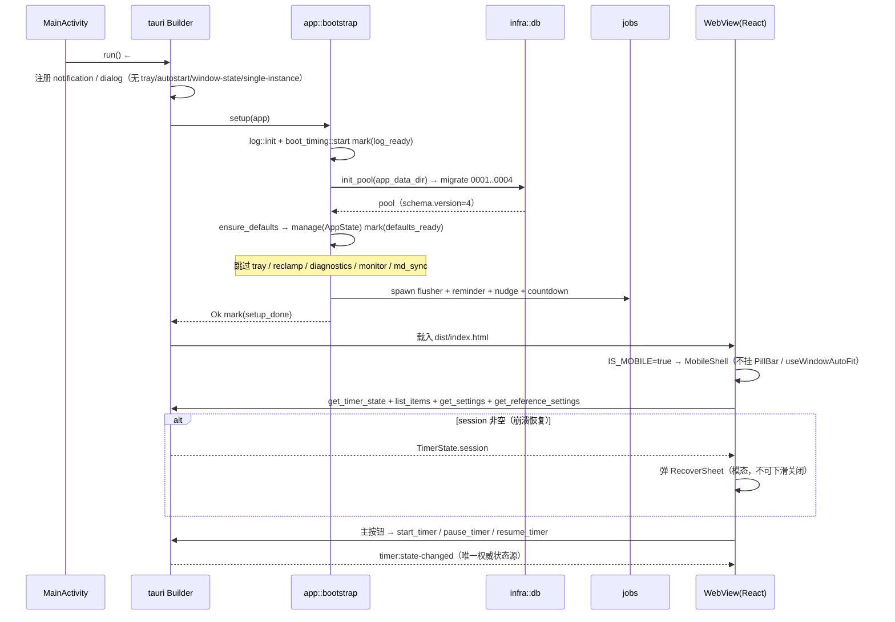

# TickBar 安卓版实现方案（Tauri 2 mobile · V1）

| 项 | 值 |
|---|---|
| 版本 / 基线 | V1 · 2026-11-02 · TickBar **v0.4.1**（Tauri 2.12.4 / React 19 / sqlx 0.8 / schema v4） |
| 依据 | `docs/mobile/PRD-ANDROID-V1.md`（P0 八条；F1–F3 纠正已采信）· `AGENTS.md` · `IPC-CONTRACT-v2.md` |
| 硬约束 | 六层单向依赖 · 单文件 ≤300 行 · **桌面行为与 65 命令契约零变化** |
| 验收边界 | **无真机、无模拟器**：只做到「APK 出包 + 结构检查 + 桌面回归全绿」，方案不含「必须装机才能验证」的关键路径 |

## 1. 方案决策（含取舍）

### 1.1 桌面专属能力门控

> 代码现实：全仓业务 `cfg` 只有 1 处（`services/md_sync/mod.rs:287`），**零 `#[cfg(desktop)]`**。托盘、窗口、自启、单实例、显示器轮询在 Android 上直接编译不过（`TrayIconBuilder`、`WebviewWindowBuilder` 的 `transparent/skip_taskbar/always_on_top/decorations`、`available_monitors` 都是 tauri 桌面专有 API）。故门控以**编译期**为主，运行期只留一处（设置页 autostart 值）。

| 能力 | 门控 | 具体做法 |
|---|---|---|
| 系统托盘 | `#[cfg(desktop)]` **模块级** | `app/mod.rs` 加 `#[cfg(desktop)] pub mod tray;`；`events.rs` 的 `tray::sync_status` 抽成本地 `sync_tray()`（mobile 空实现） |
| 透明无边框置顶窗（主/设置/事项/便利贴/计时） | `#[cfg(desktop)]` **模块级** | `infra/{window,window_note,window_rect,window_spec,geometry,tray_menu,autostart}.rs` 全门控；`lib.rs` 的 `.on_window_event()`、`bootstrap` 的 `reclamp_main`、`jobs/monitor.rs` 同步门控 |
| 窗口位置记忆 | target 依赖 + 命令桩 | `tauri-plugin-window-state` 移入桌面 target；`save_window_position`/`main_work_area`/`main_window_rect` 移动端返回 `IO_ERROR` |
| 开机自启 | target 依赖 + `#[cfg]` 分支 | `tauri-plugin-autostart` 移入桌面 target；`settings_cmd` 三处 `autostart::*` 成对 cfg；移动端 `get_settings` 恒填 `false`、`update_settings` 忽略该字段 |
| 单实例 | target 依赖 | `tauri-plugin-single-instance` 移入桌面 target；`.plugin(...)` 调用加 `#[cfg(desktop)]` |
| 系统通知 | **不门控** | 两平台通用；移动端需 `POST_NOTIFICATIONS` 运行时权限（§4 步骤 ⑥） |

```toml
[dependencies]
tauri = { version = "2.12.4" }
tauri-plugin-notification = "2.7.0"
tauri-plugin-dialog = "2.8.3"
sqlx = { version = "0.8", default-features = false, features = ["runtime-tokio", "sqlite", "macros"] }

[target.'cfg(not(any(target_os = "android", target_os = "ios")))'.dependencies]
tauri = { version = "2.12.4", features = ["tray-icon", "image-png", "image-ico"] }
tauri-plugin-autostart = "2"
tauri-plugin-window-state = "2"
tauri-plugin-single-instance = "2"
```

- **用 `cfg(desktop)` 而非 `cfg(target_os = "android")`**：`desktop`/`mobile` 是 `tauri-build` 提供的别名（`build.rs` 已是 `tauri_build::build()`，无需改）；按「桌面为准」写，iOS 复用同一套门控。`tray-icon`/`image-ico` 只出现在桌面 target 段，不得进 Android feature 集。
- **命令不做 `#[cfg]` 剔除**：命令名即契约面，`check:contract` 静态比对 `lib.rs` 的 65 个名字。改用「同名命令 + 移动端桩实现」（`#[path]` 换文件），`lib.rs` 一字不改。

### 1.2 前端分叉：单一 bundle + 编译期常量

| 候选 | 结论 | 理由 |
|---|---|---|
| 运行期 `platform()`（`@tauri-apps/plugin-os`） | 否 | 要加 Rust crate + npm 包 + capability 三项；首帧先渲桌面壳再切，透明小条会闪 |
| `src/mobile/` 独立入口（第二个 index.html / Vite entry） | 否 | 要复制 stores/services 引用；打断「一个 bundle 服务所有窗口」与 `lib/window.ts`（L3 唯一出口） |
| **编译期常量 + 同 bundle 分支** | **是** | 零新增依赖、零契约变化、可被 DCE；两端共用 stores / `services/api.ts` / `types/domain` |

落地三条：① `vite.config.ts` 加 `define: { __TICKBAR_MOBILE__: JSON.stringify(process.env.TAURI_ENV_FAMILY === 'mobile') }`（CLI 在 `android dev/build` 注入；`npm run dev`/`vitest` 下 `undefined → false`）；② 唯一读取点 `src/lib/platform.ts` 导出 `IS_MOBILE`/`HOST_OS`，`check:layers` 增 **L7**（该全局只许出现于此）；③ `App.tsx` 顶层 `if (IS_MOBILE) return <MobileShell />;`，桌面四条 label 分支原样保留。

### 1.3 存储（SQLite）

- **驱动**：沿用 sqlx **bundled**（`sqlite` feature 默认静态编译 `sqlite3.c`，由 NDK clang 编；**禁用** `sqlite-unbundled`，Android 无系统 libsqlite3）。
- **路径**：`app.path().app_data_dir()` → `tickbar.db`，`infra/db.rs` 零改动。Android 解析为应用私有 files 目录（`/data/data/com.tickbar.app/files`）：**不硬编码、无需存储权限、卸载即清**。
- **参数**：WAL + `foreign_keys(true)` + `max_connections(1)` 原样可用（无第二进程写入）。
- **迁移**：**100% 复用** `0001~0004` + `infra/migrate.rs`，新装从 v0 直跑 v4，`schema.version=4`；本轮**不新增迁移**（P0-8 同构）。

### 1.4 md-sync（SAF）：本轮不做，P0 明确排除

- **后台**：`bootstrap` 的 `jobs::md_sync::spawn_md_sync_watcher` 加 `#[cfg(desktop)]`，Android 不 spawn。
- **UI**：设置页 `TABS` 在 `IS_MOBILE` 时滤掉 `sync`（剩外观 / 插件 / 通用）。
- **IPC**：4 条 `md_sync_*` **保留注册**（65 不变），移动桩返回 `IO_ERROR`「移动端暂不支持 Markdown 同步」。
- **登记**：契约 §12.8 记为**已知差异（非契约变更）**——SAF 只有 `content://` 持久 URI，桌面是路径字符串，不同构；恢复需新 ADR + 配置模型扩容（PRD Q2）。

### 1.5 前台服务 / 后台保活：本轮不做

需 `FOREGROUND_SERVICE` + 不可消除通知 + 电池优化豁免（PRD Q3），且无设备可验，属「必须装机」路径。口径（写入 §12.8）：进程存活 → 现有 tokio ticker 正常；被冻结/杀死 → **不保证准时**，但恢复运行时 `countdown::tick`/`reminder::due` 按 `ends_at <= now`/`remind_at <= now` 幂等补判，**数据正确、通知延迟**。P2-1 再议。

> **2026-11-03 补充（悬浮形态另起一条线）**：上面这条结论只约束**Tauri 版**。
> 悬浮小条 / 顶部胶囊必须走 `TYPE_APPLICATION_OVERLAY` + 前台服务，WebView 壳做不到，
> 因此在仓库根新增独立原生工程 `android-app/`（Kotlin，零第三方依赖，未改动 `src-tauri/` 一行）。
> 它是「形态验证骨架」：`TimerCore` 单一状态机 + `PillView` 自绘小条 + `OverlayService` 前台服务 +
> 四页签外壳，数据暂存内存。取舍与边界见 `android-app/README.md`。

## 2. 文件清单

### 2.1 后端 `src-tauri/`

| 文件 | 动作 | 职责 / 改什么、为什么 |
|---|---|---|
| `Cargo.toml` | 改 | `tauri` 拆基础 + 桌面 feature；3 个桌面插件移入 target 段。**为什么**：这些 crate 在 Android 无实现，不 target 化必链接失败 |
| `src/platform/host.rs`（+ `platform/mod.rs`） | 新/改 | 平台叶子：`OS: &str`、`desktop_only(cmd) -> AppError`（统一造 `IO_ERROR`）。**为什么**：桩只允许一种错误口径，护住 16 码闭集 |
| `src/commands/{system,window,md_sync}_cmd_mobile.rs` | 新 | 三组桩：`show/hide/toggle_window`、`save_window_position` → `Ok(())`（幂等空操作，首帧会调）；`quit_app`/`main_work_area`/`main_window_rect`/`open_*_window`/`close_note_window` → `Err(desktop_only)`；4 条 `md_sync_*` → `Err(IO_ERROR)` |
| `src/commands/mod.rs` | 改 | 三组 `#[path]` 互换：`#[cfg(desktop)] pub mod system_cmd;` / `#[cfg(mobile)] #[path="system_cmd_mobile.rs"] pub mod system_cmd;`（window / md_sync 同）。**为什么**：`lib.rs` 的 65 条注册因此不动 |
| `src/commands/settings_cmd.rs` | 改 | `get_settings`/`update_settings`/`set_autostart`/`get_autostart` 内 `autostart::*` 成对 cfg；移动端恒 `false` / 忽略 patch 字段 |
| `src/lib.rs` | 改 | `run()` 加 `#[cfg_attr(mobile, tauri::mobile_entry_point)]`（**必需**，Android 靠它找入口）；插件链按 cfg 分段；`.on_window_event` 加 `#[cfg(desktop)]`；65 条 `generate_handler!` 不动 |
| `src/app/mod.rs` · `src/infra/mod.rs` · `src/jobs/mod.rs` | 改 | 模块门控：`app::{tray,diagnostics}`、`infra` 七模块、`jobs::{monitor,md_sync}` 各加 `#[cfg(desktop)]` |
| `src/app/bootstrap.rs` | 改 | 第 ⑤⑥⑦ 步与 `monitor`/`md_sync` spawn 加 `#[cfg(desktop)]`；移动端补 `boot_timing::mark("mobile_skip_desktop")` |
| `src/app/events.rs` | 改 | `tray::sync_status` → 本地 `sync_tray()`（mobile 空实现）。**为什么**：`emit_timer_state` 是唯一状态广播入口，不能在调用点分叉 |
| `capabilities/default.json` | 改 | 加 `"platforms": ["windows","macOS","linux"]`。**为什么**：`autostart:allow-*` 的插件在 Android 不存在，不隔离会导致 `tauri android build` 校验失败 |
| `capabilities/mobile.json` | 新 | `"platforms": ["android","iOS"]`，仅 `core:window:allow-show/hide/set-position/scale-factor/inner-size/outer-position`、`core:event:allow-listen/emit`、`notification:default` |
| `tauri.android.conf.json` | 新 | 仅覆盖 `app.windows`：`transparent:false`、`decorations:true`、`alwaysOnTop:false`、`skipTaskbar:false`，去掉 `additionalBrowserArgs` 与 384×360。**为什么**：桌面配置在手机上会得到全屏透明窗口。Tauri 2 按平台自动合并 `tauri.<platform>.conf.json`，若不合并则 `--config` 传入（T5 判据验证） |
| `src-tauri/gen/android/**` | 新（生成） | `tauri android init` 产物；`minSdk 24 / compile·target 35`。**不纳入 `check:size`**（仅扫 `src/`、`src-tauri/src/`） |

### 2.2 前端 `src/`

| 文件 | 动作 | 职责 |
|---|---|---|
| `src/lib/platform.ts` · `src/types/env.d.ts` | 新 | 唯一平台常量 `IS_MOBILE`/`HOST_OS`（无 import 的叶子）+ `declare const __TICKBAR_MOBILE__: boolean` |
| `vite.config.ts` · `src/App.tsx` | 改 | 加 `define`；`App.tsx` 顶层 `IS_MOBILE → <MobileShell/>`，桌面分支不动 |
| `.../mobile/MobileShell.tsx` | 新 | 4 Tab 路由（`timer/items/records/settings`）+ 底部导航 + 全局覆盖层槽 + 返回键（先关 Sheet 再退 Tab 再退后台） |
| `.../mobile/TimerPage.tsx` | 新 | 大计时环（复用 `lib/ringGeometry.ts`、`useTimerTick`）+ MM:SS + 事项名 + 主按钮 + 结束按钮 |
| `.../mobile/CountdownSheet.tsx` · `SwitchItemSheet.tsx` | 新 | 定长档位 + 分钟输入 → `start_countdown`/`set_countdown_preset`；事项选择（最近 + 新建）→ `switch_item`（`end_and_start`/`change_only` 说人话文案） |
| `.../mobile/ItemsPage.tsx` · `TodoRowMobile.tsx` | 新 | 今日汇总条 + 待办区 + 今日记录分组（复用 `useTodayRecords`）；待办行勾选/开始/左滑删/长按菜单 |
| `.../mobile/RecordsPage.tsx` · `RecordEditSheet.tsx` | 新 | 日/周分段 + 总计 + 按事项占比 + 明细（复用 `useRecordsData`）；改归属/起止/备注（≤500）→ `update_record` |
| `.../mobile/SettingsPage.tsx` | 新 | 移动布局壳；内容复用 `ThemePicker`/`PluginsTab`/`GeneralTab`，`IS_MOBILE` 时藏「同步」页签与自启开关 |
| `.../mobile/UndoToast.tsx` · `RecoverSheet.tsx` | 新 | 3s 撤销条（`discarded=true` 不显示，复用 `uiStore.undoRecord`）；三选一 +「把中间的空白也算进去」→ `resolve_open_record` |
| `.../mobile/Sheet.tsx` | 新 | 底部 Sheet 通用壳（遮罩关闭 / 下拉关闭 / SafeArea） |
| `src/styles/mobile/{shell,pages,sheets}.css` | 新 | 三份样式各 ≤300 行；类名 `m-` 前缀，局部变量 `--m-*`（**不动** tokens 的 @import 顺序） |
| `src/main.tsx` | 改 | 末尾追加 3 个 mobile 样式 import（`.m-*` 作用域，桌面零影响） |
| `src/lib/window.ts` · `src/hooks/useAppBootstrap.ts` | 改 | `showCurrentWindowOnReady`/`startCurrentWindowDrag`/`startCurrentWindowResize` 在 `IS_MOBILE` 时 no-op；首帧 `ipc.showWindow()` 跳过（其余订阅保留，后端不 emit 即空转） |
| `scripts/check-layers.mjs` | 改 | 增 **L7**：`__TICKBAR_MOBILE__` 仅允许出现在 `src/lib/platform.ts` |

## 3. 数据结构与接口

### 3.1 SQLite（与桌面同构，零差异）

| 表 | 列（桌面 = 移动） | 差异 |
|---|---|---|
| `items` | `id, name, color, is_pinned, archived_at, created_at, updated_at, deleted_at` | 无 |
| `time_records` | `id, item_id, started_at, ended_at, accumulated_sec, running_since, status, note, deleted_at`；`uq_records_open UNIQUE(status) WHERE status='active'` | 无 |
| `todos` | `id, title, item_id, due_at, done, remind_stage, auto_start, reminded_at` | 无 |
| `notes` / `daily_status` | 同桌面（`notes` 仅 P1 用） | 无 |
| `settings` KV | `schema.version='4'`、`ui.*`、`timing.*`、`plugin.*`；遗留 `autostart.enabled` 读到即被 `false` 覆盖，**不删行**（迁移一律不改） | 无 |

单位与枚举逐字对齐：epoch **ms** 存时间点、**秒** 存时长，枚举字符串值不变。

### 3.2 IPC 契约（**零变化**）

| 面 | 桌面 | 移动端 | 变更 |
|---|---|---|---|
| 命令 | 65 | **65**（全注册，其中 12 条为桩，见 §2.1） | 无 |
| 事件 | 11 | 11（`tray:highlight`/`app:open-*`/`note-window-*` 无 emit 点） | 无 |
| 错误码 / DTO | 16 / — | 16（桩统一 `IO_ERROR`）/ `Settings.autostartEnabled` 恒 `false`（字段保留） | 无 |

`check:contract` 是**文本 grep**（比对 `lib.rs`/`domain.ts`/`ipc.ts`/`browserMock`/`error.rs`），`#[cfg]` 不影响计数 → Android 分支同样过门禁。

### 3.3 需写进 `IPC-CONTRACT-v2.md` §12.8「V1.0-Android 平台差异」

| 项 | 内容 |
|---|---|
| 计数 | 65 / 16 / 11 **不变**，无增删 |
| 行为差异 | 7 条窗口命令（`main_work_area`/`main_window_rect`/`quit_app`/`open_*_window`/`close_note_window`）→ `IO_ERROR`；4 条 `md_sync_*` → `IO_ERROR`；`set_autostart` 恒 `false` |
| 已知差异 | md-sync 不可用（SAF `content://` vs 路径字符串）；无托盘/无多窗/无窗口位置；无前台服务（后台到点通知可能延迟，数据由幂等补判保证） |

## 4. 程序调用流程（Android 启动链路）

相对桌面**少了**：托盘、窗口钳制、显示器轮询、诊断快照、window-state / single-instance / autostart 三插件、md-sync 调度。**多了**：`mobile_entry_point` 入口属性、通知权限申请（首次用倒计时/提醒时）、移动 Shell。



## 5. 任务列表（T(n) 依赖 T(<n)）

| # | 任务 | 改动文件 | 完成判据 |
|---|---|---|---|
| T1 | 工具链与目标基线 | 无（`rustup target add` ×4） | 4 个 target 就位；`cargo check --target aarch64-linux-android` 能进入编译（不再报 target 缺失），报错清单留作 T2/T3 输入 |
| T2 | 依赖 target 化 + 入口属性 | `Cargo.toml`、`lib.rs`、`platform/host.rs`、`platform/mod.rs` | 桌面 `cargo check` 通过；android check 不再报 autostart/window-state/single-instance/tray-icon |
| T3 | 桌面模块门控 | `infra/mod.rs`、`app/{mod,bootstrap,events}.rs`、`jobs/mod.rs` | `cargo check --lib --target aarch64-linux-android` **通过**；桌面 `cargo test` 全绿 |
| T4 | 命令层移动桩 | `commands/mod.rs`、3 个 `*_mobile.rs`、`commands/settings_cmd.rs` | android check 通过；`npm run check:contract` 仍 `65/65/65/65 · 16/16 · 11/11` |
| T5 | 能力清单 + 平台配置 + 空壳出包 | `capabilities/{default,mobile}.json`、`tauri.android.conf.json`、`tauri android init` | `--apk --debug` 产出 `app-universal-debug.apk`；`unzip -l` 含 `lib/arm64-v8a/libtickbar_lib.so` + `classes.dex` |
| T6 | 前端平台常量与 App 分叉 | `vite.config.ts`、`lib/platform.ts`、`types/env.d.ts`、`App.tsx`、`check-layers.mjs` | `npm run check` 全绿；`npm run build` 桌面产物不含移动标记，`TAURI_ENV_FAMILY=mobile npm run build` 含标记 |
| T7 | 移动壳与样式骨架 | `MobileShell.tsx`、`Sheet.tsx`、`styles/mobile/*.css`、`main.tsx` | 4 Tab 可切换、返回键层级正确；3 个 css 均 ≤300 行、`check:size` 通过 |
| T8 | 计时页 / 倒计时 / 换事项 | `TimerPage`、`CountdownSheet`、`SwitchItemSheet` | 组件只经 `services/api.ts`（L1 通过）；主按钮四态、结束按钮独立、`discarded=true` 不出撤销条 |
| T9 | 恢复 / 撤销 / 通知权限 | `RecoverSheet`、`UndoToast`、`MobileShell` | 冷启动 `session` 非空必弹；`includeGap` 可切；撤销 3s 到期消失；权限被拒降级为应用内提示条 |
| T10 | 事项页 | `ItemsPage`、`TodoRowMobile` | 汇总条口径 = `stats_summary`；待办开始后当场移出待办区；长按菜单四项齐 |
| T11 | 记录页与编辑 | `RecordsPage`、`RecordEditSheet` | 日/周切换正确（周一为首）；改归属后分布即时变；结束早于开始被拒且保留原值 |
| T12 | 设置页与主题 | `SettingsPage`（复用 3 个 tab 组件） | 3 页签（无同步）、无自启开关；换色即时生效且冷启动保持 |
| T13 | 契约登记与全门禁 | `IPC-CONTRACT-v2.md` §12.8、`CHANGELOG.md` | `npm run check` + `npm test` + `cargo test` + clippy + fmt 全绿；§12.8 三项登记到位 |
| T14 | 双端出包验收 | 无（执行 §9） | release APK 产出且结构检查通过；`npm run tauri dev` 桌面可启动、`cargo test` 仍全绿 |

## 6. 依赖包

| 面 | 变化 | 说明 |
|---|---|---|
| Rust 桌面 target | `tauri`(tray-icon, image-png, image-ico) + autostart / window-state / single-instance | 仅移位置，版本不变 |
| Rust 共用 / Android target | **无新增**（Android 侧也不需要 `jni`、`tauri-plugin-os`） | `sqlx` 保持 `sqlite`（= bundled）；notification / dialog 两平台通用 |
| npm | **无新增** | `@tauri-apps/plugin-notification` 已在 `dependencies`，前端首次申请权限时用 |
| SDK/NDK | JDK 17 + cmdline-tools + platform-tools + `platforms;android-35` + `build-tools` + `ndk` | `libsqlite3-sys` 的 `sqlite3.c` 由 NDK clang 编，需 `CC_<triple>` 指向 `*-clang` |

## 7. 共享知识（跨文件约定）

| 项 | 约定 |
|---|---|
| 平台常量 | 只有 `src/lib/platform.ts` 读 `__TICKBAR_MOBILE__`，其余只 `import { IS_MOBILE }`；L7 机械执行 |
| 命名 / 路由 | 移动组件 `src/components/mobile/*`（`*Page`/`*Sheet`/`*Toast`）；CSS 前缀 `m-`，局部变量 `--m-*`；`type MobileTab = 'timer' \| 'items' \| 'records' \| 'settings'`，Sheet 是 `MobileShell` 的 overlay 状态不入 Tab 栈 |
| 尺寸 | 触控 ≥44×44dp、正文 ≥14sp、无 hover；安全区 `env(safe-area-inset-*)`；`min-width:600px` 仅单列居中（不做双栏，P2-3） |
| 数据访问 | 组件 → `services/*Actions` / store；组件与 store **禁止** `ipc.`（L1/L2）；统一走 `services/api.ts` 门面 |
| 错误 / 路径 / 配置 | 移动端不可用能力统一 `IO_ERROR` + 一句中文说明，**不新增错误码**；只用 `app_data_dir()`，禁拼 `/data/data/...`；平台差异只写 `tauri.android.conf.json`，**不改** `tauri.conf.json` 桌面值 |
| 时间 | epoch ms 存时间点、秒存时长；`from ≤ started_at < to`，周 = 周一 00:00 |

## 8. 风险与未决

| # | 风险 | 缓解 |
|---|---|---|
| R1 | 桌面专有 API 覆盖不全，Android 编译反复暴露新错（最可能是 `WebviewWindowBuilder` 的 builder 方法） | 以 `cargo check --target android` 作机械清单逐条消；**模块级门控优先于逐行 `#[cfg]`** |
| R2 | `libsqlite3-sys` 在 NDK 下找不到 `CC`/`ar` 而编译失败 | 显式设 `CC_aarch64_linux_android=<ndk>/…/aarch64-linux-android24-clang.cmd`（其余三 triple 同理），写进 §9 |
| R3 | 无真机/模拟器 ⇒ UI、触摸、通知权限、后台冻结行为全未验证 | 判据全部落在静态可查项（bundle 内容 / 契约计数 / 门禁）；另留「装机回归清单」不阻塞交付 |
| R4 | `TAURI_ENV_FAMILY` 在纯 vite 下无值，前端可能误判为桌面 | `define` 默认 `false`；单点常量 + L7 门禁；`npm test` 走桌面路径不受影响 |
| R5 | 依赖 target 化后 Cargo feature 在桌面侧合并异常 | T2 后立刻 `cargo test` + `npm run tauri dev` 冒烟，再进 T3 |

**待拍板（≤3）**：① md-sync 本轮排除、P1 再评估（PRD Q2）；② 不做前台服务，接受「后台到点通知延迟、数据不丢」（PRD Q3）；③ `minSdk 24 / target 35`、不做平板双栏（PRD Q5）。

## 9. 验收命令

```bash
# 0. 环境（按实际目录改名）
export JAVA_HOME="C:/Software/android-tools/jdk-17"
export ANDROID_HOME="C:/Software/android-tools/sdk"; export ANDROID_SDK_ROOT="$ANDROID_HOME"
export NDK_HOME="$ANDROID_HOME/ndk/27.2.12479018"
export PATH="$JAVA_HOME/bin:$ANDROID_HOME/platform-tools:$PATH"
NB="$NDK_HOME/toolchains/llvm/prebuilt/windows-x86_64/bin"
export CC_aarch64_linux_android="$NB/aarch64-linux-android24-clang.cmd"
export CC_armv7_linux_androideabi="$NB/armv7a-linux-androideabi24-clang.cmd"
export CC_i686_linux_android="$NB/i686-linux-android24-clang.cmd"
export CC_x86_64_linux_android="$NB/x86_64-linux-android24-clang.cmd"
rustup target add aarch64-linux-android armv7-linux-androideabi i686-linux-android x86_64-linux-android

# 1. 桌面没坏（每轮都跑）
npm run check && npm test && npm run build
(cd src-tauri && cargo test && cargo clippy --all-targets -- -D warnings && cargo fmt --check)
npm run tauri dev                 # 冒烟：药丸 / 计时 / 托盘 / 设置窗

# 2. Android 交叉编译快反馈（不出包）
(cd src-tauri && cargo check --target aarch64-linux-android && cargo check --target armv7-linux-androideabi)

# 3. 出包（首次 init；平台配置未自动合并时加 --config src-tauri/tauri.android.conf.json）
npm run tauri android init
npm run tauri android build -- --apk --debug
# 4. 结构检查（无真机时的等价验收）
APK=src-tauri/gen/android/app/build/outputs/apk/universal/debug/app-universal-debug.apk
unzip -l "$APK" | grep -E "classes.dex|lib/arm64-v8a/libtickbar_lib.so|assets/tauri.conf.json"
unzip -p "$APK" assets/tauri.conf.json | grep -q '"identifier":"com.tickbar.app"' && echo "id OK"
unzip -p "$APK" assets/index.html | head -5          # 前端已内嵌
unzip -p "$APK" 'assets/*.js' 2>/dev/null | grep -c "m-shell"   # 移动分支确已打包

# 5. release（体积/裁剪确认）
npm run tauri android build -- --apk
```
