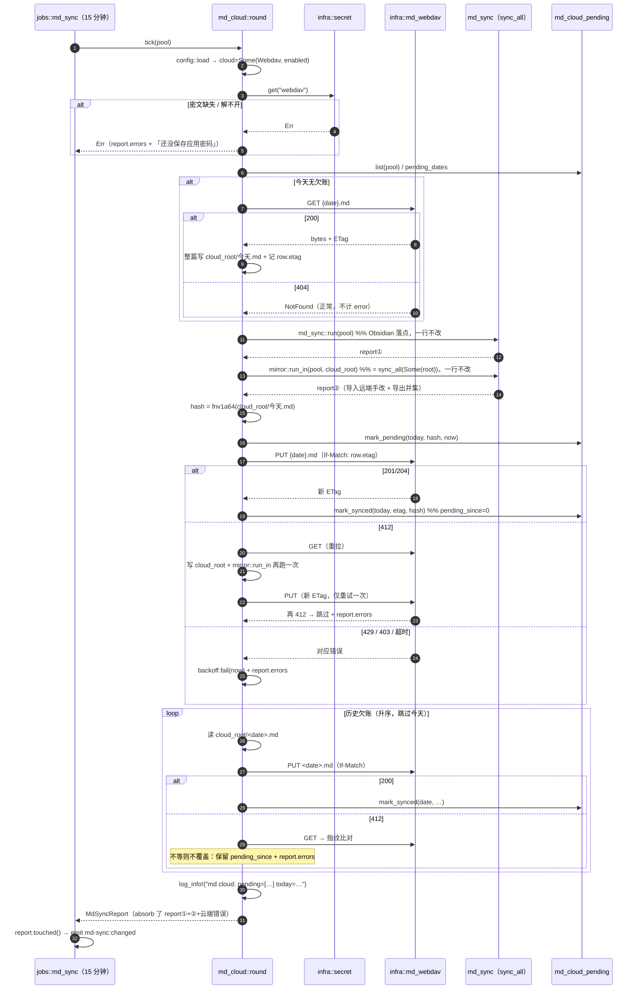
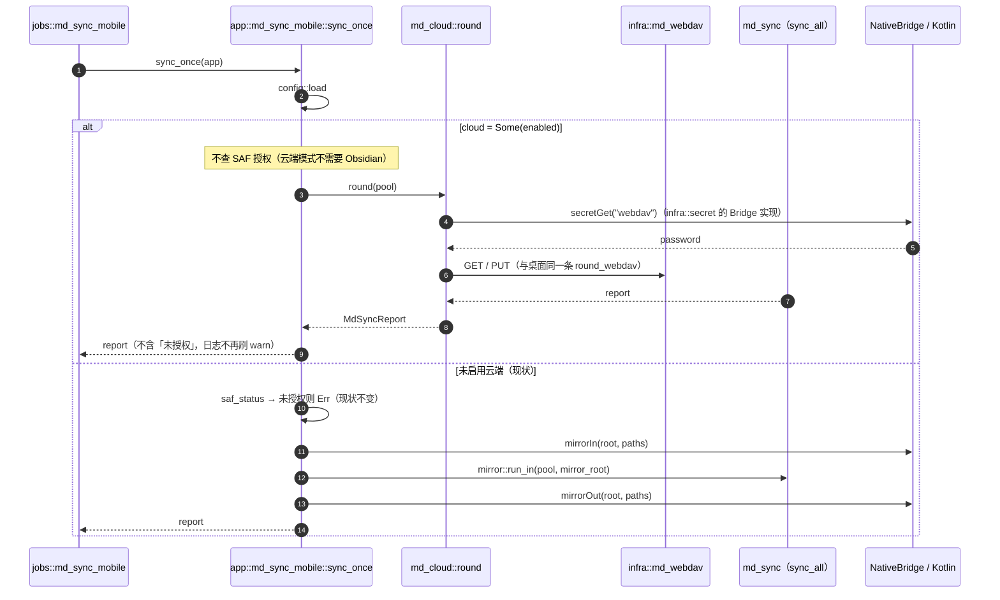
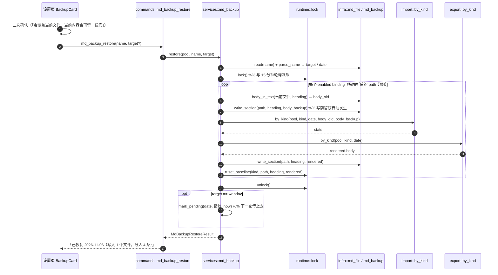
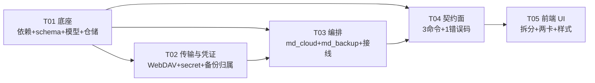

# v0.11.13 增量设计

## 0. TL;DR

1. **云端第二落点 = 再跑一轮 `sync_all`，用现成的 `mirror::run_in(pool, Some(root))`**：`services/md_cloud` 是 `services` 的兄弟模块（不在 `md_sync` 内部），通过 `crate::services::md_sync::mirror::run_in`（`pub`，等价于 `sync_all(pool, Some(root))`）拿到「换 root 的一轮」。**`services/md_sync/mod.rs` 零改动（300 行保持不变，`git diff` 为空）**。
2. **一轮云端同步 = `GET(今天)` → `md_sync::run(None)` → `mirror::run_in(cloud_root)` → 算 FNV-1a 指纹写 `md_cloud_pending` → `PUT(If-Match)`**；历史欠账日期**只 PUT 不合并**（理由与代价见 §2.3），因此**不需要**给 `sync_all` 加日期参数。
3. 凭证走 `infra::secret`（Windows DPAPI / Android Keystore 经 `NativeBridge`），密文落盘、明文只在内存；备份文件名加 `<target>__` 前缀（`obsidian` / `webdav` / `folder`），老备份不改名、列表标「归属未知」。

---

## 1. 文件清单

行数为**预计**值，硬上限 300（`npm run check:size`）。⚠ 标记为「贴线」= 余量 < 15 行，改动前先算。

> **五个贴线文件（改之前先 `wc -l`）**：`services/md_sync/mod.rs`（300，本轮要求零改动）、`infra/md_file.rs`（298，零改动）、`services/ipc.ts`（294 → 299）、`app/bootstrap.rs`（292 → 294）、`infra/md_backup.rs`（169 → 295）。前两个不动，后三个的写法见对应章节节省行的具体要求。

### 1.1 后端 · 新增

| 路径 | 职责 | 预计行数 | 依赖 |
|---|---|---|---|
| `src-tauri/src/migrations/0006_v0113.sql` | 建 `md_cloud_pending` + `schema.version=6` | 40 | — |
| `src-tauri/src/models/md_sync_cloud.rs` | `MdSyncCloud` / `CloudMode` / `MdSyncCloudStatus` / `MdSyncTestResult` / `MdSyncViewCloud` / `MD_SYNC_CLOUD_ROOT` | 165 | models::md_sync |
| `src-tauri/src/repositories/md_cloud_pending.rs` | 待传表 CRUD（5 个函数，纯 SQL） | 120 | infra::db |
| `src-tauri/src/infra/md_webdav.rs` | WebDAV GET/PUT/probe + 错误映射 + URL redact | 240 ⚠ | reqwest |
| `src-tauri/src/infra/md_webdav_test.rs` | 假服务器单测（200/404/412/429/401 + 非 ASCII Basic Auth） | 175 | — |
| `src-tauri/src/infra/secret.rs` | 凭证门面（`install_*` / `get` / `put` / `clear` / `available`，枚举分发 + async） | 110 | — |
| `src-tauri/src/infra/secret_dpapi.rs` | `cfg(windows)` DPAPI 实现 | 130 | windows-sys |
| `src-tauri/src/infra/secret_bridge.rs` | `cfg(android)` 经 `NativeBridge` 转发 | 70 | native_bridge |
| `src-tauri/src/services/md_cloud/mod.rs` | 编排入口 `round` / `tick` / `status` / `test_connection`，按 mode 分派 | 150 | services::md_sync |
| `src-tauri/src/services/md_cloud/round_webdav.rs` | GET→合并→指纹→PUT→补传（一台机器两条链路都走它） | 200 ⚠ | infra::md_webdav |
| `src-tauri/src/services/md_cloud/round_folder.rs` | `LocalFolder` 模式：只落目录，零网络 | 70 | — |
| `src-tauri/src/services/md_cloud/pending.rs` | 指纹（FNV-1a 64）、相对路径、行更新封装 | 110 | repositories::md_cloud_pending |
| `src-tauri/src/services/md_cloud/backoff.rs` | 进程内退避 5s/15s/60s | 60 | — |
| `src-tauri/src/services/md_backup.rs` | 备份列表 + 恢复覆写（写→导入→渲染→写） | 200 ⚠ | infra::md_backup |
| `src-tauri/src/tests/md_cloud_pending.rs` | 验收 4/5：迁移不丢数据、队列三态 | 150 | — |
| `src-tauri/src/tests/md_backup_restore.rs` | 验收 6：写→列→恢复内容相等 | 150 | — |

### 1.2 后端 · 修改

| 路径 | 改动 | 改后行数 |
|---|---|---|
| `src-tauri/Cargo.toml` | `reqwest`（特性见 §7-①）、`rustls`、`[target.'cfg(windows)'] windows-sys` | 88 |
| `src-tauri/src/infra/migrate.rs` | 加 `MIGRATE` 第 ⑩ 步 `include_str!("../migrations/0006_v0113.sql")` | 119 → 122 |
| `src-tauri/src/models/md_sync_config.rs` | `#[serde(default)] pub cloud: Option<MdSyncCloud>` + `Default` 补 `cloud: None` + `validate()` 调 `cloud.validate(bindings)` | 109 → 115 |
| `src-tauri/src/models/md_sync.rs` | `MdSyncReport::absorb(&mut self, other)`（合并两轮报告） | 254 → 264 |
| `src-tauri/src/models/constants.rs` | `MD_CLOUD_BACKOFF_MS` / `MD_CLOUD_CONNECT_SECS` / `MD_CLOUD_READ_SECS` | 142 → 150 |
| `src-tauri/src/infra/md_backup.rs` | `register_root` / 文件名加 `<tag>__` / `list` / `read` / `parse_name` | 169 → **295 ⚠**（余 5 行：`list`/`read`/`parse_name` 必须极简，放不下就把 `parse_name` 挪进 `infra/md_backup_name.rs`） |
| `src-tauri/src/infra/md_file.rs` | **零改动**（`write_section` 签名不动，调用点不感知落点） | 298（不变） |
| `src-tauri/src/services/md_sync/mod.rs` | **零改动**（连 `pub mod` 都不加） | 300（不变） |
| `src-tauri/src/services/md_sync/config.rs` | `load` 传 `cloud: saved.cloud`；`save` 加一次 `md_cloud::check_paths` | 131 → 137 |
| `src-tauri/src/services/md_sync/mirror.rs` | 只加 1 行文档注释：`run_in` 同时是云端落点的入口 | 63 → 64 |
| `src-tauri/src/services/mod.rs` | `pub mod md_backup;` `pub mod md_cloud;` | 20 → 22 |
| `src-tauri/src/app/bootstrap.rs` | `secret::install_from_data_root(&data_root)` + `md_backup::register_root(..)` | 292 → **294 ⚠**（只剩 8 行：两个安装器必须各自封装成**一行调用**，内部按 `cfg` 分派，不许在本文件展开） |
| `src-tauri/src/app/md_sync_mobile.rs` | `sync_once` 首段加云端分派（不要求 SAF） | 139 → 152 |
| `src-tauri/src/app/tray_sync.rs` | `md_sync::run` → `md_cloud::round` | 172 → 173 |
| `src-tauri/src/jobs/md_sync.rs` | `md_sync::tick` → `md_cloud::tick` | 41 → 43 |
| `src-tauri/src/jobs/md_sync_mobile.rs` | 分流判据补「云端模式不算未授权」 | 40 → 45 |
| `src-tauri/src/commands/md_sync_cmd.rs` | 3 新命令 + `save` 收 `secret` + `run` 走云端 | 56 → 125 |
| `src-tauri/src/commands/md_sync_cmd_mobile.rs` | 3 同名命令（备份两条回明确错误） | 63 → 110 |
| `src-tauri/src/lib.rs` | `generate_handler!` +3 | 229 → 232 |
| `src-tauri/src/error.rs` | `MdSyncRemoteError` + `as_str` + `AppError::md_sync_remote_error` | 225 → 233 |
| `src-tauri/src/tests/mod.rs` | +2 个测试模块声明 | — |
| `src-tauri/src/models/md_sync_test.rs` + `src-tauri/src/tests/{md_sync,md_sync_disabled_gate,md_sync_edges,md_sync_upgrade,portable_dir_qa_md}.rs` | 每个 `MdSyncConfig { .. }` 字面量补 `cloud: None,`（**6 个文件、13 处**，`grep -rn "MdSyncConfig {" src-tauri/src` 逐条改） | 各自 +1~5 |

### 1.3 前端 · 新增

| 路径 | 职责 | 预计行数 |
|---|---|---|
| `src/types/domain/mdCloud.ts` | `CloudMode` / `MdSyncCloud` / `MdSyncCloudStatus` / `MdSyncTestResult` / `MdBackupItem` / `MdBackupRestoreResult` | 80 |
| `src/components/settings/MdSyncCloudCard.tsx` | 云端通道区块（开关 / 模式 / 路径 / 五项 / 测试连接） | 150 |
| `src/components/settings/MdSyncBackupCard.tsx` | 备份列表 + 预览 + 恢复 + 二次确认 | 145 |
| `src/components/settings/useMdSyncDraft.ts` | 草稿收敛（含 `secret`），从 `MdSyncTab` 抽出 | 100 |
| `src/styles/settings-sync-cloud.css` | 两个新卡的样式（`settings-sync.css` 已 281 行） | 100 |
| `src/mocks/browserMockCloud.ts` | 3 条命令的 mock | 70 |
| `src/components/settings/MdSyncCloudCard.test.tsx` | 模式切换 / 手机端无 LocalFolder / 密码不回显 | 90 |
| `src/components/settings/MdSyncBackupCard.test.tsx` | 归属未知标记 / 二次确认文案 | 90 |

### 1.4 前端 · 修改

| 路径 | 改动 | 改后行数 |
|---|---|---|
| `src/components/settings/MdSyncTab.tsx` | 拆出草稿 hook 与两卡，只留开关 / 间隔 / 落点 / 按钮 | 295 → 155 |
| `src/types/domain/mdSync.ts` | `MdSyncConfig.cloud`、`MdSyncView.cloud` | 84 → 90 |
| `src/types/domain.ts` | `export * from './domain/mdCloud';` | 54 → 55 |
| `src/types/domain/ipc.ts` | `IpcApi` +3 方法 | 213 → 217 |
| `src/types/domain/models.ts` | `ErrorCode` +1 | 255 → 256 |
| `src/services/ipc.ts` | 3 个 `call()` + 3 个方法 + 1 行 import + `errorText` 1 个 case | 294 → **299 ⚠** |
| `src/services/api.ts` | `mdSyncApi` 加 `test` / `save(config, secret)` / `backupList` / `backupRestore` | 151 → 162 |
| `src/stores/mdSyncStore.ts` | `save(config, secret)`、`test`、`backups` 三块 | 66 → 130 |
| `src/mocks/browserMock.ts` | import + 展开 `createMockApiCloud()` | 256 → 259 |
| `src/main.tsx` | import 新 css | 97 → 99 |
| `src/components/settings/MdSyncTab.test.tsx` | 跟随拆分调整 | 171 → 180 |

### 1.5 原生 / 文档

| 路径 | 改动 |
|---|---|
| `src-tauri/gen/android/app/src/main/java/com/timing/app/TimingNativePlugin.kt` | +3 命令 `secretPut` / `secretGet` / `secretClear`（Keystore AES-GCM + SharedPreferences） |
| `docs/phase2/IPC-CONTRACT-v2.md` | 命令 71→74、错误码 16→17 两节 |
| `docs/decisions/ADR-061.md` | 为什么加第 17 码 + 为什么云端通道不新增事件 |
| `docs/requirements/for-owner/待决事项.md` | 「不做端到端加密」备查（任务书 §5.5） |
| `更新日志.md` | v0.11.13 条目 |

⚠ **`02-架构与契约.md` §4 写的「67 命令」是过期数字**，实测 71（`npm run check:contract` 输出）。本轮顺手改成 74。

---

## 2. 八个设计难题的结论

### 2.1 云端第二落点如何复用 `sync_all`

**结论**：新建 `services/md_cloud`（`services` 的直接子模块，**不是** `md_sync` 的子模块），调 `crate::services::md_sync::mirror::run_in(pool, &cloud_root)`。

- `sync_all` 是 `pub(super)`，`super` = `crate::services` → `services::md_cloud` 在可见范围内；但**不必**直接用——`mirror::run_in` 就是 `sync_all(pool, Some(root))` 的 `pub` 包装，已有调用方（手机端）验证过。
- 为什么不放进 `services/md_sync/cloud/`：`md_sync/mod.rs` 已经**正好 300 行**，加一行 `pub mod cloud;` 就 301。放兄弟模块 → `mod.rs` 的 `git diff` 为空，验收 7 变成「整个文件零改动」，比「只有合并逻辑不改」更强。
- `sync_all(Some(root))` 会把**所有** binding 的 root 换成同一个 root —— 这正是要的：三个 kind 的三段标题落到 `<cloud_root>/2026-11-06.md` 里，与 Obsidian 那份结构相同、路径不同。
- **基线天然隔离**：`Runtime.baselines` 的 key 是 `kind|path|heading`（`runtime.rs:74`），两份落点 path 不同 → 两份基线。Obsidian 那份被改，不会污染云端那份的判定。
- **顺序**：`sync_all(None)` 在前、`sync_all(Some(cloud_root))` 在后。理由：Obsidian 侧的用户手改先入库（ADR-042 文件优先），云端那轮再从「已含手改的 SQL」渲染出去，于是 **PUT 上去的内容一定包含本轮所有变更**；反过来（云端轮在前）会让 PUT 的内容缺 Obsidian 的手改，要等下一轮才补。
- **云端那轮不会重复处理 Obsidian 落点**：`root_override` 只替换 root，path 由 `root + file` 重算，落点集合与 Obsidian 那轮不相交（除非用户把 `local_root` 指到 Obsidian 目录，§4.1 明文禁止且保存时校验）。
- 代价（明说）：手机在云端文件的改动，要等**下一轮**才出现在 Obsidian 那份里（≤1 个 poll 周期，默认 15 分钟）。两个方向必有一个滞后一轮，选「保证上传的干净」这一侧。

### 2.2 待传队列的写入时机

**结论**：在 `services/md_cloud` 里、`mirror::run_in(cloud_root)` **之后**，按当天日期读整个文件算指纹，与 `last_hash` 比对。

```
hash = fnv1a64( read(cloud_root/今天.md) )        // 文件不存在 → hash("")，视为无内容
if hash != row.last_hash  →  mark_pending(today, hash, now)
```

- 判据是**文件内容**而不是「谁写了文件」：`md_sync` 无论导入还是导出，最终都会把规范化结果写回文件；内容没变就是没欠账，不需要知道方向。
- `pending_since` 不重置由 SQL 保证，而不是靠调用方记性：

```sql
INSERT INTO md_cloud_pending (date, last_hash, pending_since) VALUES (?, ?, ?)
ON CONFLICT(date) DO UPDATE SET
  last_hash = excluded.last_hash,
  pending_since = CASE WHEN md_cloud_pending.pending_since = 0
                       THEN excluded.pending_since
                       ELSE md_cloud_pending.pending_since END;
```

- 指纹用 **FNV-1a 64（16 位十六进制）**，手写 8 行：`sha2` 不在依赖图里，为一个「变没变」的判断引一个哈希 crate 不值得；FNV 在这里只做变更检测，不承担安全职责。
- 上传失败**不写 `last_hash`**（只留 `pending_since` 原值），下一轮才会再次判定为「有欠账」。

### 2.3 today + 待传的调度顺序（本轮最大难点）

**结论：不给 `sync_all` 加日期参数。历史欠账走「纯 PUT」，不做合并。**

顺序（`round_webdav`）：

```
① GET 今天（仅当今天无欠账）→ 整篇写入 cloud_root/今天.md
② md_sync::run(pool)                        ← Obsidian 落点，一行不改
③ mirror::run_in(pool, cloud_root)          ← 云端落点，一行不改
④ 读 cloud_root/今天.md 算指纹 → mark_pending
⑤ PUT 今天（If-Match = row.etag）
⑥ 历史欠账（升序，跳过今天）→ 逐个 PUT 本地 cloud_root/<date>.md
```

**为什么历史日期不需要合并**（这是绕开日期参数的根据，不是妥协）：

1. 待传行的产生条件是「本地写 TimingMD 且内容变化」（§2.2）。也就是说，**欠账那天的合并结果已经落在本地 `<cloud_root>/<date>.md` 里**——那天 `GET → sync_all(cloud) → PUT 失败` 时，`sync_all` 已经把远端内容与 SQL 合过一遍写进本地文件了。补传只是把这份**已经是合并结果**的文件送上去。
2. 历史那天的 SQL 不再增长（跨零点拆分只发生在记录结束当时）。所以本地文件对那天而言是**终态**。
3. 真要合并，唯一入口是 `sync_all`，它内部写死 `let date = Local::now().date_naive();`（`mod.rs:136`）。要合并就得改成 `sync_all(pool, root, date)`，牵连 5 个调用点（`run` / `tick` / `save_config_with_report` / `open` / `mirror::run_in`）——**这 2 行改动就是任务书「一行不改」与「历史日期要合并」的冲突点本身**。

**412 时的退让**（历史日期）：`GET` 一次 → 远端内容指纹 == 本地指纹 → 视为已同步（清账）；不等 → **不覆盖**，记 `report.errors`、**保留 `pending_since`**，日志 `md cloud out: <date> skip=conflict`。下一轮再试。今天那条的 412 才做「重拉 → 再合并一轮 → 再 PUT 一次」（今天可以合并，因为 `sync_all` 认今天）。这满足 `§6.1`「同一天两端都改 → 后写覆盖先写」的下限（我们比它更保守：不覆盖），也满足验收 5「上传失败 → 行仍在且 `pending_since` 不变」。

**必须通知主人的排除项**：若主人要求「历史日期也要真合并」，那就是 §7-② 的裁决项，需要 2 行改动 + 5 个调用点。

### 2.4 备份归属标识

**结论**：`infra::md_backup` 增加一张「落点根 → 标识」的注册表，`save` 按 **最长前缀** 匹配决定文件名前缀；**`save(source, text)` 签名不变**，`md_file::write_section` 零改动。

```rust
pub fn register_root(dir: PathBuf, tag: &'static str);   // 可重复调用、幂等
fn tag_of(source: &Path) -> &'static str;                // 未注册 → "obsidian"
```

- 注册点（只有两处）：
  - `app/bootstrap.rs`：`register_root(data_root.join("md"), "obsidian")`（出厂默认根，明确写出）；
  - `services/md_cloud`：跑云端那轮**之前** `register_root(cloud_root, "webdav" | "folder")`。
- 为什么不用「进程内当前落点标记」：`register_root` 是**幂等注册**，不存在「panic 了没复位 → 之后全标错」的窗口；标记法要配 RAII 守卫才能勉强等价。
- 为什么不改 `write_section` / `save` 的签名：`write_section` 的唯一调用方是 `sync_binding`（`mod.rs:259`），改签名 = 改 `sync_all` 的调用链，撞红线。`md_file.rs` 298 行也没有余量。
- 未知根一律回 `obsidian`：现存所有写入路径里，除云端两轮以外**都是** Obsidian 落点（含手机镜像 `md-mirror`，它写回的就是 Obsidian vault）。

文件名：`<tag>__<sanitize(stem)>-<yyyyMMdd-HHmmss>.md`。
解析（纯函数 `parse_name`，可单测）：先按**第一个 `__`** 切，左段属于 `{obsidian,webdav,folder}` 才认；否则整体按老格式处理 → `target = None`（列表里标「归属未知」）。老备份**不删、不改名**（`prune` 只按 mtime 计数，不认名字）。

`KEEP = 30` **不改**：两份落点会让回看窗口大约减半。改它属于未申报的行为变更，记入 §7-③ 待裁决（建议 v0.11.14 提到 60）。

### 2.4b 恢复覆写链路

`services/md_backup::restore`，**全程持 `md_sync::runtime::lock()`**（同一把锁，15 分钟轮询拿不到它 → 天然互斥；`sync_all` 内部也拿这把锁，所以恢复路径**不许**在锁内调 `sync_all`，否则死锁）：

```
lock()
 ├ ① 解析备份名 → (target?, source_stem, date?)；date 解析不出 → MD_SYNC_CONFIG_INVALID
 ├ ② 读备份字节 → 全文
 ├ ③ 对每个 enabled binding：path = resolve_path(root_of(target), binding.file, date)
 │     按 path 分组（三个 kind 常落同一个文件）
 ├ ④ 读当前（坏）内容 body_old = md_file::body_in_text(当前文件, heading)
 ├ ⑤ 写备份区块：md_file::write_section(path, heading, body_backup)   ← 写前留底自动发生
 ├ ⑥ 导入：import::by_kind(pool, kind, date, body_old, body_backup)   ← 强制导入，无冲突判定
 ├ ⑦ 渲染：export::by_kind(pool, kind, date) → write_section(...)      ← SQL 已修好，重渲染
 └ ⑧ rt.set_baseline(kind, path, heading, rendered)                    ← 基线跟上，下一轮不判「文件变了」
unlock()
```

- 调的是 `import::by_kind` / `export::by_kind`（都 `pub`、都吃 `date` 参数），**不碰 `sync_all`**。语义也不同：恢复是「用户明确要求用这份覆盖」，不做三方判定，所以这段不是复制合并逻辑。
- 若 target 是 `webdav`：结尾 `mark_pending(date, 指纹, now)`，下一轮把恢复结果传上去。
- 留底发生在 ⑤ 之前（`write_section` 内），所以「恢复本身不会再丢一次」这句话是真的，可以照任务书 §4.4-4 写进确认文案。

### 2.5 凭证存储

**结论**：`infra::secret`，**枚举分发 + async 方法**（不用 `trait`：`async fn` in trait 要 `async-trait` crate，枚举一行搞定）。

```rust
enum Backend { Unavailable, Dpapi { path: PathBuf }, Bridge { app: AppHandle, handle: PluginHandle<Wry> } }
static STORE: OnceLock<Backend>;
/// 一行调用、内部按 cfg 分派（bootstrap.rs 只剩 8 行余量，不许在那里展开）。
pub fn install_from_data_root(data_root: &Path);   // windows → Dpapi{ data_root/webdav.bin }；android → 由 bootstrap 另传 handle
#[cfg(target_os = "android")] pub fn install_mobile(app: AppHandle, handle: PluginHandle<Wry>);
pub async fn get(key: &str) -> Result<Option<String>, String>;
pub async fn put(key: &str, value: &str) -> Result<(), String>;
pub async fn clear(key: &str) -> Result<(), String>;
pub fn available() -> bool;
```

| 端 | 实现 | 密文落点 | 失败降级 |
|---|---|---|---|
| Windows | `CryptProtectData` / `CryptUnprotectData`（`CRYPTPROTECT_UI_FORBIDDEN`，绑定当前用户） | `<数据根>\webdav.bin`（tmp + rename 原子写） | `Err("系统凭据不可用")` → 云端轮记 error 并**跳过 PUT**；绝不回落明文 |
| Android | Kotlin `TimingNativePlugin` 新命令 `secretPut/secretGet/secretClear`：Keystore 派生 AES 密钥 + AES-GCM | `SharedPreferences`（文件名 `timing-secret`） | 桥未装 / 抛异常 → 同上 |

- `windows-sys` **已在依赖图**（`Cargo.lock` 有 0.61.2），加 `[target.'cfg(windows)'.dependencies] windows-sys = { version = "0.61", features = ["Win32_Security_Cryptography", "Win32_Foundation"] }` **不引入新编译单元**，只多编 feature。
- 密码**不进** `settings` 表、不进 `MdSyncCloud`、不进 `MdSyncView`；`view` 只带 `hasSecret: bool`。
- 日志：`WebdavTarget` 打印前一律 `redact(url)`，把 `user:pass@` 段抹成 `***@`；`user` 也不进 INFO 级日志（只进 `log_debug!`）。

### 2.6 WebDAV 客户端

```rust
// infra/md_webdav.rs
pub struct WebdavTarget { base_url: String, base_path: String, user: String, password: String }
impl WebdavTarget {
    pub fn new(base_url: &str, base_path: &str, user: &str, password: &str) -> Self;
    pub fn url_for(&self, rel: &str) -> Result<String, WebdavError>;   // base + 规范化 dir + 百分号编码 rel
}
pub enum WebdavError { Auth, Forbidden, RateLimited, Precondition, NotFound, Timeout, Network(String), Server(u16) }
pub struct GetOutcome { pub bytes: Vec<u8>, pub etag: Option<String> }
pub struct PutOutcome { pub etag: Option<String> }

pub async fn get(t: &WebdavTarget, rel: &str) -> Result<GetOutcome, WebdavError>;
pub async fn put(t: &WebdavTarget, rel: &str, bytes: &[u8], if_match: Option<&str>) -> Result<PutOutcome, WebdavError>;
pub async fn probe(t: &WebdavTarget, rel: &str) -> Result<(), WebdavError>;   // 200 / 404 都算通
pub fn redact(url: &str) -> String;
```

| 状态 | 映射 | 上层动作 | 人话 |
|---|---|---|---|
| 200/201/204 | `Ok` | — | — || 404（GET） | `NotFound` | 正常：今天还没记 | 不弹、不计 error |
| 404（PUT） | `NotFound` | 放弃本轮 | 「远端目录不存在，请先在坚果云网页版建好目录」 |
| 401 | `Auth` | 放弃本轮 + 提示去设置页 | 「账号或应用密码不对（坚果云要用应用密码）」 |
| 403 | `Forbidden` | 放弃本轮 | 「密码错或流量额度用尽，去设置页检查」 |
| 412 | `Precondition` | 今天：重拉+再合并+再 PUT 一次；历史：跳过不覆盖 | 「文件在别处被改过，已跳过这一份」 |
| 429 | `RateLimited` | **整轮中止** + 退避 | 「请求太频繁，稍后再试」 |
| 超时（连接 10s / 读 30s） | `Timeout` | 退避 | 「网络超时，稍后自动重试」 |
| 5xx | `Server(code)` | 退避 | 「服务器暂时不可用（code）」 |

- **Basic Auth 的凭据编码（有坑，必须钉住）**：用 `RequestBuilder::basic_auth(user, Some(password))`，**不要自己拼 `Authorization`**。已核 `reqwest 0.13.5` 的 `util::basic_auth` 实现：它把 `"{username}:{password}"` 用 `write!`（`Display`）**按原始 UTF-8 字节**喂给 base64 编码器，并 `set_sensitive(true)`（不会被调试输出）。这正是坚果云要求的口径；**绝不要**先 `encodeURIComponent` / percent-encode 再 base64（remotely-save 的 `onlyAscii(x) ? x : unescape(encodeURIComponent(x))` 是为了喂给 JS 客户端库的字符串，不是 base64 的处理方式）。两条路径产出的头**不同**，错的那个只会回 401 且不说明原因：

  ```
  user=用户  password=密码@2024
  正确（原始 UTF-8 字节）: Basic 55So5oi3OuWvhueggUAyMDI0
  错误（percent-encode）  : Basic JUU3JTk0JUE4JUU2JTg4JUI3OiVFNSVBRiU4NiVFNyVBMCU4MSU0MDIwMjQ=
  ```

  单测 `auth_header_uses_raw_utf8_bytes`（在 `infra/md_webdav_test.rs`）用上面这对向量断言假服务器收到的头逐字等于 `Basic 55So5oi3OuWvhueggUAyMDI0`——这条测试是「非 ASCII 账号密码能连上」的唯一机器证据。
- **退避状态放进程内**：`services/md_cloud/backoff.rs`，`OnceLock<tokio::Mutex<Backoff>>`，`next_at_ms` 单调时钟（`platform::clock::now_ms`）。不落库、不跨重启：重启后第一次失败重新计 5s，符合「三次仍失败就等下一轮」。
- 客户端构造一次复用：`OnceLock<reqwest::Client>`，`connect_timeout(10s)` / `timeout(30s)` / `user_agent("Timing/0.11.13")`。
- 单测 `infra/md_webdav_test.rs`：`std::net::TcpListener::bind("127.0.0.1:0")` + 一个线程读 `\r\n\r\n` 后写死响应，`base_url = format!("http://127.0.0.1:{port}")`（明文 HTTP，不碰 TLS），覆盖 200 / 404 / 412 / 429 / 401 五条分支。零新增 crate（`#[tokio::test]` 已有）。

### 2.7 前端拆分

| 文件 | 职责 | props |
|---|---|---|
| `MdSyncTab.tsx`（155） | 总开关 / 间隔 / 三张落点卡 / 「立即同步」「保存并同步」/ 顶层 notice | — |
| `useMdSyncDraft.ts`（100） | `enabled / pollMin / bindings / cloud / secret / dirty / notice` + `save()` / `run()` / `load()` | — |
| `MdSyncCloudCard.tsx`（150） | 开关 + 模式二选一 + 本地目录路径 + WebDAV 五项 + 「测试连接」 | `{ cloud, status, secret, disabled, onChange, onSecretChange, onNotice }` |
| `MdSyncBackupCard.tsx`（145） | 列表（时间/来源/大小/落点）+ 预览 + 恢复 + 二次确认 | `{ disabled, onNotice }`（数据自己拉） |

- 手机端隐藏备份入口：`MdSyncTab` 里 `import { IS_MOBILE } from '../../lib/platform'` → `{!IS_MOBILE && <MdSyncBackupCard .../>}`。`IS_MOBILE` 是常量，L7 只禁 `__TIMING_MOBILE__` 本体，允许引用。
- 手机端同时隐藏 `LocalFolder` 选项（Android 上没有意义）：`MdSyncCloudCard` 里 `IS_MOBILE ? ['webdav'] : ['localfolder','webdav']`。
- 密码框：`type="password"`，草稿态；`status.hasSecret` 时显示「已保存（不显示）」+「清除」。
- 二次确认**不用** `window.confirm`（浮层窗口规则），在卡片内展开一个 `role="alertdialog"` 的确认行，写法照抄 `components/mobile/NotesPage.tsx:138` 的 `m-confirm` 结构（改名 `sync__confirm`）。
- 样式新文件 `settings-sync-cloud.css` + `main.tsx` import（`settings-sync.css` 已 281 行，与 `settings-sync-interval.css` 同一个先例）。

### 2.8 契约五处对齐

**命令 +3**（`md_sync_test` / `md_backup_list` / `md_backup_restore`），五处：

| # | 位置 | 具体 |
|---|---|---|
| 1 | `src-tauri/src/lib.rs` `generate_handler!` | `commands::md_sync_cmd::md_sync_test,` 等 3 行 |
| 2 | `src/types/domain/ipc.ts` `IpcApi` | `mdSyncTest(params): Promise<MdSyncTestResult>;` 等 3 行（`^ {2}name(` 必须两空格缩进，脚本按此解析） |
| 3 | `src/services/ipc.ts` | 3 个 `call<T>('snake_name', ...)` + 对象里 3 个方法（**必须留在本文件**，脚本只读这里） |
| 4 | `src/mocks/browserMockCloud.ts` | 3 个处理器，**键名 4 空格缩进**（脚本正则 `^ {4}([a-z][a-z0-9_]*):\s*\(`） |
| 5 | `commands/md_sync_cmd.rs` + `commands/md_sync_cmd_mobile.rs` | 同名两个实现；手机端备份两条回 `IO_ERROR`「手机端暂不支持，请在电脑上恢复」 |

**错误码 +1**（`MD_SYNC_REMOTE_ERROR`），四处 + ADR：

| # | 位置 |
|---|---|
| 1 | `src-tauri/src/error.rs`：`ErrorCode::MdSyncRemoteError` + `as_str` → `"MD_SYNC_REMOTE_ERROR"` + `AppError::md_sync_remote_error(msg)` |
| 2 | `src/types/domain/models.ts` `ErrorCode` 联合类型 |
| 3 | `src/services/ipc.ts` `errorText()` 的 `case 'MD_SYNC_REMOTE_ERROR':` → 原样透出 `err.message`（同 `MD_SYNC_CONFIG_INVALID` 的做法） |
| 4 | `docs/phase2/IPC-CONTRACT-v2.md` §2 + 新 `docs/decisions/ADR-061.md` |

**事件 11 → 11**：云端导入产生的变化复用 `md-sync:changed`（`MdSyncReport` 载荷不变），一条不加。

`ipc.ts` 余量告警：现 294 行，+1 行 import（`import type { MdBackupItem, MdSyncTestResult } from '../types/domain';`，与既有 `from './plugin'` 同风格单行）+ 3 方法 + 1 注释 = **299**。若工程师写成每类型一行 import 就会 301 → 红了就照上面那行合并。

---

## 2.9 参考实现取舍（remotely-save，只读参考，未复制代码）

**许可边界**：参考源为本地解压的 `remotely-save` 源码副本，其中 `src/` / `tests/` / `docs/` / `assets/` 为 **Apache-2.0**，可供阅读；**`pro/` 是 PolyForm Strict（Source Available），未打开、未引用、未派生**。本项目遵守任务书 §五「抄协议用法可以，抄代码不行」：**Rust 侧全部自行实现，未复制其任何源文件、无衍生片段**；下表只记录「它踩过的坑 → 我们的对应做法」。

| # | 参考实现的事实 | 我们的取舍 | 落点（本轮设计中的位置） |
|---|---|---|---|
| 1 | 整份 `fsWebdav.ts`（969 行）是包在 npm `webdav` 客户端库外面的薄封装（`createClient` / `getDirectoryContents` / `getFileContents` / `putFileContents`），协议细节都在库里 | **不采纳其分层**。我们不引任何 WebDAV 库，自己在 `reqwest` 上做 **GET / PUT 两个动作 + Basic Auth**，公开面就三个函数（`get` / `put` / `probe`）。这既是任务书 4.6 的「不做 PROPFIND」，也是体积与可测性的理由：手写能对着 `TcpListener` 假服务器逐条验分支 | §2.6 |
| 2 | Basic Auth 对非 ASCII 账号密码做 `onlyAscii(x) ? x : unescape(encodeURIComponent(x))` | **口径采纳、实现不采纳**。调用方若把 percent-encode 后的字符串塞进 base64，坚果云回 401 且不说原因。我们走 `reqwest` 的 `.basic_auth()`（已核源码：按**原始 UTF-8 字节** base64 + `set_sensitive(true)`），并写死一条单测钉住 `user=用户 / password=密码@2024 → Basic 55So5oi3OuWvhueggUAyMDI0`。**绝不手拼 Authorization 头** | §2.6 的 Basic Auth 条 + `infra/md_webdav_test.rs::auth_header_uses_raw_utf8_bytes` |
| 3 | 坚果云目录列举**单次上限 750 条**（其代码 `r4.length >= 749` 即中止，出处 `help.jianguoyun.com/?p=2064`） | **作为「不做 PROPFIND」的硬证据写进 ADR-061**：任何"先列目录再逐个比"的设计在 750 条就断，而 Remotely Save 慢的根因正是这个模式。我们的 `{date}.md` 路径能直接算，只发 GET/PUT | `docs/decisions/ADR-061.md`（T04 撰写） |
| 4 | 坚果云**不支持 infinity PROPFIND**，只能逐层 BFS | 同上，**印证不做的决定**；我们一次 PROPFIND 都不发，连 `Depth: infinity` 这个词都不出现在代码里 | §2.6 / ADR-061 |
| 5 | WebDAV **没有通用设置 mtime 的办法**（其代码 `mtimeCli = mtimeSvr, // no universal way`） | **作为 ADR-042 / 任务书 4.3「内容差分，不用 mtime」的外部佐证**：既然连 mtime 都设不了，任何基于 mtime 的冲突判定在 WebDAV 上必然失真（服务端 mtime 由服务端定，客户端写不回去）。这正好解释为什么我们的基线是**区块内容**（`Runtime.baselines`，key 含 path）而不是时间戳 | §2.1（两份基线靠 path 天然分开）/ 任务书 4.3 |
| 6 | 它处理 401 时「给 URL 末尾补斜杠」是 **iOS + PROPFIND 的特例** | **不采纳**。Windows / Android 上我们是直连 `PUT https://dav.jianguoyun.com/dav/Timing/md/2026-11-06.md`，不补斜杠、不做 401 后的 URL 变形；401 一律映射 `WebdavError::Auth` → 「账号或应用密码不对」 | §2.6 状态表 401 行 |

> 说明：上表 6 条里 **0 行代码来自参考实现**。第 3/4/5 条是「它证实了某个结论」，把证据写进 ADR 而不是写进代码——ADR 里引用的是公开的服务器限制与协议事实（坚果云帮助页、WebDAV 规范无 mtime 写回），不是它的实现。

---


## 3. 接口与数据结构

### 3.1 Rust · 配置（`models/md_sync_cloud.rs`）

```rust
pub const MD_SYNC_CLOUD_ROOT: &str = r"%APP_DIR%\md-webdav";
pub const MD_CLOUD_URL_MAX_LEN: usize = 512;
pub const MD_CLOUD_PATH_MAX_LEN: usize = 256;
pub const MD_CLOUD_USER_MAX_LEN: usize = 128;

#[derive(Debug, Clone, Copy, PartialEq, Eq, Default, Serialize, Deserialize)]
#[serde(rename_all = "lowercase")]
pub enum CloudMode { #[default] LocalFolder, Webdav }

#[derive(Debug, Clone, PartialEq, Eq, Serialize, Deserialize)]
#[serde(rename_all = "camelCase")]
pub struct MdSyncCloud {
    #[serde(default)] pub enabled: bool,
    #[serde(default)] pub mode: CloudMode,
    #[serde(default)] pub local_root: String,   // LocalFolder：坚果云同步文件夹
    #[serde(default)] pub base_url: String,     // Webdav：https://dav.jianguoyun.com/dav/
    #[serde(default)] pub base_path: String,    // Webdav：/Timing/md
    #[serde(default)] pub user: String,         // Webdav：账号（密码不在这里）
}

impl MdSyncCloud {
    /// 纯字符串校验（不展开环境变量、不碰文件系统）——被 `MdSyncConfig::validate` 调用。
    pub fn validate(&self, bindings: &[MdSyncBinding]) -> Result<(), String>;
    pub fn is_usable(&self) -> bool;              // enabled && 必填项齐全
    /// 生效落点根（未展开的模板）：LocalFolder → local_root；Webdav → MD_SYNC_CLOUD_ROOT
    pub fn root_template(&self) -> &str;
    /// 生效落点根（已展开、绝对路径）；不可解析返回 Err
    pub fn resolve_root(&self) -> Result<PathBuf, String>;
    /// 远端目录规范化：去首尾 `/`、拒绝 `..` 段、输出 `/Timing/md`
    pub fn remote_dir(&self) -> Result<String, String>;
}
```

`models/md_sync_config.rs` 内新增：

```rust
#[serde(default)]
pub cloud: Option<MdSyncCloud>,   // None = 不启用云端通道，行为与现在完全一致
```

`validate()` 末尾 +3 行：`if let Some(cloud) = &self.cloud { cloud.validate(&self.bindings)?; }`

### 3.2 Rust · 状态与视图（同文件）

```rust
#[derive(Debug, Clone, Default, Serialize)]
#[serde(rename_all = "camelCase")]
pub struct MdSyncCloudStatus {
    pub enabled: bool,
    pub mode: CloudMode,
    pub has_secret: bool,          // 密码是否已保存（永不回传明文）
    pub today_pushed: bool,        // 今天那份是否已成功上传
    pub pending_dates: Vec<String>,// pending_since > 0 的日期（升序）
    pub last_error: Option<String>,
}

/// `md_sync_get` / `md_sync_save` 的返回：把基础视图 + 云端状态拼成一个 JSON。
/// 用 `flatten` 是为了让 `services/md_sync/mod.rs`（300 行）**零改动**。
#[derive(Debug, Clone, Serialize)]
#[serde(rename_all = "camelCase")]
pub struct MdSyncViewCloud {
    #[serde(flatten)] pub base: MdSyncView,
    pub cloud: MdSyncCloudStatus,
}

#[derive(Debug, Clone, Serialize)]
#[serde(rename_all = "camelCase")]
pub struct MdSyncTestResult { pub ok: bool, pub detail: String }
```

`models/md_backup.rs`（新，或并入 `md_sync_cloud.rs`）：

```rust
#[derive(Debug, Clone, Serialize)]
#[serde(rename_all = "camelCase")]
pub struct MdBackupItem {
    pub name: String,              // 文件名，恢复时原样回传
    pub target: Option<String>,    // "obsidian" | "webdav" | "folder" | null（老备份）
    pub source: String,            // "2026-11-06.md"
    pub date: Option<String>,      // "2026-11-06"（从名字推；推不出 → null）
    pub at_ms: i64,
    pub bytes: u64,
}

#[derive(Debug, Clone, Serialize)]
#[serde(rename_all = "camelCase")]
pub struct MdBackupRestoreResult {
    pub date: String,
    pub target: String,
    pub imported: u32,
    pub written: u32,              // 写回的文件数（通常 1）
}
```

### 3.3 Rust · 仓储（`repositories/md_cloud_pending.rs`）

```rust
pub struct CloudPendingRow {
    pub date: String,              // yyyy-MM-dd
    pub etag: Option<String>,
    pub last_hash: Option<String>,
    pub pending_since: i64,        // 0 = 无欠账
}

pub async fn list(pool: &SqlitePool) -> AppResult<Vec<CloudPendingRow>>;          // date 升序
pub async fn get(pool: &SqlitePool, date: &str) -> AppResult<Option<CloudPendingRow>>;
pub async fn pending_dates(pool: &SqlitePool) -> AppResult<Vec<String>>;          // pending_since > 0，升序
pub async fn mark_pending(pool: &SqlitePool, date: &str, hash: &str, now: i64) -> AppResult<()>;
pub async fn mark_synced(pool: &SqlitePool, date: &str, etag: Option<&str>, hash: &str) -> AppResult<()>;
pub async fn clear(pool: &SqlitePool, date: &str) -> AppResult<()>;
```

### 3.4 Rust · 备份（`infra/md_backup.rs` 增补）

```rust
pub fn register_root(dir: PathBuf, tag: &'static str);
pub fn list() -> Vec<BackupFile>;                       // 按 at_ms 降序
pub fn read(name: &str) -> Result<Vec<u8>, String>;     // 拒绝含分隔符 / ".." 的名字
pub struct BackupFile { pub name: String, pub target: Option<&'static str>,
                        pub source: String, pub at_ms: i64, pub bytes: u64 }
pub fn parse_name(name: &str) -> Option<(Option<&'static str>, String)>;  // 纯函数，单测入口
```

### 3.5 Rust · 编排（`services/md_cloud/mod.rs`）

```rust
pub struct CloudRoundOutcome { pub report: MdSyncReport, pub pending: Vec<String>, pub today: String }

/// 唯一入口：桌面命令 / 桌面轮询 / 手机 sync_once 都调它。
pub async fn round(pool: &SqlitePool) -> AppResult<CloudRoundOutcome>;
/// 轮询用：只有真的导入了数据才返回 Some（避免空转发事件）。
pub async fn tick(pool: &SqlitePool) -> AppResult<Option<MdSyncReport>>;
pub async fn status(pool: &SqlitePool) -> AppResult<MdSyncCloudStatus>;
pub async fn view(pool: &SqlitePool) -> AppResult<MdSyncViewCloud>;
pub async fn test_connection(pool: &SqlitePool, config: &MdSyncConfig, secret: Option<&str>)
    -> AppResult<MdSyncTestResult>;
/// 保存前校验：LocalFolder 的根不得与任一 binding 的根相同（展开后比较，Windows 大小写不敏感）
pub fn check_paths(config: &MdSyncConfig) -> Result<(), String>;
```

`round` 的分派：

```
config.cloud == None 或 !enabled  →  md_sync::run(pool)（现状，行为完全一致）
mode == LocalFolder               →  round_folder::run(pool, cloud)
mode == Webdav                    →  round_webdav::run(pool, cloud)
```

### 3.6 Rust · 命令

```rust
// commands/md_sync_cmd.rs（桌面）与 md_sync_cmd_mobile.rs（移动）同名
#[tauri::command] pub async fn md_sync_get(app: AppHandle) -> AppResult<MdSyncViewCloud>;
#[tauri::command] pub async fn md_sync_save(app: AppHandle, config: MdSyncConfig,
                                            secret: Option<String>) -> AppResult<MdSyncViewCloud>;
#[tauri::command] pub async fn md_sync_run(app: AppHandle) -> AppResult<MdSyncReport>;
#[tauri::command] pub async fn md_sync_open(app: AppHandle, kind: MdSyncKind) -> AppResult<()>;
#[tauri::command] pub async fn md_sync_test(app: AppHandle, config: MdSyncConfig,
                                            secret: Option<String>) -> AppResult<MdSyncTestResult>;
#[tauri::command] pub async fn md_backup_list(app: AppHandle) -> AppResult<Vec<MdBackupItem>>;
#[tauri::command] pub async fn md_backup_restore(app: AppHandle, name: String,
                                                 target: Option<String>) -> AppResult<MdBackupRestoreResult>;
```

- `secret` 语义：`Some("")` = 用户清了密码（`clear`）；`Some(pw)` = 写入；`None` = 不动。
- `md_sync_save` **顺序**：`secret` 落密文 → `config::save`（含 `check_paths`）→ `md_cloud::round`（可失败，不整条 Err，照 V0.11.5 的口径）→ `md_cloud::view`。

### 3.7 TypeScript

```ts
// src/types/domain/mdCloud.ts
export type CloudMode = 'localfolder' | 'webdav';       // 与 Rust `#[serde(rename_all="lowercase")]` 一致
export interface MdSyncCloud {
  enabled: boolean; mode: CloudMode;
  localRoot: string; baseUrl: string; basePath: string; user: string;
}
export interface MdSyncCloudStatus {
  enabled: boolean; mode: CloudMode; hasSecret: boolean; todayPushed: boolean;
  pendingDates: string[]; lastError: string | null;
}
export interface MdSyncTestResult { ok: boolean; detail: string }
export interface MdBackupItem {
  name: string; target: 'obsidian' | 'webdav' | 'folder' | null;
  source: string; date: string | null; atMs: number; bytes: number;
}
export interface MdBackupRestoreResult { date: string; target: string; imported: number; written: number }
```

```ts
// src/types/domain/mdSync.ts 追加
export interface MdSyncConfig { enabled: boolean; pollSecs: number;
  bindings: MdSyncBinding[]; cloud: MdSyncCloud | null }
export interface MdSyncView { today: string; config: MdSyncConfig;
  status: MdSyncStatus; cloud: MdSyncCloudStatus }
```

```ts
// src/types/domain/ipc.ts 的 IpcApi 追加（其余不动）
mdSyncTest(params: { config: MdSyncConfig; secret?: string }): Promise<MdSyncTestResult>;
mdBackupList(): Promise<MdBackupItem[]>;
mdBackupRestore(params: { name: string; target?: 'obsidian' | 'webdav' }): Promise<MdBackupRestoreResult>;
```

> `serde(rename_all = "lowercase")` 对 `LocalFolder` 产出 `"localfolder"`（**不是** `localFolder`），TS 侧必须写小写，否则保存后回读会 `unknown variant`。

---

## 4. 调用时序

### 4.1 桌面一轮云端同步（Webdav）



### 4.2 手机一轮云端同步



### 4.3 备份恢复覆写



---

## 5. 任务列表（5 个任务 / 3 批）

### T01 后端底座：依赖 + schema v6 + 配置模型 + 待传仓储

- **顺序**：先做（其余全部依赖它）。
- **改哪些文件**：
  1. `src-tauri/Cargo.toml`：加 `reqwest`（特性见 §7-① 的最终口径）、`rustls`、`[target.'cfg(windows)'] windows-sys`。
  2. `src-tauri/src/migrations/0006_v0113.sql`（新）：见 §3 表结构 + `schema.version=6`。`infra/migrate.rs` 加第 ⑩ 步。
  3. `src-tauri/src/models/md_sync_cloud.rs`（新）：§3.1 / §3.2 全部结构体。
  4. `src-tauri/src/models/md_sync_config.rs`：加 `cloud` 字段、`Default` 补 `cloud: None`、`validate` 调 `cloud.validate`。
  5. `src-tauri/src/models/constants.rs`：三个云端常量。
  6. `src-tauri/src/repositories/md_cloud_pending.rs`（新）：§3.3。
  7. `src-tauri/src/services/md_sync/config.rs`：`load` 带 `cloud: saved.cloud`；`save` 加 `md_cloud::check_paths`（此处先留 TODO 调用，T03 补实现——或直接在本任务写空的 `check_paths` 占位）。
  8. **机械修复**：给 13 处 `MdSyncConfig { .. }` 字面量补 `cloud: None,`（6 个文件，`grep -rn "MdSyncConfig {" src-tauri/src` 逐条改；漏一个就是编译错误，不会静默）。
- **自检**：
  - `cargo build` 绿；`cargo test` 里 `md_sync_*` 全过；
  - 新测 `src-tauri/src/tests/md_cloud_pending.rs`：① 在老库副本上跑迁移，`settings`/`items`/`todos` 行数不变（验收 4）；② `mark_pending` 两次不改 `pending_since`；③ `mark_synced` 后为 0（验收 5）；
  - `npm run check:size` 绿。

### T02 传输与凭证：WebDAV 客户端 + 密钥存储 + 备份归属

- **改哪些文件**：`infra/md_webdav.rs`、`infra/md_webdav_test.rs`、`infra/secret.rs`、`infra/secret_dpapi.rs`、`infra/secret_bridge.rs`、`infra/md_backup.rs`、`app/bootstrap.rs`、`TimingNativePlugin.kt`。
- **要点**：
  - `md_webdav` 只做传输，不认 `MdSyncCloud`（传 `WebdavTarget`），不碰 `services`（L4）；
  - `md_backup::save` 签名不变，只改 `save_to` 里的文件名拼接 + `tag_of` 前缀匹配；
  - `bootstrap` 里 `secret::install_from_data_root(&data_root)`、`md_backup::register_root(data_root.join("md"), "obsidian")`（两行，文件已 292 行）；
  - Kotlin 三条命令用 `invoke.getArgs()` 取参（ADR-055），返回 `JSObject`（ADR-056），失败 `reject("…")` 且带原文。
- **自检**：
  - `cargo test md_webdav`：200 / 404 / 412 / 429 / 401 五条分支 + `auth_header_uses_raw_utf8_bytes`（非 ASCII 账号密码的头逐字等于 `Basic 55So5oi3OuWvhueggUAyMDI0`）全过（验收 8）；
  - `cargo test md_backup`：新名字带 `obsidian__` 前缀、老名字 `parse_name` 返回 `None`、`prune` 不删老文件；
  - 手工：`data\webdav.bin` 写入后用记事本看是二进制（不是明文）。

### T03 编排与接线：`services/md_cloud` + `services/md_backup` + 三条调用链

- **改哪些文件**：`services/md_cloud/{mod,round_webdav,round_folder,pending,backoff}.rs`、`services/md_backup.rs`、`services/mod.rs`、`services/md_sync/mirror.rs`（1 行注释）、`app/md_sync_mobile.rs`、`app/tray_sync.rs`、`jobs/md_sync.rs`、`jobs/md_sync_mobile.rs`。
- **要点**：
  - `round` 的分派严格按 §3.5；**`cloud == None` 时逐字等价于现在的 `md_sync::run`**（旧行为零变化，验收 8-人工）；
  - 云端那轮用 `mirror::run_in`，**绝不**在 `md_cloud` 里复制 `sync_binding`；
  - 日志按 §6 的行格式，一条远端文件一行；
  - `services/md_backup::restore` 严格按 §2.4b 的锁范围。
- **自检**：
  - `cargo test md_backup_restore`：造一个坏文件 → 恢复 → 文件内容 == 备份（验收 6）；
  - `cargo test` 全过（尤其 `md_sync_live*` 那批，证明 `sync_all` 行为没动）；
  - `git diff --stat src-tauri/src/services/md_sync/mod.rs` 必须为空。

### T04 契约面：3 命令 + 1 错误码 + 五处对齐

- **改哪些文件**：`error.rs`、`lib.rs`、`commands/md_sync_cmd.rs`、`commands/md_sync_cmd_mobile.rs`、`types/domain/{ipc,models,mdSync}.ts`、`types/domain.ts`、`types/domain/mdCloud.ts`（新）、`services/ipc.ts`、`mocks/browserMockCloud.ts`（新）、`mocks/browserMock.ts`、`services/api.ts`、`stores/mdSyncStore.ts`、`docs/phase2/IPC-CONTRACT-v2.md`、`docs/decisions/ADR-061.md`。
- **要点**：§2.8 的 5+4 张表逐格照做；`ipc.ts` 行数余量按 §2.8 末尾那条写。`ADR-061.md` 必须写清三件事：① 为什么现有 16 码表达不了（`IO_ERROR` 会把「网络不通，稍后自动重试」与「本地文件打不开」混成一句，界面上分不开）；② 为什么云端通道**不新增事件**（`md-sync:changed` 的载荷没变，加一条就得让前端为同一件事 listen 两次）；③ 为什么**不做 PROPFIND**（坚果云列举 750 条上限 + 不支持 infinity PROPFIND，见 §2.9 第 3、4 条）。
- **自检**：
  - `npm run check:contract` → `命令：Rust 74 / IpcApi 74 / ipc.ts 74 / mock 74；错误码：Rust 17 / 前端 17；事件：11/11/11`（验收 1）；
  - `npm run check:layers` 绿（`services` 里可以 `use crate::repositories`，`infra` 里不许 `use crate::services`）；
  - `cargo test` 全过。

### T05 前端 UI：拆 `MdSyncTab` + 两张新卡 + 样式 + 测试

- **改哪些文件**：§2.7 那 6 个 + `styles/settings-sync-cloud.css` + `main.tsx` + `MdSyncTab.test.tsx`。
- **要点**：
  - 拆完 `MdSyncTab.tsx` ≤ 160 行，`MdSyncCloudCard` / `MdSyncBackupCard` 各 ≤ 150；
  - 手机端：`IS_MOBILE` 隐藏备份卡、模式只留 WebDAV；
  - 二次确认用 `role="alertdialog"`，文案含「当前内容会再留一份底」；
  - 报错说人话：`MD_SYNC_REMOTE_ERROR` 直接显示 `err.message`（后端已写成人话），不要二次包装。
- **自检**：
  - `npm run typecheck` / `lint` / `check:size` / `test` 全绿；
  - 浏览器 `npm run dev`（mock）能走通：模式切换、测试连接、备份列表点「恢复」出现确认行。

### 依赖图



> T02 与 T03 在 T01 之后可并行（T03 只需要 `md_webdav`/`secret` 的签名，签名在 §3 已冻结）。

---

## 6. 共享约定（跨文件必须一致）

1. **落点标识**（备份文件名前缀 / `register_root` 的 tag）：`obsidian` | `webdav` | `folder`；未知 → `None`（列表显示「归属未知」）。
2. **密钥键名**：`infra::secret` 只有一条 `pub const KEY_WEBDAV: &str = "webdav"`（DPAPI 文件名 `webdav.bin`、SharedPreferences 键 `webdav` 都由它派生）。
3. **日期口径**：`md_cloud_pending.date` 与文件模板的 `{date}` 同源，一律**本地时区** `%Y-%m-%d`（`chrono::Local`）。不允许出现 UTC 日期。
4. **日志格式**（对齐任务书 §4.8，逐字）：

```
md cloud in:  2026-11-06.md status=200 etag=W/"abc" bytes=1842
md cloud in:  2026-11-05.md pending 补传
md cloud out: 2026-11-06.md put=ok etag=W/"def"
md cloud out: 2026-11-04.md skip=unchanged
md cloud out: 2026-11-07.md skip=conflict
md cloud: pending=[2026-11-05] today=2026-11-06
```

   最后一行**每轮必打**（含 0 欠账：`pending=[]`），它是「今天传了但历史有欠账」的唯一可见出口。
5. **URL 脱敏**：任何日志/错误里的 URL 先过 `redact()`，`user:pass@` → `***@`；`password` 字段永不进 `{:?}`（`WebdavTarget` 手动实现 `Debug`，只打 `base_url` + `base_path` + `user`）。
6. **错误文案**（`MD_SYNC_REMOTE_ERROR` 的 message，前端原样透出）：
   - `401` → 「账号或应用密码不对（坚果云要用应用密码，在网页版 → 账户信息 → 安全选项里添加）」
   - `403` → 「密码不对或本月上传流量已用完，请到设置页检查」
   - `429` → 「坚果云限流了，稍后会自动重试」
   - 超时 → 「连接超时，稍后自动重试」
   - `404`（PUT）→ 「远端目录不存在：请先在坚果云网页版建好目录」
7. **迁移目录必须能跑在老库上**：`0006` 只 `CREATE TABLE IF NOT EXISTS` + `UPDATE settings`，不 `ALTER` 既有表（K-13）。
8. **两轮 `sync_all` 的先后顺序不可换**（§2.1 的理由），任何"优化"都要先读那条理由。
9. **Basic Auth 只经 `reqwest::RequestBuilder::basic_auth()` 生成**：账号密码按**原始 UTF-8 字节** base64；禁止手拼 `Authorization`、禁止 percent-encode、禁止打印该头（`set_sensitive(true)` 已由 reqwest 设好）。理由与错误样例见 §2.6 / §2.9-2。

---

## 7. 待主人裁决 / 事实修正

### ① `reqwest` 的特性名与任务书原文不符（**必须裁决，否则编译不过**）

任务书 §4.5 要求 `default-features = false` + 只开 `rustls-tls-native-roots`。实测本仓库 `Cargo.lock` 里 `reqwest 0.13.5`（由 `tauri 2.12.4` 直接引入，未开任何 TLS 特性），而 **0.13.5 的 `[features]` 里没有 `rustls-tls-native-roots`**（已读本地 registry 源码确认）：

- `default = ["default-tls","charset","http2","system-proxy"]`，其中 **`default-tls = ["rustls"]`**；
- `rustls = ["__rustls-aws-lc-rs", "dep:rustls-platform-verifier", "__rustls"]`（aws-lc-rs 提供者 + 平台根证书）；
- `rustls-no-provider = ["dep:rustls-platform-verifier", "__rustls"]`；
- `native-tls` / `native-tls-vendored` 是**主动 opt-in**，默认不会拖 OpenSSL。

任务书的**意图**（不拖 OpenSSL、用系统根证书）在 0.13.5 有两条等价路径：

| 方案 | 声明 | 优劣 |
|---|---|---|
| **A（推荐）** | `reqwest = { version = "0.13", default-features = false, features = ["rustls-no-provider"] }` + `rustls = { version = "0.23", default-features = false, features = ["ring","std","tls12"] }`，`bootstrap` 里 `rustls::crypto::ring::default_provider().install_default()` | `ring` 只需 cc，Windows/NDK 都能编；`rustls-platform-verifier` 读系统根证书（等价于 native roots） |
| B | `reqwest = { version = "0.13", default-features = false, features = ["rustls"] }` | 一行搞定，但 `aws-lc-rs` 在 Windows 上要 **cmake + NASM**，`06-已知边界与坑` 的构建环境没有；Android 交叉编译更麻烦 |

**建议 A**，并在 `Cargo.toml` 注释里写明「任务书写的 `rustls-tls-native-roots` 在 0.13 不存在，等价的意图是 `rustls-no-provider` + 平台验证器」。

### ② 「`sync_all` 一行不改」 vs 「历史日期补传要合并」（**需裁决**）

- 冲突点：`sync_all` 写死 `Local::now().date_naive()`（`mod.rs:136`），任何"按历史日期跑一轮合并"都必须动它。
- 我的方案（§2.3）：**历史欠账只 PUT 不合并**。成立的前提是「欠账那天的本地文件已经是那次合并的结果」，这一点由 §2.2 的产生条件保证。
- 若主人要求历史日期也真合并，最小改动是 `sync_all(pool, root, date: Option<NaiveDate>)`（签名 1 行 + 第 136 行 1 行 + 5 个调用点传 `None`），**合并逻辑本身仍是零改动**。请裁决：接受"只 PUT"（推荐）还是接受这 2 行 + 5 个调用点。

### ③ `md_backup::KEEP = 30` 不改

两份落点各写一次，回看窗口大约从 30 份缩到 15 份。本轮不改（任务书没要求，改它是未申报的行为变更）。建议 v0.11.14 提到 60——请裁决是否本轮顺手改。

### ④ 本轮必须改 Android 原生代码

`infra::secret` 的 Android 实现要新增 Kotlin 命令 `secretPut/secretGet/secretClear`（Keystore + AES-GCM + SharedPreferences）。任务书 §4.5 写了「走现有 NativeBridge」，但没列出要新增原生命令。请确认允许改 `TimingNativePlugin.kt`。

### ⑤ `md_sync_save` 参数从 1 个变 2 个

新增 `secret: Option<String>`（密码不能塞进 `MdSyncConfig`——那会被序列化进 `settings`）。命令**数量**不变（74 仍是 74），但入参形状变了，前端与后端必须同版本发布。请确认可接受。

---

## 8. 验收映射（任务书 §7 的 8 条机器可断言项）

| # | 验收项 | 覆盖任务 | 具体断言 |
|---|---|---|---|
| 1 | `npm run check` 全绿；74/17/11 五处对齐 | T04 | `check:contract` 输出 `命令 74 / 错误码 17 / 事件 11`；`check:size`、`check:layers`、`check:version`、`lint` 全绿 |
| 2 | 全部文件 ≤300 行 | T01–T05 | `npm run check:size`（**不加豁免**；`ipc.ts` 299、`mod.rs` 300、`md_file.rs` 298 均在限内） |
| 3 | 版本六处一致 `0.11.13` | T05 收尾 | `check:version`；六处 = `package.json` / `package-lock.json`(×2) / `Cargo.toml` / `Cargo.lock` / `tauri.conf.json` |
| 4 | `md_cloud_pending` 迁移在老库跑通、不丢数据 | T01 | `tests/md_cloud_pending.rs`：把老库副本（v5）跑到 v6，断言 `items/time_records/todos/notes` 行数不变、`schema.version=6` |
| 5 | 待传队列三态 | T01（仓储）+ T03（时序） | 单测：`mark_pending` → 有行；`mark_synced` → `pending_since=0`；`mark_pending` 两次 → `pending_since` 不变。集成（T03 可选）：断网模拟 → 行仍在 |
| 6 | 备份：写入产生一份 → 列表能列（老备份「归属未知」）→ 恢复后内容相等 | T02 + T03 | `tests/md_backup_restore.rs` + `infra/md_backup.rs` 单测 |
| 7 | `sync_all` 一行未改 | T03 | `git diff --stat src-tauri/src/services/md_sync/mod.rs` 为空（**整文件零改动**，比任务书要求更强） |
| 8 | WebDAV 四条分支单测全过 | T02 | `cargo test md_webdav`：`fake_server_200` / `_404` / `_412` / `_429`（另加 `_401` 与非 ASCII `auth_header_uses_raw_utf8_bytes`，共 6 条） |

> 人工项（任务书 §7 后半 8 条）不归任务，但 T03 的日志格式与 T05 的文案设计就是为了让那 8 条能一次过——尤其人工 5（断网补传）依赖 `md cloud: pending=[…]` 那一行。

---

## 9. 明确不做（复述任务书 §5，防止实现漂移）

PROPFIND / 历史天同步 / 端到端加密 / 手机端备份恢复 / 设备分文件 / 全量拉取按钮 / 删 SAF 通道 / 移植 Remotely Save。
