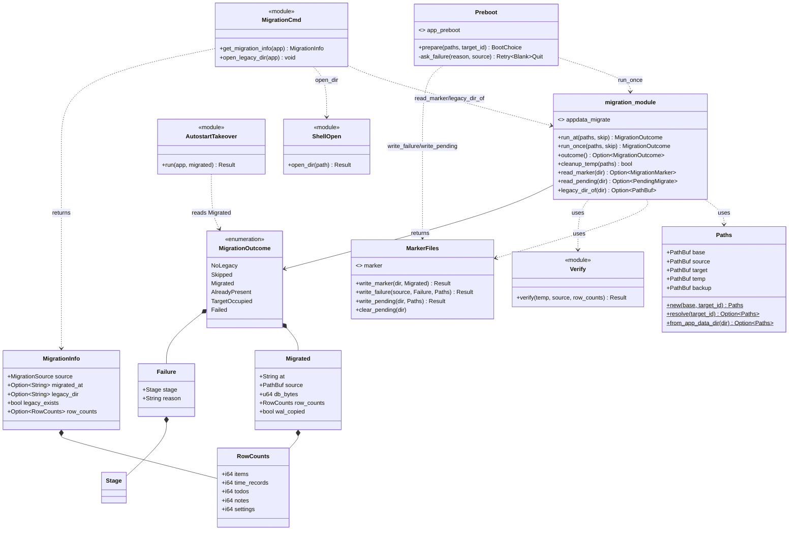
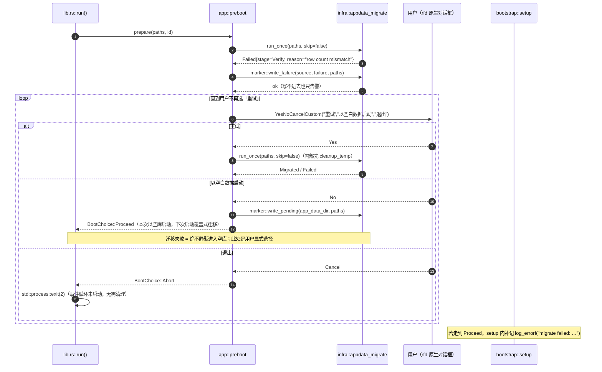
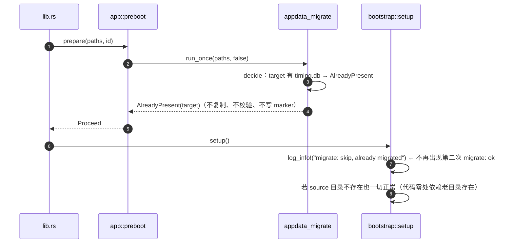
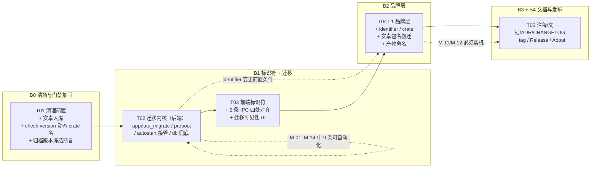

# Timing v0.5.0 系统架构与任务分解（改名 + 数据迁移 + 迁移可见性）

- 文档类型：架构设计 + 任务分解（ARCHITECTURE）
- 上游依据：`docs/rename-v0.5.0/PRD.md`（唯一需求依据）、`AGENTS.md`
- 版本：0.4.1 → 0.5.0
- 撰写：高见远（架构师）｜日期：2026-11-04
- 工程根：`D:\101-Workshop\261102-Timing`
- 交付对象：工程师（按 Part B 的 T01–T05 顺序执行）、QA（按 §6 验收命令与 PRD M-01..M-14）

> 阅读顺序建议：先看 §1 的三张张力对照表（它们决定了后面所有文件落点），再看 §2 文件清单，再按 Part B 执行。

---

## 0. 一页速览（给主理人 / 工程师）

| 项 | 结论 |
| --- | --- |
| 迁移触发点 | `src-tauri/src/lib.rs::run()` 内，**`Builder::run()` 之前**、`boot_timing::start()` 之后（已核实 Tauri 2.12.4 的 `setup()` 是先建 config 窗口再调钩子） |
| 迁移模块 | `src-tauri/src/infra/appdata_migrate/`（6 个子模块，全部 ≤300 行，只依赖 std / sqlx / dirs） |
| 迁移 UI 决策点 | `src-tauri/src/app/preboot.rs`，用 **`rfd`**（已是传递依赖）阻塞式原生对话框；**不用** `tauri-plugin-dialog`（其 `blocking_show` 文档明确禁止主线程调用，在 `setup` 里会死锁） |
| IPC 契约 | 命令 **65 → 67**（新增 `get_migration_info` / `open_legacy_dir`），事件 11 / 错误码 16 / DB schema v4 **不变**；需 ADR-037 并改写 PRD「零变化」口径 |
| 可测性 | 迁移核心函数签名 `run_at(&Paths, skip: bool)`，**不读 identifier、不读 app_data_dir()、不碰 Tauri**，测试直接塞两个临时目录 |
| 安卓 | 本机**无 Android SDK / NDK / Java / aarch64-linux-android target** → 本轮**不可能**产出 APK；Release 附件只放 Windows 产物（§5.5 有核实证据） |
| 验收手段限制 | 本机 `reg.exe` 被安全策略拦截 → **注册表类验收只能「程序内读回 + 日志」+ QA 手工 `regedit` 目视**，禁止写进脚本/门禁/单测（§7 N16） |
| 归档件 | `android-app/` **代码零改动**：改名目标值只写进 `ARCHIVED.md` 的「重新启用前必须先执行」清单（T01.6），理由是本机无法编译、style 名与引用脱钩的错误会潜伏（§7 N8-c） |
| 任务 | 5 个任务（T01–T05，对应批次 B0–B4），任务内用 `T0x.n` 步骤给出按文件的可执行粒度 |

---

# Part A 系统设计

## 1. 实现方案总览与关键技术决策

### 1.1 总体思路

1. **迁移先于身份**：`run()` 开头用「旧 identifier 目录 → 新 identifier 目录」的纯文件复制完成数据搬家；此时 `tauri.conf.json` 的 identifier 还没换也能测——因为迁移函数只认传进来的两个绝对路径。
2. **迁移模块与 UI 彻底解耦**：`infra/appdata_migrate` 只做文件 + SQLite 校验，返回 `MigrationOutcome`；「弹窗问用户」是 `app/preboot.rs` 的事（它需要 `rfd`，且必须在事件循环启动前执行）。
3. **日志后置补记**：迁移跑在 `log::init` 之前，因此迁移自身无日志能力 → 结果缓存在内存，`bootstrap::setup` 里补写 `migrate: ok/...`；失败明细直接落 `migration-failed.txt`。
4. **迁移可见性用 2 条显式命令**，不做隐式 schema 变更（见 1.2）。
5. **改名分层落地**：B1 只动「标识符 + 迁移」，B2 才动「displayName / identifier / 打包产物」，B3 收尾文档，B4 发布。

### 1.2 张力 1：迁移可见性 vs 契约零变化

D4 要求设置页展示「数据来源 + 打开旧数据目录」。三条备选路径的实测评估：

| 备选 | 可行性核实 | 代价 | 结论 |
| --- | --- | --- | --- |
| **(a) 新增 IPC 命令** | 4 处落点可枚举（`lib.rs::generate_handler!`、`IpcApi`、`ipc.ts`、`browserMock*.ts`），`check:contract` 会把缺一处的地方直接判红。**「打开目录」并不需要新能力**：`services/plugin.rs:124 open_user_dir` → `infra/plugin_fs.rs:191 open_dir` 已有现成的 `explorer <dir>` 实现，本方案只是把它抽成公共函数复用，`open_legacy_dir` 命令体约 15 行 | 命令 65→67；`ipc.ts` 现 295 行，需先抽文件腾行数；契约文档 + ADR | **采纳** |
| (b) 复用现有命令 | 逐条查过 65 条：`plugin_list` / `plugin_open_dir` 绑死 `<app_data>/plugins`；`md_sync_*` 绑死用户配置的外部落点；诊断快照 `diagnostics.txt` **只有写没有读**，且根本不是 IPC 命令。**没有任何一条能读 app_data_dir 下任意文件或打开任意目录**（`plugin_fs::open_dir` 只接受调用方给的路径且由 `plugin_open_dir` 硬编成 plugins 子目录，暴露成通用命令等于给前端一条「打开任意目录」的通路，与 ADR-015 的最小权限面冲突） | 0 条新命令，但必须把语义塞进 `plugin_open_dir`（或给它加 path 参数） | **否决**（语义污染 + 越权面扩大） |
| (c) 写 `settings` 表 + `get_settings` 读 | `settings` 确实是 kv 表（`migrations/0001_init.sql:73`：`key TEXT PRIMARY KEY / value TEXT NOT NULL / updated_at INTEGER`）。**但前端读设置不是读 kv**：`commands/settings_cmd.rs:54-58 get_settings(app, state) -> AppResult<Settings>` 返回的是**强类型 `Settings` 结构体**（`models/settings.rs`，`#[serde(rename_all="camelCase")]`），由 `services::settings::get()` 把 kv 行映射成字段 | **仍然是一次完整的契约变更**：要扩 `Settings` 类型 + `services::settings::get()` 的映射 + 前端 `src/types/domain` 的 `Settings` 接口 + `settingsStore` 的消费方；只是**不新增命令名**。而 `check:contract` 只比对命令名 / 错误码 / 事件，**对响应体字段零校验 → 变更发生了，门禁全程绿**。再叠加「打开旧目录」仍需 1 条新命令，最终是「1 条新命令 + 1 次隐式响应体变更」 | **否决**（不是零成本；且是最坏的一类——静默的契约变更，评审时看不见，破坏兼容时也看不见） |

**结论的准确表述（ADR-037 必须逐字收录这一段）**：

> **(c) 省掉的只是「命令条数」这一项数字，省不掉契约变更本身；而且它是最坏的一类——`check:contract` 只比对命令名 / 错误码 / 事件，对响应体字段零校验，于是变更发生了而门禁全程绿。** (a) 把变更**显式化**：代价是多 2 个命令名、2 份 mock 实现与 1 节契约文档，换来**可枚举、可被 `check:contract` 机械校验**。故选 (a)。

> 给 ADR 作者（T03.17）的硬要求：上面这段引文是「为什么选 (a)」的**核心理由**，不得压缩成「为了迁移可见性新增了 2 条命令」。ADR 里至少要有三块：① (b)(c) 各自的否决依据（含 `plugin_fs::open_dir` 已存在但仍不能复用为通用命令的理由、`Settings` 强类型的事实）；② 上面这段引文；③ 「不新增错误码、路径由后端重算」两条约束。

**采纳 (a)，且只加 2 条，不加第 3 条：**

| 命令 | 语义 | 入参 | 返回 | 自启相关命令**不新增** |
| --- | --- | --- | --- | --- |
| `get_migration_info` | 纯查询，幂等、无副作用 | 无 | `MigrationInfo` | — |
| `open_legacy_dir` | 动作：资源管理器打开旧数据目录（不存在则返回 `IO_ERROR`，不创建） | 无 | `()` | — |

> 自启接管复用既有命令面：`commands/settings_cmd.rs:80-81 set_autostart` 与 `:92-93 get_autostart` 已存在，**命令数不变**；接管逻辑由后端在 `setup` 内自行调用 `infra::autostart`，不经 IPC。

配套口径变更（**必须写进文档，否则 release notes 与契约文档自相矛盾**）：

- `docs/phase2/IPC-CONTRACT-v2.md`：命令 **65 → 67**，新增一节 §「迁移可见性」；
- PRD §1.3「零变化：命令 65 / 事件 11 / 错误码 16」改写为「**命令 65 → 67（新增 2 条只读/打开目录命令）；事件 11 / 错误码 16 / DB schema v4 不变**」；
- 新增 `docs/decisions/ADR-037.md`：为什么必须破「零变化」（记录 (b)(c) 被否决的依据）；
- **不新增错误码**：两条命令失败一律 `IO_ERROR`（PRD 铁律「错误码只在 error.rs 定义且数量不变」）。

> 行数代价与解法：`src/services/ipc.ts` 当前 **295 行**（不是 300，只剩 5 行余量）。新增 2 条命令约 +4 行会顶到 299。因此在同一任务里把 `IpcError` + `normalizeError` 抽到新文件 `src/services/ipcError.ts`（约 45 行），`ipc.ts` 保留 `export { IpcError } from './ipcError'` 使 4 个既有 import 点（`ItemPicker.tsx` / `useTimerActions.test.ts` / `themeActions.ts` / `todoStore.ts` / `todoStore.test.ts`）零改动。**`errorText()` 必须留在 `ipc.ts`**——`scripts/check-contract.mjs:183` 直接从该文件解析 `case '...'`，搬走会让「错误码文案覆盖」规则静默失效。

### 1.3 张力 2：迁移模块的分层与调用点

#### 1.3.1 「`run()` 开头没有 AppHandle」这个真实难点

三条路径的取舍：

| 方案 | 事实依据 | 结论 |
| --- | --- | --- |
| A. 迁移放 `Builder::setup` 里，用 `tauri-plugin-dialog` 弹窗 | 已核实 `tauri-2.12.4/src/app.rs` 的 `fn setup(app)`：**先** `WebviewWindowBuilder::from_config(...).build()` 建 config 窗口，**再** 调用户 setup 钩子。`window-state` 的 `on_window_ready` 就在建窗那一刻触发 → 迁移放 setup，首启窗口位置已回默认，L2-19/ M-11 必失败 | **否决**（与 PRD §4.2 硬要求冲突） |
| B. 迁移放 `run()` 开头，失败时用 `tauri-plugin-dialog::blocking_show` | 该 crate 源码注释原文：「This is a blocking operation, and should **NOT** be used when running on the main thread context.」`run()` 与 `setup` 都在主线程 → 调它等于自锁；且 `run()` 开头根本没有 `AppHandle`（`DialogExt` 只能从 `AppHandle`/`Window` 取） | **否决**（技术不可行） |
| **C. 迁移放 `run()` 开头（纯文件操作，无 UI）；决策点在 `run()` 内、`Builder` 之前，用 `rfd` 阻塞式原生对话框** | `rfd 0.16.0` 已在依赖树（`tauri-plugin-dialog 2.8.3` 的传递依赖），`MessageButtons::YesNoCancelCustom(重试, 以空白数据启动, 退出)` 正好三按钮 + 自定义文案，`MessageDialog::show()` 同步阻塞；此时事件循环尚未启动，主线程阻塞安全 | **采纳** |

> 结论一句话：**「先复制、后问人」，且问人时不依赖 Tauri 运行时**。迁移 = `infra`（headless），问答 = `app::preboot`（rfd）。

#### 1.3.2 模块契约（`infra/appdata_migrate`）

依赖白名单：**std + sqlx（已在 infra 用）+ dirs（新增，见下）+ serde/serde_json + chrono**。**不得** `use crate::services`、**不得** `use tauri::`（保持 headless，L4 自然满足）。

```rust
// ── infra/appdata_migrate/paths.rs ────────────────────────────────
pub const LEGACY_IDENTIFIER: &str = "com.tickbar.app";
pub const LEGACY_DB_NAME:   &str = "tickbar.db";
pub const LEGACY_PRODUCT_NAME: &str = "TickBar";   // 自启注册表值名 = productName
pub const LEGACY_LOG_PREFIX: &str = "tickbar-";
pub const DB_NAME: &str = "timing.db";

/// dirs::data_dir()——与 Tauri 完全同源（tauri 2.12.4 内部即 `dirs 7` + identifier）。
pub fn data_dir() -> Option<PathBuf>;

#[derive(Debug, Clone)]
pub struct Paths {
    pub base: PathBuf,      // %APPDATA%
    pub source: PathBuf,    // base/com.tickbar.app
    pub target: PathBuf,    // base/<target_id>
    pub temp: PathBuf,      // base/<target_id>.migrating
    pub backup: PathBuf,    // base/<target_id>.premigrate-<ts>
}
impl Paths {
    /// 纯拼接，无 IO。测试用任意两个临时目录时也走这个构造函数。
    pub fn new(base: &Path, target_id: &str) -> Self;
    /// 生产入口一：dirs::data_dir() + target_id（identifier 来自 lib.rs 的 Context）
    pub fn resolve(target_id: &str) -> Option<Self>;
    /// 生产入口二：由权威 app_data_dir 反推（命令层用，避免再算一遍 identifier）
    pub fn from_app_data_dir(app_data_dir: &Path) -> Option<Self>;
}

// ── infra/appdata_migrate/mod.rs ──────────────────────────────────
#[derive(Debug, Clone)]
pub enum MigrationOutcome {
    NoLegacy,                                   // 全新用户
    Skipped,                                    // TIMING_SKIP_MIGRATE / debug 默认跳过
    Migrated(Migrated),
    AlreadyPresent(PathBuf),                    // 目标已有库 → 不迁移、不覆盖（PRD §4.1 条件2）
    TargetOccupied(PathBuf),                    // 目标有库且老目录也有东西 → 诊断要提示「未采用的旧数据」
    Failed(Failure),
}

pub struct Migrated { pub at: String, pub source: PathBuf, pub db_bytes: u64,
                      pub row_counts: RowCounts, pub wal_copied: bool }
pub struct Failure  { pub reason: String, pub stage: Stage }   // stage: Copy|Verify|Rename

/// 唯一可测入口：不读环境变量、不读 identifier、不碰 Tauri。
pub fn run_at(paths: &Paths, skip: bool) -> MigrationOutcome;

/// 生产入口：内部 = run_at + 结果缓存（OnceLock）+ WARN 日志缓冲。
pub fn run_once(paths: &Paths, skip: bool) -> MigrationOutcome;
pub fn outcome() -> Option<MigrationOutcome>;    // 供 bootstrap / 命令层读取
pub fn cleanup_temp(paths: &Paths) -> bool;      // 清理残留临时目录（M-07）
```

子模块划分（每个都远小于 300 行，规避 P1-1）：

| 文件 | 职责 | 预估行 |
| --- | --- | --- |
| `appdata_migrate/mod.rs` | `MigrationOutcome` 定义、`run_at` 编排（判 → 清残留 → 复制 → 校验 → 换名 → 写标记）、`OnceLock` 结果缓存 | 130 |
| `appdata_migrate/paths.rs` | `Paths`、`LEGACY_*` 常量、`data_dir()` | 75 |
| `appdata_migrate/decide.rs` | 纯判定：读三个路径的存在性 + 库文件存在性 → `Decision::{Go, NoLegacy, AlreadyPresent, Occupied}`；**无 IO 副作用**（只 `exists`/`read_dir`） | 95 |
| `appdata_migrate/copy.rs` | 整树递归复制 + 数据库改名映射（`tickbar.db*` → `timing.db*`）+ 目标已存在时的「备份改名」分支 | 135 |
| `appdata_migrate/verify.rs` | V1 逐文件字节数 / V2 `PRAGMA integrity_check` / V3 五表行数 + `settings.schema.version` 可读 / V4 源库可读则行数比对 | 125 |
| `appdata_migrate/marker.rs` | `migrated-from-tickbar-app.json`、`migration-failed.txt`、`pending-migrate.json` 三份文件的读写 | 115 |

#### 1.3.3 `run()` 的调用位置与完整时序

```rust
// src-tauri/src/lib.rs（示意，不给实现）
pub fn run() {
    platform::boot_timing::start();                 // ① 保持不变（T17 冷启动计时起点）

    let ctx = tauri::generate_context!();           // ② 提前构造：只读 config()，不建 App
    #[cfg(desktop)]
    let boot = app::preboot::prepare(
        infra::appdata_migrate::Paths::resolve(ctx.config().identifier.as_str()),
        ctx.config().identifier.as_str(),
    );
    #[cfg(desktop)]
    if matches!(boot, app::preboot::BootChoice::Abort) { std::process::exit(2); }
    #[cfg(desktop)]
    platform::boot_timing::mark("preboot");

    let builder = tauri::Builder::default();
    /* ... 插件注册与 generate_handler! 原样保留，另加 2 条新命令 ... */
    builder.run(ctx).expect("Timing 启动失败");     // ③ ctx 在这里被消费
}
```

为什么 identifier 从 `ctx.config().identifier` 取而不是写常量：`Context::config()` 是公开 API（`tauri-2.12.4/src/lib.rs:414`），拿到的是**编译期嵌入的 tauri.conf.json 原文**，B2 改了 identifier 后迁移目标目录自动跟着变，**永远不会与打包配置漂移**。同理 `ctx.config().product_name` 可直接喂给自启接管，不必再写 `"Timing"` 字面量。

> 与 PRD §4.2「必须放在 `run()` 最开头」的差异：保留 `boot_timing::start()` 作为第一行。理由：它是「计时起点」，若把它挪到迁移之后，首启耗时统计会漏掉迁移这段（恰恰是最该被测量的）。语义上仍满足「早于 `platform::boot_timing::start()` 之外的任何初始化」与「早于 `Builder::run()`」。**已在此备案，不视为偏离。**

四类路径的时序见 §4 的 Mermaid。

#### 1.3.4 `Paths` 无法从 `AppHandle` 取得的补偿设计

`run()` 阶段没有 `AppHandle`，只能靠 `dirs::data_dir()` 复刻 Tauri 的路径推导。为防「推错了但没人知道」，加一道**自检**（`app/bootstrap.rs`，约 4 行）：

```rust
// setup 开头，紧跟 log::init 之后
let authoritative = app.path().app_data_dir()?;      // 权威值
if let Some(p) = infra::appdata_migrate::paths_used() {
    if p.target != authoritative {
        crate::log_error!("appdata mismatch: migrate target={} authoritative={}", ...);
    }
}
```

即：迁移目标与实际运行目录不一致时，**必须留下一条 ERROR 日志**（否则用户「数据没过来」而日志一片安静——这是最难查的一类）。

依赖版本选择：`dirs = "7"`（desktop target 段）。已核实 `tauri-2.12.4/Cargo.toml` 要求 `dirs = "7"`，`Cargo.lock` 里已有 `dirs 7.0.0`；**若声明 `dirs = "6"` 会多编一份 6.0.0（lock 里也已存在，被别人引用），两份 dirs 的 Windows 实现可能不同** → 必须写 `"7"`。

### 1.4 张力 3：改名顺序的不可逆性 vs 可独立测试

**核心手段：注入路径，不读环境。**

```rust
pub fn run_at(paths: &Paths, skip: bool) -> MigrationOutcome
```

- `Paths` 由调用方（生产 = `Paths::resolve(identifier)`；测试 = `Paths::new(&tmp, "com.timing.app")`）构造；
- 迁移函数内部**没有** `app_data_dir()`、没有 `identifier`、没有 `dirs`、没有 `tauri::`；
- 因此 B1（迁移落地、identifier 仍是 `com.tickbar.app`）就能跑 M-01..M-14 的绝大部分：测试里目标目录名随便取（例如 `tmp/com.timing.app`），与真实 identifier 无关。

Rust 集成测试方案（沿用 `src-tauri/src/tests/support.rs` 的既有模式，`mod support;` 里的 `unique_dir` / `fresh_pool` 复用）：

```rust
// src-tauri/src/tests/appdata_migrate.rs（新增，约 280 行，注册进 tests/mod.rs）
use crate::infra::appdata_migrate::{self as mig, Paths};
use crate::tests::support::{unique_dir, fresh_pool, new_item};

/// 造一个「0.4.1 老目录」：真实 init_pool 建库 + 插数据 + 手写 .window-state.json / plugins/
async fn make_legacy(tag: &str) -> PathBuf;

#[tokio::test] async fn m01_migrates_all_data();          // 行数一致 + 老目录 mtime 不变（除 -wal）
#[tokio::test] async fn m02_second_run_is_noop();         // 返回 AlreadyPresent，目标库不被改写
#[tokio::test] async fn m05_target_with_db_is_not_overwritten();
#[tokio::test] async fn m06_copy_failure_leaves_no_temp(); // 目标父目录不可写 / temp 父级是文件
#[tokio::test] async fn m07_leftover_temp_is_cleaned();
#[tokio::test] async fn m08_wal_records_are_carried();    // 见下「WAL 用例技巧」
#[tokio::test] async fn m09_skip_flag_returns_skipped();  // run_at(&paths, true)
#[tokio::test] async fn m13_only_logs_dir_counts_as_legacy();
#[test]        fn paths_new_is_pure_join();               // 路径拼接纯函数
#[test]        fn marker_schema_roundtrip();              // JSON schema 稳定性
```

WAL 用例技巧（M-08 唯一可靠的造法）：用 `SqliteConnectOptions` 建一个**第二连接**写入一批记录后 `std::mem::forget(conn)`，让 `-wal` 保持非空不 checkpoint，再调用 `run_at`。断言：新库 `SELECT COUNT(*) FROM time_records` 包含那批记录。

### 1.5 三个张力之外的四个关键实现决策

| # | 决策 | 理由 |
| --- | --- | --- |
| D-A | **失败对话框用 `rfd`，不用 `tauri-plugin-dialog`** | 见 1.3.1 备选 B 的源码依据；`rfd 0.16` 已在树内，零新编译 |
| D-B | **debug 构建默认跳过迁移**（需 `TIMING_FORCE_MIGRATE=1` 才在 debug 下执行） | R6 的根治：`npm run tauri dev` 与 release 共用 identifier，任何人不带环境变量就会搬真实数据。脚本层加变量是「靠记性」，默认跳过才是「靠机制」。release 构建行为不变 |
| D-C | **「以空白数据启动」后必须写 `pending-migrate.json`，下次启动走覆盖式迁移** | PRD §4.4 承诺「下次启动仍会重试」在实现上**不成立**：空白会话会在新目录里建出 `timing.db`，下次启动 §4.1 条件 2 永久为假 → 老数据再也不会被迁移（**新发现风险 N1**，见 §7） |
| D-D | **旧 target 目录用「备份改名」而非删除** | `fs::rename(temp, target)` 在目标已存在时 Windows 必失败；改名成 `com.timing.app.premigrate-<ts>` 既保住原子性，又不销毁任何用户数据 |

---

## 2. 模块与文件清单

> 列 = 动作 / 相对路径 / 一句话职责 / 预估行数。新增文件一律 ≤300 行；「修改」栏给出改动行数量级（≈ 表示等长替换）。

### 2.1 新增（Rust，12 个）

| # | 路径 | 职责 | 行 |
| --- | --- | --- | --- |
| 1 | `src-tauri/src/infra/appdata_migrate/mod.rs` | 迁移编排 + `MigrationOutcome` + 结果缓存 | 130 |
| 2 | `src-tauri/src/infra/appdata_migrate/paths.rs` | `Paths` / `LEGACY_*` 常量 / `data_dir()` | 75 |
| 3 | `src-tauri/src/infra/appdata_migrate/decide.rs` | 纯判定：要不要迁 | 95 |
| 4 | `src-tauri/src/infra/appdata_migrate/copy.rs` | 整树复制 + DB 改名 + 备份改名 | 135 |
| 5 | `src-tauri/src/infra/appdata_migrate/verify.rs` | 四重校验 | 125 |
| 6 | `src-tauri/src/infra/appdata_migrate/marker.rs` | 三份 JSON/TXT 文件读写 | 115 |
| 7 | `src-tauri/src/infra/shell_open.rs` | `open_dir(path)`（不建目录）——**从既有 `infra/plugin_fs.rs:191 open_dir` 抽出的公共函数**，`plugin_fs` 改为委托它；不是新能力 | 40 |
| 8 | `src-tauri/src/models/migration.rs` | `MigrationInfo` / `RowCounts`（camelCase serde，与前端 DTO 逐字对齐） | 80 |
| 9 | `src-tauri/src/commands/migration_cmd.rs` | `get_migration_info` / `open_legacy_dir` | 70 |
| 10 | `src-tauri/src/app/preboot.rs` | 迁移 + rfd 失败决策循环（桌面独占） | 120 |
| 11 | `src-tauri/src/app/autostart_takeover.rs` | 自启接管：清理 `Run\TickBar` 并按原设置重挂（桌面独占） | 80 |
| 12 | `src-tauri/src/tests/appdata_migrate.rs` | M-01..M-13 集成测试 | 280 |

### 2.2 新增（前端，6 个）

| # | 路径 | 职责 | 行 |
| --- | --- | --- | --- |
| 13 | `src/types/domain/migration.ts` | `MigrationInfo` / `MigrationSource` 类型 | 50 |
| 14 | `src/services/ipcError.ts` | `IpcError` + `normalizeError`（从 `ipc.ts` 抽出，腾行数） | 45 |
| 15 | `src/services/migrationActions.ts` | 迁移可见性动作（L1 规则：组件不得直接碰 `ipc.`） | 45 |
| 16 | `src/mocks/browserMockMigration.ts` | 两条新命令的浏览器 mock | 45 |
| 17 | `src/components/settings/MigrationInfoCard.tsx` | 设置→通用页签底部「数据迁移状态」卡片 | 120 |
| 18 | `src/lib/storageKeys.ts` | 5 个 localStorage 键常量 + 双读兼容（一次性搬运） | 60 |

### 2.3 新增（脚本 / 文档，6 个）

| # | 路径 | 职责 |
| --- | --- | --- |
| 19 | `scripts/archived-versions.json` | 归档工程版本冻结表（`android-app` → `0.3.6`），`check:version` 据此断言 |
| 20 | `docs/decisions/ADR-036.md` | 品牌回归 Timing（`TickBar` 是重写期代号） |
| 21 | `docs/decisions/ADR-037.md` | IPC 命令 65 → 67：迁移可见性为何必须破「零变化」 |
| 22 | `android-app/ARCHIVED.md` | 归档声明（主线为 `src-tauri/gen/android`、不发布、版本冻结）+ **§改名清单：重新启用前必须先执行的 8 条（T01.6 一次写全；清单本身本轮不执行）** |
| 23 | `docs/rename-v0.5.0/VERIFY.md` | M-01..M-14 执行记录表（QA 填） |
| 24 | `scripts/brand-gate.mjs` + `scripts/brand-allowlist.txt` | 品牌残留门禁（P2-3，可选，T05 落地） |

### 2.4 修改（Rust，15 个）

| 路径 | 改动 | 量级 |
| --- | --- | --- |
| `src-tauri/src/lib.rs` | 提前 `generate_context!()`、preboot 调用、`mod` 不变、`generate_handler!` 加 2 条、`expect("Timing 启动失败")` | +18 ≈ |
| `src-tauri/src/main.rs` | `tickbar_lib::run()` → `timing_lib::run()` | ≈1 |
| `src-tauri/src/app/mod.rs` | `#[cfg(desktop)] pub mod preboot; pub mod autostart_takeover;` | +4 |
| `src-tauri/src/app/bootstrap.rs` | app_data 自检、日志补记迁移结果、自启接管调用、`boot_timing::mark` | +26 |
| `src-tauri/src/app/tray.rs` | `TRAY_ID = "timing-tray"`、`tooltip("Timing")`（文件头注释 ≈） | ≈3 |
| `src-tauri/src/app/diagnostics.rs` | 首行 `Timing diagnostics`、`timing.db`、新增 `migration:` 行、`TIMING_BUILD_TIME` | +6 |
| `src-tauri/src/infra/mod.rs` | `pub mod appdata_migrate; pub mod shell_open;` | +2 |
| `src-tauri/src/infra/db.rs` | `timing.db` + 「`timing.db` 缺但有 `tickbar.db` 则用它」兜底（L2-2） | +10 ≈ |
| `src-tauri/src/infra/autostart.rs` | 新增 `legacy_value_exists` / `remove_legacy_value`（含 `StartupApproved\Run`，见 §7 N5） | 22 → 110 |
| `src-tauri/src/infra/plugin_fs.rs` | `open_dir` 改为委托 `shell_open::open_dir`（去重） | ≈6 |
| `src-tauri/src/infra/window_spec.rs` | 4 个窗口标题 `TickBar → Timing`（PRD L1-13） | ≈4 |
| `src-tauri/src/models/mod.rs` | `pub mod migration;` | +1 |
| `src-tauri/src/commands/mod.rs` | `pub mod migration_cmd;` | +1 |
| `src-tauri/src/platform/log.rs` | `timing-YYYY-MM-DD.log`、`TIMING_LOG` 优先 + `TICKBAR_LOG` 回落打 WARN、启动首行 | +14 ≈ |
| `src-tauri/src/services/plugin.rs` | `tickbar-plugin-` → `timing-plugin-`（**注意：本文件 295 行**，只做等长替换） | ≈2 |
| `src-tauri/src/infra/md_backup.rs` / `md_file.rs` | 临时目录前缀 `tickbar-` → `timing-`（L2-14） | ≈3 |
| `src-tauri/Cargo.toml` | `name/lib/description/authors/version`、desktop 段加 `dirs = "7"` / `rfd = "0.16"` / `windows-registry = "0.6"` | +8 |
| `src-tauri/tauri.conf.json` | `productName/identifier/title/version` | ≈4 |
| `src-tauri/tauri.android.conf.json` | 窗口 `title` | ≈1 |

### 2.5 修改（前端，14 个）

| 路径 | 改动 | 量级 |
| --- | --- | --- |
| `src/services/ipc.ts` | 抽 `IpcError`/`normalizeError` 出去、加 2 条命令、`ErrorCode` 导入可能变无用需删 | 295 → ≈276 |
| `src/types/domain/ipc.ts` | **`IpcApi` 的唯一落点（196 行，余量 104 行）**，加 `getMigrationInfo` / `openLegacyDir` | +5 |
| `src/types/domain.ts` | **36 行纯 re-export 门面**，只加 `export * from './domain/migration';`（`IpcApi` 不在这里） | +1 |
| `src/types/domain/constants.ts` | `THEME_CACHE_KEY = 'timing.theme'` + 新增 `THEME_CACHE_KEY_LEGACY` | ≈3 |
| `src/mocks/browserMock.ts` | 并入 `createMockApiMigration`（253 → ≈256） | +3 |
| `src/lib/theme.ts` | 双读 + 读老键即写新键 | +8 |
| `src/stores/appearanceStore.ts` | 用 `storageKeys` | ≈2 |
| `src/stores/countdownArm.ts` | 同上（2 个键） | ≈4 |
| `src/hooks/useWindowAutoFit.ts` | `'tickbar:fit-offset'` → 新键 + 老键双读（**本文件 262 行，注意余量**） | +8 |
| `src/components/settings/GeneralTab.tsx` | 底部挂 `<MigrationInfoCard />`（桌面/`IS_MOBILE` 门控） | +6 |
| `index.html` | 删 `[TEMP-DIAG]` 整块（P0-1）、内联脚本双读新老主题键、`<title>` | -36 +6 |
| `src/components/ui/AppErrorBoundary.tsx` | `[tickbar]` → `[timing]`（2 处） | ≈2 |
| `src/components/mobile/MobileShell.tsx` / `src/hooks/useMobileBackSheet.ts` | `tickbarRecover`/`tickbarOverlay` → `timing*`（L2-12） | ≈3 |
| `src/components/settings/PluginsTab.test.tsx` / `src/mocks/browserMockPlugins.ts` / `src/types/domain/plugin.ts` | 路径字面量 `com.tickbar.app` → `com.timing.app`（L2-16） | ≈4 |

### 2.6 修改（配置 / 脚本 / 文档 / 安卓）

| 路径 | 改动 |
| --- | --- |
| `package.json` / `package-lock.json` | name / description / version（lock 由 `npm install --package-lock-only` 生成，不手改） |
| `vite.config.ts` / `vitest.config.ts` | `__TICKBAR_MOBILE__` → `__TIMING_MOBILE__`；`'tickbar:platform-css'` → `'timing:platform-css'`（P2-1） |
| `scripts/check-version.mjs` | **crate 名从 `Cargo.toml` 动态读**（P0-4）+ 归档版本冻结断言 |
| `scripts/check-layers.mjs` | L7 正则 `__TIMING_MOBILE__` + **新增哨兵断言**（§7 N7） |
| `scripts/dev-desktop.cmd` / `build-release.cmd` | 加 `TIMING_SKIP_MIGRATE=1`；`-p timing` / `timing.exe` / `release\Timing.exe` |
| `plugins/md-sync/plugin.json` / `README.md` | 绝对路径脱敏（P0-5）+ 安装路径 |
| `src-tauri/gen/android/**` | 包名搬迁 + `assets/` 出库（见 §5.3） |
| `android-app/**` | **入库 + 归档声明 + 改名清单，代码零改动**（见 T01.5 / T01.6，均在 B0 完成） |
| `AGENTS.md` / `README.md` / `docs/mobile/DESIGN-ANDROID-V1.md` 等 | L3 文档（R1–R8 规则，见 PRD §3.3.1） |
| `CHANGELOG.md` / `更新日志.md` | 只追加 0.5.0 条目 |

### 2.7 删除

| 目标 | 方式 | 理由 |
| --- | --- | --- |
| `index.html` 内 `[TEMP-DIAG]` 脚本块（36–70 行） | 删代码 | P0-1；且 CSP `default-src 'self'` 本就把 `127.0.0.1:8787` 打点拦掉，删它零风险 |
| `src-tauri/gen/android/app/src/main/assets/**`（7 个文件） | `git rm -r --cached` + 磁盘删除 + `.gitignore` | P0-6；由 `tauri android build` 从 `dist/` 重建 |

---

## 3. 关键数据结构与接口

### 3.1 `appdata_migrate` 公开 API（完整签名）

```rust
// mod.rs
pub enum MigrationOutcome {
    NoLegacy,
    Skipped,
    Migrated(Migrated),
    AlreadyPresent(PathBuf),   // 目标已有库（M-02 / M-05）
    TargetOccupied(PathBuf),   // 目标有库 且 老目录也有数据（M-05，需诊断提示）
    Failed(Failure),
}

pub struct Migrated {
    pub at: String,            // "2026-11-04T15:20:31+08:00"
    pub source: PathBuf,
    pub db_bytes: u64,
    pub row_counts: RowCounts,
    pub wal_copied: bool,
}
pub struct Failure { pub stage: Stage, pub reason: String }
pub enum Stage { CleanTemp, Copy, Verify, Swap, Marker }

pub fn run_at(paths: &Paths, skip: bool) -> MigrationOutcome;   // 可测
pub fn run_once(paths: &Paths, skip: bool) -> MigrationOutcome; // 生产 = run_at + 缓存
pub fn outcome() -> Option<MigrationOutcome>;
pub fn cleanup_temp(paths: &Paths) -> bool;

// markers（供命令层与 bootstrap 使用，均只读/纯 IO）
pub fn read_marker(app_data_dir: &Path) -> Option<MigrationMarker>;
pub fn read_pending(app_data_dir: &Path) -> Option<PendingMigrate>;
pub fn legacy_dir_of(app_data_dir: &Path) -> Option<PathBuf>;   // 重算，不读 marker
```

### 3.2 迁移标记 JSON schema（落盘契约，QA 依赖）

`<app_data_dir>/migrated-from-tickbar-app.json`

```json
{
  "schema": 1,
  "at": "2026-11-04T15:20:31+08:00",
  "appVersion": "0.5.0",
  "source": "C:\\Users\\<user>\\AppData\\Roaming\\com.tickbar.app",
  "dbBytes": 81920,
  "rowCounts": { "items": 8, "timeRecords": 512, "todos": 20, "notes": 3, "settings": 14 },
  "walCopied": true,
  "verified": "size+integrity+rows"
}
```

`<app_data_dir>/pending-migrate.json`（D-C 新增）

```json
{ "schema": 1, "blankStartedAt": "2026-11-04T16:02:10+08:00", "reason": "user chose blank start", "legacyDir": "C:\\Users\\<user>\\AppData\\Roaming\\com.tickbar.app" }
```

`<source>/migration-failed.txt`（追加写，每次尝试一段；**写到老目录**是 PRD §4.4 的原文要求，且老目录可能只读 → 写失败时退化为「只写日志」）

```
[2026-11-04 16:01:55] stage=verify reason=row count mismatch: time_records 512 vs 511
  source=C:\Users\<user>\AppData\Roaming\com.tickbar.app
  temp  =C:\Users\<user>\AppData\Roaming\com.timing.app.migrating
  detail=integrity_check=ok dbBytes=81920 walCopied=true appVersion=0.5.0
```

### 3.3 IPC 命令契约（新增 2 条）

```rust
// models/migration.rs
#[derive(Serialize)] #[serde(rename_all = "camelCase")]
pub struct MigrationInfo {
    pub source: MigrationSource,             // "legacy"|"fresh"|"pending"|"unattached"|"skipped"
    pub migrated_at: Option<String>,
    pub app_version_at_migration: Option<String>,
    pub legacy_dir: Option<String>,
    pub legacy_exists: bool,
    pub db_bytes: Option<u64>,
    pub row_counts: Option<RowCounts>,
}
#[derive(Serialize)] #[serde(rename_all = "camelCase")]
pub struct RowCounts { pub items: i64, pub time_records: i64, pub todos: i64,
                       pub notes: i64, pub settings: i64 }
```

`source` 判定（命令层，纯函数，可单测）：

| 条件（按序优先） | `source` | 前端文案 |
| --- | --- | --- |
| 读到 `migrated-from-tickbar-app.json` | `legacy` | 已从 TickBar 迁移（日期） |
| 读到 `pending-migrate.json` 且老目录存在 | `pending` | 旧数据待迁移（上次选择了空白启动） |
| 本次进程 `MigrationOutcome::Skipped` | `skipped` | 已跳过迁移（开发模式） |
| 目标无库 且 老目录无数据 | `fresh` | 全新数据 |
| 目标有库 且 无 marker 且 老目录有数据 | `unattached` | 发现未采用的旧数据 |

TS 侧（`src/types/domain/migration.ts`）：

```ts
export type MigrationSource = 'legacy' | 'fresh' | 'pending' | 'unattached' | 'skipped';
export interface RowCounts { items: number; timeRecords: number; todos: number; notes: number; settings: number }
export interface MigrationInfo {
  source: MigrationSource;
  migratedAt: string | null;
  appVersionAtMigration: string | null;
  legacyDir: string | null;
  legacyExists: boolean;
  dbBytes: number | null;
  rowCounts: RowCounts | null;
}
```

`open_legacy_dir`：**路径必须重算，绝不使用 `MigrationInfo.legacyDir` 回传值**（防「改 marker 文件 → 打开任意目录」，见 §7 N14）。实现：`app.path().app_data_dir()?.parent()?.join(LEGACY_IDENTIFIER)`，存在性检查通过后调用 `infra::shell_open::open_dir`。

### 3.4 类图（模块关系）



---

## 4. 程序调用时序

### 4.1 路径一：正常迁移（首次启动，老数据齐全）

```mermaid
sequenceDiagram
  autonumber
  participant R as lib.rs::run()
  participant P as app::preboot
  participant M as infra::appdata_migrate
  participant F as 文件系统
  participant S as bootstrap::setup
  participant L as platform::log

  R->>R: platform::boot_timing::start()
  R->>R: ctx = generate_context!(); id = ctx.config().identifier
  R->>P: prepare(Paths::resolve(id), id)
  P->>M: run_once(paths, skip=false)
  M->>F: decide: source 存在? target 有库?
  F-->>M: Go
  M->>F: cleanup_temp(com.timing.app.migrating)
  M->>F: 递归复制 source → temp（tickbar.db* → timing.db*，含 -wal/-shm）
  M->>M: verify(temp)：逐文件字节数 / PRAGMA integrity_check / 五表行数 / 版本键可读
  M->>F: rename(temp → com.timing.app)
  M->>F: write_marker(migrated-from-tickbar-app.json)
  M-->>P: Migrated{ at, dbBytes, rowCounts, walCopied }
  P-->>R: BootChoice::Proceed
  R->>R: boot_timing::mark("preboot")
  R->>R: Builder::default() + 插件 + generate_handler!
  R->>S: setup(AppHandle)
  S->>S: app.path().app_data_dir() 与 paths.target 自检
  S->>L: log::init(<app_data>)（此后文件名已是 timing-*.log）
  S->>L: log_info!("migrate: ok from=… rows=… bytes=…")   ← 迁移结果的补记点
  S->>S: db::init_pool(<app_data>) → 读 timing.db
  S->>S: app::autostart_takeover::run(&app, migrated)
  S-->>R: Ok(())
  R->>R: builder.run(ctx) → 建窗 + window-state 回填（位置正确）
```

### 4.2 路径二：迁移失败（用户可重试 / 空白启动 / 退出）



### 4.3 路径三：目标已存在（M-05 / 本机现状）

```mermaid
sequenceDiagram
  autonumber
  participant R as lib.rs
  participant P as app::preboot
  participant M as appdata_migrate
  participant S as bootstrap::setup
  participant C as commands::migration_cmd

  R->>P: prepare(paths, id)
  P->>M: run_once(paths, false)
  M->>M: decide → AlreadyPresent / TargetOccupied（target 有 timing.db 或 tickbar.db）
  M-->>P: TargetOccupied(source)
  P-->>R: Proceed
  R->>S: setup()
  S->>S: log_init 后 log_warn!("migrate: skipped, target db exists; legacy=<path>")
  S->>S: diagnostics 追加一行 "migration : skipped (unattached legacy data: <path>)"
  Note over S: 绝不覆盖、绝不合并、绝不自动删除
  C->>M: get_migration_info()
  M-->>C: source="unattached", legacyDir="…com.tickbar.app", legacyExists=true
  C-->>C: 设置页显示「发现未采用的旧数据」+「打开旧数据目录」
```

### 4.4 路径四：第二次启动（M-02）/ 迁移后删老目录（M-03）



---

## 5. 任务列表（Part B）

### 5.0 关于任务粒度

按角色硬约束，任务数**上限 5 个**；每个任务内部用 `T0x.n` 编号给出「按文件、可直接执行」的步骤（步骤编号 = 建议 commit 粒度）。批次映射：

| 任务 | 批次 | 目标 | 硬门禁 |
| --- | --- | --- | --- |
| T01 | B0 | 清场 + 入库 + 门禁先行加固 | `npm run check` + `npm test` |
| T02 | B1 | 迁移内核（后端）+ 标识符（后端） | `cargo test`（含新增迁移用例）+ `check:layers` |
| T03 | B1 | 前端标识符 + 2 条新 IPC 的四处对齐 + 迁移可见性 UI | `npm run check`（尤其 `check:contract`）+ `npm test` |
| T04 | B2 | L1 品牌层 + 安卓包名/目录搬迁 + 产物命名 | `cargo build` + 桌面实机 M-11 |
| T05 | B3+B4 | 文档/ADR/CHANGELOG + tag/Release/About | `git grep -in tickbar` = 白名单 + 人工 checklist |

依赖（见 §9 图）：`T01 → T02 → T03 → T04 → T05`（线性，但 T03 的 mock/契约部分可与 T04 并行起草，**合并顺序不可颠倒**）。

> 顺序不可逆的原因（PRD §9）：identifier 一旦先改，用户首启就是「空的新目录 + 老数据还在老名字下」，再补迁移会被 §4.1 条件 2 判为「目标已有库」而永久跳过。

---

### T01（B0）清理前置 + 安卓入库 + 门禁先行加固

**目标**：在不改任何产品行为的前提下，把「改名会踩到的坑」先填掉，并让门禁在后续改名中保持有效。

| 步骤 | 文件 | 改成什么 | 验收 |
| --- | --- | --- | --- |
| T01.1 | `index.html` | 删除整块 `[TEMP-DIAG]` `<script>`（现 36–70 行），只留防白闪引导脚本 | `git grep -n "8787\|__diagSend\|TEMP-DIAG"` 零命中 |
| T01.2 | `plugins/md-sync/plugin.json` | 3 处 `%USERPROFILE%\OneDrive\...\1-MemeX\Diary` → 占位符 `%USERPROFILE%\Documents\Timing`；`plugins/md-sync/README.md` 同步说明「首次使用请改成本机真实目录」 | `git grep -n "OneDrive\|1-MemeX"` 零命中 |
| T01.3 | `src-tauri/gen/android/app/.gitignore` | 追加 `/src/main/assets/` | — |
| T01.4 | `src-tauri/gen/android/app/src/main/assets/**`（7 个文件） | `git rm -r --cached`，并**删磁盘文件**（构建时从 `dist/` 重建） | `git ls-files src-tauri/gen/android/app/src/main/assets` 为空且 `du -sh` 不再计 457K |
| T01.5 | `android-app/` | 确认 `.gitignore` 含 `local.properties`/`build/`/`.gradle/`/`.kotlin/`（已含）→ `git add android-app` | `git ls-files android-app \| wc -l` > 45；`git status` 无 `?? android-app/`；**`git ls-files android-app \| grep local.properties` 为空** |
| T01.6 | `android-app/ARCHIVED.md`（新增；**若已存在则本任务内补全**） | **一次写全**：归档声明（主线 = `src-tauri/gen/android`（Tauri mobile，包名 `com.timing.app`）；**本工程代码零改动，归档即保真，与 `docs/archive/v1/` 同理**；**不发布**；版本**冻结** `versionCode 9 / versionName 0.3.6`）+ 一节 `## 改名清单（重新启用前必须先执行）`，8 条逐条「文件 → 原值 → 目标值」：① `settings.gradle.kts` `rootProject.name` `TickBar` → `TimingDroid`；② `app/build.gradle.kts` `namespace` + `applicationId` `com.tickbar.droid` → `com.timing.droid`；③ `versionCode 9` / `versionName 0.3.6` **保持不动**（与 `scripts/archived-versions.json` 的冻结断言一致，T01.9 校验）；④ `app/src/main/res/values/strings.xml` `app_name` `TickBar` → `Timing`；⑤ **`Theme.TickBar` → `Theme.Timing`（保首字母大写，与主线小写 `Theme.timing` 不同，勿混）**，**必须同时改两处并成对提交**：`res/values/themes.xml:4` 的 `<style name="…">` 与 `AndroidManifest.xml:19` 的 `@style/…` 引用；⑥ Kotlin 包路径 `app/src/main/java/com/tickbar/droid/` → `app/src/main/java/com/timing/droid/`（`git mv` + 全量 `package`/`import` 替换）；⑦ `core/Prefs.kt` SP 名 `"tickbar"` → `"timing"`；⑧ `core/Db.kt` `NAME = "tickbar.db"` → `"timing.db"`。清单末尾必须写明三条警告：**本机无 Android SDK/NDK/java，改完无法编译验证**；**style 名与 `@style/` 引用脱钩会直接编译失败**；**未执行本清单前不得启用本工程**。⚠️ **本任务（B0）是唯一允许动 `android-app/` 的窗口**——只允许「首次 `git add` + 新增/补全 `ARCHIVED.md`」，此后任何批次出现 `android-app/**` 的其他 diff 一律打回（T04 完全不碰它） | ① `git diff --stat` 里 `android-app/` **只有 `ARCHIVED.md`**；② 清单 8 条齐全、每条三要素完整；③ 三条警告齐全；④ 被 T05.9 的 brand gate 归档白名单收录（每次输出「已跳过归档目录 android-app：N 处」）；⑤ **B0 提交之后** `git status --short android-app` 必须为空（`git add` 当场看到的是 `A ` 暂存项，属正常；提交后才应为空） |
| T01.7 | `scripts/check-version.mjs` | ① 新增 `crateName()`：从 `src-tauri/Cargo.toml` 的 `[package]` 段读 `^name\s*=\s*"([^"]+)"`；② `cargoLock()` 改用 `new RegExp('name\\s*=\\s*"' + escapeRe(crateName()) + '"')`（**正则转义**，别指望 crate 名永远无特殊字符）；③ 解析不到 crate 名时直接 FAIL（不许静默跳过）；④ 文件头注释与末尾 OK 文案改成「七处」口径（六处桌面 + 归档冻结表） | ① `npm run check:version` 输出 `OK — 0.4.1`；② 把 `Cargo.toml` 的 crate 名临时改成 `x-y` 时脚本仍能定位版本段（转义与动态读取都生效）；③ **负向验证（见 §7 G1）：只改 `src-tauri/Cargo.lock` 里该 package 段的 `version` 一处 → 必须红**（其余五处不动，证明 Cargo.lock 那一路还在被读）→ 改回再绿 |
| T01.8 | `scripts/archived-versions.json`（新增） | `{ "android-app": { "versionName": "0.3.6", "versionCode": 9, "reason": "archived (D2)" } }` | — |
| T01.9 | `scripts/check-version.mjs` | 读取该文件并断言 `android-app/app/build.gradle.kts` 的 `versionName`/`versionCode` **等于冻结值**（改错即红，同时不要求与桌面 0.5.0 对齐）。**只读断言，不改归档件** | 故意把 `versionName` 改成 `0.5.0` → `npm run check:version` 非零退出；**改回后用 `git status --short android-app` 确认已还原为干净状态**（验证动作不得留下污染，同 T05.9 ②） |
| T01.10 | 全量门禁 | — | `npm run check && npm test` 全绿；`cd src-tauri && cargo test` 全绿 |

**为什么版本门禁要做在 B0**：B2 会把 crate 名从 `tickbar` 改成 `timing`、`Cargo.lock` 由 cargo 重写。若 `check-version.mjs` 仍硬编码 `tickbar`，那一刻门禁必红，工程师会在「改名 PR 里同时改门禁脚本」——正是 PRD R10 想避免的耦合。先做成动态读取，B2 就变成纯数据变更。

---

### T02（B1）迁移内核（后端）+ 后端标识符

**目标**：让 0.5.0 首启能把 `com.tickbar.app` 的全部数据原样搬到 `com.tickbar.app` 之外的目标目录，并留下可核对的痕迹；**此时 identifier 仍未变**，靠注入 `Paths` 完成全部测试。

| 步骤 | 文件 | 改成什么 | 验收 |
| --- | --- | --- | --- |
| T02.1 | `src-tauri/Cargo.toml` | 桌面 target 段新增：`dirs = "7"`（**必须 7，与 tauri 2.12.4 同源**）、`rfd = { version = "0.16", default-features = false, features = ["common-controls-v6"] }`、`windows-registry = "0.6"`（与 auto-launch 的 0.6.1 同源）。三者在 `Cargo.lock` 里都已存在 → **不引入新编译单元** | `cargo tree -d \| grep -E "dirs\|rfd\|windows-registry"` 不出现第二份 |
| T02.2 | `src-tauri/src/infra/appdata_migrate/{paths,decide,copy,verify,marker,mod}.rs` | 按 §1.3.2 / §3.1 的契约实现；`mod.rs` 内 `run_at` 编排顺序固定：`cleanup_temp → decide → copy → verify → swap → write_marker` | `cargo clippy --all-targets -- -D warnings` 零告警；每个文件 ≤300 行 |
| T02.3 | `src-tauri/src/infra/mod.rs` | `pub mod appdata_migrate; pub mod shell_open;`（`appdata_migrate` 本身用 `#[cfg(desktop)]`？**不用**——它 headless，可两平台编译；只有 `app/preboot.rs` 桌面独占） | `cargo build` 通过 |
| T02.4 | `src-tauri/src/infra/shell_open.rs`（新增） | `pub fn open_dir(path: &Path) -> Result<(), String>`：`Command::new("explorer").arg(path)` + `spawn`（不 wait，explorer 成功也常返回 1）；**不创建目录** | — |
| T02.5 | `src-tauri/src/infra/plugin_fs.rs` | `open_dir` 保留「先建后用」语义，内部改调 `shell_open::open_dir`（去重，不新增能力）；`tickbar-plugin-` 前缀 → `timing-plugin-`（等长替换） | `plugin_open_dir` 行为不变 |
| T02.6 | `src-tauri/src/infra/db.rs` | `tickbar.db` → `timing.db`；新增兜底 `resolve_db_path(dir)`：`timing.db` 不存在且 `tickbar.db` 存在 → 用 `tickbar.db` 并 `log_warn!`（L2-2 一次性兜底） | 手建 `<dir>/tickbar.db` 后 `init_pool` 复用该文件 |
| T02.7 | `src-tauri/src/infra/autostart.rs` | 新增 `pub fn legacy_value_exists(name: &str) -> bool`、`pub fn remove_legacy_value(name: &str) -> Result<bool, String>`（走 `windows-registry` 进程内 API，**不 shell 出 `reg.exe`**）。**必须同时删两个位置**：`HKCU\Software\Microsoft\Windows\CurrentVersion\Run\<name>` **和** `HKCU\...\Explorer\StartupApproved\Run\<name>`（后者是「任务管理器 → 启动」的开关记录，只删前者会留僵尸条目）。**并做幂等双名清理**：依次尝试 `LEGACY_PRODUCT_NAME`（`"TickBar"`，注册表值名的正确口径，见 §7 N6）与 `LEGACY_IDENTIFIER`（`"com.tickbar.app"`，防口径变化/历史遗留），任何名字不存在都返回 `Ok(false)` 静默忽略——**用幂等换口径确定性** | **不能**用 `reg query` 验收（本机安全策略拦截 `reg.exe`，见 §7 N16）。改为：① 程序内读回——`legacy_value_exists` 在删除前后各读一次，日志打印 `autostart: legacy<TickBar> present=true removed=true / legacy<com.tickbar.app> present=false`；② `get_autostart` 返回 `true`（新值已挂）；③ QA 手工开 `regedit` 目视核对 `Run` 下只有 `Timing`、`StartupApproved\Run` 无 `TickBar` |
| T02.8 | `src-tauri/src/platform/log.rs` | ① 日志文件名 `timing-YYYY-MM-DD.log`；② 级别来源 `TIMING_LOG` 优先，缺失时回落 `TICKBAR_LOG` 并 `log(Warn, "log", "TICKBAR_LOG 已弃用，请改用 TIMING_LOG")`；③ 启动首行 `---- Timing v{} start ----` | 设 `TICKBAR_LOG=debug` 启动 → 有 WARN 且级别生效 |
| T02.9 | `src-tauri/src/models/migration.rs` + `models/mod.rs` | 按 §3.3 实现 `MigrationInfo` / `RowCounts` / `MigrationSource`（`#[serde(rename_all = "camelCase")]`） | `cargo build` |
| T02.10 | `src-tauri/src/app/preboot.rs`（新增）+ `app/mod.rs` | `prepare(paths: Option<Paths>, target_id: &str) -> BootChoice`；`skip` 逻辑 = `env_flag("TIMING_SKIP_MIGRATE") \|\| (cfg!(debug_assertions) && !env_flag("TIMING_FORCE_MIGRATE"))`；失败时 `rfd::MessageDialog::new().set_title("数据迁移未完成").set_description(正文).set_buttons(YesNoCancelCustom("重试","以空白数据启动","退出")).show()` 循环 | `cargo build --release` 与 `cargo build` 均通过 |
| T02.11 | `src-tauri/src/app/autostart_takeover.rs`（新增） | `run(app: &AppHandle, outcome: &MigrationOutcome) -> Result<(), String>`：仅当 `Migrated` 时动作。顺序：① `legacy_value_exists(LEGACY_PRODUCT_NAME)` / `legacy_value_exists(LEGACY_IDENTIFIER)` 各读一次并打日志；② 若曾开启（新值当前 `!is_enabled()` 且旧值存在）→ `manager.enable()`（等价于既有 `set_autostart` 的后端实现，**不新增 IPC 命令**）；③ `remove_legacy_value` 两个名字都删（幂等，NotFound 静默）。**先挂新的再删旧的**（任何一步失败都不会让用户丢掉自启） | 见 T02 手测项 M-10。注意：本项目不新增自启命令，`set_autostart` / `get_autostart`（`settings_cmd.rs:80/92`）保持原样 |
| T02.12 | `src-tauri/src/app/bootstrap.rs` | 依次插入：① `app_data_dir` 与 `paths_used()` 一致性自检（不一致 `log_error!`）；② `log::init` 之后按 `outcome()` 补记 `migrate: ok/…`、`migrate: skip, already migrated`、`migrate: no legacy data`、`migrate failed: …`；③ `app::autostart_takeover::run(&app, &outcome)`——**失败只 `log_warn!` + 诊断行，绝不 `?` 传播、绝不阻断启动**（本机安全策略也可能拦截注册表写入，自启接管失败不该让应用起不来）；④ `boot_timing::mark("migrate_recorded")` | ① 日志四条分支各自只出现一条；② 把 `autostart_takeover` 人为改成返回 Err 时应用仍能正常启动且日志有 WARN；③ **开关不得显示假状态**：接管失败后打开「设置 → 通用」，「开机自启」必须显示**真实**状态（`get_autostart` 读回注册表；未挂上就显示关）。硬约束：`autostart_takeover` **一律不写** `settings.autostart.enabled` 这条 kv 行——该键只能由用户显式操作 `set_autostart` / `update_settings` 写入，否则 DB 会与真实状态脱钩（见 §7 N6-c） |
| T02.13 | `src-tauri/src/app/tray.rs` | `TRAY_ID = "timing-tray"`、`tooltip("Timing")` | 托盘 tooltip 显示 Timing |
| T02.14 | `src-tauri/src/app/diagnostics.rs` | 首行 `Timing diagnostics`；`timing.db`；`built` 用 `TIMING_BUILD_TIME`；新增三行：`migration    : migrated|fresh|pending|unattached (at=…, source=…)`、`migrate_target: <paths.target>`、`legacy       : <path> (kept)` | PRD M-01 期望的诊断行 |
| T02.15 | `src-tauri/src/infra/window_spec.rs` | 4 个窗口标题 `TickBar 设置/计时器/事项/便利贴` → `Timing …` | 任务栏/Alt-Tab 显示 Timing |
| T02.16 | `src-tauri/src/infra/md_backup.rs` / `md_file.rs` | 临时前缀 `tickbar-md-backup-` → `timing-md-backup-`、`.{name}.tickbar-{pid}.tmp` → `.{name}.timing-{pid}.tmp`（等长替换，注意 md_file.rs 的 tmp 必须与目标同目录） | `cargo test` md_sync 全绿 |
| T02.17 | `src-tauri/src/tests/appdata_migrate.rs` + `tests/mod.rs` | 按 §1.4 的 10 个用例实现；`mod support;` 复用既有工具 | `cargo test appdata_migrate` 10/10 绿 |
| T02.18 | `scripts/check-layers.mjs` | L7：`__TICKBAR_MOBILE__` → `__TIMING_MOBILE__`（第 13 行注释、第 51 行规则描述、第 94 行正则三处）。**并加哨兵**：文件末尾断言 `src/lib/platform.ts` 含 `declare const __TIMING_MOBILE__` 且 `vite.config.ts` 的 `define` 含同名键，缺一即 FAILED（否则常量再改名时规则会「绿着空转」，即 PRD R7） | `npm run check:layers` 输出「7 条规则」；把 `platform.ts` 的常量名改回旧名 → 门禁红 |
| T02.19 | `scripts/dev-desktop.cmd` | 在 `call npm.cmd run tauri dev` 之前 `set "TIMING_SKIP_MIGRATE=1"`，并加一行注释说明「危险：否则第一次 dev 就会搬真实 `%APPDATA%` 数据」 | 双击脚本启动后 `%APPDATA%\com.timing.app` 不被创建 |
| T02.20 | `src-tauri/src/commands/migration_cmd.rs`（新增）+ `src-tauri/src/commands/mod.rs` | 按 §3.3 实现两条命令；`get_migration_info(app: AppHandle) -> AppResult<MigrationInfo>`（`app.path().app_data_dir()` + `read_marker` / `read_pending` / `outcome()` + `legacy_dir_of`），`open_legacy_dir(app: AppHandle) -> AppResult<()>`（**路径重算，不读 marker**，不存在返回 `AppError::io`）。`commands/mod.rs` 加 `pub mod migration_cmd;` | `cargo build`；`cargo clippy -D warnings` |
| T02.21 | `src-tauri/src/lib.rs` | ① 顶部提前 `let ctx = tauri::generate_context!();`；② `pub fn run()` 保持 `boot_timing::start()` 为第一行，随后 `#[cfg(desktop)]` 调 `app::preboot::prepare(Paths::resolve(ctx.config().identifier.as_str()), ctx.config().identifier.as_str())`，`Abort` 则 `std::process::exit(2)`，随后 `boot_timing::mark("preboot")`；③ `generate_handler!` 追加 `commands::migration_cmd::get_migration_info` / `open_legacy_dir`；④ 末行 `builder.run(ctx)`（**ctx 由这里消费，不能再调一次 `generate_context!`**）；⑤ `expect("Timing 启动失败")` | `cargo build`；启动后 `get_migration_info` 可在浏览器/WebView 面板调到（T03 完成前 `check:contract` 会红，属预期） |

**T02 手测项（release 构建，覆盖 PRD 用例）**

| 用例 | 操作 | 期望 |
| --- | --- | --- |
| 基线准备 | **先清理** `%APPDATA%\com.timing.app`（此前手工试验的残留，`timing.db` 81920 B / `diagnostics.txt` 写 v0.1.1）。**备份而不是直接删**：`move "%APPDATA%\com.timing.app" "%APPDATA%\com.timing.app.manual-test-bak"` | 老目录 `com.tickbar.app` **一字节不动**（D5） |
| M-01 | 桌面实机首启 | 全部数据可见；老目录仍在；日志有 `migrate: ok from=… rows=… bytes=…` |
| M-02 | 再启动一次 | 无第二次 `migrate: ok`；日志 `migrate: skip, already migrated` |
| M-06 | 用一个只读的目标父目录（或用满盘模拟不现实，改用「`com.timing.app.migrating` 为已存在文件」） | 临时目录被清理、老目录完好、`migration-failed.txt` 有内容、弹窗出现 |
| M-07 | 复制中强杀进程 | 下次启动日志报「cleaned leftover temp」并完整重迁 |
| M-09 | `TIMING_SKIP_MIGRATE=1` | 完全不迁移；`get_migration_info` 返回 `skipped` |
| M-10 | 老版本曾开自启 → 迁移 → 重登/重启 | **本机不能用 `reg.exe` 验收（N16）**，改为三重证据：① 日志 `autostart: legacy<TickBar> present=true removed=true`（程序内 `windows-registry` 读回，不经 shell）；② 设置页「开机自启」开关显示为开（`get_autostart` 读新值）；③ QA 手工开 `regedit` → `HKCU\Software\Microsoft\Windows\CurrentVersion\Run` 只剩 `Timing`，`...\Explorer\StartupApproved\Run` 无 `TickBar`；④ 系统「设置 → 应用 → 启动」列表只剩 Timing |
| M-10b | **接管失败**（人造：让 `autostart_takeover` 返回 Err） | ① 应用正常启动；② 日志有 WARN 无 ERROR；③ **设置页「开机自启」显示「关」**（真实值，不是假的「已开启」，见 N6-c）；④ 反复重启不会因为「以为自己开着」而留下不一致状态（DB 里没有这条 kv 被接管路径写脏） |
| M-11 | 迁移后主题浅色 + 副屏 | 首启仍浅色（localStorage 兼容属 T03）、窗口仍在副屏（时序正确） |

---

### T03（B1）前端标识符 + 2 条新 IPC 的四处对齐 + 迁移可见性 UI

**目标**：把「迁移结果」变成用户看得懂的一行字 + 一个按钮；同时把 5 个 localStorage 键迁到 `timing.*` 并保证老键只读兼容。

| 步骤 | 文件 | 改成什么 | 验收 |
| --- | --- | --- | --- |
| T03.1 | `src/services/ipcError.ts`（新增）+ `src/services/ipc.ts` | 把 `IpcError` 类与 `normalizeError` 函数搬到新文件（**`isTauri` 不搬**：它与错误无关且被外部引用）。`ipc.ts` 保留 `export { IpcError } from './ipcError';` 与 `import { IpcError, normalizeError } from './ipcError';`，使 5 个既有 import 点（`ItemPicker.tsx` / `useTimerActions.test.ts` / `themeActions.ts` / `todoStore.ts` / `todoStore.test.ts`）零改动。**`errorText()` 绝对不能抽走**——`check-contract.mjs:183` 从 `ipc.ts` 内联解析 `case '...'`，搬走不会报错，只会让「每个错误码都有文案」这条规则**静默失效**（少写一个 case 门禁照样绿，线上落到通用兜底文案）。搬完检查 `ErrorCode` 导入是否已无用并删除 | ① `npm run typecheck` 0 错；② `npm run check:contract` 的「错误码文案覆盖」仍通过；③ **负向验证（必做，见 §7 G3）：抽完后故意删掉 `errorText()` 里任意一个 `case` → `npm run check:contract` 必须变红 → 恢复后再绿**。这是唯一能证明该规则还活着的办法 |
| T03.2 | `src/types/domain/migration.ts`（新增）+ `src/types/domain.ts` | 按 §3.3 的 TS 定义写**新文件**；`domain.ts`（**36 行，纯 re-export 门面**）只追加一行 `export * from './domain/migration';`。**⚠️ `domain.ts` 里没有 `IpcApi`，不要在这里加方法**（见 T03.3） | `npm run typecheck`；`git diff src/types/domain.ts` 只有 1 行新增 |
| T03.3 | `src/types/domain/ipc.ts`（**196 行，`IpcApi` 的唯一落点**） | 在 `IpcApi` 接口末尾追加 `getMigrationInfo(): Promise<MigrationInfo>;` 与 `openLegacyDir(): Promise<void>;`（注释块 `/* 迁移可见性 [V0.5.0] */`），并从 `./migration` 导入 `MigrationInfo`。**落点写死在这里**：`src/types/domain.ts` 只是 36 行 re-export 门面、没有接口定义；196 行到 300 有 104 行余量，**不需要拆文件** | `npm run typecheck`；`npm run check:contract` 的 `IpcApi` 计数 = 67；`git diff --stat src/types/domain/ipc.ts` 约 +5 行 |
| T03.4 | `src/services/ipc.ts` | `ipc` 对象追加 `getMigrationInfo: () => call<MigrationInfo>('get_migration_info'),` 与 `openLegacyDir: () => call<void>('open_legacy_dir'),`；import type 增加 `MigrationInfo` | `npm run check:contract` 报「命令：Rust 67 / IpcApi 67 / ipc.ts 67 / mock 67」（与 T02 同步后才绿） |
| T03.5 | `src/mocks/browserMockMigration.ts`（新增）+ `src/mocks/browserMock.ts` | `createMockApiMigration(): Record<string, (args?: any) => unknown>`，两个键 `get_migration_info` / `open_legacy_dir`（**必须 4 空格缩进**，`check-contract.mjs:155` 的正则 `^ {4}([a-z]...):\s*\(` 才认）；`browserMock.ts` 合并该 map | `npm run check:contract` mock 数 = 67 |
| T03.6 | `src/services/migrationActions.ts`（新增） | `export const migrationActions = { load(): Promise<MigrationInfo>, openLegacyDir(): Promise<void> }`（L1 规则：组件不得出现 `ipc.`/`invoke(`） | `npm run check:layers` L1 通过 |
| T03.7 | `src/components/settings/MigrationInfoCard.tsx`（新增） | 卡片：标题「数据迁移」；按 `source` 渲染 5 种文案（§3.3 表）；`legacyExists` 为真时显示「打开旧数据目录」按钮（调 `migrationActions.openLegacyDir`）；显示行数摘要与迁移时间；`IS_MOBILE` 时不渲染（迁移只发生在桌面） | 组件 ≤300 行；`npm test` 绿 |
| T03.8 | `src/components/settings/GeneralTab.tsx` | 文件末尾（`inline-error` 之后）挂 `<MigrationInfoCard />`，并 `import`；外层加 `{!IS_MOBILE && …}`（本文件 145 行 → ≈152） | 设置→通用页签底部可见卡片 |
| T03.9 | `src/lib/storageKeys.ts`（新增） | `STORAGE_KEYS` / `LEGACY_STORAGE_KEYS` / `readKeyWithLegacy(key)`（读新 → 无则读老 → 命中即写新并返回）/ `writeKey` / `removeKey`（双删） | 单测：只写老键 → `readKeyWithLegacy` 返回该值且新键被补齐 |
| T03.10 | `src/types/domain/constants.ts` + `src/lib/theme.ts` | `THEME_CACHE_KEY = 'timing.theme'`、新增 `THEME_CACHE_KEY_LEGACY = 'tickbar.theme'`；`theme.ts` 两处读写改走 `readKeyWithLegacy('theme')` / `writeKey('theme', …)` | 手测：先在 DevTools 写 `tickbar.theme='light'`，刷新后仍是浅色，且出现 `timing.theme` |
| T03.11 | `src/stores/appearanceStore.ts` / `src/stores/countdownArm.ts` / `src/hooks/useWindowAutoFit.ts` | 各自改用 `storageKeys`（`appearance.v1` / `countdownArm.v1` / `countdownDuration.v1` / `fit-offset`）。**注意 `useWindowAutoFit.ts` 现 262 行**，改动控制在 +8 行内 | 全仓 `localStorage` 键扫描无 `tickbar` 字面量（`index.html` 除外，见 T03.12） |
| T03.12 | `index.html` | ① 内联防白闪脚本：读 `timing.theme`，空则读 `tickbar.theme`（**这处逃过类型检查，必须与 T03.10 同批改**）；② `<title>Timing · 悬浮时间记录</title>`（TEMP-DIAG 已在 T01 删除） | `git grep -n "tickbar" index.html` 仅剩内联脚本里的老键回落分支（并加注释说明「0.5.0 兼容，一版后删」） |
| T03.13 | `src/components/ui/AppErrorBoundary.tsx` | `[tickbar]` → `[timing]`（2 处） | — |
| T03.14 | `src/components/mobile/MobileShell.tsx` / `src/hooks/useMobileBackSheet.ts` | `{ tickbarRecover: true }` / `{ tickbarOverlay: true }` → `timingRecover` / `timingOverlay`（纯内存标记，无兼容） | 移动端返回栈行为不变 |
| T03.15 | `src/components/settings/PluginsTab.test.tsx` / `src/mocks/browserMockPlugins.ts` / `src/types/domain/plugin.ts` | `com.tickbar.app` → `com.timing.app`（测试夹具 / mock / 注释） | `npm test` 绿 |
| T03.16 | `docs/phase2/IPC-CONTRACT-v2.md` | 命令 65 → 67；新增一节「迁移可见性命令」：两命令语义、请求/响应字段表、`MigrationSource` 5 值、失败一律 `IO_ERROR`、路径由后端重算（不接受前端传路径） | 文档评审 |
| T03.17 | `docs/decisions/ADR-037.md`（新增） | 记录：为何必须新增 2 条命令。**必含 §1.2「结论的准确表述」那段引文（逐字，不得压缩成「为了迁移可见性新增 2 条命令」）**；另含 (b)(c) 各自否决依据（`plugin_fs::open_dir` 已存在但不能复用为通用命令的理由、`Settings` 是强类型而非泛 kv 的事实）、「不新增错误码」「`open_legacy_dir` 路径由后端重算」两条约束 | `docs/decisions/` 编号连续（036 品牌 / 037 命令）；评审时能一眼看到「门禁看不见的契约变更」这句 |
| T03.18 | 全量门禁 | — | `npm run check && npm test` 全绿；`cd src-tauri && cargo test` 全绿 |

> **T03 与 T02 的耦合点**：`check:contract` 要求 Rust 命令集合 = `IpcApi` = `ipc.ts` = mock 完全相等。所以 T02.20 / T02.21 必须先注册两条命令（`lib.rs::generate_handler!` + `commands/migration_cmd.rs`），T03 才补前端三处；中间态 `check:contract` 会红（「Rust 注册了、前端没调用」），**这是预期的**——推荐做法：T02 提交时顺手把 `IpcApi` / `ipc.ts` / `browserMockMigration.ts` 的 2 条空实现一起带上（它们都在 T03 清单里，允许 T02 提前提交），让每个 commit 都可绿。若不做这个提前量，必须保证 T02 与 T03 **在同一个合并点收敛**。

---

### T04（B2）L1 品牌层 + 安卓包名/目录搬迁 + 产物命名

**目标**：把用户可见身份从 `TickBar` 换成 `Timing`；此时迁移已上线（B1），identifier 变更不再有数据风险。

| 步骤 | 文件 | 改成什么 | 验收 |
| --- | --- | --- | --- |
| T04.1 | `package.json` | `name: "timing"`、`description: "Timing — 桌面悬浮计时条（Tauri 2 + React 19）"`、`version: "0.5.0"` | — |
| T04.2 | `package-lock.json` | **不手改**：`npm install --package-lock-only` 生成；确认 `version` 与 `packages[""].version`/`name` 三处同步 | `npm run check:version` |
| T04.3 | `src-tauri/Cargo.toml` | `name = "timing"`、`[lib] name = "timing_lib"`、`description = "Timing — 常驻悬浮计时条（Windows 桌面，纯本地）"`、`authors = ["Timing Team"]`、`version = "0.5.0"` | — |
| T04.4 | `src-tauri/Cargo.lock` | **不手改**：`cargo build` 自动重写 crate 名段 | `git diff src-tauri/Cargo.lock` 仅 name/version 相关行 |
| T04.5 | `src-tauri/src/main.rs` | `tickbar_lib::run()` → `timing_lib::run()` | `cargo build` |
| T04.6 | `src-tauri/tauri.conf.json` | `productName: "Timing"`、`identifier: "com.timing.app"`、主窗 `title: "Timing"`、`version: "0.5.0"` | — |
| T04.7 | `src-tauri/tauri.android.conf.json` | 窗口 `title: "Timing"` | — |
| T04.8 | `src-tauri/src/lib.rs` | `expect("Timing 启动失败")`；文件头注释 | — |
| T04.9 | `vite.config.ts` / `vitest.config.ts` / `src/lib/platform.ts` | `__TICKBAR_MOBILE__` → `__TIMING_MOBILE__`（3 处 define + `declare` + 使用）；`'tickbar:platform-css'` → `'timing:platform-css'` | `npm run check:layers` 通过；`npm run build` 后 `dist` 里搜不到 `__TICKBAR_MOBILE__` |
| T04.10 | **5 个 300 行文件** | `GlassMenu.tsx` / `TodosPendingRow.test.tsx` / `services/timer.rs` / `services/md_sync/mod.rs` / `models/md_sync.rs`：**只做等长替换**（`TickBar` → `Timing`，短 1 字符，不会因换行重新排）。**禁止在这 5 个文件里新增任何行**；若确实需要（目前设计不需要），先拆出 ≤250 行的子模块再改 | `npm run check:size` 在 T04 开始前与结束后各跑一次，均 `OK` 且 `size-allowlist.json` 无新增条目 |
| T04.11 | `src-tauri/gen/android/app/build.gradle.kts` | `namespace = "com.timing.app"`、`applicationId = "com.timing.app"`（`versionCode/versionName` 从 `tauri.properties` 读，**不手改**；`tauri.properties` 被 `app/.gitignore` 忽略，由 CLI 生成 0.5.0 / 5000） | 文件内 `com.tickbar` 零命中 |
| T04.12 | `src-tauri/gen/android/app/src/main/java/com/tickbar/app/MainActivity.kt` | `mkdir -p .../java/com/timing/app` → `git mv MainActivity.kt .../com/timing/app/` → 首行 `package com.timing.app` → 删空目录 `com/tickbar` | `find src-tauri/gen/android -path "*com/tickbar*"` 为空 |
| T04.13 | `src-tauri/gen/android/buildSrc/src/main/java/com/tickbar/app/kotlin/BuildTask.kt` | 该文件**无 `package` 声明**（已核实），目录名与编译无关 → `git mv` 到 `buildSrc/src/main/java/kotlin/BuildTask.kt`，删空目录 | `git grep -in tickbar src-tauri/gen` 零命中 |
| T04.14 | `src-tauri/gen/android/app/src/main/AndroidManifest.xml` + `app/src/main/res/values/themes.xml` + `values-night/themes.xml` | `android:theme="@style/Theme.tickbar"` → `@style/Theme.timing`（**gen/android 侧实际是小写 `tickbar`**，PRD L1-18 写的 `Theme.TickBar` 与文件不符——以文件为准）。**必须与 style 定义同一次改完、成对提交**：`values/themes.xml` / `values-night/themes.xml` 的 `<style name="Theme.tickbar">` 与 `AndroidManifest.xml` 的 `@style/Theme.tickbar` 三处引用/定义不得分批。**注意 `android-app/` 侧恰好相反（大写 `Theme.TickBar`）且本轮零改动，见 T01.6 的改名清单** | ① **旧名 0 命中（两种写法都查）**：`git grep -in "theme\.tickbar" src-tauri/gen/android` = **0**，且区分大小写的 `git grep -n "theme\.tickbar"` 也 = 0；② **新名 3 命中（成对性检查，只查"旧名消失"不够）**：`git grep -in "Theme\.timing" src-tauri/gen/android` 必须 **= 3**，且分布在三处——`app/src/main/res/values/themes.xml`（`<style name="Theme.timing">`）、`app/src/main/res/values-night/themes.xml`（同）、`app/src/main/AndroidManifest.xml`（`android:theme="@style/Theme.timing"`）。⚠️ **不要用 `@style/Theme.timing` 期望 3 命中**——`@style/` 前缀只出现在 Manifest 的**引用**处（1 次），`values*/` 里是 `name="Theme.timing"` 的**定义**（2 次），加起来才是 3；③ 逐文件核：`git grep -c "Theme\.timing" -- <三个文件>` 分别为 1/1/1；④ 若哪天能构建 Android，`aapt` 阶段不得报 `resource style/Theme.tickbar not found`（本轮无法执行，见 N10） |
| T04.15 | `src-tauri/gen/android/app/src/main/res/values/strings.xml` | `app_name` / `main_activity_title` → `Timing`（**只改字符串**；`themes.xml` 的 style 改名与 `AndroidManifest.xml` 的 `@style/` 引用统一在 T04.14 里成对完成，避免两个步骤各改一半） | **大小写不敏感**校验：`git grep -in "app_name" -A1 src-tauri/gen/android/app/src/main/res` 显示 `Timing`；**不要用区分大小写的 `grep "TickBar"`**——两个安卓工程写法不同（N8-b），区分大小写会漏检 |
| T04.16 | `scripts/build-release.cmd` | `cargo clean --release -p timing`、`src-tauri\target\release\timing.exe`、`release\Timing.exe`、注释 | 构建脚本跑通（见 T05.1） |
| T04.17 | `plugins/md-sync/plugin.json` / `plugins/md-sync/README.md` | 描述改 `Timing`；安装路径 `%APPDATA%\com.timing.app\plugins` | `git grep -n "com.tickbar.app" plugins` 零命中 |
| T04.18 | `preview/pill-preview.html` | `<title>` / `<h1>` 的 TickBar → Timing | — |
| T04.19 | 全量门禁 | — | `npm run check` 绿；`cd src-tauri && cargo test` 绿；`npm run tauri build` 或 `scripts/build-release.cmd` 产出 `release\Timing.exe`；**桌面实机 M-01/M-05/M-11/M-12 手工验收** |

**M-12 回滚验证（必做，T04 之后）**：卸载 0.5.0 → 装回 0.4.1（`release\TickBar.exe` 旧产物仍在）→ 0.4.1 能读到全部老数据（证明只复制、未移动）。

---

### T05（B3 + B4）文档/ADR/CHANGELOG + Release

| 步骤 | 文件 | 改成什么 | 验收 |
| --- | --- | --- | --- |
| T05.1 | `src-tauri/src/**` 头注释（19 处 Rust） | `//! TickBar ` → `//! Timing `（逐条确认不是「原 TickBar」语境）。**行数纪律（§7 N2 附表）**：`services/timer.rs`(300)、`services/md_sync/mod.rs`(300)、`models/md_sync.rs`(300)、`tests/todo.rs`(296)、**`tests/md_sync_edges.rs`(292)**、`platform/boot_timing.rs`(288) **只允许等长替换**（`TickBar`→`Timing` 短 1 字符，不会触发重排），**不得在这些文件里加任何行** | `git grep -n "//! TickBar"` 零命中；`npm run check:size` 绿且 `size-allowlist.json` 未变 |
| T05.2 | `src/**` 头注释（231 个文件） | `* TickBar — ` → `* Timing — `。**禁止无脑 sed**：先 `git grep -n "TickBar"` 分类，再按目录白名单脚本化；`Timing（原 TickBar）` 语境不动。**行数纪律**：`components/menu/GlassMenu.tsx`(300)、`components/todos/TodosPendingRow.test.tsx`(300)、`components/menu/ItemsPrefsMenu.tsx`(299)、`components/todos/TodosPanel.tsx`(298) **只允许等长替换**；`hooks/useWindowAutoFit.ts`(262) 的改动已在 T03.11 用掉余量，本步不得再加行 | `git grep -c "TickBar" src/` = 仅白名单；`npm run check:size` 绿 |
| T05.3 | `scripts/*.mjs`、`vite.config.ts`、`vitest.config.ts`、`eslint.config.js` 头注释 | `TickBar` → `Timing`（6 个文件） | — |
| T05.4 | `docs/**` 按 PRD §3.3.1 的 R1–R8 规则 | R4 类「正本」文档必改：`IPC-CONTRACT-v2/v3`、`plugin-spec.md`、`docs/phase1/ARCHITECTURE-V0.2.0.md`、`DESIGN-V0.2.0.md`、`docs/mobile/PRD-ANDROID-V1.md`、`DESIGN-ANDROID-V1.md`、`schema-V0.2.0.sql`；R7 类现行文档改；R1/R2/R3/R5/R6 不改 | 见 T05.9 |
| T05.5 | `docs/mobile/DESIGN-ANDROID-V1.md:260` | **文本必改，但本轮无执行机会**：`grep -q '"identifier":"com.tickbar.app"'` → `'"identifier":"com.timing.app"'`（不改会让**下一次**安卓构建的 APK 验收假失败）；`:55` 的 `tickbar.db` → `timing.db` | **⚠️ 留待下次安卓构建时生效，不属于 0.5.0 验收项**——本轮 Release 不含安卓产物（Q5）且本机无法构建 Android（N10），这条断言在 0.5.0 没有任何执行机会。本轮唯一验收方式是**文本比对**：`grep -n 'com.timing.app' docs/mobile/DESIGN-ANDROID-V1.md` 命中且无 `com.tickbar.app`。**不要把它记进 PRD M-01..M-14 的通过项**（避免虚增验收项） |
| T05.6 | `AGENTS.md` / `README.md` / `归档说明.md` | 首行版本 `0.5.0`；`TickBar` → `Timing`；`AGENTS.md` 的分层段落补一条迁移模块位置说明，版本号段落的「六处」改「六处 + 归档冻结表」 | `npm run check:version` 与文档版本一致 |
| T05.7 | `docs/decisions/ADR-036.md`（新增） | 品牌回归 Timing：`TickBar` 是重写期工程代号；依据 `docs/timing-1.7.3-parity.md` + `TIMING-DELTA-AUDIT.md` + 仓库名 `Timing_Rust`；35 篇既有 ADR 正文不改 | — |
| T05.8 | `CHANGELOG.md` / `更新日志.md` | **只追加** 0.5.0 条目（不改历史条目）：显示名/包名/identifier/crate/安卓包名变更、`com.tickbar.app` → `com.timing.app`、**命令 65 → 67**、DB schema v4 不变、安卓需卸载重装、老数据目录永久保留 | 追加段落在最上方 |
| T05.9 | `scripts/brand-gate.mjs` + `scripts/brand-allowlist.txt`（新增，P2-3） | 扫描一律 `git grep -in "tickbar"`（**实现里必须带 `-i`**，大写 `TickBar` 才抓得到，见 N8-b）。白名单 = 文件名白名单（`docs/archive/**`、`docs/reviews/**`、`docs/phase4/**`、`PHASE-*.md`、`ADR-001..035.md`、`migrations/0001~0004.sql`、`CHANGELOG.md`、`更新日志.md`、`android-app/ARCHIVED.md`、`docs/rename-v0.5.0/PRD.md\|ARCHITECTURE.md`）+ **归档目录白名单：`android-app/`（整目录，因「归档件零改动」决策）**。**归档目录必须打印「已跳过归档目录 android-app：N 处」——不许静默跳过**（静默跳过 = 自欺：将来没人知道这里有残留、残留多少）。`package.json` 加 `"check:brand"` 并纳入 `check` | ① 人为往 `src/` 塞一处 `tickbar` → `npm run check:brand` 非零退出；② **人为往 `android-app/` 塞一处 `tickbar` → 门禁仍绿，但输出必须出现 `已跳过归档目录 android-app：N 处` 且 N 随之 +1**（这是「不静默」的可测判据）。**⚠️ 做完必须把塞进去的内容删干净，并跑 `git status --short android-app` 确认为空**——一次验证动作本身就会污染归档件的「零 diff」状态，而那正是我们整轮花力气保证的东西；③ 把某白名单文件从名单里删掉 → 立即变红；④ `grep -n "\-i" scripts/brand-gate.mjs`（或脚本内 `git grep` 调用处）可看到 `-i`，代码评审可核 |
| T05.10 | **Release 构建（Windows）** | ① `scripts/build-release.cmd` → `release\Timing.exe`；② `npm run tauri build` → 期望 `src-tauri\target\release\bundle\nsis\Timing_0.5.0_x64-setup.exe` 与 `...\msi\Timing_0.5.0_x64_en-US.msi`。**两者都试，记录实际成功的那几个**；若 `tauri build` 因缺 WiX/NSIS 失败，就只用裸 exe，并在 Release 说明里**明确写「本轮仅提供绿色单文件 exe」**——不写做不到的事 | 产物文件存在且 `Timing.exe` 双击能启动 |
| T05.11 | **Android 产物** | **本轮不构建**。已核实本机无 `ANDROID_HOME`/`ANDROID_SDK_ROOT`/`NDK_HOME`、`java` 不在 PATH、`rustup target list --installed` 只有 5 个非 Android target → `cargo tauri android build` 必然失败（详见 §7 N10 的证据）。Release 说明中**不列 APK**，改用一段「安卓：本轮未提供构建产物；包名变更与重装路径见 PRD §5」 | Release 正文无 .apk 附件、无「APK 已验证」字样 |
| T05.12 | `docs/rename-v0.5.0/VERIFY.md`（新增） | M-01..M-14 执行记录表（用例 / 时间 / 结果 / 证据路径），QA 填写 | 14 行全部有结果 |
| T05.13 | git tag + GitHub Release + About | `git tag v0.5.0` + `git push origin v0.5.0`；`gh release create v0.5.0 --title "Timing v0.5.0 — 品牌更名为 Timing（老数据自动迁移）"`；附件 = 实际产物 + `SHA256SUMS.txt`（`certutil -hashfile <f> SHA256` 或 Git Bash `sha256sum * > SHA256SUMS.txt`）；`gh repo edit --description "…（原 TickBar）" --add-topic tauri,rust,react,sqlite,time-tracker,timer,productivity,windows,android,desktop-app` | `gh release view v0.5.0` 附件与 SHA256SUMS 一致；About 描述/Topics 生效 |
| T05.14 | Release 正文结构 | 按 PRD §7.3 的 8 段；**第 4 段必须是「命令 65 → 67 / 事件 11 / 错误码 16 / schema v4」的准确口径**（不能抄 PRD 原文的「命令 65 不变」） | 人工 checklist |

---

## 6. 共享约定（跨文件必须一致）

### 6.0 依赖清单（Required Packages）

**新增 / 变更的 Rust 依赖（全部只进桌面 target 段，移动端不引入）**

```
- dirs@7                    # %APPDATA% 解析，必须与 tauri 2.12.4 内部同版本（其 Cargo.toml 要求 "7"）；
                            # 锁文件里已有 7.0.0，不会新增编译单元。写 "6" 会多编一份 6.0.0
- rfd@0.16                  # 迁移失败的三按钮原生对话框（YesNoCancelCustom），同步阻塞、可在事件循环启动前调用；
                            # 是 tauri-plugin-dialog 2.8.3 的传递依赖，锁文件已有 0.16.0
                            # features: ["common-controls-v6", "default-features = false"]（Windows 自定义按钮文案必需）
- windows-registry@0.6      # 清理 HKCU\...\Run\TickBar 与 StartupApproved\Run\TickBar；
                            # 是 auto-launch 0.6 的传递依赖，锁文件已有 0.6.1
```

**不加的依赖（明确否决）**：`rusqlite`（校验走已有 `sqlx`）、`winapi`/`windows-sys`（注册表走 `windows-registry`）、`anyhow`（项目统一 `AppError`）、任何前端文件系统插件（ADR-015）。

**前端依赖**：**零新增**。迁移可见性复用 `@tauri-apps/api` 的 `invoke`，UI 用现有自写 CSS + `var(--*)` 令牌。

**版本号同步点（`check:version` 覆盖）**：`package.json` / `package-lock.json`（2 处）/ `src-tauri/Cargo.toml` / `src-tauri/Cargo.lock` / `src-tauri/tauri.conf.json` = 六处；第七处为归档冻结表 `scripts/archived-versions.json`（T01.8）。

### 6.1 命名与键名映射表（**唯一口径**，任何文件不得自创变体）

| 类别 | 旧值 | 新值 | 定义处（唯一源头） |
| --- | --- | --- | --- |
| 显示名 | `TickBar` | `Timing` | `tauri.conf.json::productName` |
| npm 包 | `tickbar` | `timing` | `package.json::name` |
| identifier | `com.tickbar.app` | `com.timing.app` | `tauri.conf.json::identifier`（代码侧从 `ctx.config().identifier` 读，**不写常量**） |
| Rust crate / lib | `tickbar` / `tickbar_lib` | `timing` / `timing_lib` | `Cargo.toml` |
| DB 文件名 | `tickbar.db` | `timing.db` | `infra/appdata_migrate/paths.rs::DB_NAME` + `infra/db.rs` |
| 日志文件名 | `tickbar-YYYY-MM-DD.log` | `timing-YYYY-MM-DD.log` | `platform/log.rs` |
| 日志级别环境变量 | `TICKBAR_LOG` | `TIMING_LOG`（旧名回落 + WARN，保留 1 版） | `platform/log.rs` |
| 构建时间环境变量 | `TICKBAR_BUILD_TIME` | `TIMING_BUILD_TIME` | `app/diagnostics.rs` + 构建脚本 |
| 前端编译期常量 | `__TICKBAR_MOBILE__` | `__TIMING_MOBILE__` | `vite.config.ts` / `vitest.config.ts` / `lib/platform.ts` / `check-layers.mjs` |
| 迁移逃生开关 | — | `TIMING_SKIP_MIGRATE=1` | `app/preboot.rs` |
| debug 强制迁移 | — | `TIMING_FORCE_MIGRATE=1` | `app/preboot.rs`（D-B） |
| 托盘 id | `tickbar-tray` | `timing-tray` | `app/tray.rs` |
| 自启注册表值名 | `TickBar`（= productName） | `Timing` | `package_info().name` → `ctx.config().product_name` |
| 临时前缀 | `tickbar-md-backup-` / `.{name}.tickbar-{pid}.tmp` / `tickbar-plugin-` | `timing-*` | 各模块内 |
| console 前缀 | `[tickbar]` | `[timing]` | `AppErrorBoundary.tsx` |
| 安卓包名（Tauri） | `com.tickbar.app` | `com.timing.app` | `gen/android/app/build.gradle.kts` |
| 安卓包名（独立工程，归档） | `com.tickbar.droid` | **`com.timing.droid`（仅写进 `ARCHIVED.md` 改名清单，本轮不执行——代码零改动）** | `android-app/ARCHIVED.md`（目标值）；实际文件保持 `com.tickbar.droid` |

### 6.2 localStorage 5 键映射（含**唯一逃过类型检查**的落点）

| 新键 | 旧键 | 定义处 | 值形态 |
| --- | --- | --- | --- |
| `timing.theme` | `tickbar.theme` | `types/domain/constants.ts::THEME_CACHE_KEY` + `lib/theme.ts`(2 处) + **`index.html` 内联脚本（字面量硬编码）** | `'dark'\|'light'\|'system'` |
| `timing.appearance.v1` | `tickbar.appearance.v1` | `stores/appearanceStore.ts` | JSON |
| `timing.countdownArm.v1` | `tickbar.countdownArm.v1` | `stores/countdownArm.ts` | string |
| `timing.countdownDuration.v1` | `tickbar.countdownDuration.v1` | `stores/countdownArm.ts` | string |
| `timing.fit-offset` | `tickbar:fit-offset`（**冒号，本次统一为点**，P1-2） | `hooks/useWindowAutoFit.ts` | number/JSON |

读取语义（五处一致）：**读新键 → 无则读老键 → 命中即写新键 → 老键保留不删**（一个版本后再删，PRD §2.3）。`index.html` 只读不写（它必须同步执行，不能等异步写），由首帧后的 `theme.ts` 完成搬运。

### 6.3 日志格式（迁移相关必须逐字可 grep）

| 场景 | 行（`platform/log.rs` 的 `target` 为 `module_path!()`） |
| --- | --- |
| 成功 | `migrate: ok from=<source> rows=items:8,records:512,todos:20,notes:3,settings:14 bytes=81920 wal=true` |
| 已迁移 | `migrate: skip, already migrated target=<target>` |
| 目标被占用 | `migrate: skip, target db exists; legacy=<source>（未采用）` |
| 全新 | `migrate: no legacy data` |
| 跳过 | `migrate: skipped by TIMING_SKIP_MIGRATE` |
| debug 跳过 | `migrate: skipped (debug build; set TIMING_FORCE_MIGRATE=1 to run)` |
| 失败 | `migrate failed: stage=<Copy\|Verify\|Swap> reason=<...> source=<source> temp=<temp>` |
| 残留清理 | `migrate: cleaned leftover temp <temp>` |
| 路径不一致 | `appdata mismatch: migrate target=<t1> authoritative=<t2>`（`log_error!`） |
| 自启接管 | `autostart: legacy<TickBar> present=<bool> removed=<bool>; legacy<com.tickbar.app> present=<bool> removed=<bool>; re-enabled=<bool>` |

### 6.4 迁移标记字段（三份文件，schema 版本号必须存在）

见 §3.2。约定：**所有时间字段用本地时区 ISO8601 带偏移**（`chrono::Local::now().to_rfc3339()`），与 `platform/log.rs` 的本地时间口径一致；**只增字段不改含义**，`schema` 递增。

### 6.5 commit 粒度（PRD §3.3.3）

`chore(rename): B0 清理与入库` / `feat(migrate): B1 迁移内核与标识符` / `feat(ipc): B1 迁移可见性` / `refactor(rename): B2 品牌层` / `docs(rename): B3 注释与文档` / `chore(release): B4 v0.5.0`。每个 commit 结束点都必须 `npm run check` + `cargo test` 可绿。

---

## 7. 风险与缓解（仅列 PRD R1–R10 之外的新发现）

| # | 风险 | 依据（已核实） | 缓解（落实到具体文件/函数） |
| --- | --- | --- | --- |
| **N1** | **「以空白数据启动」会把迁移永久锁死**：空白会话在新目录里建出 `timing.db`，下次启动 §4.1 条件 2 永久为假 → PRD §4.4「下次启动仍会重试迁移」在实现上不成立，用户从此看不到老数据且无任何提示 | PRD §4.4 与 §4.1 条件 2 冲突；`bootstrap::setup` 必然 `db::init_pool` 建库 | D-C：空白启动时 `marker::write_pending()`；`decide.rs` 增加分支「target 有库 但存在 `pending-migrate.json` 且 source 仍有数据 → **覆盖式迁移**：先把当前 target `rename` 成 `com.timing.app.premigrate-<ts>`（保留，不删），再把新迁移结果 rename 成 target，成功后删 `pending-migrate.json`」。测试用例 `m06b_blank_session_then_retry_migrates` |
| **N2** | **行数贴顶清单（PRD 只列了 5 个满格 300，实际还有 6 个 ≥290，其中 3 个本设计要动）**——完整清单见下方「N2 附表」。最危险的是 `src/services/ipc.ts` **295 行**（本设计要 +4 行加 2 条命令）与 `src/hooks/useWindowAutoFit.ts` **262 行**（要 +8 行做 localStorage 双读）；`src-tauri/src/services/plugin.rs` **295 行**（要做等长替换）；`src-tauri/src/tests/md_sync_edges.rs` **292 行**（T05.1 要改头注释，只能等长替换） | `find src src-tauri/src scripts -type f … \| wc -l` 实测（数字见附表） | `ipc.ts` 抽 `ipcError.ts` 腾 24 行（T03.1）；`useWindowAutoFit.ts` 改动限制 +8 行（T03.11）；`plugin.rs` / `md_sync_edges.rs` 只做等长替换（T02.5 / T05.1）；**T04 开始前与结束后各跑一次 `npm run check:size`**，`size-allowlist.json` 不得新增条目 |
| **N3** | **`tauri-plugin-dialog` 的 `blocking_show` 禁止主线程调用**，若照 PRD §4.4 直觉写在 `setup` 里会直接死锁（表现为应用启动即挂、无窗口无日志） | 插件源码注释原文（`tauri-plugin-dialog-2.8.3/src/lib.rs:380`） | D-A：改用 `rfd 0.16` 在 `Builder` 之前弹（事件循环未启动，阻塞安全），且 `rfd` 已因 dialog 插件在依赖树内 → 零新编译 |
| **N4** | **`setup` 回调晚于 config 窗口创建**（不是早于），所以任何「迁移写在 setup 里」的方案都会让 `window-state` 先回填默认位置 | `tauri-2.12.4/src/app.rs` 的 `fn setup(app)`：先 `WebviewWindowBuilder::from_config(...).build()` 循环，再调用户钩子 | 迁移固定在 `run()` 内、`Builder::run()` 之前；`boot_timing::mark("preboot")` 便于日后回归验证 |
| **N5** | **自启残留有第二处注册表**：`auto-launch 0.6` 在 `enable()` 时同时写 `Run\<name>` 与 `HKCU\...\Explorer\StartupApproved\Run\<name>`（任务管理器启动项开关）。只删 `Run` 会在「任务管理器 → 启动」里留下永远的 TickBar 条目 | `auto-launch-0.6/src/windows.rs` 的 `TASK_MANAGER_OVERRIDE_REGKEY` | T02.7：`remove_legacy_value` 必须删两个键；M-10 验收要求「启动项列表只剩 Timing」 |
| **N6** | **注册表值名 = `productName`（不是 identifier）**：`tauri-plugin-autostart 2.7.0` 的 `PluginBuilder::setup` 里 `app_name = self.app_name.unwrap_or_else(|| &app.package_info().name)`，而 `PackageInfo::name` 由 `tauri-codegen` 取 `tauri.conf.json::productName`（缺省才回落 crate 名）。故 0.4.1 的值名是 `TickBar`，0.5.0 是 `Timing`。**但本机无法实测验证**（`reg.exe` 被安全策略拦截，N16）→ 结论来自源码而非实测 | `tauri-plugin-autostart-2.7.0/src/lib.rs:222-229`；`tauri-codegen/src/context.rs:250-251`（`product_name` 优先）；**实测被阻断**（N16） | 双保险：① 值名从 `ctx.config().product_name` 取，不写 `"Timing"` 字面量；② `remove_legacy_value` **幂等双名清理**（`"TickBar"` + `"com.tickbar.app"` 都试，删不到静默忽略）。另注意 `dirs` 在锁文件里有两份（6.0.0 / 7.0.0），tauri 2.12.4 用 **7**，故 Cargo.toml 必须声明 `dirs = "7"`、`windows-registry = "0.6"`、`rfd = "0.16"`（三者锁文件已存在 → 不新增编译单元） |
| **N6-b** | **双保险的真正价值不是「怕测不准」，而是对「编译期注入方式的漂移」免疫**：`tauri-codegen/src/context.rs` 的 `product_name` 优先逻辑是**编译期把字符串注入 `Context`** 的。将来任何一环变化——tauri 大版本改注入方式、我们改用 `builder.product_name()` 覆写、或 `PackageInfo` 改由别处派生——值名都会**静默漂移**；而注册表里留下的老值名是**历史事实**，不可能跟着代码变。幂等双名清理让「清理」这一侧与「写入」这一侧的推导方式**解耦**：无论 0.4.1 当年写的是 `TickBar` 还是 `com.tickbar.app`，两侧都清得掉 | 同上 + 「写入侧随代码演进、清理侧面对历史数据」这一不对称性 | 除双名清理外，再留一条可观测证据：启动日志打印 `autostart: legacy<…> present=… removed=…`（§6.3）。即便将来出现第三种历史值名，这条日志能让 QA 立刻看出「有残留但没清」，而不是盲猜 |
| **N6-c** | **接管失败不得让设置页显示假的「已开启」**：用户看到「开机自启已开」但实际没开，比看到「关闭」更糟——他不会去手动开，重启后应用就再没起来，而这是他自己的计时工具 | `services/settings.rs:140` 的 `flag(&map, KEY_AUTOSTART_ENABLED, false)` 是 DB 兜底值，`commands/settings_cmd.rs:57` 才用注册表真实值覆写（`settings.autostart_enabled = autostart_enabled(&app)?`）。若接管路径里写下了 `settings.autostart.enabled` 的 kv 行，DB 与真实状态会脱钩 | T02.12 追加硬约束：`autostart_takeover` **一律不写** `settings.autostart.enabled` 这条 kv 行（该键只能由既有 `set_autostart` / `update_settings` 的用户显式操作写入）；失败路径只 `log_warn!` + 诊断行。设置页开关恒等于 `get_autostart` 读回的真实注册表状态 |
| **N7** | **门禁空转（R7 的更宽版本）**：不只 L7，任何「按符号名 grep」的规则在符号改名后都会静默失效。`check-layers` 的 L7 正则若写错常量名，仍会打印「7 条规则全部通过」 | `check-layers.mjs:94` 用的是字符串正则，不校验被扫描符号是否真实存在 | T02.18 加哨兵断言：`src/lib/platform.ts` 必须含 `declare const __TIMING_MOBILE__`，`vite.config.ts` 的 `define` 必须含同名键，否则 FAILED。同法可选加到 `check:brand`（T05.9） |
| **N8** | **`gen/android` 的品牌出现在 3 个 PRD 未列的位置**：① `AndroidManifest.xml` 的 `@style/Theme.tickbar`（**小写 t**，PRD L1-18 写的 `Theme.TickBar` 与文件不符）；② `buildSrc/src/main/java/com/tickbar/app/kotlin/BuildTask.kt`（**第二处包路径**，文件无 `package` 声明）；③ `app/src/main/assets/` 的 457 KB 陈旧产物。另核实 `app/.gitignore` 已忽略 `generated/`、`tauri.properties`、`tauri.build.gradle.kts`，但**没忽略 `assets/`** | `git ls-files src-tauri/gen/android`（47 条）+ 逐文件读取 | T04.12–T04.15 逐项处理，以文件实际内容为准而非 PRD 文本；T01.3/T01.4 补 `.gitignore` 并出库 |
| **N8-b** | **两个安卓工程的主题名大小写相反**：`src-tauri/gen/android`（Tauri 主线）是 `Theme.tickbar`（小写 t，`AndroidManifest.xml` / `values/themes.xml`），`android-app`（归档）是 `Theme.TickBar`（大写 T，`AndroidManifest.xml:19` / `res/values/themes.xml:4`）。区分大小写的 grep 必然漏检一处 | 逐文件核实两个工程的 `AndroidManifest.xml` 与 `res/values/themes.xml` | ① 归档件**代码零改动**（T01.6 在 B0 一次写全清单，此后不碰），所以大写那一侧不进本轮改动面；② 主线 T04.14 的 `Theme.tickbar → Theme.timing` 必须与 `@style/` 引用**成对同提交**；③ **所有品牌残留校验一律 `git grep -in`（大小写不敏感）**，`brand-gate.mjs` 实现里必须带 `-i`（T05.9 验收格已把这条写成可测判据，而非只写在风险表）；④ `ARCHIVED.md` 的改名清单写明「`Theme.TickBar` → `Theme.Timing` 保大写，与主线小写不同，勿混」 |
| **N8-c** | **改不动就验不了 = 归档件改名的失败模式可能潜伏很久**：改了 `themes.xml` 的 style 名却漏改 `AndroidManifest.xml` 的 `@style/` 引用，该工程一旦重新启用会**直接编译失败**；而本机无 Android SDK/NDK/java，改完连编译都跑不了 | 本机环境实测（N10）+ style 名与引用是两处独立字符串 | 决策变更：`android-app/` **代码零改动**，T01.6（B0）一次写进 `ARCHIVED.md` 的「重新启用前必须先执行」8 条清单（含「style 名与 `@style/` 引用必须成对改」的显式警告）。归档即保真——与 `docs/archive/v1/` 同理；不参与发布，不影响用户看到的软件名 |
| **N9** | **`check:version` 若把 `android-app` 纳入「与桌面版本对齐」规则会长期红**（该工程按 D2 归档、版本冻结 0.3.6） | D2 + PRD P0-3 的验收语句 | T01.8/T01.9：改为「归档冻结断言」——`archived-versions.json` 记录冻结值，脚本断言相等。既满足「改错即红」，又不要求归档工程追版本 |
| **N10** | **本机不可能产出 Android APK**，且改名后的 `gen/android` 从未被真实编译验证过（包名搬迁属「纸面正确」） | `ANDROID_HOME`/`ANDROID_SDK_ROOT`/`NDK_HOME` 全空；`java` 不在 PATH；`rustup target list --installed` = `aarch64-apple-darwin, x86_64-apple-darwin, x86_64-pc-windows-msvc, x86_64-unknown-linux-gnu` | T05.11：Release **不列 APK**，正文明确「安卓本轮无产物」；`docs/mobile/*` 注明「包名已改为 `com.timing.app`，构建验证需在带 Android SDK/NDK 的环境执行」；`docs/rename-v0.5.0/VERIFY.md` 记一条「未验证项」 |
| **N11** | **迁移自身没有日志**（跑在 `log::init` 之前），PRD §4.4 要求 `migrate: ok` 落日志 → 直觉实现会「日志里查不到迁移」 | `bootstrap.rs:35` 才是 `log::init` | 结果缓存在 `OnceLock`，`bootstrap::setup` 在 `log::init` 之后按 `outcome()` 补记（§6.3 六条文案）；失败明细直接写 `migration-failed.txt`（不依赖 logger） |
| **N12** | **`dirs::data_dir()` 与真实 `app_data_dir()` 可能不一致**（漫游配置、`TAURI_CONFIG` 覆盖、旧版 Tauri 的行为差异）→ 迁移把数据搬到「不是应用实际用的目录」，用户看到空库且日志安静 | `run()` 阶段无 `AppHandle`，只能复刻路径 | T02.12 一致性自检：不一致时 `log_error!` + 诊断快照输出两个路径。风险从「静默」降为「可诊断」 |
| **N13** | **marker 文件里的路径被当作打开目标 = 路径注入**（改一行 JSON 就能让应用 `explorer` 打开任意目录） | marker 是用户目录下的明文 JSON | `open_legacy_dir` **重算路径**（`app_data_dir.parent()/LEGACY_IDENTIFIER`），完全忽略 `MigrationInfo.legacyDir` 的返回值（后者只用于展示）；§3.3 已写明 |
| **N14** | **`check:contract` 的 `IpcApi`/mock 解析是「文本正则」**：mock 处理器必须 4 空格缩进（`^ {4}name: (`），`IpcApi` 方法必须 2 空格缩进（`^ {2}name(`），`ipc.ts` 的 `call<>` 与命令名之间不能超过 160 字符 | `check-contract.mjs:63,72,155` 的正则 | T03.4/T03.5 明确格式要求；T03.18 以 `check:contract` 计数相等（67）为唯一验收 |
| **N15** | **`window-state` 的持久化文件在 `app_config_dir`，不是 `app_data_dir`**（Windows 上二者同为 `%APPDATA%\<identifier>`，所以「整树复制」恰好覆盖；但若将来某天不同，M-11 会静默失败） | `tauri-plugin-window-state-2.5` 用 `app.path().app_config_dir()?.join(".window-state.json")` | 迁移按「整树复制」而非「白名单复制」，天然覆盖；诊断快照新增 `window_state` 行（T02.14 可选项）便于日后排障 |
| **N16** | **本机安全策略拦截 `reg.exe`（系统黑名单，无法绕过）→ 注册表状态无法脚本化验收**。任何把 `reg query` / `reg delete` 写进验收命令或脚本的设计都会在执行时直接失败；`reg add` 同理不可用 | 已由主理人实测确认（本机策略） | 三条落实：① 实现侧**只用 `windows-registry` 进程内 API**（不 shell 出 `reg.exe`），`remove_legacy_value` / `legacy_value_exists` 均为进程内调用；② **验收改成程序内读回 + 日志**（§6.3 自启行）+ 设置页开关状态 + QA 手工 `regedit` / 系统「设置 → 应用 → 启动」目视；③ **禁止**把注册表断言写进 `scripts/*`、`npm run check*` 或 `cargo test`（那会在 CI/本机稳定红）。`docs/rename-v0.5.0/VERIFY.md` 的 M-10 行标记为**人工用例（不可自动化）** |

---

### N2 附表：行数贴顶完整清单（`npm run check:size` 的 LIMIT = 300）

**满格 300 行（5 个，零余量 —— 本轮只允许等长替换，禁止插入任何行）**

| 文件 | 本设计是否触碰 | 处置 |
| --- | --- | --- |
| `src/components/menu/GlassMenu.tsx` | 是（T05.2 头注释） | 等长替换 |
| `src/components/todos/TodosPendingRow.test.tsx` | 是（T05.2 头注释） | 等长替换 |
| `src-tauri/src/services/timer.rs` | 是（T05.1 头注释） | 等长替换 |
| `src-tauri/src/services/md_sync/mod.rs` | 是（T05.1 头注释） | 等长替换 |
| `src-tauri/src/models/md_sync.rs` | 是（T05.1 头注释） | 等长替换 |

**贴顶 ≥290 行（6 个，余量 1–10 行）**

| 文件 | 行数 | 余量 | 本设计是否触碰 | 处置 |
| --- | --- | --- | --- | --- |
| `src/components/menu/ItemsPrefsMenu.tsx` | 299 | 1 | 是（T05.2 头注释） | 等长替换 |
| `src/components/todos/TodosPanel.tsx` | 298 | 2 | 是（T05.2 头注释） | 等长替换 |
| `src-tauri/src/tests/todo.rs` | 296 | 4 | 是（T05.1 头注释） | 等长替换 |
| **`src/services/ipc.ts`** | **295** | **5** | **是（T03.1 抽文件 / T03.4 加 2 条命令）** | **必须先抽 `ipcError.ts`（-24 行），再 +4 行 → 约 276** |
| `src-tauri/src/services/plugin.rs` | 295 | 5 | 是（T02.5 前缀等长替换） | 等长替换 |
| **`src-tauri/src/tests/md_sync_edges.rs`** | **292** | **8** | **是（T05.1 头注释）** | 等长替换；**不要顺手在里面加断言** |

**另需知晓（本轮不改，但已是红线）**：`src/styles/settings-sync.css` 299、`src/styles/mobile/primitives.css` 298、`src/styles/surfaces.css` 296。本轮不动 CSS，列在这里只为让工程师知道「改样式时这三处没有余量」。
**另有低余量但可控**：`src/hooks/useWindowAutoFit.ts` 262（T03.11 改动限制 +8 行内）、`src-tauri/src/platform/boot_timing.rs` 288（T02.12 只加 `mark` 调用，不加函数）。

> 纪律：任何"贴顶"文件在改动后若 `npm run check:size` 变红，**不许加 `size-allowlist.json` 条目**（AGENTS.md 要求带 owner + 到期日，且不允许永久豁免），必须先拆出 ≤250 行的子模块再改。

### 门禁静默失效清册（4 条，同一类问题：**门禁绿着，但已经不管事了**）

这四条不是"可能出错"，而是"已经知道会失效"，每条都配了**负向验证**（故意破坏 → 必须变红 → 恢复）：

| # | 失效点 | 失效机理 | 修复步骤 | **负向验证（必做）** |
| --- | --- | --- | --- | --- |
| G1 | `scripts/check-version.mjs` 硬编码 crate 名 `"tickbar"` | B2 把 crate 改名 `timing` 后，`Cargo.lock` 里再也找不到 `name = "tickbar"` 段 → 该处解析为 `undefined` → 脚本只报「未解析到」，而人很容易把它当成"改名后的正常现象"顺手放过，版本门禁对 `Cargo.lock` 就此失效 | T01.7（B0 先做）：crate 名从 `Cargo.toml` 动态读 + **解析不到直接 FAIL（不许静默跳过）** | **只改 `Cargo.lock` 里该 package 段的 `version` 一处（其余五处不动）→ 必须红**（只有 Cargo.lock 那一路能发现这处改动）→ 改回再绿。⚠️ 不要用「改 `Cargo.toml` 的 version」来验——那是六处不一致触发的红，证明不了 Cargo.lock 还在被读 |
| G2 | `scripts/check-layers.mjs` L7 正则写死 `__TICKBAR_MOBILE__` | 常量改名 `__TIMING_MOBILE__` 后，正则不再匹配任何行 → 打印"7 条规则全部通过"，实际 L7 已成空转 | T02.18：改正则 + **加哨兵**（断言 `platform.ts` 含 `declare const __TIMING_MOBILE__`、`vite.config.ts` 的 `define` 含同名键） | 把 `platform.ts` 的 `declare const` 改成旧名 → 必须红 |
| G3 | `scripts/check-contract.mjs:183` 从 `src/services/ipc.ts` 内联解析 `case '...'` 校验「每个错误码都有文案」 | T03.1 把 `errorText()` 搬走（或搬成动态生成/映射表）后，正则命中 0 个 case → `textCodes` 为空集合 → 「错误码没有对应文案」这条规则**静默失效**：今后少写一个 case 门禁照样绿，线上落到通用兜底文案 | T03.1：**`errorText()` 必须留在 `ipc.ts`**，只抽 `IpcError` + `normalizeError`（约 45 行）；保留 `export { IpcError } from './ipcError'` 让 5 个既有 import 点零改动 | **抽完后故意删掉 `errorText()` 里任意一个 `case` → 必须红 → 恢复**。这是唯一能证明该规则还活着的办法 |
| G4 | `scripts/brand-gate.mjs` 对 `android-app/` 归档目录的处理 | 若静默跳过，将来没人知道这里有残留、残留多少；若不加白名单，归档件零改动又会让门禁长期红 → 两种错法都会让人"顺手把门禁关掉" | T05.9：整目录进白名单，但**必须打印「已跳过归档目录 android-app：N 处」** | **往 `android-app/` 人为塞一处 `tickbar` → 门禁仍绿，但 N 必须 +1**（证明"跳过但不静默"） |

> 归纳：这四条的共同形态是「**规则依赖一个字符串/符号名，而本次改动正好会改掉那个名字**」。凡属此类，修复时都必须同时留下一条**能让门禁变红的负向用例**，否则等于把门禁换成一张贴纸。

---

## 8. 待明确事项（需主理人 / 用户拍板）

| # | 事项 | 我的建议（默认值） | 影响 |
| --- | --- | --- | --- |
| Q1 | `android-app/` 归档后**是否仍要把 versionName 改成 0.5.0**（PRD L1-15 要求 `10 / 0.5.0`，与 D2「归档、不发布」冲突） | **已定（决策变更）：代码零改动**，版本自然冻结在 `9 / 0.3.6`，由 `archived-versions.json` + `check:version` 机械断言锁住。理由：① 本机无 Android SDK/NDK/java，改完编译不了，而 style 名与 `@style/` 引用脱钩的错误会潜伏很久（N8-c）；② 不参与发布，不影响用户看到的软件名；③ 归档即保真。改名目标值改为写进 `ARCHIVED.md` 的清单（T01.6，B0 一次写全） | T01.8/T01.9（冻结断言）、T01.6（清单，B0 内完成）、T05.9（归档白名单 + 打印跳过数） |
| Q2 | IPC 命令 65 → 67 是否接受 | **接受**（见 §1.2 的 (b)(c) 否决证据）。若不接受，唯一替代是「不做 D4 的迁移可见性」，那要推翻 D4 | 契约文档、ADR-037、Release 文案 |
| Q3 | 空白启动后「覆盖式迁移」是否接受（会把空白会话期间的数据改名备份到 `com.timing.app.premigrate-<ts>`，不删除） | **接受**（N1：不这么做，PRD §4.4 的承诺是假的） | T02.2 的 `decide` 分支 + 测试 |
| Q4 | debug 构建默认跳过迁移（需 `TIMING_FORCE_MIGRATE=1`）是否接受 | **接受**（R6 的机制化解决；release 行为零变化） | T02.10 |
| Q5 | 本轮 Release **不含 Android 产物**是否接受（本机无 SDK/NDK/Java，N10） | **接受并在正文写明**；安卓延到有构建环境时另发一版 | T05.11 |
| Q6 | 是否落地 `check:brand` 门禁（P2-3，新增 1 个脚本 + 1 个白名单） | **落地**：本次改动 ~290 文件，靠人眼守「白名单以外零残留」不现实 | T05.9 |
| Q7 | `%APPDATA%\com.timing.app` 的清理方式（PRD §10-2） | **改名为 `com.timing.app.manual-test-bak` 而不是删除**（本机它是手工试验产物，但也可能是某人唯一的数据副本） | T02 手测基线 |

---

## 9. 任务依赖图



**并行性说明**：`T02` 与 `T03` 在文件层面几乎不重叠（后端 vs 前端），但 `check:contract` 要求 Rust 命令集合 == 前端三处 == mock，所以**合并点必须一致**；建议 `T02` 提交时把 `IpcApi` / `ipc.ts` / mock 的 2 条空实现一起带上（都在 T03 清单里，允许 T02 顺手提交），让每个 commit 都可绿。

---

## 附录 A：本设计的「不做」清单（防止工程师自由发挥）

1. **不移动老目录**、不删除老目录、不改老目录里任何文件的 mtime（只读复制）。
2. **不新增错误码**、不改窗口 label、不改 SQL 表列名、不改插件 `id`/`apiVersion`。
3. **不合并两套安卓工程**（D2：只归档，不删）；**且 `android-app/` 代码零改动**——不碰它的包名、类名、`app_name`、`Theme.TickBar`、Kotlin 包路径、版本号；改名目标值只写进 `ARCHIVED.md` 的清单（T01.6）。
4. **不改图标/视觉令牌**（D6）。
5. **不动 `docs/archive/**`、`docs/reviews/**`、`docs/phase4/**`、`ADR-001..035.md` 正文、`migrations/*.sql`**。
6. **不重跑 `tauri android init`**（会重建 `com/tickbar` 目录结构与 `buildSrc/.../com/tickbar/app/kotlin/`）。
7. **不给前端加文件系统 / SQL / KV 能力**（ADR-015）：迁移可见性只经 2 条命令。
8. **不在 `run()` 里 `unwrap`/`expect` 迁移结果**：迁移失败绝不 panic（panic=abort 会让用户看到「应用一闪即退」）。
9. **不 shell 出 `reg.exe`**（本机被安全策略拦截，N16）：注册表一律走 `windows-registry` 进程内 API；**也不把注册表断言写进任何脚本或门禁**。
10. **不把迁移字段塞进 `Settings`**（§1.2 (c) 已否决）：那是一次门禁看不见的强类型契约变更。
11. **不把 style 名与其 `@style/` 引用分批提交**（主线 `gen/android`，T04.14）：`Theme.tickbar → Theme.timing` 必须三处一次改完（`values/themes.xml`、`values-night/themes.xml`、`AndroidManifest.xml`），否则编译期直接炸。
12. **不用区分大小写的 grep 核对品牌残留**：一律 `git grep -in`（N8-b；两个安卓工程大小写相反）。
13. **B0 之后任何批次都不得再出现 `android-app/**` 的 diff**（唯一例外：T01.5 首次 `git add` + T01.6 新增/补全 `ARCHIVED.md`，均在 B0）。B2 结束时 `git status --short android-app` 必须为空；品牌门禁的「塞一处再删」验证也必须还原到这个状态。
