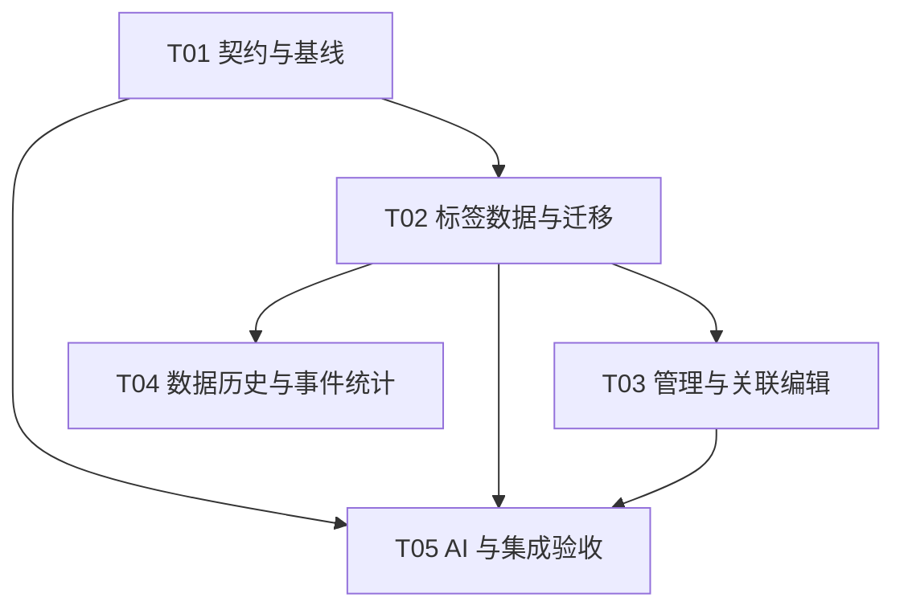

# 标签与 AI 重构架构设计

> 范围：`docs/tags/PRD-tags-ai.md` 的 P0（标签 + AI）与任务拆分；基于当前工作树现状设计，不代表现有未提交实现已满足需求。仅设计，不在本阶段实现或覆盖功能源码。审阅日期：2026-11-18。

## 1. 实现方案与边界

### 1.1 当前基线与关键判断

项目是 Tauri 2 + React 19 + Zustand + 自写 CSS + Rust/sqlx/SQLite 双窗口应用。窗口隔离由 `AGENTS.md` 的 L9/L10 守卫；共享标签规则、模型和样式必须落在 `src/windows/shared/`，而活动窗与主窗各自持有 IPC gateway/DTO 适配层。

当前工作树已有大量标签与 AI 的未提交先行改动：业务库 `items.tags` 列与 `0017_v01231_item_tags.sql`、Rust `item_tag` 命令/仓库、AI client/config/prompt/suggest/daily 服务、六条 AI IPC、事项标签编辑 UI、分析窗 AI 设置卡，以及相关契约和 mock 改动。不得覆盖或回退这些工作；实施前必须将它们当作正在演进的基线逐项比对，而不是从干净仓库重建。

已确认重要偏差/数据风险：
- `items.tags` 目前按路径文本存储，但前端与 Rust 各自有归一实现；两者对反斜杠、大小写规范、字符/层级限制以及超限行为不一致。Rust 目前静默截断至 64 字符、32 项；产品要求 64 字符、4 级、段长 32、UI 12 项且超限明确报错。现有截断可能把不同输入压成同一个路径，造成标签误合并/丢信息。
- 事项标签目前只在事项侧存路径；活动库分类目录用 `custom:<id>` 键及 label override。若通过标签路径连接两边，必须有唯一、事务化的路径→分类键解析及碰撞策略，不能将路径直接当活动库键写入。
- `categoryCatalog` 的目录快照是六组原始 KV 行，当前仅从应用/网站主分类、定义、颜色及内置键推导候选；不包括应用 `categories[]` 全集和事项标签路径。若直接复用，将遗漏多标签关联和事项自动登记。
- `0017` 已在工作树中被业务库迁移占用，且当前 `schema.version` 由它推进为 17。严禁在此基础上照抄 PRD 中“业务库下一个 0018”的假设前先核对合并后迁移编号；当前需求若需要新表/列，应使用合流后确认的下一个唯一版本，历史 SQL 不改。
- 现有 AI 错误仍统一映射为 `IO_ERROR`，无需求规定的错误分类、重试/退避、请求总预算、取消/全局并发控制、部分批次统计；响应解析只取首个 `{` 至末个 `}`，整批反序列化，未识别 aliases/分条丢弃统计。这与 PRD A-01 至 A-10 有明确差距。
- AI 应用建议前端目前只呈现第一项标签并调用旧的单分类分配流程；事项标签 AI 会直接并入编辑草稿。需求规定批量预览、可逐条勾选，且应用主标签/辅助标签均须经统一标签选择保存命令；当前 UI 流程不是目标契约。
- `ai_daily_summary` 当前可能在生成后写日记，PRD 要求 AI 建议写入须先预览确认（A-09）；日汇总的写入确认策略尚未明确，需区分它与标签建议，不能把两者隐式混为一条自动写库政策。

### 1.2 目标架构

采用现有分层：React feature/component → 窗口本地 gateway/store → IPC → commands → services → repositories/现有 KV 设施。共享规则作为无 UI、无窗口依赖的纯函数：标签路径归一、校验、树投影、排序、key/path映射、chips DTO。Rust 侧负责单库事务持久化、可恢复传播、迁移与 AI 请求安全；前端仅持有派生缓存和乐观状态，跨库一致性不表述为事务原子。

标签主数据不新增独立定义表作为默认方案：复用分类 KV 定义/label/color/deleted 的历史兼容机制；事项 `items.tags` 仍保存规范化路径数组。父节点可隐式存在，只有被直接分配或设色时需要登记。应用多标签继续复用 override 中 `categories[]`，保持 `category == categories[0]` 不变式；key 稳定，路径 rename 修改自定义标签显示名而非重写应用 key。网站 P0 保留单值主标签。

新增后端统一的标签管理/关联服务，用一个 IPC 对管理命令执行预览、重命名、删除/恢复及关联统计；目标路径冲突只返回明细，不在传播中自动合并。服务分别在业务 SQLite 与独立 Activity SQLite 内执行单库事务，并通过 journal/outbox 记录阶段、before/after 与 fingerprint；两 pool 不能组成跨库 SQLite 单事务，因此不承诺跨库原子。任一阶段失败必须返回可见失败/待恢复状态，启动继续按 journal 恢复和幂等重放；`items.category_key` 按 mapping 写目标键或 `NULL`，`focus_blocks.category_key` 仅作为投影快照由 projector 重建/更新，传播服务不得直接写它。

标签写入采用一个统一业务入口：`set_object_tags(target, tags, primary?)`，按对象 kind 支持 app/web/item。解析归一、数量/长度/级数校验、确保目录登记、引用去重、主标签约束、持久化、更新同步标记与发出 `tags:changed` 事件都由后端完成。应用写入时 `primary` 必须是集合成员并重排到首项，`category` 同步等于首项；删除主标签时下一项递补。事项标签只存路径，不设置主标签。写入失败不发成功事件；前端保存成功后跨窗刷新，当前窗乐观状态失败回滚。

AI client 拆为可注入 transport + 错误分类/脱敏 + retry budget；解析器纯函数只接受已有候选目录，返回 `suggestions + stats`。网络调用只产预览建议，不做标签写入；用户确认后统一走上述标签写入命令。取消采用 request id/cancellation token 在后端取消 transport，并让前端在卸载/关闭时取消；超 40 条顺序分批，部分成功在 preview stats 明示。

### 1.3 范围界定

P0：标签库归一和目录、管理/详情/删除影响预览/rename merge/delete/restore、应用和事项多标签编辑、数据/历史打标入口和展示、跨窗事件、主标签统计兼容、旧数据迁移、移动端桩与可读显示；AI 错误/脱敏/重试/超时/解析容错/预览确认/取消/并发/测试连接。

P1/P2 不作为 P0 阻塞：标签筛选和单标签/并集时长、网站多标签、子色继承、重复标签治理、导出 tags 列、键盘导航、解析纠正重试、连接测试详细诊断、新标签 AI 建议、拖拽等。UI 可预留扩展数据类型，但不得提前改变统计口径。

统计读模型继续以应用主标签分桶，任何多标签只改变对象的可发现性，不得多计时；事项统计维度不变，`categoryKey` 字段保留且不在 UI 暴露，但传播 mapping 会将 `items.category_key` 写入目标键或 `NULL`，不由首个标签派生。`focus_blocks.category_key` 是投影快照，必须由 projector 按业务库结果更新。迁移和用户文案不得把内部分类键显示出来。

## 2. 文件清单与预计改动

以下为预计改动面，当前标记为“已有未提交”者均需在实现前审查 diff，不可覆盖。测试文件应与被测模块同目录。最终拆分单文件须遵守 ≤300 行与 size 棘轮。

| 分区 | 文件（相对仓根） | 预计改动 |
|---|---|---|
| 文档/迁移 | `docs/tags/PRD-tags-ai.md` | 需求基线，只读 |
| 文档/迁移 | `docs/tags/DESIGN-tags-ai.md` | 本架构与任务设计 |
| 文档/迁移 | `src-tauri/src/migrations/0017_v01231_item_tags.sql`、`src-tauri/src/infra/migrate/columns.rs`、`src-tauri/src/infra/migrate.rs` | 已有未提交事项标签列；确认编号/版本门与合并冲突，仅新增迁移，不改已应用 SQL |
| 后端模型/持久化 | `src-tauri/src/models/item_tags.rs`、`src-tauri/src/repositories/item_tags.rs`、`src-tauri/src/services/item_tag.rs`、`src-tauri/src/commands/item_tag_cmd.rs` | 已有未提交；将规范校验从静默截断改为显式拒绝，拓展统一 object tags 事务服务与关联读写 |
| 后端标签管理 | `src-tauri/src/models/tag_catalog.rs`（新增）、`src-tauri/src/repositories/tag_catalog.rs`（新增）、`src-tauri/src/services/tag_catalog.rs`（新增）、`src-tauri/src/commands/tag_catalog_cmd.rs`（新增） | 目录、树节点、usage、rename/delete/restore、合并预览和事务/恢复 |
| 后端 AI | `src-tauri/src/models/ai.rs`、`src-tauri/src/services/ai/{client,config,prompt,suggest,daily}.rs`、`src-tauri/src/commands/ai_cmd.rs`、`src-tauri/src/commands/ai_cmd_mobile.rs` | 已有未提交；错误类别/重试/预算/注入 transport/解析 stats/取消/批处理；移动端同名桩 |
| 后端集成 | `src-tauri/src/error.rs`、`src-tauri/src/commands/mod.rs`、`src-tauri/src/services/mod.rs`、`src-tauri/src/repositories/mod.rs`、`src-tauri/src/models/mod.rs`、`src-tauri/src/ipc_commands.rs`、`src-tauri/permissions/host-commands.toml`、`src-tauri/permissions/activity-host-settings.toml` | 已有未提交 IPC/注册；同步新增命令、错误码契约、权限和事件来源 |
| 前端共享 | `src/windows/shared/tags/{normalize.ts,tree.ts,catalog.ts,types.ts,*.test.ts}`（新增）、`src/windows/shared/tags/tagStyles.css`（新增，若 CSS 令牌允许） | 两窗共用路径归一/校验/排序/树/chip 逻辑；Rust parity fixtures |
| 主窗 | `src/windows/timing/types/domain/ai.ts`、`src/windows/timing/types/domain/ipc.ts`、`src/windows/timing/services/{api.ts,ipc.ts}`、`src/windows/timing/mocks/{browserMock.ts,browserMockTagsAi.ts}`、`src/windows/timing/hooks/useItemTags.ts`、`src/windows/timing/components/menu/{ItemsPrefsMenu.tsx,ItemsPrefsForm.tsx,ItemsPrefsTags.tsx}` | 已有未提交；契约、mock、主窗卡片订阅和乐观保存回滚 |
| 分析窗 gateway/DTO | `src/windows/activity/shared/types/ai.ts`、`src/windows/activity/platform/desktop/hostAiGateway.ts`、`src/windows/activity/platform/desktop/hostTagGateway.ts`（新增）、`src/windows/activity/features/classification/services/categoryCatalog.ts`、`src/windows/activity/features/classification/services/tagAdminState.ts`（新增） | 两窗 DTO 手工 parity；gateway 严禁跨窗导入；归并分类目录和标签引用 |
| 分析窗管理/编辑 | `src/windows/activity/features/classification/components/{TagManagerDialog.tsx,TagTree.tsx,TagUsageDetails.tsx,TagPicker.tsx}`（新增）、`src/windows/activity/features/classification/hooks/{useTagCatalog.ts,useTagMutations.ts}`（新增）、现有 `AppMapping.tsx` 与相关分类 admin/hooks/services | 管理面板、应用多选/主标签、影响预览、rename/delete/merge |
| 数据/历史 | `src/windows/activity/features/data/{components,services,hooks}` 与 `src/windows/activity/features/history/{components,hooks,services}` 相关列表/记录行、chip/selector 与测试 | 打标入口及芯片；限定局部派生更新，不重建整页/不重置滚动 |
| 分析窗 AI/设置 | `src/windows/activity/features/classification/components/AiCategorySuggestButton.tsx`、`src/windows/activity/features/settings/components/host/{HostAiCard.tsx,HostAiModelField.tsx}` 及测试、`src/windows/activity/features/settings/services/hostApi.ts` | 已有未提交；改成多标签、逐项勾选预览、stats/取消/错误动作 |
| 事件同步 | `src-tauri/src/app/events.rs`（或实际事件装配所在文件）、`src/windows/shared/windowApi.ts`、两窗订阅 hooks/gateway | 新增事件 `tags:changed`，更新常量/emit/unlisten、窗口关闭 cleanup；先核对实际 events.rs 路径 |
| 测试/契约/版本 | `docs/phase2/IPC-CONTRACT-v2.md`、`docs/phase2/IPC-CONTRACT-v3.md`、相关 Rust/Vitest tests、`CHANGELOG.md`、`更新日志.md`、`scripts/size-allowlist.json` | 文档/计数/错误码/事件计数一致；当前版本是否并入 0.12.3 待确认；只追加更新日志 |

## 3. 数据结构与 IPC 契约

### 3.1 标签及目标对象

```ts
type TagPath = string; // normalized display path; e.g. 学习/考公
type TagTarget =
  | { kind: 'item'; id: number }
  | { kind: 'app'; id: string } // stable app key
  | { kind: 'web'; id: string }; // normalized domain

interface TagNode {
  path: TagPath;
  segment: string;
  parentPath: TagPath | null;
  depth: number; // 1..4
  key: string | null; // activity-category key, null for implicit item-only node
  color: string | null;
  isBuiltin: boolean;
  isDeleted: boolean;
  usage: { apps: number; websites: number; items: number };
}

interface TagAssignment {
  target: TagTarget;
  tags: TagPath[];
  primary?: TagPath; // app only; first entry invariant
}

interface TagMutationPreview {
  operation: 'rename' | 'delete' | 'merge';
  sourcePaths: TagPath[];
  destinationPath?: TagPath;
  impact: { apps: string[]; websites: string[]; items: Array<{id:number; name:string}> };
  counts: { apps: number; websites: number; items: number };
}
```

路径归一契约必须一处定义并两端 parity：trim、去一个或多个前导 `#`、反斜杠转 `/`、按段 trim 和删除空段、大小写不敏感查重（保留规范显示大小写）、段数 ≤4、总字符 ≤64、单段 ≤32、控制字符拒绝、集合去重最多 UI 12 / 服务端 32。P0 写入超限应返回校验错误，不静默截断。是否 Unicode NFC 归一需拍板；在无决定前不做隐式 Unicode 折叠。

应用内部仍是分类键集合 `categories[]`，展示/匹配以标签路径建立映射；首项为主标签且 `category == categories[0]`。事项持久化 `items.tags` JSON 字符串数组。网站本期单值主分类映射为一条标签。旧内置删除用 tombstone 保留键与原 override，以便恢复显示，但不得把删除标签用于新分配。

### 3.2 管理/写入 IPC

新增命令均使用既有 Tauri IPC 错误包装，不臆造 `{code,data,message}`，项目实际错误为 `{code,message}`，成功直接返回 DTO。候选 API：
- `tag_catalog_list() -> TagCatalogSnapshot`：返回节点/路径、颜色、内置/删除状态及 usage；目录排序唯一在共享 builder 中实现。
- `tag_assignment_get(target) -> TagAssignment`：读单个目标标签。
- `tag_assignment_set(assignment) -> TagAssignment`：规范化、校验、关联键登记、事务写入，成功返回 canonical 值；UI 可乐观更新，失败回滚。
- `tag_mutation_preview(operation, sourcePath, destinationPath?) -> TagMutationPreview`：只读预览。
- `tag_rename(sourcePath, destinationPath, expectedFingerprint) -> TagCatalogSnapshot`：先由 preview 返回 `app_category(app_key, category_key)` 冲突明细、占用方身份/字段快照和 fingerprint；`block_segment_override(block_uid, app_key, seg_start)` 不因 category mapping 产生冲突。apply 重建影响面并校验 fingerprint，任一 `app_category` 冲突或指纹过期都整笔拒绝，解决冲突后重新 preview，不自动合并、覆盖或静默去重。
- `tag_delete(path, cascade, confirmed) -> TagCatalogSnapshot`：子孙默认级联，确认后解除引用；内置记录 tombstone 供恢复。
- `tag_restore(path) -> TagCatalogSnapshot`：仅恢复 tombstone，不伪造引用。

AI API 沿用 `ai_config_get/save/test/list_models`、`ai_suggest_tags` 与 `ai_daily_summary`。建议接口改为：
```ts
interface AiSuggestRequest {
  requestId: string;
  mode: 'item' | 'app';
  targets: Array<{ id: string; text: string }>;
  candidates: Array<{ key: string; path: TagPath }>;
}
interface AiSuggestResponse {
  suggestions: Array<{ id: string; tags: string[] }>;
  stats: { parsed: number; dropped: number; attempts: number; batches: number; failedBatches: number };
}
```
候选只能从本地既有标签库构造；建议中 tags 为 canonical paths/keys 映射后的唯一值。新增 `ai_cancel(requestId) -> void`，且可选进度事件用带 requestId 的专用事件；若现有 Tauri invoke future 支持取消评估通过窗口 close 生命周期 token，不允许只在前端忽略结果而让后端继续占用连接。

新增错误码按 ADR/闭集流程评审。错误消息必须经统一脱敏器处理，外显供应商详情截断 200 字；日志只记录入口/模型/码/状态/次数/耗时。禁止输出配置 key、Authorization 头、完整 request debug 或响应中可能回显密钥的文本。

### 3.3 类图

见独立文件 `docs/tags/class-diagram.mermaid`。类/模块职责：`TagPathRules` 无状态纯规则；`TagCatalogService` 协调目录与传播；`TagRepository` 读写两类数据后端；`TagIpcCommands` 验证边界并调用 service；`TagChangeEvent` 通知两个窗口；`AiClient`/`AiRetryPolicy`/`AiSuggestionParser` 只生成建议，不写标签；`TagPicker`/`TagManager` 等 UI 仅通过本窗 gateway 写入。

## 4. 调用流程

完整标签新增/选择、rename、delete、AI 建议/确认、初始化迁移流程见 `docs/tags/sequence-diagram.mermaid`。核心约束：
- 启动：业务库迁移/校验完成 → 事项旧 categoryKey 一次性回填（setting marker 原子设置）→ 读活动 KV + items.tags → 共享规则构建统一目录 → 两窗各自拉快照并订阅变更事件。
- 手工保存：前端规范化预检 → 显示乐观芯片 → IPC set → 后端重校验并在一个一致性边界内写路径定义/对象关联/主标签 → 标记同步变更 → emit → 返回 canonical assignment；失败则前端撤销 optimistic state 并显示 errorText。
- Rename/delete：先 preview 显示关联数量/名字及具体唯一键冲突明细；当前 category mapping 可能触发的数据库冲突仅指 `app_category(app_key, category_key)`，`block_segment_override(block_uid, app_key, seg_start)` 唯一键不含 `category_key`，不应归类为传播目标冲突。确认后服务端重新构建影响面并校验 expectedFingerprint，避免预览后竞态。任一 `app_category` 冲突或 fingerprint 过期都必须在 journal 持久化前整笔拒绝，不得部分应用、自动覆盖或静默去重；无冲突时分别执行单库事务并写可恢复 journal。业务事项 `items.category_key` 按 mapping 写目标键或 `NULL`，`focus_blocks` 由 projector 更新。成功后发事件；跨库阶段失败则返回可见待恢复/失败状态，不能声称已原子完成。任何异常不得只改 KV 或只改 `items.tags` 后静默成功。
- AI：UI 防重复并发 → 后端入口开关/总开关检查 → transport retry policy → parser 按条校验并产 stats → UI 预览逐项可勾选 → 用户确认后逐对象调用统一 set → 一次成功事件/部分失败显示对象级结果。取消或卸载不得写入。

## 5. 依赖关系与包

沿用现有依赖，不引入 UI/CSS 框架：Tauri 2、React 19、zustand、sqlx、serde/serde_json、tokio、async-openai、reqwest、url、现有测试 Vitest 与 Rust test。可能新增 `unicode-normalization` 仅在决定采用 NFC 后评估；取消/重试优先用现有 tokio/reqwest，除非 transport 架构证明需要额外 crate。不要引入 MUI/Tailwind。

依赖方向：窗口 feature → 同窗 hooks/services → 本窗 gateway/共享 DTO → IPC；commands → services → repositories/models；共享 tags 纯模块不得依赖 timing/activity；两窗不互相 import。`tag_catalog` 应只依赖共享业务模型和仓储接口，不调用 React/gateway；AI service 可使用 tag catalog 做候选校验，但不得把模型输出直接写入 repository。传播服务对业务 SQLite 与 Activity SQLite 分别提交单库事务，以 journal/outbox 记录阶段和 before/after；不宣称跨库事务原子。

## 6. 分批任务与验收映射

### T01 项目与契约基线（P0）
- 文件：`docs/tags/DESIGN-tags-ai.md`、`src-tauri/src/error.rs`、`src-tauri/src/commands/mod.rs`、`src-tauri/src/services/mod.rs`、`src-tauri/src/repositories/mod.rs`、`src-tauri/src/models/mod.rs`、`src-tauri/src/ipc_commands.rs`、`src-tauri/permissions/host-commands.toml`、`src-tauri/permissions/activity-host-settings.toml`、两窗 IPC/types/mocks、IPC 契约文档。
- 依赖：无。
- 内容：盘点已存在未提交实现、锁定稳定 DTO/命令/事件/错误码；确定数据库池关系及迁移编号；补齐契约四面、移动端同名桩、mock；不得批量覆盖当前改动。
- 验收映射：N-01；工程验收 22；移动端验收 15 的契约基础。

### T02 标签数据与迁移安全（P0）
- 文件：`src-tauri/src/migrations/*`、`src-tauri/src/infra/migrate{.rs,/columns.rs}`、`src-tauri/src/models/{item_tags,tag_catalog}.rs`、`src-tauri/src/repositories/{item_tags,tag_catalog}.rs`、`src-tauri/src/services/{item_tag,tag_catalog}.rs`、`src/windows/shared/tags/*`、相关 parity/迁移测试。
- 依赖：T01。
- 内容：统一路径规则/目录生成；安全迁移、categoryKey 一次性回填、事项自动登记；旧键/path映射；保留 categoryKey 和 KV/JSON 兼容；传播时按 mapping 将 `items.category_key` 写入目标键或 `NULL`，`focus_blocks` 只由 projector 更新；分别验证单库事务与跨库 journal/outbox 恢复，不承诺两库原子性。
- 验收映射：标签基础 1–3；迁移兼容 13–14；工程 22。

### T03 管理与关联编辑入口（P0）
- 文件：`src-tauri/src/commands/tag_catalog_cmd.rs`、`src-tauri/src/commands/item_tag_cmd.rs`、相关应用分类命令/服务；`src/windows/activity/features/classification/**`、`src/windows/timing/{hooks,useItemTags.ts,components/menu/ItemsPrefs*.tsx}`、`src/windows/shared/tags/**` 与测试。
- 依赖：T02。
- 内容：管理树、usage 明细、rename/delete/restore 的预览与执行；应用多选/主标签；事项多标签；传播时同步更新 `items.category_key`（目标键或 `NULL`），由 projector 更新 `focus_blocks` 快照；仅传播会触发的 `app_category` 目标唯一键冲突在 preview 暴露且 apply 整笔拒绝，解决冲突后重新预览；`block_segment_override` 的身份键不含 `category_key`，不因分类映射臆造冲突；优化 UI 入口；统一保存逻辑。
- 验收映射：US-1–5；传播 4–7；两窗一致 2、9。

### T04 数据/历史、事件与统计兼容（P0）
- 文件：`src/windows/activity/features/data/**`、`src/windows/activity/features/history/**`、`src-tauri/src/app/events.rs`（核定实际路径）、`src/windows/shared/windowApi.ts`、两窗订阅及统计回归测试、`docs/phase2/IPC-CONTRACT-v3.md`。
- 依赖：T02；可与 T03 并行开发 UI，最终集成依赖 T03。
- 内容：行 chip/＋入口；事件订阅和卸载清理；局部派生刷新；确保现有分类统计只按主标签，rename/delete 后正确递补。
- 验收映射：入口 8–10；统计不回归 11；工程事件契约；性能 N-01。

### T05 AI 可靠性与集成验收（P0）
- 文件：`src-tauri/src/services/ai/**`、`src-tauri/src/models/ai.rs`、`src-tauri/src/commands/ai_cmd{,_mobile}.rs`、`src/windows/activity/features/classification/components/AiCategorySuggestButton.tsx`、`src/windows/activity/features/settings/components/host/**`、两窗 AI DTO/gateway、错误文案、AI fixture/tests、`CHANGELOG.md`、`更新日志.md`。
- 依赖：T01、T02、T03。
- 内容：有限错误码/脱敏；mock transport；retry/timeout budget/cancel/global concurrency/batches；鲁棒逐条 parser+stats；preview-only + confirm via shared tag command；daily policy separately clarified；整仓门禁。
- 验收映射：AI 16–21；工程 22；需求 A-01 至 A-10。

## 7. 迁移与兼容策略

不改任何历史 `.sql`。工作树中已有 `0017_v01231_item_tags.sql`，合并后先核对该迁移是否已应用、schema 版本及任何并行分支的新迁移；绝不出现同编号 SQL，因为版本门可能导致迁移永久跳过且无错误。需要新列/表时选择经核验的下一编号，并登记 migration/schema registry（若属于 activity.db）。`items.tags` 默认 `[]`，旧客户端忽略未知列并继续读取兼容；不要变更导出包或 KV 键格式。

迁移步骤建议：备份验证 → `ensure_column` 补列 → 幂等迁移与版本门 → 只在 `tags` 空且 categoryKey 指向有效未删除分类时回填 → 成功后写一次性 marker → 统一 builder 首次访问时登记历史 tags 中缺失路径。失败记日志且不破坏原始类别/路径；依 PRD 可延后重试，但启动降级策略、迁移是否允许部分完成须通过事务/journal 验证。回填 marker 必须与数据更新处于同一事务，避免“数据写了但 marker 未写”造成重跑或反之。

跨设备：事项整行 LWW 沿用 `updated_at_ms`；每次标签写入都推进现有时间戳触发器，确认 `0017` SQL 实际触发列和 `updated_at`/`updated_at_ms` 一致。KV 同步按现有通道；rename/delete 需确保所有更新在可重试操作中保持幂等。旧客户端对 `/` 仅显示扁平路径，不能丢字段；旧导出包可读取。移动端保留 `items.tags` 显示路径，不显示 raw key；AI/管理能力桩返回项目一致的 `IO_ERROR` 中文“不支持”，不要未经 ADR 引入新 ErrorCode。

## 8. 测试计划

- 归一/parity：TS 与 Rust 共用黄金 fixture，覆盖 `#学习 / 考公`、``、反斜杠、多分隔符、空段、大小写、超长/深层/长段、重复大小写路径、NFC/NFD 决策；超限须错误而非静默截断。
- 目录与关系：内置固定序、自定义 zh-CN 排序、隐藏/恢复、路径碰撞、父子隐式节点、应用/web/item usage 三方计数、删除确认快照与并发变化重验。
- 数据一致性：rename 子树和 delete cascade 的单库事务回滚，主标签递补；当前 category mapping 可能触发的唯一冲突仅为 `app_category(app_key, category_key)`，该冲突必须在 preview 暴露并在 journal 写入前整笔拒绝，不做自动合并/覆盖/静默去重。`block_segment_override(block_uid, app_key, seg_start)` 唯一键不含 `category_key`，不因传播目标改变产生该类冲突。分别验证单库事务故障回滚，以及跨库 journal 的阶段恢复、幂等重放和 activity 不可用时的延迟恢复。检查 KV 与 `items.tags` 不会半改；`items.category_key` 按 mapping 写目标键或 `NULL`，`focus_blocks` 只通过 projector 重建。
- 迁移：v16/旧 schema/v17 与已含 tags 列升级、重复启动幂等、坏 JSON 行隔离、categoryKey 空 tags 一次性回填、marker 与回填数据在业务库内原子提交、失败后重试、不改历史迁移 checksum；跨库传播不采用事务原子性，按 journal/outbox 恢复。
- 统计：固定历史数据在迁移前后对数据/看板/主标签趋势/时间线/按小时汇总逐值相等；多标签不能重复计时，移除主标签后下个主标签接管。
- IPC/UI：命令注册/类型/gateway/mock/契约文档四面一致；应用/事项/历史行测试 chip、＋入口、乐观回滚、事件到达两窗口、卸载 listener；手机桩和中文错误文案。
- AI：模拟 transport 测错误分类与 401 不重试、网络/超时/429/5xx 重试上限、Retry-After 上限、抖动预算、各入口超时、全局并发、取消迟到结果；解析覆盖围栏、think、平衡 JSON 提取、字段 aliases、数字 ID、字符串 tags 分隔符、部分有效统计、未知标签/上限、全非法 AI_PARSE；密钥脱敏断言覆盖错误文案与日志；确认前不写库。
- 项目门禁：`npm run check`、`npm test`、`cd src-tauri && cargo test`、`cargo clippy --all-targets -- -D warnings -A clippy::unwrap_used -A clippy::expect_used`；确认 ≤300 行、size 棘轮净降、无跨窗 import、migration registry 与 IPC/event/error 契约计数正确。

## 9. 冲突和待确认事项

1. 数据库一致性（已决策）：业务 SQLite 与独立 Activity SQLite/KV 不能组成跨库 SQLite 事务；rename/delete 不承诺跨库原子性，采用 journal/outbox 分阶段提交、失败可见并在启动恢复。单库阶段仍须事务回滚，且不得部分提交同一库内的操作。该决策已闭环，不再等待“确认是否同库”。
2. 迁移编号冲突：PRD 的 0018 是未来默认，但工作树已有未提交 0017；合并/发布前检查其他分支 SQL 与 schema version，确认是否新增表，以及 activity migration 当前最新号。
3. 错误码：PRD 要求 9 个 AI 稳定码，AGENTS 要求 error.rs + timing union + errorText + contract doc + ADR 五处评审；确认一次批量 ADR 是否批准增加整组码，还是先暂用 IO_ERROR 的兼容过渡方案（后者不能满足 A-01）。
4. 标签唯一性：PRD 规定路径大小写不敏感，但大小写保留与 Unicode NFC/NFD 未定义；也未定义 locale-specific casefold。需给出 cross-platform canonical key 策略，避免土耳其语/Unicode 与 Rust/JS 差异。
5. 应用映射边界：应用 category key 的稳定身份、custom key 的 label override 与标签路径之间若存在重复路径，使用管理界面合并；缺失自定义定义但被 override 引用时如何恢复/映射？确认是否由 catalog builder 自动登记。
6. delete/rename 竞争：用户预览后其他窗口/设备更新关联，在执行时须重算影响面；确认操作锁/乐观版本戳策略以及跨设备实时一致性承诺上限。
7. AI 需求与现状冲突：A-07、A-09 覆盖 AI 事项和应用两入口；现有应用建议逐类单值、事项 UI 调用后并入草稿。确认统一预览选择/应用流程；“今日汇总”是否自动写日记仍依现有配置，还是要求单独用户确认。
8. 两窗错误呈现：主窗 `errorText()` 按 code 映射；分析窗 host gateway 原样透中文 message。AI vendor detail 如何折叠与脱敏需单一共用策略而不跨窗 import。
9. 事件承载对象：`tags:changed` 是否无 payload 仅作为失效信号，还是携带 revision/affected IDs；推荐携带 `revision` 和受影响目标，避免全量 reload，但多设备同步事件是否能产生同一 revision 需验证。
10. 数据页行聚合：同一应用存在多个 exe/key 时芯片编辑是逐 app key 还是该趋势行所代表的所有 sourceAppKeys 一并保存？建议展开到具体应用身份或显式批量操作，否则用户不清楚写入范围。
11. 性能指标中标签管理 150ms / picker 50ms 与 500 tags/1000 apps/500 items 的冷缓存/热缓存、设备规格和计时口径需明确；usage 全量扫描是否需索引/缓存。
12. 版本：PRD Q-6 默认并入未发布 desktop 0.12.3，但 `AGENTS.md` 当前版本头与目标状态/dirty changes 应复核；不得自行修改手机版本。

## 10. 共享知识

- 统一标签路径（不得把 `custom:<id>` 给用户看）；事项存路径，应用存稳定分类键集合，网站本期单值。
- 应用 `category == categories[0]` 不变；所有既有统计仍只按主标签；事项 `categoryKey` 字段保留，但传播 mapping 将 `items.category_key` 写入目标键或 `NULL`，不由首个标签派生；`focus_blocks.category_key` 仅为 projector 维护的快照。唯一键冲突必须先由 preview 暴露，apply 整笔拒绝。
- IPC 错误真实形状 `{code,message}`，成功返回 DTO；契约改动同步注册、前端 IpcApi/invoke、mock、权限、契约文档。
- 双窗互不 import，共用纯规则放 `src/windows/shared/`；组件不直接 invoke，持久化经 gateway→IPC。
- 不改历史 SQL；迁移编号合流前核对；写事项标签必须推进 `updated_at_ms`；所有 rename/delete 操作幂等可恢复。
- 密钥只进请求头/安全凭据存储；日志和错误对外必须脱敏；AI 建议只有用户确认后才能写标签。
- 不引入 MUI/Tailwind；沿用 Quiet 组件和 CSS tokens；文件 ≤300 行并维持 size 棘轮。
- 所有日期时间继续使用项目既有毫秒 epoch/时区语义；AI summary date 按设备本地日界（除非单独决策改为 UTC）。

## 11. 任务依赖图


